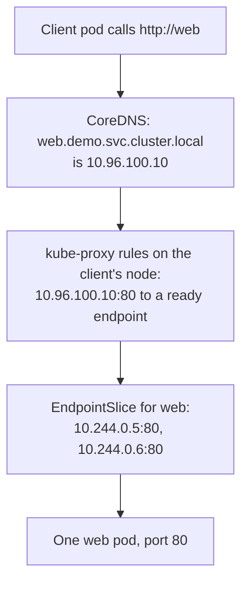

# Services and DNS

> **Status: AI draft, 2026-11-16.** Not yet verified by me. Commands and output were run on a local kind cluster (Kubernetes 1.37); addresses are rewritten to example ranges.

## In one line

A Service gives a changing set of pods one stable virtual IP and DNS name: its selector picks the pods, EndpointSlices list the ready ones, and kube-proxy's rules forward traffic for the Service IP to one of them. `port` is the Service's port, `targetPort` the container's; CoreDNS answers `name.namespace.svc.cluster.local`, and short names work through the pod's search list.

## The plain idea

Pods come and go, and each new one has a new IP address ([Pods](pods.md)). Clients cannot keep up with that. A **Service** is a fixed front door: one address and one name that stay the same for as long as the Service exists, behind which Kubernetes keeps an up-to-date list of the pods that should get the traffic.

Inside the cluster, **DNS** makes the front door easy to find: a pod can call `http://web` and reach the `web` Service in its own namespace, or `web.other-team` in another. Nothing in the application needs to know about pods at all.

## How it works

### From name to pod



1. The client resolves `web`. Its `/etc/resolv.conf` points at the cluster DNS Service (`10.96.0.10`) with a search list, so `web` is tried as `web.demo.svc.cluster.local`.
2. **CoreDNS** answers with the Service's **ClusterIP**, a virtual address that no interface owns.
3. The packet to the ClusterIP is caught by rules that **kube-proxy** wrote on every node (iptables, IPVS or nftables), which rewrite the destination to one ready pod's address (destination NAT, [Routing and NAT](../networking/routing-and-nat.md)).
4. The **EndpointSlice controller** keeps the list of pods that match the Service's selector **and** are ready ([Probes and graceful shutdown](probes-and-graceful-shutdown.md), [Labels, selectors and namespaces](labels-selectors-namespaces.md)).

Because the ClusterIP is virtual, `ping` to it usually fails: only the Service's TCP or UDP ports are forwarded.

### Service types

| Type | Reachable from | How |
|---|---|---|
| **ClusterIP** (default) | Inside the cluster | A virtual IP and DNS name |
| **NodePort** | Outside, at any node's IP on a high port (30000-32767 by default) | ClusterIP plus a port opened on every node |
| **LoadBalancer** | Outside, through a cloud load balancer | NodePort or pod IPs behind a load balancer created by a controller ([AWS Load Balancer Controller](../eks/load-balancer-controller.md)) |
| **ExternalName** | Inside | A DNS CNAME to an outside name; no proxying |
| **Headless** (`clusterIP: None`) | Inside | DNS returns the pod IPs directly; no virtual IP ([StatefulSets and DaemonSets](statefulsets-and-daemonsets.md)) |

### Ports

```yaml
spec:
  selector:
    app: web
  ports:
    - name: http
      port: 80          # the Service's own port: clients connect to web:80
      targetPort: 8080  # the container's port; can be a number or a named containerPort
      nodePort: 30080   # NodePort and LoadBalancer types only
```

`targetPort` defaults to `port`. Naming ports (`name: http`) lets meshes detect protocols and lets `targetPort` refer to a container port by name.

### Cluster DNS names

| Name | Resolves to |
|---|---|
| `web` | `web` in the client's own namespace (through the search list) |
| `web.demo` | `web` in namespace `demo` |
| `web.demo.svc.cluster.local` | The full name; works from anywhere |
| `db-0.db.demo.svc.cluster.local` | One pod of a StatefulSet behind headless Service `db` |

**`ndots:5`.** A pod's `resolv.conf` contains `options ndots:5`: any name with fewer than five dots is first tried with each search suffix appended. So a lookup of `api.example.com` from a pod first tries `api.example.com.demo.svc.cluster.local`, then `...svc.cluster.local`, then `...cluster.local`, and only then the real name: several wasted queries per external lookup. A trailing dot (`api.example.com.`) or a lower `ndots` in the pod's `dnsConfig` avoids it for heavy external callers ([DNS](../networking/dns.md)).

## A concrete example

A new `orders` service cannot reach `payments`. Both run in namespace `shop`.

1. From an `orders` pod: `wget -qO- -T 3 payments:8080` gives `Connection refused`. Name resolution worked (it found an address), and refused means something answered.
2. `kubectl get endpointslices -l kubernetes.io/service-name=payments` shows no addresses. The Service has no ready endpoints, and with none, kube-proxy rejects connections to it.
3. The Service selector says `app: payment`; the pods are labelled `app: payments`. One letter.
4. Fix the selector. The EndpointSlice fills with the two pod addresses, and requests succeed.

If the endpoints had been there but marked not ready, the readiness probe would have been the next place to look.

## Why not just...?

- **...connect to pod IPs directly?** They change on every restart, reschedule and deploy. A Service name is stable.
- **...use a NodePort for every service that needs outside access?** It opens high ports on every node, needs something in front to balance across nodes, and exposes node addresses. Use an Ingress or a load balancer for HTTP ([Ingress and Gateway API](ingress-and-gateway-api.md)).
- **...expect the Service to balance requests evenly?** kube-proxy picks a backend per connection, not per request. Long-lived connections (HTTP/2, gRPC, database pools) stick to one pod. Use client-side balancing or a mesh for per-request balancing ([Traffic management](../mesh/traffic-management.md)).

## Commands to know

A ClusterIP Service and a NodePort Service for the same pods:

```console
$ kubectl get svc -n demo web web-np
NAME     TYPE        CLUSTER-IP      EXTERNAL-IP   PORT(S)          AGE
web      ClusterIP   10.96.100.10    <none>        80/TCP           1s
web-np   NodePort    10.96.100.20    <none>        8080:30080/TCP   0s
$ kubectl get endpointslices -n demo -l kubernetes.io/service-name=web -o custom-columns=NAME:.metadata.name,ADDRESSES:.endpoints[*].addresses[0],PORTS:.ports[*].port
NAME        ADDRESSES               PORTS
web-<id>    10.244.0.5,10.244.0.6   80
```

A pod's DNS configuration:

```console
$ kubectl exec -n demo client -- cat /etc/resolv.conf
search demo.svc.cluster.local svc.cluster.local cluster.local
nameserver 10.96.0.10
options ndots:5
```

How names resolve from a pod in `demo` (the first line of `ping` shows the address the resolver returned):

```console
web                            PING web (10.96.100.10): 56 data bytes
web.demo                       PING web.demo (10.96.100.10): 56 data bytes
web.demo.svc.cluster.local     PING web.demo.svc.cluster.local (10.96.100.10): 56 data bytes
kube-dns.kube-system           PING kube-dns.kube-system (10.96.0.10): 56 data bytes
web.default                    ping: bad address 'web.default'
```

There is no `web` Service in `default`, so that name does not exist.

Calling the Service, and the NodePort from the node itself:

```console
$ kubectl exec -n demo client -- wget -qO- web
<title>Welcome to nginx!</title>
$ curl -s localhost:30080          # run on the node
<title>Welcome to nginx!</title>
```

A Service whose selector matches nothing:

```console
$ kubectl exec -n demo client -- wget -qO- -T 3 empty
wget: can't connect to remote host (10.96.100.30): Connection refused
```

With no endpoints, kube-proxy rejects the connection instead of letting it time out.

The rule kube-proxy wrote, in iptables mode:

```console
$ iptables -t nat -L KUBE-SERVICES -n | grep demo/web    # on the node
KUBE-SVC-<hash>  tcp  --  0.0.0.0/0  10.96.100.10  /* demo/web cluster IP */ tcp dpt:80
```

| Command | What it does |
|---|---|
| `kubectl expose deployment web --port=80 --target-port=8080` | Create a Service for a Deployment's pods. |
| `kubectl get endpointslices -l kubernetes.io/service-name=<svc>` | Which pod addresses the Service currently sends to. |
| `kubectl describe svc <svc>` | Selector, ports and endpoints at a glance. |
| `kubectl port-forward svc/<svc> 8080:80` | Reach a Service from your laptop for testing. |
| `kubectl run tmp --rm -it --image=busybox:1.36 --restart=Never -- wget -qO- <svc>` | Test a Service from inside the cluster. |
| `kubectl get pods -n kube-system -l k8s-app=kube-dns` | CoreDNS pods; check them when names stop resolving. |

## How it breaks

| Symptom | Layer | Check | Likely cause |
|---|---|---|---|
| `Connection refused` to the Service | Endpoints | EndpointSlices for the Service | Selector matches no pods, or no pod is ready |
| Connection times out to the Service | Ports or policy | `targetPort` against the container's port; NetworkPolicies | Wrong `targetPort`, app listening on another port, or a policy dropping traffic |
| Name does not resolve | DNS | `resolv.conf`; CoreDNS pods and logs; namespace in the name | Wrong namespace, CoreDNS down, or a NetworkPolicy blocking port 53 |
| External lookups slow from pods | `ndots` | Number of queries per lookup | Search-list expansion for names with fewer than 5 dots |
| Traffic sticks to one pod | Balancing | Connection type | Long-lived connections; kube-proxy balances per connection |
| Some pods get no traffic after a deploy | Readiness | Endpoint `ready` conditions | New pods not ready |
| NodePort unreachable from outside | Node firewall | Security groups or firewall on node ports | Port range not allowed |

## Interview questions

**1. What is a Kubernetes Service, and why do we need it?**

<details markdown="1">
<summary>Answer</summary>

- A stable virtual IP and DNS name in front of a changing set of pods chosen by a selector.
- Pod IPs change on every restart and reschedule; clients use the Service instead.
- EndpointSlices track the ready pods; kube-proxy forwards traffic to them.

</details>

**2. Explain ClusterIP, NodePort, LoadBalancer and headless Services.**

<details markdown="1">
<summary>Answer</summary>

- ClusterIP: internal virtual IP (default).
- NodePort: also opens a port on every node.
- LoadBalancer: also provisions an external load balancer through a controller.
- Headless: no virtual IP; DNS returns pod IPs directly, used with StatefulSets.

</details>

**3. What is the difference between `port`, `targetPort` and `nodePort`?**

<details markdown="1">
<summary>Answer</summary>

- `port`: the Service's port that clients connect to.
- `targetPort`: the container port traffic is sent to (number or named port).
- `nodePort`: the port opened on every node for NodePort and LoadBalancer Services.

</details>

**4. A Service returns "connection refused". Walk through your checks.**

<details markdown="1">
<summary>Answer</summary>

- EndpointSlices: are there any addresses, and are they ready?
- If empty: compare the Service selector with pod labels; check pod readiness.
- If present: check `targetPort` against the port the app listens on, and NetworkPolicies.

</details>

**5. How does DNS work for Services, and what is `ndots:5`?**

<details markdown="1">
<summary>Answer</summary>

- CoreDNS answers `service.namespace.svc.cluster.local` with the ClusterIP; the pod's search list lets short names work.
- `ndots:5` makes names with fewer than five dots try the search suffixes first.
- External names therefore cost extra queries; use a trailing dot or tune `dnsConfig` where it matters.

</details>

**6. Why might load not be balanced evenly across pods behind a Service?**

<details markdown="1">
<summary>Answer</summary>

- kube-proxy chooses a backend per connection, not per request.
- HTTP/2, gRPC and pooled database connections stay on one pod for a long time.
- Use client-side load balancing, a mesh, or connection recycling.

</details>

## Try it

**Step 1.** On a kind cluster, create a Deployment, a Service and a client pod.

```bash
kubectl create deployment web --image=nginx:1.27 --replicas=2
kubectl expose deployment web --port=80
kubectl run client --image=busybox:1.36 --restart=Never -- sleep 3600
kubectl wait --for=condition=Ready pod/client
```

**Step 2.** Look at the client's DNS settings, and call the Service by its short and full names.

```bash
kubectl exec client -- cat /etc/resolv.conf
kubectl exec client -- wget -qO- web | head -4
kubectl exec client -- wget -qO- web.default.svc.cluster.local | head -4
```

**Step 3.** Break the selector. Predict whether the call times out or is refused, then check and clean up.

```bash
kubectl patch svc web -p '{"spec":{"selector":{"app":"nope"}}}'
kubectl exec client -- wget -qO- -T 3 web
kubectl delete deploy web && kubectl delete svc web && kubectl delete pod client
```

## Zoom out

Services are the internal addressing layer that Ingress, Gateway API, load balancer controllers and service meshes build on ([Ingress and Gateway API](ingress-and-gateway-api.md), [Pod networking and NetworkPolicy](pod-networking-and-network-policy.md)). They combine DNS, destination NAT and readiness from earlier pages into one object. The principle to carry: when a Service misbehaves, check its endpoints first, because an empty list explains most failures.

## Sources

- [Kubernetes documentation: Service](https://kubernetes.io/docs/concepts/services-networking/service/)
- [Kubernetes documentation: DNS for Services and Pods](https://kubernetes.io/docs/concepts/services-networking/dns-pod-service/)
- [Kubernetes documentation: EndpointSlices](https://kubernetes.io/docs/concepts/services-networking/endpoint-slices/)
- [Kubernetes documentation: virtual IPs and service proxies](https://kubernetes.io/docs/reference/networking/virtual-ips/)
- [Kubernetes documentation: debugging Services](https://kubernetes.io/docs/tasks/debug/debug-application/debug-service/)
