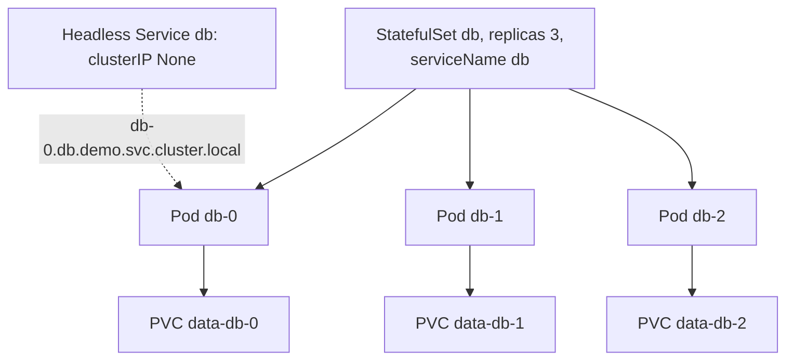

# StatefulSets and DaemonSets

> **Status: AI draft, 2026-11-16.** Not yet verified by me. Commands and output were run on a local kind cluster (Kubernetes 1.37); addresses are rewritten to example ranges.

## In one line

A StatefulSet gives each replica a stable name (`db-0`, `db-1`), its own persistent volume, a stable DNS name through a headless Service, and ordered start and update. A DaemonSet runs exactly one pod on every matching node, for node-level agents. Neither replicates your data: that is still the application's job.

## The plain idea

A Deployment treats its pods as interchangeable: any copy can be replaced by any other, with a new random name and a fresh disk. That suits stateless web servers. It does not suit a database cluster, where member 0 might be the primary, each member keeps its own data, and the others need to find it by a name that does not change.

A **StatefulSet** gives each replica a permanent identity: a fixed ordinal name, its own volume that follows it wherever it is rescheduled, and a DNS name. A **DaemonSet** solves a different problem: some software must run once on every machine (a log collector, a monitoring agent, the network plugin), and new machines should get it automatically.

## How it works

### StatefulSet identity



| Guarantee | How |
|---|---|
| **Stable name** | Pods are named `<statefulset>-<ordinal>`, from 0. A replaced `db-1` is again `db-1`. |
| **Stable storage** | `volumeClaimTemplates` creates one PVC per ordinal (`data-db-1`). A replaced pod reattaches the same claim ([Storage](storage.md)). |
| **Stable DNS** | A **headless Service** (`clusterIP: None`) named in `serviceName` gives each pod a DNS record, `db-0.db.demo.svc.cluster.local` ([Services and DNS](services-and-dns.md)). |
| **Ordered start** | With the default `OrderedReady` policy, `db-1` is created only when `db-0` is running and ready, and so on. `Parallel` turns this off. |
| **Ordered updates** | Rolling updates go from the highest ordinal down, one pod at a time. A `partition` value updates only ordinals at or above it, which allows canary-style updates of stateful members. |
| **Volumes kept** | Scaling down deletes pods but keeps their PVCs, so data survives a scale-down and comes back on scale-up. A `persistentVolumeClaimRetentionPolicy` can change that. |

What a StatefulSet does **not** do: decide which replica is primary, copy data between replicas, or handle failover. The application (or an operator for it) does that ([CRDs, operators and admission webhooks](crds-and-operators.md)). Managed databases outside the cluster are often simpler ([RDS and Aurora](../aws-services/rds-and-aurora.md)).

### DaemonSet

A DaemonSet keeps one pod on every node that matches its node selector and tolerates its taints. When a node joins, it gets the pod; when a node leaves, the pod goes with it. Typical DaemonSets: log agents such as Fluent Bit ([Fluent Bit](../observability/fluent-bit.md)), node exporters for metrics, CNI plugins, CSI node drivers, kube-proxy.

DaemonSet pods usually need tolerations to run on tainted nodes (control-plane nodes, special pools) and often mount host paths such as `/var/log`. Updates roll node by node, controlled by `maxUnavailable`.

### Comparing the workload controllers

| | Deployment | StatefulSet | DaemonSet |
|---|---|---|---|
| Pod names | Random suffix | Ordinal: `-0`, `-1` | Random suffix, one per node |
| Storage | Shared or none | One PVC per replica | Usually host paths or none |
| Scaling | `replicas` | `replicas`, in order | Follows the number of nodes |
| Update order | Any, within surge limits | Highest ordinal first, one at a time | Node by node |
| Use for | Stateless services | Databases, queues, clustered stores | Per-node agents |

## A concrete example

A three-member Redis set runs as a StatefulSet.

1. The pods start strictly in order, `db-0` first; each waits for the previous one to be ready.
2. Each gets its own 1 GiB claim, `data-db-0` to `data-db-2`.
3. The headless Service returns all three pod addresses for `db`, and `db-0.db...` resolves to `db-0` alone, so clients and peers can address a specific member.
4. `db-1` is deleted. The controller recreates `db-1` with the same claim, and the key written before is still there.
5. Scaling to one replica removes `db-2` and `db-1` (highest first) but leaves all three claims, so scaling back up restores their data.

## Why not just...?

- **...run a database as a Deployment with one shared volume?** Replicas would compete for the same files, replacements get random names peers cannot find, and most block volumes allow only one node to mount them. StatefulSets give each member its own volume and name.
- **...expect the StatefulSet to fail over the primary?** It restarts pods; it does not know which one is primary or how to promote another. That logic lives in the database or its operator.
- **...run node agents as a Deployment with enough replicas?** The scheduler might put two on one node and none on another, and new nodes would not get one. A DaemonSet places exactly one per node.

## Commands to know

The StatefulSet and its headless Service:

```yaml
apiVersion: v1
kind: Service
metadata:
  name: db
  namespace: demo
spec:
  clusterIP: None
  selector:
    app: db
  ports:
    - port: 6379
---
apiVersion: apps/v1
kind: StatefulSet
metadata:
  name: db
  namespace: demo
spec:
  serviceName: db
  replicas: 3
  selector:
    matchLabels:
      app: db
  template:
    metadata:
      labels:
        app: db
    spec:
      containers:
        - name: redis
          image: redis:7
          volumeMounts:
            - name: data
              mountPath: /data
  volumeClaimTemplates:
    - metadata:
        name: data
      spec:
        accessModes: ["ReadWriteOnce"]
        resources:
          requests:
            storage: 1Gi
```

Ordered start, watched every 5 seconds:

```text
t+5s  db-0=ContainerCreating
t+15s db-0=Running db-1=Pending
t+20s db-0=Running db-1=Running db-2=Pending
t+25s db-0=Running db-1=Running db-2=Running
```

One claim per replica:

```console
$ kubectl get pvc -n demo
NAME        STATUS   CAPACITY   CLASS
data-db-0   Bound    1Gi        standard
data-db-1   Bound    1Gi        standard
data-db-2   Bound    1Gi        standard
```

DNS for the headless Service and for one member:

```console
$ nslookup db.demo.svc.cluster.local
Name:	db.demo.svc.cluster.local
Address: 10.244.0.9
Name:	db.demo.svc.cluster.local
Address: 10.244.0.8
Name:	db.demo.svc.cluster.local
Address: 10.244.0.6
$ nslookup db-0.db.demo.svc.cluster.local
Name:	db-0.db.demo.svc.cluster.local
Address: 10.244.0.6
```

A headless Service returns the pods' own addresses instead of one virtual IP.

Identity and data survive deletion; claims survive scale-down:

```console
$ kubectl exec -n demo db-1 -- redis-cli set mykey kept
OK
$ kubectl delete pod db-1 -n demo
$ kubectl exec -n demo db-1 -- redis-cli get mykey
kept
$ kubectl scale sts db -n demo --replicas=1
$ kubectl get pvc -n demo
data-db-0 Bound
data-db-1 Bound
data-db-2 Bound
```

A DaemonSet on a one-node cluster:

```console
$ kubectl get ds node-agent -n demo
NAME         DESIRED   CURRENT   READY   UP-TO-DATE   AVAILABLE   NODE SELECTOR
node-agent   1         1         1       1            1           <none>
$ kubectl logs -n demo -l app=node-agent
agent on notes-lab-control-plane
```

`DESIRED` equals the number of eligible nodes. The pod learned its node's name through the downward API (`fieldRef: spec.nodeName`).

| Command | What it does |
|---|---|
| `kubectl rollout status sts/<s>` | Watch an ordered rolling update. |
| `kubectl patch sts <s> -p '{"spec":{"updateStrategy":{"rollingUpdate":{"partition":2}}}}'` | Update only ordinals 2 and above. |
| `kubectl get pvc -l app=<label>` | The claims a StatefulSet created (they carry the template labels). |
| `kubectl rollout restart ds/<d>` | Restart a DaemonSet's pods node by node. |
| `kubectl get ds -A` | Every DaemonSet, with desired against ready counts. |

## How it breaks

| Symptom | Layer | Check | Likely cause |
|---|---|---|---|
| `db-0` stuck `Pending`, nothing else created | Storage | `kubectl describe pvc data-db-0` | No StorageClass, provisioner down, or the volume's zone has no node ([Storage](storage.md)) |
| Only `db-0` exists, not ready | Ordered start | `db-0`'s readiness and logs | `OrderedReady` waits for `db-0` before creating `db-1` |
| Pod stuck `Pending` after its node was replaced | Volume topology | PV's zone against nodes | A zonal volume (EBS) with no node in that zone |
| Old data appears after scaling up | Retained claims | PVCs left from before | Claims are kept on scale-down by default |
| DaemonSet `DESIRED` lower than the node count | Taints or selector | Node taints; `nodeSelector`; tolerations | Some nodes are tainted or do not match |
| DaemonSet rollout slow on large clusters | Update strategy | `maxUnavailable` | One node at a time by default |

## Interview questions

**1. When do you use a StatefulSet instead of a Deployment?**

<details markdown="1">
<summary>Answer</summary>

- When each replica needs a stable identity: a fixed name, its own persistent volume and a stable DNS name.
- When order matters for start-up, scale-down or updates.
- Typical for databases, queues and clustered stores.

</details>

**2. What is a headless Service, and why does a StatefulSet need one?**

<details markdown="1">
<summary>Answer</summary>

- A Service with `clusterIP: None`: DNS returns the pods' addresses directly instead of a virtual IP.
- It gives each StatefulSet pod its own DNS name, `pod-N.service.namespace.svc.cluster.local`.
- Peers and clients can address a specific member.

</details>

**3. What happens to a StatefulSet's volumes when you scale down or delete a pod?**

<details markdown="1">
<summary>Answer</summary>

- Deleting a pod: it is recreated with the same name and reattaches its PVC.
- Scaling down: pods are removed highest ordinal first, but their PVCs are kept by default.
- Scaling back up reattaches the old claims and data.

</details>

**4. Does a StatefulSet replicate data or handle failover?**

<details markdown="1">
<summary>Answer</summary>

- No: it gives identity, storage and ordering only.
- Replication, leader election and failover are the application's or an operator's job.
- That is why operators or managed databases are common for stateful systems.

</details>

**5. What is a DaemonSet, and what typically runs as one?**

<details markdown="1">
<summary>Answer</summary>

- A controller that runs one pod on every eligible node, adding and removing pods as nodes come and go.
- Log collectors, metrics exporters, CNI plugins, CSI node drivers, kube-proxy.
- They often need tolerations and host path mounts.

</details>

**6. A StatefulSet's first pod is stuck `Pending`. What do you check?**

<details markdown="1">
<summary>Answer</summary>

- The pod's events, then its PVC: is it bound?
- The StorageClass and provisioner, and whether volume topology (zone) matches available nodes.
- Resources and scheduling constraints, as for any pending pod.

</details>

## Try it

**Step 1.** On a kind cluster, create a headless Service and a StatefulSet with two replicas.

```bash
kubectl apply -f - <<'EOF'
apiVersion: v1
kind: Service
metadata: { name: kv }
spec: { clusterIP: None, selector: { app: kv }, ports: [ { port: 6379 } ] }
---
apiVersion: apps/v1
kind: StatefulSet
metadata: { name: kv }
spec:
  serviceName: kv
  replicas: 2
  selector: { matchLabels: { app: kv } }
  template:
    metadata: { labels: { app: kv } }
    spec: { containers: [ { name: redis, image: "redis:7" } ] }
EOF
kubectl get pods -l app=kv -w
```

**Step 2.** Predict the name of the pod that replaces `kv-1`, then delete it and check.

```bash
kubectl delete pod kv-1
kubectl get pods -l app=kv
```

**Step 3.** Clean up.

```bash
kubectl delete sts kv && kubectl delete svc kv
```

## Zoom out

StatefulSets and DaemonSets complete the set of workload controllers alongside Deployments and Jobs ([Deployments and rollouts](deployments-and-rollouts.md), [Jobs and CronJobs](jobs-and-cronjobs.md)). StatefulSets depend heavily on storage and DNS ([Storage](storage.md), [Services and DNS](services-and-dns.md)); DaemonSets underpin logging, metrics and networking on every node. The principle to carry: choose the controller by what must stay the same about each pod, its identity and data, or its node.

## Sources

- [Kubernetes documentation: StatefulSets](https://kubernetes.io/docs/concepts/workloads/controllers/statefulset/)
- [Kubernetes documentation: DaemonSet](https://kubernetes.io/docs/concepts/workloads/controllers/daemonset/)
- [Kubernetes documentation: headless Services](https://kubernetes.io/docs/concepts/services-networking/service/#headless-services)
- [Kubernetes documentation: DNS for Services and Pods](https://kubernetes.io/docs/concepts/services-networking/dns-pod-service/)
- [Kubernetes documentation: StatefulSet basics tutorial](https://kubernetes.io/docs/tutorials/stateful-application/basic-stateful-set/)
