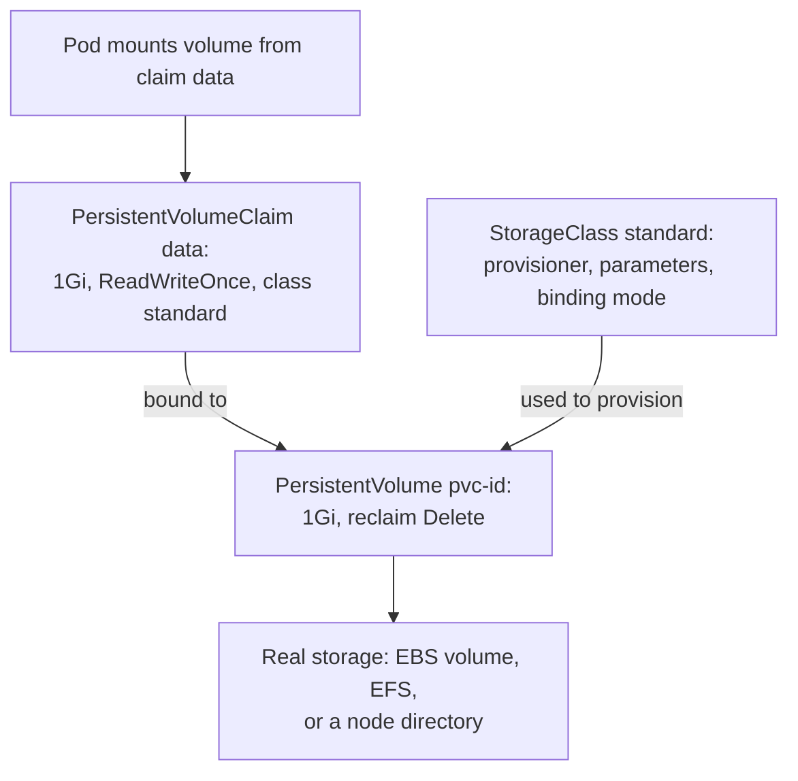

# Storage

> **Status: AI draft, 2026-11-16.** Not yet verified by me. Commands and output were run on a local kind cluster (Kubernetes 1.37) with its local-path provisioner; generated volume names are shortened.

## In one line

A pod requests storage with a PersistentVolumeClaim; a StorageClass tells a CSI driver how to create the PersistentVolume, usually once the pod is scheduled so it lands in the right zone. Access modes, reclaim policy and expansion decide what happens to the data.

## The plain idea

A container's own filesystem disappears when it is replaced ([What a container is](../containers/what-is-a-container.md)). Data that must survive (a database's files, uploaded documents) needs storage that lives outside any one pod.

Kubernetes splits the job in two. The application says what it needs: "1 GiB, writable by one node at a time". That request is a **PersistentVolumeClaim** (PVC). The cluster decides how to provide it: an EBS volume, an EFS share, a directory on a node. The provided disk is a **PersistentVolume** (PV), and a **StorageClass** says which kind to create and how. Developers write claims; platform teams define classes; drivers do the work.

## How it works

### The objects



| Object | Owned by | Meaning |
|---|---|---|
| **PersistentVolumeClaim** | The application team, in a namespace | "I need this much storage with this access mode" |
| **PersistentVolume** | Cluster-wide | One real piece of storage, bound to at most one claim |
| **StorageClass** | Platform team, cluster-wide | How to create PVs: which driver (provisioner), parameters such as disk type, reclaim policy, binding mode, expansion |
| **CSI driver** | Installed in the cluster | The plugin that talks to the storage system: creates, attaches, mounts, resizes |

**Dynamic provisioning**: a claim naming a StorageClass (or using the default class) causes the driver to create a new PV for it. **Static provisioning**: an administrator creates PVs in advance, and claims bind to a matching one.

### Access modes

| Mode | Meaning | Typical storage |
|---|---|---|
| `ReadWriteOnce` (RWO) | Mounted read-write by one **node** (several pods on that node can share it) | Block storage: EBS |
| `ReadOnlyMany` (ROX) | Read-only by many nodes | Shared file systems, snapshots |
| `ReadWriteMany` (RWX) | Read-write by many nodes | Network file systems: EFS, NFS |
| `ReadWriteOncePod` (RWOP) | Read-write by exactly one **pod** | Block storage, where only one writer is safe |

The mode must be supported by the driver; asking an EBS-backed class for RWX does not work ([EBS and EFS CSI drivers](../eks/storage.md)).

### Binding mode and zones

- `Immediate`: the volume is created as soon as the claim exists, wherever the driver chooses.
- `WaitForFirstConsumer`: the volume is created only after a pod using the claim is scheduled, in that pod's zone.

Block volumes live in one zone, and a pod can only use a volume in its own zone. With `Immediate`, the volume might be created in zone a while the scheduler later can only place the pod in zone b: the pod stays Pending with a volume affinity conflict. `WaitForFirstConsumer` avoids that, and is the usual choice for block storage.

### Reclaim policy and expansion

- **Reclaim policy**: what happens to the PV and its data when the claim is deleted. `Delete` (the usual default for dynamic classes) deletes the storage too; `Retain` keeps it for manual recovery. For important data, `Retain` plus backups is safer ([Backup and disaster recovery](../operations/backup-and-dr.md)).
- **Expansion**: if the class has `allowVolumeExpansion: true` and the driver supports it, increasing a claim's request grows the volume, and usually the filesystem, sometimes only after the pod restarts. Volumes can grow but not shrink ([Disks and filesystems](../linux/disks-and-filesystems.md)).

### Volumes that are not persistent

| Volume | Lives as long as | Use |
|---|---|---|
| `emptyDir` | The pod | Scratch space shared between a pod's containers; `medium: Memory` puts it in RAM (counted against memory) |
| `configMap`, `secret`, `projected` | The pod | Configuration and credentials as files ([ConfigMaps and Secrets](configmaps-and-secrets.md)) |
| `hostPath` | The node | A directory on the node; ties the pod to that node and is a security risk. Avoid except for node agents |

## A concrete example

A team creates a 1 GiB claim for an application on a cluster whose default class uses `WaitForFirstConsumer`.

1. The claim shows `Pending` with the event "waiting for first consumer to be created before binding". That is expected, not an error.
2. A pod using the claim is scheduled; the provisioner creates a PV on (or in the zone of) that node, and the claim becomes `Bound`.
3. The pod writes a file and is deleted. A new pod mounting the same claim reads the file back.
4. The team asks to grow it to 2 GiB. The request is refused: this class does not allow expansion. On a cloud class with expansion enabled, the same patch would grow the volume.
5. The claim is deleted. With reclaim policy `Delete`, the PV and the data on it are deleted too.

## Why not just...?

- **...use `hostPath` for application data?** The data lives on one node; if the pod moves, it sees a different, empty directory, and the pod can read the node's files. Use a claim.
- **...use `Immediate` binding for block storage?** The volume can be created in a zone where the pod cannot run. `WaitForFirstConsumer` lets scheduling decide first.
- **...rely on the `Delete` reclaim policy for production databases?** Deleting the claim (or the namespace) deletes the data. Use `Retain` for important volumes, back them up, and protect them from accidental deletion.

## Commands to know

The StorageClass:

```console
$ kubectl get storageclass
NAME                 PROVISIONER             RECLAIMPOLICY   VOLUMEBINDINGMODE      ALLOWVOLUMEEXPANSION
standard (default)   rancher.io/local-path   Delete          WaitForFirstConsumer   false
```

A claim waiting for its first consumer, then bound:

```console
$ kubectl get pvc data -n demo
NAME   STATUS    VOLUME   CAPACITY   ACCESS MODES   STORAGECLASS
data   Pending                                      standard
$ kubectl get events -n demo --field-selector involvedObject.name=data
WaitForFirstConsumer: waiting for first consumer to be created before binding
$ kubectl get pvc data -n demo        # after a pod using it was scheduled
NAME   STATUS   VOLUME       CAPACITY   ACCESS MODES   STORAGECLASS
data   Bound    pvc-<uid>    1Gi        RWO            standard
$ kubectl get pv pvc-<uid> -o custom-columns=CAPACITY:.spec.capacity.storage,ACCESS:.spec.accessModes,RECLAIM:.spec.persistentVolumeReclaimPolicy,STATUS:.status.phase,CLAIM:.spec.claimRef.name
CAPACITY   ACCESS            RECLAIM   STATUS   CLAIM
1Gi        [ReadWriteOnce]   Delete    Bound    data
```

The data outlives the pod that wrote it:

```console
$ kubectl delete pod writer -n demo
$ kubectl logs reader -n demo        # a new pod that cats /data/file.txt from the same claim
important
```

Expansion refused by this class, a memory-backed `emptyDir`, and the reclaim policy in action:

```console
$ kubectl patch pvc data -n demo -p '{"spec":{"resources":{"requests":{"storage":"2Gi"}}}}'
Error from server (Forbidden): persistentvolumeclaims "data" is forbidden: only dynamically provisioned pvc can be resized and the storageclass that provisions the pvc must support resize
$ kubectl logs scratch -n demo        # df inside a pod with emptyDir medium Memory, sizeLimit 64Mi
tmpfs                    64.0M         0     64.0M   0% /scratch
$ kubectl delete pvc data -n demo
$ kubectl get pv pvc-<uid>
Error from server (NotFound): persistentvolumes "pvc-<uid>" not found
```

| Command | What it does |
|---|---|
| `kubectl get pvc -A`, `kubectl get pv` | Claims and volumes, with status and binding. |
| `kubectl describe pvc <c>` | Events: provisioning, binding, resize. |
| `kubectl get volumeattachments` | Which volumes are attached to which nodes (CSI). |
| `kubectl get csidrivers` | CSI drivers installed. |
| `kubectl patch pv <pv> -p '{"spec":{"persistentVolumeReclaimPolicy":"Retain"}}'` | Protect an existing volume's data from deletion with its claim. |

## How it breaks

| Symptom | Layer | Check | Likely cause |
|---|---|---|---|
| Claim `Pending`, "waiting for first consumer" | Binding mode | Is any pod using it? | Normal with `WaitForFirstConsumer` until a pod is scheduled |
| Claim `Pending`, provisioning errors | Driver | `describe pvc`; CSI controller logs | Driver missing or failing, permissions, unsupported parameters |
| Pod `Pending`, `volume node affinity conflict` | Zones | The PV's zone against schedulable nodes | Volume in a zone with no available node |
| Pod `ContainerCreating`, `Multi-Attach error` | Access mode | Where the volume is attached | RWO volume still attached to another node, often during a reschedule |
| `Permission denied` writing to the volume | Ownership | Container user, `fsGroup` | Volume owned by root, container runs as non-root ([Pod security](pod-security.md)) |
| Data gone after deleting a namespace | Reclaim policy | Class reclaim policy | `Delete` policy removed the volumes with their claims |
| Resize does nothing or is refused | Expansion | `allowVolumeExpansion`, driver support | Class does not allow it, or filesystem grows only after restart |

## Interview questions

**1. Explain PersistentVolume, PersistentVolumeClaim and StorageClass.**

<details markdown="1">
<summary>Answer</summary>

- A PVC is a namespaced request for storage: size, access mode, class.
- A PV is a cluster-wide piece of real storage, bound to one claim.
- A StorageClass tells a CSI driver how to provision PVs dynamically: parameters, reclaim policy, binding mode, expansion.

</details>

**2. What are the access modes, and which work with EBS and EFS?**

<details markdown="1">
<summary>Answer</summary>

- RWO (one node read-write), ROX (many read-only), RWX (many read-write), RWOP (one pod read-write).
- EBS is block storage: RWO or RWOP.
- EFS is a network file system: RWX.

</details>

**3. Why use `WaitForFirstConsumer`?**

<details markdown="1">
<summary>Answer</summary>

- Block volumes are zonal; the volume must be in the pod's zone.
- Waiting until the pod is scheduled lets the volume be created in the right zone.
- `Immediate` binding can produce volumes in zones where the pod cannot run.

</details>

**4. What does the reclaim policy control?**

<details markdown="1">
<summary>Answer</summary>

- What happens to the PV and its data when the claim is deleted.
- `Delete` removes the storage; `Retain` keeps it for manual recovery.
- Important data: `Retain` plus backups.

</details>

**5. A pod with a PVC is stuck `ContainerCreating` with `Multi-Attach error`. What happened?**

<details markdown="1">
<summary>Answer</summary>

- An RWO volume is still attached to another node, typically after the pod moved and the old attachment was not released.
- Check `kubectl get volumeattachments` and the old node's state.
- Detachment completes when the old pod is gone; a dead node may need cleanup before the volume is released.

</details>

**6. How do you grow a volume used by a StatefulSet?**

<details markdown="1">
<summary>Answer</summary>

- The StorageClass must allow expansion and the driver must support it.
- Patch each PVC's request; the volume grows, and the filesystem grows online or on restart, depending on the driver.
- `volumeClaimTemplates` cannot simply be edited; existing claims are changed one by one.

</details>

## Try it

**Step 1.** On a kind cluster, create a claim and look at its status before any pod uses it.

```bash
kubectl apply -f - <<'EOF'
apiVersion: v1
kind: PersistentVolumeClaim
metadata: { name: demo-data }
spec:
  accessModes: ["ReadWriteOnce"]
  resources: { requests: { storage: 1Gi } }
EOF
kubectl get pvc demo-data
```

**Step 2.** Write to it from one pod and read from another. Predict whether the second pod sees the file.

```bash
kubectl run w --restart=Never --image=busybox:1.36 --overrides='{"spec":{"containers":[{"name":"w","image":"busybox:1.36","command":["sh","-c","echo hello > /d/f"],"volumeMounts":[{"name":"d","mountPath":"/d"}]}],"volumes":[{"name":"d","persistentVolumeClaim":{"claimName":"demo-data"}}]}}'
sleep 10
kubectl run r --restart=Never --image=busybox:1.36 --overrides='{"spec":{"containers":[{"name":"r","image":"busybox:1.36","command":["cat","/d/f"],"volumeMounts":[{"name":"d","mountPath":"/d"}]}],"volumes":[{"name":"d","persistentVolumeClaim":{"claimName":"demo-data"}}]}}'
sleep 10; kubectl logs r
```

**Step 3.** Clean up, and check whether the volume survives.

```bash
kubectl delete pod w r && kubectl delete pvc demo-data
kubectl get pv
```

## Zoom out

Storage connects Linux filesystems ([Disks and filesystems](../linux/disks-and-filesystems.md)) to cloud volumes ([EBS](../aws-services/ebs.md), [EFS](../aws-services/efs.md)) through CSI drivers, and it is what StatefulSets build on ([StatefulSets and DaemonSets](statefulsets-and-daemonsets.md)). Most storage incidents are about zones, access modes and reclaim policies rather than disks themselves. The principle to carry: know where each volume lives, who can mount it, and what happens to its data when the claim goes away.

## Sources

- [Kubernetes documentation: persistent volumes](https://kubernetes.io/docs/concepts/storage/persistent-volumes/)
- [Kubernetes documentation: storage classes](https://kubernetes.io/docs/concepts/storage/storage-classes/)
- [Kubernetes documentation: volumes](https://kubernetes.io/docs/concepts/storage/volumes/)
- [Kubernetes documentation: dynamic volume provisioning](https://kubernetes.io/docs/concepts/storage/dynamic-provisioning/)
- [Kubernetes CSI documentation](https://kubernetes-csi.github.io/docs/)
- [local-path-provisioner](https://github.com/rancher/local-path-provisioner)
