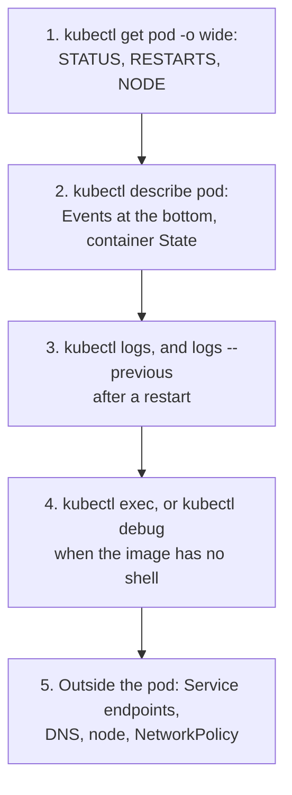

# Troubleshooting playbook

> **Status: AI draft, 2026-11-16.** Not yet verified by me. Every symptom below except "Terminating forever" (on [Finalizers and deletion](finalizers-and-deletion.md)) was reproduced on purpose on a one-node local kind cluster (Kubernetes 1.37); addresses are rewritten to example ranges and generated IDs replaced with placeholders.

## In one line

Read the pod's STATUS and RESTARTS, then `describe` it and read the Events at the bottom, then the logs (and the previous container's logs after a restart), then look inside with `exec` or `debug`, and only then outside the pod: Service endpoints, DNS, the node. The STATUS value tells you which of those steps holds the answer.

## The order



Events are kept for about an hour by default, so read them early. `kubectl get events -n <ns> --sort-by=.lastTimestamp` shows them for the whole namespace ([kubectl fluency](kubectl.md)).

| STATUS, or what you see | Where the answer is | Section below |
|---|---|---|
| `Pending` | Scheduler events | Pending |
| `ContainerCreating` for minutes | Kubelet events: volumes, network | ContainerCreating |
| `ErrImagePull`, `ImagePullBackOff` | Kubelet events: the pull error | ImagePullBackOff |
| `CrashLoopBackOff`, or `Error` with RESTARTS rising | Logs, exit code | Crash loop |
| `OOMKilled` | Last state, memory limit | OOMKilled |
| `CreateContainerConfigError` | Kubelet events: missing reference | CreateContainerConfigError |
| `Running` but READY `0/1` | Probe events | Running but not Ready |
| Service does not answer | EndpointSlices | Service has no endpoints |
| Name does not resolve in a pod | Name, namespace, resolv.conf | DNS fails in a pod |
| Node `NotReady` | Node conditions, kubelet | Node NotReady |
| `Terminating` forever | Finalizers | [Finalizers and deletion](finalizers-and-deletion.md) |

The lab pods, all in namespace `trouble`:

```console
$ kubectl get pods -n trouble
NAME                READY   STATUS                       RESTARTS      AGE
bad-image           0/1     ImagePullBackOff             0             49s
crash               0/1     Error                        3 (35s ago)   49s
missing-configmap   0/1     ContainerCreating            0             49s
missing-secret      0/1     CreateContainerConfigError   0             49s
not-ready           0/1     Running                      0             49s
oom                 0/1     OOMKilled                    3 (34s ago)   49s
too-big             0/1     Pending                      0             49s
```

## Pending

The scheduler has not found a node. The pod has no node and no containers yet, so there are no logs.

```console
$ kubectl describe pod too-big -n trouble
...
Events:
Type     Reason            Age   From               Message
Warning  FailedScheduling  49s   default-scheduler  0/1 nodes are available: 1 Insufficient cpu. preemption: 0/1 nodes are available: 1 Preemption is not helpful for scheduling.
```

The pod requested 100 CPUs. The message counts nodes per reason.

| Message mentions | Usual cause | Fix |
|---|---|---|
| `Insufficient cpu` or `memory` | Requests larger than free allocatable capacity | Lower requests, or add nodes ([Requests, limits and QoS](resources-and-qos.md)) |
| `didn't match Pod's node affinity/selector` | `nodeSelector` or affinity matches no node | Fix labels or the rule ([Scheduling](scheduling.md)) |
| `untolerated taint` | Nodes are tainted | Add a toleration, or use other nodes |
| `unbound immediate PersistentVolumeClaims` | PVC not bound | Check the PVC and StorageClass ([Storage](storage.md)) |
| No events at all | Wrong scheduler name, or the scheduler is down | Check `spec.schedulerName` and kube-system pods |

On a cluster with a node autoscaler, `Pending` should trigger a new node; if it does not, read the autoscaler's logs ([Autoscaling](autoscaling.md)).

## ContainerCreating

Scheduled, but the kubelet cannot finish preparing the pod: usually a volume or the network.

```console
$ kubectl describe pod missing-configmap -n trouble
...
Warning  FailedMount  17s (x7 over 49s)  kubelet  MountVolume.SetUp failed for volume "cfg" : configmap "app-settings" not found
```

| Event | Usual cause |
|---|---|
| `FailedMount ... not found` | ConfigMap or Secret volume references an object that does not exist in this namespace |
| `FailedAttachVolume`, `Multi-Attach error` | A ReadWriteOnce volume is still attached to another node, or the disk is in another zone |
| `FailedCreatePodSandBox` | Network plugin cannot set up the pod network: CNI not ready, or no IP addresses left ([VPC CNI](../eks/vpc-cni.md)) |

## ImagePullBackOff

The kubelet cannot pull the image. `ErrImagePull` is the failure; `ImagePullBackOff` is the wait before the next attempt.

```console
$ kubectl describe pod bad-image -n trouble
...
Normal   Pulling    8s (x3 over 49s)   kubelet  spec.containers{app}: Pulling image "registry.invalid/sample-app:1.0"
Warning  Failed     8s (x3 over 49s)   kubelet  spec.containers{app}: Failed to pull image "registry.invalid/sample-app:1.0": failed to pull and unpack image "registry.invalid/sample-app:1.0": failed to resolve reference
Warning  Failed     8s (x3 over 49s)   kubelet  spec.containers{app}: Error: ErrImagePull
```

| Error text contains | Usual cause |
|---|---|
| `not found`, `manifest unknown` | Tag or digest does not exist; a typo, or the build never pushed it |
| `unauthorized`, `denied`, `403` | Private registry with no or wrong `imagePullSecrets`, or the node's role cannot read the registry ([Registries and image security](../containers/registries-and-image-security.md)) |
| `failed to resolve reference`, `no such host`, `i/o timeout` | Registry host unreachable from the node: DNS, NAT gateway, VPC endpoint |
| `toomanyrequests` | Registry rate limit; use a mirror or pull-through cache |
| `no match for platform` | Image built for another CPU architecture |

## Crash loop

The container starts, exits, and is restarted with growing delays. Many clusters show `CrashLoopBackOff`; this 1.37 lab showed `Error` between restarts. Either way the signs are RESTARTS rising and `BackOff` events.

```console
$ kubectl describe pod crash -n trouble
...
    State:          Terminated
      Reason:       Error
      Exit Code:    1
...
Warning  BackOff  8s (x3 over 46s)  kubelet  spec.containers{app}: Back-off restarting failed container app in pod crash_trouble(<pod-uid>)
$ kubectl logs crash -n trouble
config file /etc/app.conf not found
starting
$ kubectl logs crash -n trouble --previous
unable to retrieve container logs for containerd://<container-id>
```

Here the plain `kubectl logs` printed the crashed run, because no newer container was running yet. `--previous` failed because the older container had already been removed from the node (only the latest log file was left in `/var/log/pods`). When a container has restarted and is running again, `--previous` is the one that shows the crash. Try both.

| Exit code or clue | Usual cause |
|---|---|
| 1 or another small code, and an error in the logs | The application failed: missing config, a dependency unreachable at startup, a bad argument |
| 137, with reason `OOMKilled` | Memory limit; see OOMKilled below |
| 137 without OOM, after probe failure events | Liveness probe killed it ([Probes and graceful shutdown](probes-and-graceful-shutdown.md)) |
| 127 or `exec format error` | Command not found in the image, or wrong CPU architecture |
| 0, and it restarts anyway | The process finished; a Deployment expects it to run forever. Use a Job ([Jobs and CronJobs](jobs-and-cronjobs.md)) |
| No logs at all | It dies before logging: check `command`, `args`, and `kubectl debug` with a copy of the pod |

## OOMKilled

The container went over its memory limit and the kernel killed it ([Memory and the OOM killer](../linux/memory-and-oom.md)).

```console
$ kubectl describe pod oom -n trouble
...
    Last State:     Terminated
      Reason:       OOMKilled
      Exit Code:    137
    Restart Count:  3
```

Exit code 137 is 128 + 9: killed by SIGKILL. Compare the limit with real usage (`kubectl top pod`, or memory metrics over time). Raise the limit if usage is legitimate; look for a leak if it grows without bound; for JVMs and other runtimes, size the heap below the container limit. If the node itself ran out of memory, the pods are evicted instead, with reason `Evicted` and a message about memory pressure.

## CreateContainerConfigError

The image is there, but the kubelet cannot build the container's configuration: almost always a missing ConfigMap or Secret used in `env` or `envFrom`.

```console
$ kubectl describe pod missing-secret -n trouble
...
Warning  Failed  8s (x5 over 49s)  kubelet  spec.containers{app}: Error: secret "db-credentials" not found
```

The Secret exists in namespace `demo`, but a pod can only use Secrets in its own namespace ([ConfigMaps and Secrets](configmaps-and-secrets.md)). Other causes: a missing key in an existing Secret, or `runAsNonRoot` with an image that runs as root ([Pod security](pod-security.md)).

## Running but not Ready

The container runs, but its readiness probe fails, so the pod is left out of its Services' endpoints.

```console
$ kubectl describe pod not-ready -n trouble
...
Warning  Unhealthy  3s (x12 over 54s)  kubelet  spec.containers{app}: Readiness probe failed: cat: can't open '/tmp/ready': No such file or directory
$ kubectl get endpointslices -n trouble -l kubernetes.io/service-name=shop -o jsonpath='{range .items[*].endpoints[*]}{.addresses[0]} ready={.conditions.ready}{"\n"}{end}'
10.244.0.7 ready=false
```

Check the probe's path, port and timing against the application; a dependency the readiness check calls may be the real failure.

## Service has no endpoints

Requests to the Service time out or are refused, while the pods look fine.

```console
$ kubectl get endpointslices -n trouble
NAME              ADDRESSTYPE   PORTS     ENDPOINTS     AGE
shop-ffs5m        IPv4          8080      10.244.0.7    50s
shop-typo-nqg7m   IPv4          <unset>   <unset>       50s
$ kubectl describe svc shop-typo -n trouble | grep -E 'Selector|Endpoints'
Selector:                 app=shpo
Endpoints:
```

| Check | Usual cause |
|---|---|
| Endpoints empty, selector differs from pod labels | Typo in the selector (`shpo`), or labels changed ([Labels, selectors and namespaces](labels-selectors-namespaces.md)) |
| Endpoints present but `ready=false` | Readiness probes failing (previous section) |
| Endpoints ready, still no answer | `targetPort` does not match the port the app listens on, or a NetworkPolicy blocks it ([Pod networking and NetworkPolicy](pod-networking-and-network-policy.md)) |

## DNS fails in a pod

```console
$ kubectl exec -n trouble dns-test -- ping -c1 -W1 web
ping: bad address 'web'
$ kubectl exec -n trouble dns-test -- ping -c1 -W1 web.demo
PING web.demo (10.96.100.10): 56 data bytes
$ kubectl exec -n trouble dns-test -- cat /etc/resolv.conf
search trouble.svc.cluster.local svc.cluster.local cluster.local
nameserver 10.96.0.10
options ndots:5
```

The short name `web` only searches the pod's own namespace (`trouble`); the Service lives in `demo`. `ping` is used only to show the name resolving; a Service address does not answer ping. Other causes: CoreDNS pods down or overloaded, a NetworkPolicy blocking port 53 to kube-system, or an external name failing upstream ([Services and DNS](services-and-dns.md), [DNS](../networking/dns.md)).

## Node NotReady

The kubelet stopped reporting. Reproduced by stopping the kubelet inside the kind node for about a minute:

```console
$ kubectl get nodes
NAME                      STATUS     ROLES           AGE   VERSION
notes-lab-control-plane   NotReady   control-plane   59m   v1.37.0
$ kubectl describe node notes-lab-control-plane
...
  Ready            Unknown   ...   NodeStatusUnknown   Kubelet stopped posting node status.
Taints:             node.kubernetes.io/unreachable:NoExecute
                    node.kubernetes.io/unreachable:NoSchedule
```

The control plane marked it NotReady 48 seconds after the stop and tainted it. Pods tolerate the `unreachable` taint for 300 seconds by default, then they are evicted and recreated elsewhere. Starting the kubelet again made the node Ready within seconds.

| Condition or clue | Usual cause |
|---|---|
| `Kubelet stopped posting node status` | Kubelet down, node powered off, or network between node and control plane cut |
| `MemoryPressure`, `DiskPressure`, `PIDPressure` True | Node resources exhausted; kubelet evicts pods ([Disks and filesystems](../linux/disks-and-filesystems.md)) |
| `NetworkUnavailable`, or Ready false with a CNI message | Network plugin not running on the node |
| Many nodes at once | Control plane connectivity, expired certificates, or an upgrade gone wrong |

On the node itself: `systemctl status kubelet` and `journalctl -u kubelet` ([systemd and services](../linux/systemd.md), [Logs](../linux/logs.md)).

## Tools beyond describe and logs

| Command | Use it when |
|---|---|
| `kubectl debug -it <pod> --image=busybox:1.36 --target=<container>` | The image has no shell; adds an ephemeral container sharing the process namespace |
| `kubectl debug <pod> -it --copy-to=<pod>-debug --container=<c> -- sh` | A copy of a crashing pod with a different command, to look around |
| `kubectl debug node/<node> -it --image=busybox:1.36` | A shell on the node, with its filesystem under `/host` |
| `kubectl get events -A --field-selector type=Warning` | Every warning in the cluster, newest at the bottom with `--sort-by` |
| `kubectl auth can-i` | A controller or user is `Forbidden` ([RBAC and service accounts](rbac-and-service-accounts.md)) |

## Interview questions

**1. A pod is `Pending`. What do you check?**

<details markdown="1">
<summary>Answer</summary>

- `kubectl describe pod`: the `FailedScheduling` event counts nodes per reason.
- Usual causes: requests larger than free capacity, node selectors or affinity, taints, unbound PVCs.
- With a node autoscaler, check why it did not add a node.

</details>

**2. What is the difference between `ImagePullBackOff` and `CrashLoopBackOff`?**

<details markdown="1">
<summary>Answer</summary>

- `ImagePullBackOff`: the container never started; the image could not be pulled. Read the pull error in events.
- `CrashLoopBackOff`: the image ran and the process keeps exiting. Read logs and the exit code.
- Both are back-off waits between retries, not the original error.

</details>

**3. A pod restarts every few minutes with exit code 137. What could it be, and how do you tell?**

<details markdown="1">
<summary>Answer</summary>

- 137 is SIGKILL: either the memory limit (`OOMKilled` in the last state) or a liveness probe failure (probe events before the restart).
- `kubectl describe pod` shows which.
- Fix the limit or leak, or the probe's timing and endpoint.

</details>

**4. Pods are Running and Ready, but the Service times out. Walk through it.**

<details markdown="1">
<summary>Answer</summary>

- EndpointSlices: are the pods listed and ready? Empty means a selector mismatch.
- `targetPort` against the port the container listens on.
- Test from another pod: the pod IP directly, then the Service name; then NetworkPolicy.

</details>

**5. How do you debug a container whose image has no shell?**

<details markdown="1">
<summary>Answer</summary>

- `kubectl debug` with an ephemeral container and `--target` to share its processes.
- Or `--copy-to` to start a copy with a different command or image.
- Logs and events first; a shell is rarely the first step.

</details>

**6. `kubectl logs` shows nothing useful for a crash-looping pod. What next?**

<details markdown="1">
<summary>Answer</summary>

- `kubectl logs --previous` once the next container is running; check `describe` for the exit code and reason.
- If it dies before logging: check `command` and `args`, missing files or variables, and the architecture.
- Run a copy with `sleep` as the command and start the program by hand.

</details>

**7. A node shows `NotReady`. What happens to its pods, and what do you check?**

<details markdown="1">
<summary>Answer</summary>

- The node is tainted unreachable or not-ready; pods are evicted after their toleration (300 seconds by default) and recreated elsewhere, if a controller owns them.
- Check node conditions in `describe node`, then the kubelet and container runtime on the node, its disk and memory, and the network to the control plane.
- Many nodes at once points to the control plane or the network, not the nodes.

</details>

**8. A pod works in namespace `a` but calls to `web` fail after moving it to namespace `b`. Why?**

<details markdown="1">
<summary>Answer</summary>

- Short names are searched only in the pod's own namespace.
- Use `web.a` or the full `web.a.svc.cluster.local`.
- Also check NetworkPolicies in `a` that allow only traffic from inside `a`.

</details>

## Try it

**Step 1.** On a kind cluster, create three broken pods.

```bash
kubectl create namespace trouble-try
kubectl run img -n trouble-try --image=registry.invalid/app:1.0
kubectl run crash -n trouble-try --image=busybox:1.36 -- sh -c 'echo boom; exit 3'
kubectl run big -n trouble-try --image=busybox:1.36 --overrides='{"spec":{"containers":[{"name":"big","image":"busybox:1.36","command":["sleep","3600"],"resources":{"requests":{"cpu":"64"}}}]}}'
```

**Step 2.** Before looking, predict each pod's STATUS and the one command that shows its cause. Then check, using only `get`, `describe` and `logs`.

```bash
kubectl get pods -n trouble-try
kubectl describe pod img -n trouble-try | tail -5
kubectl logs crash -n trouble-try
kubectl describe pod big -n trouble-try | tail -3
```

**Step 3.** Clean up.

```bash
kubectl delete namespace trouble-try
```

## Sources

- [Kubernetes documentation: debug pods](https://kubernetes.io/docs/tasks/debug/debug-application/debug-pods/)
- [Kubernetes documentation: debug running pods (kubectl debug)](https://kubernetes.io/docs/tasks/debug/debug-application/debug-running-pod/)
- [Kubernetes documentation: debug Services](https://kubernetes.io/docs/tasks/debug/debug-application/debug-service/)
- [Kubernetes documentation: debugging DNS resolution](https://kubernetes.io/docs/tasks/administer-cluster/dns-debugging-resolution/)
- [Kubernetes documentation: pod lifecycle](https://kubernetes.io/docs/concepts/workloads/pods/pod-lifecycle/)
- [Kubernetes documentation: taint-based evictions](https://kubernetes.io/docs/concepts/scheduling-eviction/taint-and-toleration/#taint-based-evictions)
- [Kubernetes documentation: kube-apiserver reference (`--event-ttl`, default 1 hour)](https://kubernetes.io/docs/reference/command-line-tools-reference/kube-apiserver/)
