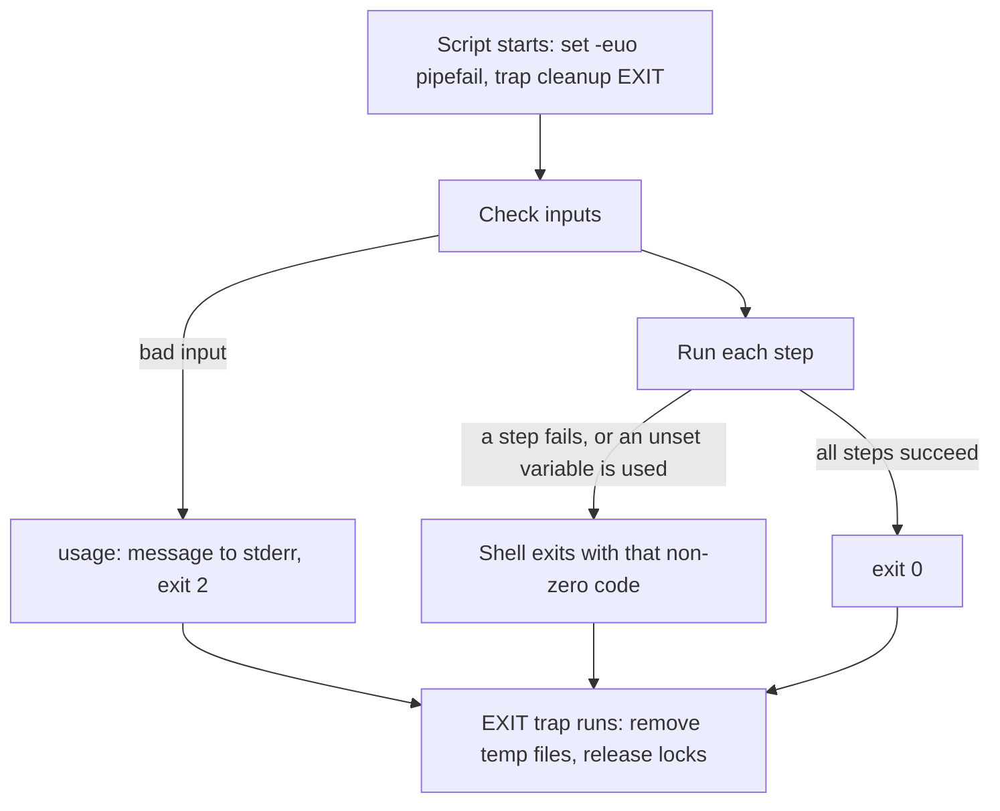

# Bash scripting

> **Status: AI draft, 2026-11-16.** Not yet verified by me. Commands and output were run in a throwaway container; addresses are rewritten to example ranges.

## In one line

A safe bash script starts with `set -euo pipefail`, quotes every variable, checks its inputs, cleans up with `trap`, and returns a meaningful exit code. Most script bugs are word splitting from missing quotes, or failures that were silently ignored.

## The plain idea

A bash script is the commands you would type, saved in a file so they run the same way every time. The trouble is that the shell was designed for people typing, not for programs: by default it carries on after a command fails, treats an unset variable as an empty string, and splits values on spaces. Typing by hand, you notice when something goes wrong. A script does not.

So a good script turns those defaults around: stop on the first failure, refuse unset variables, keep values in one piece. Then it adds what a person does without thinking: checking the inputs, explaining how to use it, and tidying up afterwards.

## How it works

### The strict-mode line

```bash
#!/usr/bin/env bash
set -euo pipefail
```

| Option | Effect | The surprise to know |
|---|---|---|
| `-e` (`errexit`) | Exit as soon as a command fails | It does not apply to a command tested by `if` or `while`, or on the left of `&&` or the OR operator, nor to a failing command inside a pipeline without `pipefail` |
| `-u` (`nounset`) | Using an unset variable is an error | Use `${var:-default}` for variables that are allowed to be missing |
| `-o pipefail` | A pipeline fails if any command in it fails | Without it, a pipeline reports only its last command's result ([Streams, pipes and redirection](streams-and-redirection.md)) |

The **shebang** `#!/usr/bin/env bash` finds bash on `PATH`, which works on systems where bash is not at `/bin/bash`.

How a strict-mode script ends:



### Quoting

The shell expands variables and then splits the result on spaces, tabs and newlines, and expands any `*` it finds. Double quotes stop both.

| You write | `f` is `my file.txt` | Result |
|---|---|---|
| `ls $f` | Two words | `ls` looks for `my` and `file.txt` |
| `ls "$f"` | One word | `ls` looks for `my file.txt` |
| `for x in "$@"` | Each argument kept whole | Correct way to loop over arguments |
| `for x in $(cat list)` | Split on any space | A line with a space becomes two items |

Single quotes keep everything literal: `'$HOME'` stays the five characters `$HOME`.

### Building blocks

| Construct | Example | Notes |
|---|---|---|
| Test | `[[ -f "$f" && -n "$name" ]]` | `-f` file exists, `-d` directory, `-z` empty, `-n` not empty, `==` with a pattern, `=~` with a regex. Prefer `[[ ]]` to `[ ]` in bash. |
| Numbers | `(( count > 3 ))`, `$(( a + b ))` | Integer arithmetic only. |
| If | `if cmd; then ...; elif ...; else ...; fi` | `if` runs a command and tests its exit code. |
| Case | `case "$1" in start) ... ;; stop) ... ;; *) usage ;; esac` | Clean way to handle subcommands. |
| Loops | `for h in "${hosts[@]}"; do ...; done`, `while IFS= read -r line; do ...; done < file` | The `while read` form reads one whole line at a time. |
| Functions | `check() { [[ $1 == ok ]]; }` | `return` sets the exit code; the last command's code is returned otherwise. Use `local` for variables inside. |
| Arrays | `hosts=(web-1 web-2)`, `"${hosts[@]}"`, `${#hosts[@]}` | The count of elements is `${#hosts[@]}`. |
| Defaults | `${var:-default}`, `${var:?message}` | `:?` stops the script with the message if `var` is empty or unset. |
| Arguments | `$1`, `"$@"`, `$#`, `getopts` | `getopts "s:d:"` parses `-s value -d value`. |
| Substitution | `today=$(date +%F)` | Runs a command and captures its output. |
| Cleanup | `trap 'rm -f "$tmp"' EXIT` | Runs when the script exits for any reason, including errors. |

### Exit codes

A script's exit code is its last command's, or what it passes to `exit`. Use 0 for success, 1 for failure, 2 for wrong usage. Callers, cron and CI systems all decide what happened from this one number.

## A concrete example

A backup script that copies a directory into a dated archive and keeps the newest `N`:

```bash
#!/usr/bin/env bash
# Copy a directory into a dated tar file and keep the newest N.
set -euo pipefail

usage() { echo "usage: $0 -s <source-dir> -d <dest-dir> [-k <keep>]" >&2; exit 2; }

keep=3
while getopts "s:d:k:" opt; do
  case "$opt" in
    s) src=$OPTARG ;;
    d) dest=$OPTARG ;;
    k) keep=$OPTARG ;;
    *) usage ;;
  esac
done
[[ -n "${src:-}" && -n "${dest:-}" ]] || usage
[[ -d "$src" ]] || { echo "error: $src is not a directory" >&2; exit 1; }

tmp=$(mktemp)
trap 'rm -f "$tmp"' EXIT

mkdir -p "$dest"
stamp=$(date +%Y%m%d-%H%M%S)
tar -czf "$tmp" -C "$src" .
mv "$tmp" "$dest/backup-$stamp.tar.gz"
echo "wrote $dest/backup-$stamp.tar.gz"

count=0
for f in $(ls -1t "$dest"/backup-*.tar.gz); do
  count=$((count + 1))
  if (( count > keep )); then
    rm -- "$f"
    echo "removed old $f"
  fi
done
```

Line by line, the parts that matter:

1. `set -euo pipefail`: a failed `tar` stops the script before the rename, so a broken archive never replaces a good one.
2. `usage` prints to stderr (`>&2`) and exits 2, the conventional "wrong usage" code.
3. `getopts "s:d:k:"`: each letter is an option; the colon means it takes a value, delivered in `$OPTARG`.
4. `${src:-}` lets the check run under `set -u` even when `-s` was not given.
5. The archive is written to a temporary file first, then moved into place. `mv` within one filesystem is atomic, so a reader never sees half an archive.
6. `trap ... EXIT` deletes the temporary file however the script ends.
7. `rm --`: the `--` means "no more options", so a file name starting with `-` cannot be read as a flag.

The loop over `$(ls ...)` is safe here only because the script controls the file names and they contain no spaces. With names you do not control, use `find -print0` with `while IFS= read -r -d ''`.

What it did when run:

```console
# /tmp/backup.sh
usage: /tmp/backup.sh -s <source-dir> -d <dest-dir> [-k <keep>]
# echo $?
2
# /tmp/backup.sh -s /nope -d /backups
error: /nope is not a directory
# for i in 1 2 3 4; do /tmp/backup.sh -s /srv/data -d /backups -k 2; sleep 1; done
wrote /backups/backup-<stamp>.tar.gz
wrote /backups/backup-<stamp>.tar.gz
wrote /backups/backup-<stamp>.tar.gz
removed old /backups/backup-<stamp>.tar.gz
wrote /backups/backup-<stamp>.tar.gz
removed old /backups/backup-<stamp>.tar.gz
```

The timestamps are replaced with `<stamp>`.

## Why not just...?

- **...write it in Python instead?** For anything with data structures, parsing or more than about a hundred lines, often yes. Bash is the right tool for gluing commands together, and every Linux machine and container image already has it.
- **...leave out `set -e` and check `$?` after each command?** That works if you never forget one. One missed check, and the script carries on after a failure: deleting the old backup after the new one failed, for example.
- **...use `[ ]` like older scripts?** `[` is a command, so unquoted variables inside it split and break it. `[[ ]]` is part of bash's syntax, does not split variables, and supports `&&`, patterns and regexes.

## Commands to know

`set -e` and `set -u`, before and after:

```console
# bash -c 'false; echo still here'
still here
# bash -c 'set -e; false; echo still here'
# echo $?
1
# bash -c 'echo "[$undefined_var]"'
[]
# bash -c 'set -u; echo "$undefined_var"'
bash: line 1: undefined_var: unbound variable
```

`${var:?message}` stops the whole script, not just the line:

```console
# bash -c 'unset name; echo "${name:?name is required}"; echo after'
bash: line 1: name: name is required
# echo $?
127
```

`after` never ran. A non-interactive shell exits on this error; this run's exit code was 127.

Quoting:

```console
# bash -c 'f="my file.txt"; ls /tmp/$f'
ls: cannot access '/tmp/my': No such file or directory
ls: cannot access 'file.txt': No such file or directory
# bash -c 'f="my file.txt"; ls "/tmp/$f"'
/tmp/my file.txt
```

Tests, arithmetic, functions and arrays:

```console
# x=5; [[ $x -gt 3 ]] && echo "5 > 3"
5 > 3
# [[ "abc" == a* ]] && echo "pattern match"
pattern match
# echo $(( 7 / 2 )) $(( 7 % 2 )) $(( 2 ** 10 ))
3 1 1024
# is_up() { [[ $1 == ok ]]; }; is_up down; echo "is_up down returned $?"
is_up down returned 1
# hosts=(web-1 web-2 db-1); echo ${#hosts[@]}; for h in "${hosts[@]}"; do echo "check $h"; done
3
check web-1
check web-2
check db-1
```

Reading lines safely:

```console
# printf "web-1\nweb 2\n" > /tmp/h
# while IFS= read -r line; do echo "[$line]"; done < /tmp/h
[web-1]
[web 2]
# for line in $(cat /tmp/h); do echo "<$line>"; done
<web-1>
<web>
<2>
```

`IFS=` keeps leading and trailing spaces, and `-r` keeps backslashes as they are.

| Command | What it does |
|---|---|
| `bash -n script.sh` | Check the syntax without running anything. |
| `bash -x script.sh`, or `set -x` inside | Print each command after expansion as it runs: the first tool for "what did it actually do?". |
| `shellcheck script.sh` | A linter that finds quoting bugs, unused variables and many traps on this page. |
| `mktemp`, `mktemp -d` | Create a unique temporary file or directory safely. |
| `flock -n /tmp/job.lock <cmd>` | Run only if no other copy holds the lock ([Cron and timers](cron-and-timers.md)). |

## How it breaks

| Symptom | Layer | Check | Likely cause |
|---|---|---|---|
| A file name with a space becomes two arguments | Quoting | `bash -x` shows the split | An unquoted `$var` or `$(...)` |
| The script carried on after a failure | Error handling | Is `set -e` on? Was the failure inside `if`, `&&` or a pipeline? | No `set -e`, or `-e` does not apply there, or no `pipefail` |
| Works in your terminal, fails in cron or CI | Environment | Print `env` from inside the job | Different `PATH`, no terminal, a different shell (`sh`, not bash), or a different working directory |
| `syntax error near unexpected token` on a line that looks fine | Shell or line endings | `head -1 script.sh`; `file script.sh` or `cat -A` | Run with `sh` instead of bash, or Windows line endings (`^M`) |
| Temporary files pile up | Cleanup | Look for `trap` | No `trap ... EXIT` to remove them |
| Two copies run at once and corrupt output | Concurrency | Check for overlapping runs in the logs | No lock: use `flock` |

## Interview questions

**1. What does `set -euo pipefail` do, line by line?**

<details markdown="1">
<summary>Answer</summary>

- `-e`: exit when a command fails.
- `-u`: treat use of an unset variable as an error.
- `-o pipefail`: a pipeline fails if any command in it fails, not just the last.
- Know the limits: `-e` does not fire for commands tested by `if`, `&&` or `||`.

</details>

**2. Why should you quote variables, and what goes wrong if you do not?**

<details markdown="1">
<summary>Answer</summary>

- Unquoted expansions are split on whitespace and globbed.
- A value with a space becomes several arguments; a value with `*` can expand to file names.
- An empty unquoted variable disappears entirely, which can change a command's meaning, as in `rm -rf $dir/*`.

</details>

**3. What is `trap` used for in scripts?**

<details markdown="1">
<summary>Answer</summary>

- To run code when the script exits or receives a signal.
- `trap 'cleanup' EXIT` removes temporary files or releases locks whatever happens.
- `trap '...' TERM INT` handles being stopped, for example to finish the current item.

</details>

**4. How do you read a file line by line correctly in bash?**

<details markdown="1">
<summary>Answer</summary>

- `while IFS= read -r line; do ...; done < file`.
- `IFS=` keeps leading and trailing whitespace; `-r` keeps backslashes literal.
- `for line in $(cat file)` is wrong: it splits on every space, not on lines.

</details>

**5. A script runs fine by hand but fails in cron. What do you check?**

<details markdown="1">
<summary>Answer</summary>

- `PATH` and environment: cron gives a minimal one. Use full paths or set `PATH`.
- The shell: cron runs `/bin/sh` unless told otherwise; bash-only syntax fails there.
- The working directory and user, and where its output went: redirect stdout and stderr to a log.

</details>

**6. How do you debug a bash script that does the wrong thing?**

<details markdown="1">
<summary>Answer</summary>

- `bash -x script.sh` (or `set -x`) to see every command after expansion.
- `bash -n` for syntax, and `shellcheck` for common bugs.
- Add `echo` of key variables to stderr, and check exit codes at each step.

</details>

**7. Write the outline of a script that deploys only if a health check passes, and rolls back otherwise.**

<details markdown="1">
<summary>Answer</summary>

- Strict mode, argument parsing and input checks first.
- Record the current version before changing anything.
- Deploy, then poll the health endpoint with a timeout and a retry limit.
- On failure, redeploy the recorded version and exit non-zero; on success exit 0.
- Log every step; take a lock so two deploys cannot overlap.

</details>

## Try it

**Step 1.** Start a throwaway container.

```bash
docker run --rm -it ubuntu:24.04 bash
```

**Step 2.** Predict the output of each line, then run it.

```bash
bash -c 'false; echo still here'
bash -c 'set -e; false; echo still here'; echo $?
bash -c 'set -u; echo "$nope"'; echo $?
f="a b.txt"; touch "$f"; ls $f; ls "$f"
```

**Step 3.** Run a loop with tracing on and read how each line was expanded.

```bash
bash -x -c 'for h in web-1 web-2; do echo "check $h"; done'
```

**Step 4.** Type `exit`. The container is deleted.

## Zoom out

Bash is the glue in CI pipelines, container entrypoints and cron jobs ([CI/CD concepts](../cicd/concepts.md), [Cron and timers](cron-and-timers.md)), so its defaults decide whether a failure stops a deploy or slips through. Without strict mode and quoting, scripts fail silently and destructively. The principle to carry: make failures loud and early, and make every value stay in one piece.

## Sources

- [GNU Bash manual](https://www.gnu.org/software/bash/manual/bash.html)
- [GNU Bash manual: The Set builtin](https://www.gnu.org/software/bash/manual/html_node/The-Set-Builtin.html)
- [GNU Bash manual: Shell parameter expansion](https://www.gnu.org/software/bash/manual/html_node/Shell-Parameter-Expansion.html)
- [GNU Bash manual: Word splitting](https://www.gnu.org/software/bash/manual/html_node/Word-Splitting.html)
- [ShellCheck](https://www.shellcheck.net/)
