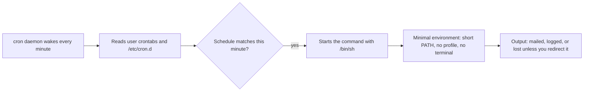

# Cron and timers

> **Status: AI draft, 2026-11-16.** Not yet verified by me. Commands and output were run in a throwaway container; the systemd timer examples are from the systemd documentation and were not run, because a plain container has no systemd.

## In one line

Cron runs commands on a schedule written as five fields: minute, hour, day of month, month, day of week. Jobs run with a minimal environment, in the server's time zone, and can overlap unless you lock them. systemd timers do the same job with logging, catch-up after downtime, and dependencies.

## The plain idea

Some work has to happen on a clock: a nightly backup, an hourly report, a cleanup every Sunday. Rather than someone remembering, a background program, the **cron daemon**, wakes up every minute, reads a list of schedules, and starts any job whose time has come.

The list is a **crontab** (cron table). Each line is a schedule and a command. The surprises all come from the job running with nobody watching: no terminal, a different environment, no one to see the error, and no guarantee that the previous run has finished.

## How it works

### The schedule

```text
┌───────────── minute        0-59
│ ┌─────────── hour          0-23
│ │ ┌───────── day of month  1-31
│ │ │ ┌─────── month         1-12
│ │ │ │ ┌───── day of week   0-7 (0 and 7 are Sunday)
│ │ │ │ │
30 2 * * *   /usr/local/bin/backup.sh
```

| Schedule | Meaning |
|---|---|
| `*/5 * * * *` | Every 5 minutes |
| `0 * * * *` | At the top of every hour |
| `30 2 * * *` | Every day at 02:30 |
| `0 9 * * 1-5` | 09:00, Monday to Friday |
| `0 0 1 * *` | Midnight on the first of each month |
| `0 3 * * 0` | 03:00 every Sunday |

`*` means every value, `a-b` a range, `a,b` a list, and `*/n` every n-th value. One trap: if both day of month and day of week are restricted, the job runs when **either** matches.

### Where crontabs live

| Location | Edited with | Format |
|---|---|---|
| A user's crontab | `crontab -e` (and `crontab -l` to list) | Five time fields, then the command. Runs as that user. |
| `/etc/crontab` and files in `/etc/cron.d/` | Any editor | Five time fields, **a user name**, then the command. |
| `/etc/cron.daily/`, `/etc/cron.hourly/`, and so on | Drop in an executable script | No schedule line; run by the system at its daily or hourly time. |

### What a job runs with



- **Environment.** Cron does not read your shell profile. `PATH` is short, so commands in `/usr/local/bin` or a user directory are not found unless you use full paths or set `PATH` at the top of the crontab.
- **Shell.** Commands run with `/bin/sh`, not bash, unless `SHELL=/bin/bash` is set. `%` has a special meaning in a crontab line (a newline) and must be written `\%`.
- **Output.** Anything the job prints is mailed to the owner if mail is set up, and otherwise often lost. Redirect it: `>> /var/log/job.log 2>&1`.
- **Time zone.** The schedule uses the server's time zone, often UTC on cloud servers. `30 2 * * *` on a UTC server is 08:00 in India (UTC+5:30).
- **Overlap.** Cron starts a job on time whether or not the previous run has finished. A job that sometimes runs longer than its interval will overlap with itself. `flock` prevents that.
- **Missed runs.** If the machine was off at 02:30, plain cron does not run that job later.

### systemd timers

A **timer** is a systemd unit that starts a service unit on a schedule ([Boot, systemd and services](systemd.md)). Two files:

```ini
# /etc/systemd/system/backup.service
[Unit]
Description=Nightly backup

[Service]
Type=oneshot
ExecStart=/usr/local/bin/backup.sh
```

```ini
# /etc/systemd/system/backup.timer
[Unit]
Description=Run the nightly backup

[Timer]
OnCalendar=*-*-* 02:30:00
Persistent=true
RandomizedDelaySec=5m

[Install]
WantedBy=timers.target
```

Enable it with `systemctl enable --now backup.timer`; list timers with `systemctl list-timers`.

| | cron | systemd timer |
|---|---|---|
| Logs | Whatever you redirect | Automatically in the journal: `journalctl -u backup.service` |
| Missed runs | Skipped | `Persistent=true` runs it at the next boot |
| Overlap | Possible; needs `flock` | A service that is still running is not started again |
| Status and history | None | `systemctl status`, last and next run in `list-timers` |
| Resource limits, dependencies | No | Everything a service unit can do |
| Simplicity | One line | Two files |

## A concrete example

A report job is scheduled `*/15 * * * * /opt/report/run.sh` and sometimes produces a corrupted file.

1. The job's log shows two runs writing at the same time: a slow run took 20 minutes and the next started at its 15-minute mark.
2. Wrap it in a lock: `*/15 * * * * flock -n /tmp/report.lock /opt/report/run.sh >> /var/log/report.log 2>&1`. `-n` means "if the lock is held, give up at once" instead of queueing.
3. The overlapping run is now skipped, and the skip is visible in the log because `flock` exits with code 1.
4. Next, find out why some runs take 20 minutes. The lock stops the damage; it does not fix the slowness.

## Why not just...?

- **...run a script in a `while true; sleep 3600` loop?** Nothing restarts it if it crashes or the machine reboots, and its timing drifts. A scheduler survives both.
- **...rely on cron's email for failures?** Most servers have no working mail. Log to a file or the journal, and alert on missing success, for example with a heartbeat check that expects a ping after every run.
- **...use cron inside a container?** A container usually runs one process; cron adds a second, with its own environment problems. In Kubernetes, use a [CronJob](../kubernetes/jobs-and-cronjobs.md), which starts a fresh pod per run.

## Commands to know

A file in `/etc/cron.d`, with the user field, and what the job really saw:

```console
# cat /etc/cron.d/tick
* * * * * root echo tick $(date +\%H:\%M) >> /tmp/cron.log 2>&1
# cat /tmp/cron.log
tick 03:02
# grep -E "^(PATH|SHELL|HOME)=" /tmp/cron-env.txt
HOME=/root
PATH=/usr/bin:/bin
SHELL=/bin/sh
```

The second file was written by a job that ran `env > /tmp/cron-env.txt`. `PATH` is only `/usr/bin:/bin`, and the shell is `sh`.

A lock that skips an overlapping run:

```console
# flock -n /tmp/job.lock -c "sleep 3" &
# flock -n /tmp/job.lock -c "echo second run" || echo "second run skipped: lock held (exit $?)"
second run skipped: lock held (exit 1)
```

| Command | What it does |
|---|---|
| `crontab -l`, `crontab -e` | List or edit the current user's crontab. `crontab -l -u app` for another user, as root. |
| `ls /etc/cron.d /etc/cron.daily` | System jobs. |
| `grep CRON /var/log/syslog` or `journalctl -u cron` | Whether cron started the job. Debian and Ubuntu call the service `cron`; RHEL calls it `crond`. |
| `systemctl list-timers` | Every systemd timer with its last and next run. |
| `systemd-analyze calendar "Mon..Fri 09:00"` | Check what an `OnCalendar` expression means. |
| `timedatectl` | The server's time zone. |

## How it breaks

| Symptom | Layer | Check | Likely cause |
|---|---|---|---|
| Job never seems to run | Scheduler | `journalctl -u cron` or syslog for the job line | Syntax error in the line, a `cron.d` file with bad permissions or a dot in its name, or the cron service stopped |
| Runs, but fails with `command not found` | Environment | Log `env` from the job | Short `PATH`; use full paths |
| Runs at the wrong hour | Time zone | `timedatectl`; compare UTC and local time | Server is on UTC |
| Job output, including errors, is nowhere | Output | Is there a redirect? | Output went to mail that is not configured |
| Two runs corrupt each other | Overlap | Start and end times in the log | No lock; use `flock` or a systemd timer |
| A nightly job was skipped after maintenance | Missed runs | Was the machine down at that minute? | Cron does not catch up; use `Persistent=true` on a timer |
| `date +%F` in a crontab line breaks the line | Crontab syntax | Look for `%` | `%` must be escaped as `\%` |

## Interview questions

**1. Explain `30 2 * * 1-5`.**

<details markdown="1">
<summary>Answer</summary>

- Minute 30, hour 2: at 02:30.
- Any day of the month, any month.
- Days of the week 1 to 5: Monday to Friday.
- In the server's time zone.

</details>

**2. Why does a script that works in your shell fail under cron?**

<details markdown="1">
<summary>Answer</summary>

- Cron's environment is minimal: a short `PATH`, no profile, `/bin/sh` as the shell.
- No terminal, and possibly a different working directory and user.
- Fix with full paths or `PATH` in the crontab, an explicit shell, and output redirected to a log.

</details>

**3. How do you stop a cron job from overlapping with itself?**

<details markdown="1">
<summary>Answer</summary>

- Wrap it in `flock -n <lockfile> <command>`, so a second run exits if the first still holds the lock.
- Or use a systemd timer, which does not start a service that is still running.
- Then find out why the job runs longer than its interval.

</details>

**4. What does a systemd timer give you that cron does not?**

<details markdown="1">
<summary>Answer</summary>

- Logs in the journal, and status and history through `systemctl`.
- `Persistent=true` to run a missed job after downtime.
- No overlap of a running service, plus resource limits, dependencies and randomised delays.

</details>

**5. Where would you look to see whether a cron job ran last night?**

<details markdown="1">
<summary>Answer</summary>

- The cron service's log: `journalctl -u cron` or `/var/log/syslog` (`/var/log/cron` on RHEL).
- The job's own log, if its output is redirected.
- For a timer: `systemctl list-timers` and `journalctl -u <service>`.

</details>

**6. A daily cleanup must run at 23:00 India time, but the server uses UTC. What do you write?**

<details markdown="1">
<summary>Answer</summary>

- 23:00 IST is 17:30 UTC, so `30 17 * * *`.
- Or set the time zone for the job if the cron implementation supports `CRON_TZ`, or use a systemd timer with a time zone in `OnCalendar`.
- Document the zone next to the line either way.

</details>

## Try it

**Step 1.** Start a container and install cron.

```bash
docker run --rm -it ubuntu:24.04 bash
apt-get update -qq && apt-get install -y -qq cron
cron
```

**Step 2.** Add a job that records its own environment every minute. Predict what `PATH` and `SHELL` will contain.

```bash
echo '* * * * * root env > /tmp/cron-env.txt' > /etc/cron.d/env-check
sleep 70; grep -E '^(PATH|SHELL)=' /tmp/cron-env.txt
```

**Step 3.** Try the lock. Predict which line prints.

```bash
flock -n /tmp/job.lock -c 'sleep 5' &
flock -n /tmp/job.lock -c 'echo ran' || echo 'skipped'
```

**Step 4.** Type `exit`. The container is deleted.

## Zoom out

Scheduled work exists at every layer: cron and timers on a server, CronJobs in Kubernetes ([Jobs and CronJobs](../kubernetes/jobs-and-cronjobs.md)), and scheduled rules in the cloud ([SQS, SNS and EventBridge](../aws-services/messaging.md)). The same three questions apply to all of them: which time zone, what happens if a run is missed, and what happens if two runs overlap. The principle to carry: a job that runs unattended must log, lock and report its own failure.

## Sources

- [crontab(5) manual page](https://man7.org/linux/man-pages/man5/crontab.5.html)
- [cron(8) manual page](https://manpages.ubuntu.com/manpages/noble/man8/cron.8.html)
- [systemd.timer(5)](https://www.freedesktop.org/software/systemd/man/latest/systemd.timer.html)
- [systemd.time(7): calendar events](https://www.freedesktop.org/software/systemd/man/latest/systemd.time.html)
- [flock(1) manual page](https://man7.org/linux/man-pages/man1/flock.1.html)
