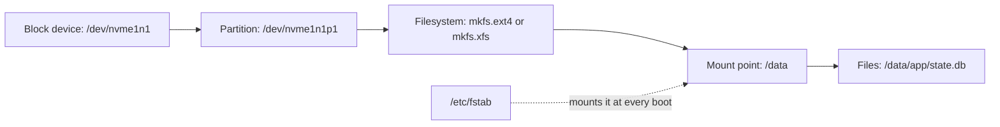

# Disks and filesystems

> **Status: AI draft, 2026-11-16.** Not yet verified by me. Commands and output were run in a throwaway container with a 2 MB RAM disk; addresses are rewritten to example ranges.

## In one line

A disk becomes usable through a chain: block device, partition, filesystem, mount point. "No space left on device" means either the blocks or the inodes ran out, and when `df` and `du` disagree, a deleted file is usually still held open by a process.

## The plain idea

A new disk is a long row of empty boxes with no labels. Before you can store a file on it, three things have to happen. You may divide it into sections (**partitions**). You lay out a system for keeping track of what is stored where (a **filesystem**). Then you attach it somewhere in the single directory tree, such as `/data`, so programs can reach it by path (**mounting**).

A filesystem keeps two separate budgets. One is space: the blocks that hold file contents. The other is **inodes**: the records that describe each file ([Shell and filesystem basics](shell-and-filesystem.md)). Either can run out first. A disk with gigabytes free can still refuse to create a file if it has no inodes left.

## How it works

### From device to path



1. **Block device.** The kernel shows each disk as a file under `/dev`, for example `/dev/sda` or `/dev/nvme1n1`. `lsblk` lists them as a tree.
2. **Partition.** An optional slice of the device (`/dev/nvme1n1p1`). Cloud data volumes are often used whole, with no partition.
3. **Filesystem.** `mkfs.ext4` or `mkfs.xfs` writes the structures that track inodes, free blocks and directories. This erases whatever was there.
4. **Mount.** `mount /dev/nvme1n1p1 /data` attaches the filesystem's root directory at `/data`. Whatever was in `/data` before is hidden until you unmount.
5. **Persist.** A line in `/etc/fstab` mounts it at every boot. Use the filesystem's UUID (from `blkid`) rather than the device name, because device names can change between boots.

### Filesystem types you will meet

| Type | What it is | Where you see it |
|---|---|---|
| ext4 | The long-standing Linux default, journaled | Ubuntu root disks, many data volumes |
| xfs | Journaled, strong with large files and parallel writes; can grow but not shrink | Amazon Linux and RHEL defaults |
| tmpfs | Lives in memory; gone on reboot | `/run`, `/dev/shm`, sometimes `/tmp` |
| overlayfs | Layers stacked into one view | Container images ([What a container is](../containers/what-is-a-container.md)) |
| nfs | A filesystem on another machine, over the network | Shared storage such as EFS ([EFS](../aws-services/efs.md)) |

A **journal** records what the filesystem is about to change, so after a crash it can finish or undo half-done operations instead of scanning the whole disk.

### Why `df` and `du` disagree

- `df` asks the **filesystem** how many blocks are in use.
- `du` walks the **directory tree** and adds up the files it can see by name.

When a file is deleted, its name goes at once, but its blocks are freed only when the last process holding it open closes it. Until then `du` cannot see it (no name) and `df` still counts it (blocks in use). The usual culprit is a log file deleted by hand while the service was still writing to it. `lsof +L1` lists open files with no remaining name.

The two can also disagree for smaller reasons: blocks reserved for root (5% by default on ext4), and files hidden underneath a mount point.

### Growing a volume

On a cloud server, making the volume bigger in the provider's console is only the first step. The operating system still sees the old partition and filesystem sizes.

1. `lsblk` to confirm the device is bigger.
2. `growpart /dev/nvme0n1 1` to grow partition 1, if there is a partition.
3. Grow the filesystem: `resize2fs /dev/nvme0n1p1` for ext4, or `xfs_growfs /` for xfs (it takes the mount point).

Both resize tools work while the filesystem is mounted.

**LVM** (Logical Volume Manager) adds a layer between disks and filesystems: disks become a pool, and you carve **logical volumes** out of it that can span disks and grow more easily. You will meet it on older servers more than on cloud instances.

## A concrete example

An alert fires: the root filesystem of an application server is at 100%.

1. `df -h` confirms `/` is full. `df -i` shows inodes are fine, so this is space.
2. `du -xh --max-depth=1 / | sort -h` finds the biggest directories without crossing into other mounts (`-x`). `/var/log` is the largest.
3. `du -sh /var/log/*` points at `app.log`, 18 GB. Someone deleted it ten minutes ago, yet `df` has not changed.
4. `lsof +L1` shows the Java process still holds `app.log (deleted)`. The space is not free and will not be until that process lets go.
5. Free it without a restart by truncating through the process's descriptor: `: > /proc/<pid>/fd/<fd>`. Or restart the service at a quiet moment.
6. Prevent it: [log rotation](logs.md) with a size limit, and an alert at 80%, not 100%.

## Why not just...?

- **...`rm` the big log file?** If the writer still has it open, the space is not freed and the log name is gone too, so you lose the evidence and gain nothing. Truncate it instead (`: > file` or `truncate -s 0 file`), or rotate it.
- **...reboot to free space?** It works, because every open file is closed, but you take an outage to fix what `lsof` would have shown in a second, and the cause is still there.
- **...mount by `/dev/sdb` in `/etc/fstab`?** Device names depend on detection order and can change after a reboot or a hardware change. A wrong or missing disk in `fstab` can stop the server from booting. Use `UUID=` and add `nofail` for disks that are not essential.

## Commands to know

Space, then a full filesystem:

```console
# df -h /mnt/small
Filesystem Size Used Avail Use% Mounted on
tmpfs 2.0M 0 2.0M 0% /mnt/small
# dd if=/dev/zero of=/mnt/small/big bs=1M count=3
2097152 bytes (2.1 MB, 2.0 MiB) copied, 0.00393833 s, 532 MB/s
# df -h /mnt/small
Filesystem Size Used Avail Use% Mounted on
tmpfs 2.0M 2.0M 0 100% /mnt/small
# du -sh /mnt/small/*
2.0M	/mnt/small/big
```

`dd` asked for 3 MB and stopped at 2 MB, when the filesystem filled.

A deleted file still held open:

```console
# sleep 600 < /mnt/small/held &
# rm /mnt/small/held
# df -h /mnt/small
Filesystem Size Used Avail Use% Mounted on
tmpfs 2.0M 1.0M 1.0M 50% /mnt/small
# du -sh /mnt/small
0	/mnt/small
# lsof +L1
COMMAND  PID USER   FD   TYPE DEVICE SIZE/OFF NLINK NODE NAME
sleep   2434 root    0r   REG   0,96  1048576     0    3 /mnt/small/held (deleted)
# kill 2434
# df -h /mnt/small
Filesystem Size Used Avail Use% Mounted on
tmpfs 2.0M 0 2.0M 0% /mnt/small
```

`df` counts 1 MB that `du` cannot find. `lsof +L1` lists open files whose link count is below 1, meaning no name is left. When the process ended, the space came back.

Out of inodes with space to spare:

```console
# touch /mnt/small/f64
touch: cannot touch '/mnt/small/f64': No space left on device
# df -h /mnt/small
Filesystem Size Used Avail Use% Mounted on
tmpfs 2.0M 0 2.0M 0% /mnt/small
# df -i /mnt/small
Filesystem Inodes IUsed IFree IUse% Mounted on
tmpfs 64 64 0 100% /mnt/small
```

The error says "space", but the space is 0% used. Only `df -i` shows the real cause.

What is mounted where, and with which options:

```console
# findmnt /mnt/small
TARGET     SOURCE FSTYPE OPTIONS
/mnt/small tmpfs  tmpfs  rw,nosuid,nodev,noexec,relatime,size=2048k,nr_inodes=64,inode64
```

| Command | What it does |
|---|---|
| `lsblk -f` | Devices and partitions as a tree, with filesystem type, UUID and mount point. |
| `blkid` | Filesystem type and UUID of each device. |
| `mount`, `umount` | Attach or detach a filesystem. `umount` fails with "target is busy" while files are open; `lsof +D <dir>` shows by whom. |
| `du -xh --max-depth=1 /` | Size of each top-level directory on this filesystem only. |
| `ncdu` | An interactive `du`, if installed. |
| `mount -a` | Mount everything in `/etc/fstab`; run it after editing the file to catch mistakes before a reboot does. |

## How it breaks

| Symptom | Layer | Check | Likely cause |
|---|---|---|---|
| `No space left on device`, `df -h` at 100% | Blocks | `du -xh --max-depth=1 /` then drill down | Logs, core dumps, old releases, container images |
| `No space left on device`, `df -h` shows space | Inodes | `df -i` | Millions of small files: a cache, a mail spool, session files |
| `df` full but `du` adds up to much less | Open deleted files | `lsof +L1` | A deleted log still held open by a running process |
| Volume resized in the cloud, `df` shows the old size | Partition or filesystem | `lsblk` vs `df -h` | `growpart` and `resize2fs` or `xfs_growfs` not run |
| Server does not boot after adding a disk | `/etc/fstab` | Console or rescue mode, read `/etc/fstab` | Wrong device name or UUID, missing `nofail` |
| `umount: target is busy` | Open files | `lsof +D /data`; `fuser -vm /data` | A process, or a shell, is using a path inside it |

## Interview questions

**1. Walk through what it takes to use a new disk on a Linux server.**

<details markdown="1">
<summary>Answer</summary>

- Find it with `lsblk`; optionally partition it.
- Create a filesystem with `mkfs.ext4` or `mkfs.xfs`.
- Mount it on a directory and check with `df -h` or `findmnt`.
- Add it to `/etc/fstab` by UUID, ideally with `nofail`, and test with `mount -a`.

</details>

**2. What is the difference between `df` and `du`?**

<details markdown="1">
<summary>Answer</summary>

- `df` reports what the filesystem says is used and free.
- `du` adds up the sizes of files it can reach by name.
- They differ when deleted files are still open, when files hide under a mount point, or because of reserved blocks.

</details>

**3. A disk shows 100% in `df`, but `du` finds only half of that. What is happening and how do you fix it?**

<details markdown="1">
<summary>Answer</summary>

- A file was deleted while a process still has it open, so its blocks are still in use.
- `lsof +L1` shows which process and file.
- Restart or signal the process to reopen its log, or truncate through `/proc/<pid>/fd/<fd>`.
- Prevent with proper log rotation.

</details>

**4. "No space left on device", but `df -h` shows 40% free. What do you check?**

<details markdown="1">
<summary>Answer</summary>

- `df -i`: the filesystem may be out of inodes.
- Find directories with huge numbers of small files, for example by counting entries per directory.
- Clean them up, or recreate the filesystem with more inodes; xfs allocates inodes dynamically, ext4 fixes the count at creation.

</details>

**5. You enlarged a cloud volume from 50 GB to 100 GB, but the server still shows 50 GB. Why?**

<details markdown="1">
<summary>Answer</summary>

- The block device grew, but the partition and the filesystem did not.
- `growpart` grows the partition.
- `resize2fs` (ext4, takes the device) or `xfs_growfs` (xfs, takes the mount point) grows the filesystem, online.

</details>

**6. What is the safe way to clear a huge log file that a running service is writing to?**

<details markdown="1">
<summary>Answer</summary>

- Truncate it in place: `truncate -s 0 app.log` or `: > app.log`. The service keeps its open file and the space is freed.
- Do not `rm` it: the space stays used until the service closes the file.
- Fix the cause with logrotate, using `copytruncate` or a reopen signal.

</details>

**7. Why should `/etc/fstab` use UUIDs, and what does `nofail` do?**

<details markdown="1">
<summary>Answer</summary>

- Device names such as `/dev/sdb` depend on detection order and can change; a UUID identifies the filesystem itself.
- `nofail` lets the boot continue if that device is missing.
- Without it, a missing data disk can leave the server stuck in emergency mode.

</details>

## Try it

**Step 1.** Start a container with a tiny RAM disk: 2 MB and 64 inodes.

```bash
docker run --rm -it --tmpfs /mnt/small:size=2m,nr_inodes=64 ubuntu:24.04 bash
apt-get update -qq && apt-get install -y -qq lsof
```

**Step 2.** Hold a file open, delete it, and compare. Predict what `df` and `du` each say before you run them.

```bash
dd if=/dev/zero of=/mnt/small/held bs=1M count=1
sleep 600 < /mnt/small/held &
rm /mnt/small/held
df -h /mnt/small; du -sh /mnt/small; lsof +L1
kill %1; df -h /mnt/small
```

**Step 3.** Run out of inodes. Predict which `df` shows the problem.

```bash
for i in $(seq 1 80); do touch /mnt/small/f$i || break; done
df -h /mnt/small; df -i /mnt/small
```

**Step 4.** Type `exit`. The container is deleted.

## Zoom out

The same chain of device, filesystem and mount comes back in the cloud ([EBS](../aws-services/ebs.md), [EFS](../aws-services/efs.md)) and in Kubernetes, where a volume is attached and mounted into a pod for you ([Storage](../kubernetes/storage.md)). A full disk stops databases, logging and deploys at once. The principle to carry: when the numbers disagree, ask which tool is counting what.

## Sources

- [df(1) manual page](https://man7.org/linux/man-pages/man1/df.1.html)
- [du(1) manual page](https://man7.org/linux/man-pages/man1/du.1.html)
- [lsof manual page](https://manpages.ubuntu.com/manpages/noble/man8/lsof.8.html)
- [fstab(5) manual page](https://man7.org/linux/man-pages/man5/fstab.5.html)
- [mount(8) manual page](https://man7.org/linux/man-pages/man8/mount.8.html)
- [resize2fs(8) manual page](https://man7.org/linux/man-pages/man8/resize2fs.8.html)
- [xfs_growfs(8) manual page](https://man7.org/linux/man-pages/man8/xfs_growfs.8.html)
- [Amazon EC2 documentation: extend the file system after resizing a volume](https://docs.aws.amazon.com/ebs/latest/userguide/recognize-expanded-volume-linux.html)
