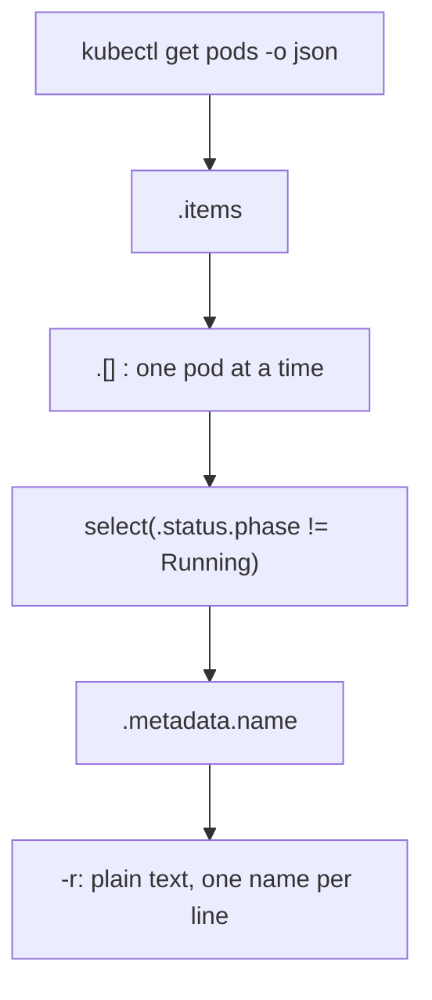

# jq and yq

> **Status: AI draft, 2026-11-16.** Not yet verified by me. Commands and output were run in throwaway containers (jq 1.7 on Ubuntu 24.04, and the mikefarah yq v4 image) on sample data.

## In one line

`jq` filters and reshapes JSON the way `grep` and `awk` handle text: `.field` picks, `.[]` iterates, `select()` filters, `|` chains. `yq` (mikefarah's) does the same for YAML, including editing a file in place, which is how pipelines bump an image tag.

## The plain idea

Most DevOps tools speak JSON or YAML: `kubectl -o json`, the AWS CLI, Terraform's `show -json`, Helm values, Kubernetes manifests, GitHub Actions workflows. Text tools such as `grep` see these as lines and get confused by nesting. **jq** understands the structure: you describe a path through the data, and it returns what is there.

A jq program is a **filter**: something that takes a value in and puts values out. Filters chain with `|`, exactly like shell pipes, except that what flows between them is JSON, not lines.

## How it works



### The pieces you use daily

| Filter | Meaning |
|---|---|
| `.` | The whole input |
| `.metadata.name` | A field inside a field |
| `.items[0]` | The first element of an array |
| `.items[]` | Each element, one after another |
| `select(cond)` | Keep the input only if `cond` is true |
| `[ ... ]` | Collect outputs into an array |
| `{name: .metadata.name}` | Build a new object |
| `length`, `keys`, `map(f)`, `sort_by(f)`, `group_by(f)` | Common functions |
| `a // b` | `a`, or `b` if `a` is null or false: a default value |
| `@tsv`, `@csv` | Format an array as one tab- or comma-separated line |

Two filters joined by a pipe, as in `.items[] | .metadata.name`, feed every output of the first into the second.

Flags that matter: `-r` prints strings without quotes (needed when the result feeds another command), `-c` prints each result on one line, and `--arg name value` passes a shell value in safely as `$name`.

### Quoting

The jq program goes in **single quotes** so the shell leaves `$`, `|` and `"` alone. To use a shell variable, pass it with `--arg` instead of pasting it into the program: `jq --arg app "$APP" '.items[] | select(.metadata.labels.app == $app)'`. Pasting breaks on quotes in the value and can change the program's meaning.

### yq

There are two different tools called `yq`. This page uses **mikefarah's yq** (version 4), a single binary with jq-like syntax that edits YAML while keeping its layout. The other, a Python wrapper around jq, is what Ubuntu's `yq` package installs; its options differ. Check with `yq --version`.

| Task | Command |
|---|---|
| Read a value | `yq '.spec.replicas' deploy.yaml` |
| Change values in place | `yq -i '.spec.replicas = 3' deploy.yaml` |
| Convert YAML to JSON | `yq -o json '.' deploy.yaml` |
| Use an environment variable | `TAG=1.5.0 yq -i '.image.tag = strenv(TAG)' values.yaml` |

`kubectl` has its own `-o jsonpath='{...}'` output, and the AWS CLI has `--query` with JMESPath syntax. Both work for simple reads without extra tools; jq is more capable and the same everywhere.

## A concrete example

A CI job must update the image tag in a GitOps repository after a build ([Promotion, rollback and troubleshooting](../gitops/promotion-and-rollback.md)).

1. The build produced `sample-app:1.5.0`.
2. The job edits only that field: `yq -i '.spec.template.spec.containers[0].image = "sample-app:1.5.0"' deploy.yaml`.
3. `git diff` shows exactly one changed line, because yq kept the file's layout and comments.
4. The job commits and opens a pull request; Argo CD deploys it after the merge.

A `sed` replacement would also change one line, but it matches text, not structure: it can hit the wrong `image:` line in a file with several containers, and breaks silently if the formatting changes.

## Why not just...?

- **...`grep` the JSON?** JSON can be on one line, or split across lines in any way; field order is not fixed; and the same key appears at many depths. `grep` cannot tell which `"name"` belongs to which object.
- **...paste a shell variable into the jq program?** A value containing a quote breaks the program, and a crafted value can change what it does. `--arg` passes the value as data.
- **...edit YAML with `sed`?** It works until indentation, comments, or a second matching line appear. yq edits the field you name.

## Commands to know

The sample input is a trimmed `kubectl get pods -o json` with three pods.

Count, list, and filter:

```console
# jq '.items | length' pods.json
3
# jq -r '.items[].metadata.name' pods.json
sample-app-7d9f-abcde
sample-app-7d9f-fghij
worker-5c4b-klmno
# jq -r '.items[] | select(.status.phase != "Running") | .metadata.name' pods.json
worker-5c4b-klmno
```

A table with a default for a missing value:

```console
# jq -r '.items[] | [.metadata.name, (.status.containerStatuses[0].restartCount // 0)] | @tsv' pods.json
sample-app-7d9f-abcde	0
sample-app-7d9f-fghij	4
worker-5c4b-klmno	0
```

The pending pod has no container statuses yet, so `// 0` supplies a value.

Group and count, and pass a value in from the shell:

```console
# jq '[.items[] | .metadata.labels.app] | group_by(.) | map({app: .[0], count: length})' pods.json
[
  {
    "app": "sample-app",
    "count": 2
  },
  {
    "app": "worker",
    "count": 1
  }
]
# jq -c --arg app worker '.items[] | select(.metadata.labels.app == $app) | {name: .metadata.name, phase: .status.phase}' pods.json
{"name":"worker-5c4b-klmno","phase":"Pending"}
```

A missing field gives `null`, not an error:

```console
# jq '.items[0].metadata.missing' pods.json
null
# jq -r '.items[0].metadata.missing // "none"' pods.json
none
```

yq on a Deployment manifest:

```console
$ yq '.spec.replicas' deploy.yaml
2
$ yq '.spec.template.spec.containers[0].image' deploy.yaml
sample-app:1.4.0
$ yq '.spec.template.spec.containers[0].image = "sample-app:1.5.0" | .spec.replicas = 3' deploy.yaml
apiVersion: apps/v1
kind: Deployment
metadata:
  name: sample-app
spec:
  replicas: 3
  template:
    spec:
      containers:
        - name: app
          image: sample-app:1.5.0
$ yq -o json '.metadata' deploy.yaml
{
  "name": "sample-app"
}
```

Without `-i`, yq prints the edited document; with `-i` it writes it back.

Everyday uses:

| Command | What it does |
|---|---|
| `kubectl get pods -o json`, piped into `jq -r '.items[].metadata.name'` | Pod names, ready for a loop. |
| `aws ec2 describe-instances --query 'Reservations[].Instances[].InstanceId' --output text` | The same idea with the AWS CLI's built-in JMESPath. |
| `terraform show -json plan.out`, piped into `jq '.resource_changes[].change.actions'` | What a saved plan will do to each resource ([Reading a plan](../iac/reading-a-plan.md)). |
| `jq -e '.ready == true'` | Sets the exit code from the result: useful in scripts and health checks. |

## How it breaks

| Symptom | Layer | Check | Likely cause |
|---|---|---|---|
| `parse error: Invalid numeric literal` | Input | Look at the first lines of the input | The input is not JSON: an error message, HTML, or YAML |
| Output has quotes around every value | Output format | Was `-r` used? | Without `-r`, strings are printed as JSON |
| `Cannot iterate over null` | Path | Print the parent: `jq '.items[0]'` | A field on the path is missing for some elements |
| A filter works by hand but not in a script | Shell quoting | `bash -x` to see the program jq received | Double quotes let the shell expand `$` and `!` inside the program |
| `yq` says unknown flag or command | Tool | `yq --version` | The Python `yq` is installed, not mikefarah's |
| `kubectl -o jsonpath` gives nothing | Syntax | Compare with jq on `-o json` | JSONPath syntax differs from jq; braces and `range` are needed for lists |

## Interview questions

**1. How do you list the names of all pods that are not Running, using `kubectl` and `jq`?**

<details markdown="1">
<summary>Answer</summary>

- `kubectl get pods -o json`, piped into a jq filter.
- Filter: `.items[] | select(.status.phase != "Running") | .metadata.name`.
- Add `-r` so the names print without quotes.

</details>

**2. What do `-r`, `-c` and `--arg` do in jq?**

<details markdown="1">
<summary>Answer</summary>

- `-r` prints strings raw, without JSON quotes.
- `-c` prints each output on one compact line.
- `--arg name value` passes a shell value in as `$name`, safely, as data.

</details>

**3. How do you give a default when a field might be missing?**

<details markdown="1">
<summary>Answer</summary>

- The alternative operator: `.field // "default"`.
- It returns the right side when the left is null or false.
- Careful: a real `false` is also replaced.

</details>

**4. Why use yq instead of sed to change an image tag in a manifest?**

<details markdown="1">
<summary>Answer</summary>

- yq edits a named field in the YAML structure; sed matches text.
- sed can hit the wrong line when several containers or similar keys exist, and breaks when the layout changes.
- yq keeps the rest of the file, including comments, so the diff stays one line.

</details>

**5. A script runs `jq ".items[] | select(.name == \"$NAME\")"` and breaks for some values. Why, and what is the fix?**

<details markdown="1">
<summary>Answer</summary>

- The shell pastes the value into the program; a quote or backslash in it breaks the jq syntax, and a crafted value can change the filter.
- Use single quotes for the program and `--arg name "$NAME"`, then compare with `$name`.

</details>

**6. How would you see which resources a Terraform plan will destroy, from a script?**

<details markdown="1">
<summary>Answer</summary>

- Save the plan, then `terraform show -json plan.out`.
- Filter with jq for resource changes whose actions include `delete`: `.resource_changes[] | select(.change.actions | index("delete")) | .address`.
- Fail the pipeline if the list is not empty, unless the deletion was expected.

</details>

## Try it

**Step 1.** Start a container and install jq.

```bash
docker run --rm -it ubuntu:24.04 bash
apt-get update -qq && apt-get install -y -qq jq
```

**Step 2.** Make a small list of services, then predict the output of each filter before running it.

```bash
echo '[{"name":"web","port":80,"up":true},{"name":"db","port":5432,"up":false},{"name":"cache","port":6379}]' > s.json
jq 'length' s.json
jq -r '.[] | select(.up == false) | .name' s.json
jq -r '.[] | "\(.name) \(.up // "unknown")"' s.json
```

`\(...)` inside a string inserts a value.

**Step 3.** Type `exit`. The container is deleted.

## Zoom out

JSON and YAML are how tools talk to each other, so jq and yq sit in the middle of scripts and pipelines: reading `kubectl` and AWS output, checking Terraform plans, and editing manifests for GitOps ([CI/CD concepts](../cicd/concepts.md)). Without them, scripts scrape text and break when the format shifts. The principle to carry: work with the structure, not with the text that happens to represent it.

## Sources

- [jq manual](https://jqlang.org/manual/)
- [mikefarah yq documentation](https://mikefarah.gitbook.io/yq)
- [Kubernetes documentation: JSONPath support in kubectl](https://kubernetes.io/docs/reference/kubectl/jsonpath/)
- [AWS CLI documentation: filtering output with --query](https://docs.aws.amazon.com/cli/latest/userguide/cli-usage-filter.html)
- [Terraform documentation: JSON output format](https://developer.hashicorp.com/terraform/internals/json-format)
