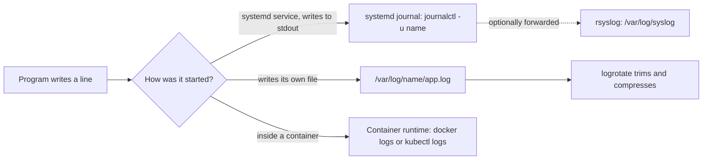

# Logs

> **Status: AI draft, 2026-11-16.** Not yet verified by me. Commands and output were run in a throwaway container; addresses are rewritten to example ranges. A plain container has no systemd journal, so `journalctl` appears as commands only, without output.

## In one line

Logs live in three places: the systemd journal (`journalctl`), files under `/var/log`, and a container's stdout. Read them by narrowing the time window first, then finding the first error, and keep them from filling the disk with rotation.

## The plain idea

A log is a program's diary: one line per event, with a time. When something breaks, the log is usually the only record of what the program saw just before. Two skills matter. Knowing **where** a given program writes, because there are several possible places, and knowing **how to read** a large log under pressure without drowning in it.

The third skill is housekeeping. Logs grow forever unless something trims them, and a full disk is one of the most common self-inflicted outages ([Disks and filesystems](disks-and-filesystems.md)).

## How it works

### Where a log line can end up



| Source | How to read it | Notes |
|---|---|---|
| **systemd journal** | `journalctl` | Binary, indexed store. Captures each service's stdout and stderr, plus kernel messages. May be lost on reboot unless stored on disk (`/var/log/journal`). |
| **`/var/log` files** | `less`, `tail -f`, `grep` | Written by the program itself or by **rsyslog**. Common files: `syslog` or `messages` (general), `auth.log` or `secure` (logins and sudo), `kern.log`, `dpkg.log` or the dnf log (package changes). |
| **Container stdout** | `docker logs`, `kubectl logs` | The runtime saves what the container prints ([How Kubernetes logging works](../observability/kubernetes-logging.md)). |

### Severity

Syslog defined eight severity levels, which journald also uses. From most to least severe: `emerg` (0), `alert` (1), `crit` (2), `err` (3), `warning` (4), `notice` (5), `info` (6), `debug` (7). `journalctl -p err` shows level 3 and anything more severe.

### Rotation

**logrotate** runs daily (from a cron job or a systemd timer), renames the current file, optionally compresses old ones, and deletes the oldest. The hard part is the program that is still writing:

| Method | How it works | Trade-off |
|---|---|---|
| `create` with a `postrotate` signal | Rename `app.log` to `app.log.1`, create a new `app.log`, then tell the program to reopen its file (often SIGHUP or a reload) | Clean, but the program must support reopening. |
| `copytruncate` | Copy `app.log` to `app.log.1`, then empty `app.log` in place | Works with any program, but lines written between the copy and the truncate are lost. |

Without either, the program keeps writing to the renamed file (it holds the file open, not the name), and the new `app.log` stays empty.

### Structured logs

A line such as `level=error user=42 order=9001 msg="payment failed"`, or the same as JSON, can be filtered by field instead of by guessing at text. Log pipelines can index each field, and `jq` can query JSON logs on the command line ([jq and yq](jq-and-yq.md)).

## A concrete example

At 14:05 users report that checkout fails. The service runs under systemd.

1. **Narrow the window.** `journalctl -u checkout --since "14:00" --until "14:10"`. Ten minutes instead of ten days.
2. **Find the first error, not the loudest.** `journalctl -u checkout --since "14:00" -p err`, then read upwards from the first one. Later errors are often consequences of the first.
3. **Follow a request.** If the error line carries a request ID, `grep` for that ID across this log and the upstream service's log to see the whole path.
4. **Check the neighbours.** `journalctl -k --since "14:00"` for kernel messages such as an OOM kill. `journalctl --since "14:00" -p warning` without `-u`, to see what else happened on the machine.
5. **Watch live while you test a fix:** `journalctl -u checkout -f`.

## Why not just...?

- **...`cat` the whole log and scroll?** A busy service writes thousands of lines a minute. Narrow by time first, then by severity, then by text.
- **...delete old logs by hand when the disk fills?** A deleted file the program still has open keeps its space, and the next time nobody remembers. Configure rotation once, with a size or age limit.
- **...log everything at debug level, just in case?** Debug logs cost disk, network and money in a log pipeline, and bury the lines that matter. Log at info, and raise the level temporarily when investigating.

## Commands to know

Reading the journal (no output shown, because a plain container has no journal):

| Command | What it shows |
|---|---|
| `journalctl -u nginx` | Everything the `nginx` unit logged. |
| `journalctl -u nginx -f` | Follow new lines as they arrive. |
| `journalctl -u nginx --since "1 hour ago"` | A time window. Also `--since "2026-11-16 14:00" --until "14:10"`. |
| `journalctl -p err -b` | Errors and worse since this boot. `-b -1` is the previous boot. |
| `journalctl -k` | Kernel messages, the same as `dmesg`. |
| `journalctl -u nginx -o json-pretty -n 1` | The last entry with every field the journal stored. |
| `journalctl --disk-usage` | How much space the journal uses. `--vacuum-size=500M` trims it. |

Reading files:

| Command | What it does |
|---|---|
| `tail -n 100 app.log` | The last 100 lines. |
| `tail -F app.log` | Follow the file, and keep following after it is rotated (capital `F`). |
| `less +F app.log` | Follow inside `less`. Ctrl+C stops following so you can scroll and search with `/`. |
| `zgrep ERROR app.log.2.gz` | Search a compressed rotated log without unpacking it. |
| `grep -c ERROR app.log` | Count error lines ([Text tools](text-tools.md)). |

What `/var/log` holds in a minimal Ubuntu container:

```console
# ls /var/log
README
alternatives.log
apt
bootstrap.log
btmp
dpkg.log
faillog
journal
lastlog
private
wtmp
```

A logrotate rule, run three times by force:

```console
# cat /etc/logrotate.d/sample-app
/var/log/sample-app/*.log {
    daily
    rotate 7
    compress
    delaycompress
    missingok
    notifempty
    copytruncate
}
# logrotate -f /etc/logrotate.d/sample-app
# ls -l /var/log/sample-app
-rw-r--r-- 1 root root 0 Nov 16 03:01 app.log
-rw-r--r-- 1 root root 21 Nov 16 03:01 app.log.1
# logrotate -f /etc/logrotate.d/sample-app
# echo "x" >> /var/log/sample-app/app.log
# logrotate -f /etc/logrotate.d/sample-app
# ls -1 /var/log/sample-app
app.log
app.log.1
app.log.2.gz
```

| Directive | Meaning |
|---|---|
| `daily` | Rotate once a day. Also `weekly`, `monthly`, or `size 100M`. |
| `rotate 7` | Keep 7 old files; delete older ones. |
| `compress`, `delaycompress` | Compress old files, but leave the newest old one (`app.log.1`) uncompressed for one more cycle. |
| `missingok`, `notifempty` | No error if the log is missing; skip it if it is empty. That is why the second forced run, on an empty file, did nothing. |
| `copytruncate` | Copy then empty the live file, instead of renaming it. |

`logrotate -d <file>` shows what it would do without doing it.

## How it breaks

| Symptom | Layer | Check | Likely cause |
|---|---|---|---|
| The new `app.log` stays empty after rotation | Rotation | `lsof <old file>` shows the program still writing to it | Neither `copytruncate` nor a reopen signal is configured |
| Logs from before a reboot are gone | Journal storage | `ls /var/log/journal`; `journalctl --list-boots` | The journal is kept only in memory |
| Disk full of logs | Rotation | `du -sh /var/log/*`; `logrotate -d` | No rule for that file, or a size far too large between daily runs |
| `journalctl -u app` is empty | Where it logs | `systemctl cat app`; the app's config | The program writes to its own file, not stdout |
| Timestamps do not line up between two services | Time | `timedatectl` on both hosts | Clocks out of sync, or one logs local time and the other UTC |

## Interview questions

**1. Where do logs go on a modern Linux server?**

<details markdown="1">
<summary>Answer</summary>

- The systemd journal, which captures services' stdout and stderr and kernel messages; read with `journalctl`.
- Files under `/var/log`, written by programs themselves or by rsyslog.
- For containers, the runtime's log of each container's stdout, read with `docker logs` or `kubectl logs`.

</details>

**2. How do you see only errors from one service in the last hour?**

<details markdown="1">
<summary>Answer</summary>

- `journalctl -u <service> --since "1 hour ago" -p err`.
- `-p err` includes everything more severe than err as well.
- Add `-f` to keep following.

</details>

**3. What is the difference between `copytruncate` and rotating with a reopen signal?**

<details markdown="1">
<summary>Answer</summary>

- With a signal, the file is renamed, a new one created, and the program told to reopen; nothing is lost, but the program must support it.
- `copytruncate` copies the file then empties it in place; it works with any program, but lines written in between are lost.
- Without either, the program keeps writing to the renamed file.

</details>

**4. You are paged at 3 a.m. for a failing service. How do you read its logs efficiently?**

<details markdown="1">
<summary>Answer</summary>

- Narrow to the time window around the first alert.
- Filter by severity, then find the first error and read the lines just before it.
- Follow a request ID across services if there is one.
- Check kernel messages and other services on the host for OOM kills, disk errors or restarts.

</details>

**5. After logrotate ran, the application's log file is empty but the application is clearly busy. Why?**

<details markdown="1">
<summary>Answer</summary>

- The program holds the old file open and keeps writing to it under its new name, `app.log.1`.
- logrotate created a new empty `app.log` that nobody writes to.
- Fix: add `copytruncate`, or a `postrotate` command that makes the program reopen its log.

</details>

**6. Why are structured logs better than free-text logs?**

<details markdown="1">
<summary>Answer</summary>

- Each value has a named field, so you can filter and aggregate by field instead of guessing at text patterns.
- Log pipelines can index fields, which makes searches fast and reliable.
- Tools such as `jq` can query JSON logs directly.

</details>

## Try it

**Step 1.** Start a container, install logrotate and create a log.

```bash
docker run --rm -it ubuntu:24.04 bash
apt-get update -qq && apt-get install -y -qq logrotate
mkdir -p /var/log/sample-app && seq 1 3 > /var/log/sample-app/app.log
```

**Step 2.** Write a rule, then ask logrotate what it would do, without doing it.

```bash
printf '/var/log/sample-app/*.log {\n  rotate 2\n  compress\n  delaycompress\n  copytruncate\n}\n' > /etc/logrotate.d/sample-app
logrotate -d /etc/logrotate.d/sample-app
```

**Step 3.** Predict the file names after each forced run, then run it three times, adding a line in between.

```bash
logrotate -f /etc/logrotate.d/sample-app; echo x >> /var/log/sample-app/app.log; ls /var/log/sample-app
```

**Step 4.** Type `exit`. The container is deleted.

## Zoom out

On a server, logs come through the journal and `/var/log`; in a cluster, the same lines are collected by an agent and shipped to a central store ([Fluent Bit](../observability/fluent-bit.md), [OpenSearch](../observability/opensearch.md)). Without logs, an incident is guesswork. The principle to carry: narrow the time window first, then find the first error, not the loudest one.

## Sources

- [journalctl(1) manual page](https://www.freedesktop.org/software/systemd/man/latest/journalctl.html)
- [journald.conf(5): journal storage](https://www.freedesktop.org/software/systemd/man/latest/journald.conf.html)
- [logrotate(8) manual page](https://man7.org/linux/man-pages/man8/logrotate.8.html)
- [RFC 5424: the syslog protocol and severity levels](https://www.rfc-editor.org/rfc/rfc5424)
- [tail(1) manual page](https://man7.org/linux/man-pages/man1/tail.1.html)
