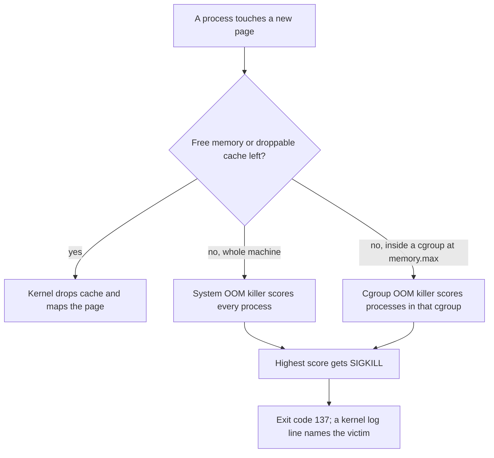

# Memory and the OOM killer

> **Status: AI draft, 2026-11-16.** Not yet verified by me. Commands and output were run in a throwaway container; addresses are rewritten to example ranges.

## In one line

Linux uses spare memory as cache, so "free" is the wrong number to watch: "available" is the right one. When a process or a cgroup runs out, the kernel's OOM killer ends a process with SIGKILL, which shows up as exit code 137 and, in containers, `OOMKilled`.

## The plain idea

Memory that holds nothing is wasted, so Linux fills idle memory with copies of files it has read recently. That is the **page cache**. When a program needs memory, the kernel quietly drops some cache and hands it over. A server showing almost no "free" memory is usually healthy; it is using the spare room as a cache.

Real trouble starts when programs ask for more than the machine, or their own limit, can give, and there is no cache left to drop. The kernel then has to choose: crash, or end something. It ends something. The part of the kernel that picks the victim is the **OOM killer** (out of memory).

## How it works

### Two sizes for every process

| Measure | Meaning |
|---|---|
| **VSZ** (virtual size) | Everything the process has asked for or mapped, including memory it has not touched yet and shared libraries. Usually large and mostly harmless. |
| **RSS** (resident set size) | The memory the process is actually using in RAM right now, including shared pages. The number to watch. |

Programs can reserve more than exists, because the kernel only finds real memory when a page is first touched. This is **overcommit**. It lets many programs start with generous reservations, and it is also why running out happens later, at a surprising moment, instead of at the request.

### Reading `free`

```console
$ free -h
               total        used        free      shared  buff/cache   available
Mem:            14Gi       4.2Gi       7.0Gi        96Mi       3.6Gi        10Gi
Swap:          4.0Gi          0B       4.0Gi
```

| Column | Meaning |
|---|---|
| `used` | Memory held by processes and the kernel. |
| `free` | Memory holding nothing at all. |
| `buff/cache` | The page cache and kernel buffers. Most of it can be dropped on demand. |
| `available` | The kernel's estimate of how much a new program could get without swapping. **This is the number to alert on.** |

**Swap** is disk space used as overflow. Pages that have not been touched for a while can be moved out, freeing RAM for active work. Reading them back is thousands of times slower than RAM, so a machine that swaps constantly feels frozen. `swappiness` (0 to 200, default 60) sets how willing the kernel is to swap rather than drop cache. Kubernetes nodes have traditionally run with swap off.

### The OOM killer



The kernel gives each process an **oom_score**, mostly from how much memory it uses. You can bias it with `oom_score_adj` (-1000 to 1000) in `/proc/<pid>/`; -1000 exempts a process entirely. The victim gets SIGKILL, so it cannot clean up ([Processes and signals](processes-and-signals.md)), and its exit code is 128 + 9 = 137.

### cgroups: memory limits per group of processes

A **cgroup** (control group) is a kernel feature that groups processes and limits what the group can use. Containers are built on it ([What a container is](../containers/what-is-a-container.md)). In cgroup version 2 the memory files are:

| File | Meaning |
|---|---|
| `memory.max` | The hard limit. Above it, the cgroup's own OOM killer acts, even if the host has plenty free. `max` means no limit. |
| `memory.high` | A softer limit: above it the kernel slows the group down and reclaims harder. |
| `memory.current` | What the group uses now, page cache included. |
| `memory.events` | Counters: `max` (times the limit was hit), `oom`, `oom_kill`. |

`docker run -m 64m` sets `memory.max`. A Kubernetes memory **limit** does the same for a container ([Requests, limits and QoS](../kubernetes/resources-and-qos.md)). That is why a container can be OOM-killed on a machine with gigabytes free: it hit its own ceiling, not the machine's.

## A concrete example

A Java service in a container restarts every few hours. `docker inspect` shows `ExitCode=137` and `OOMKilled=true`. The container limit is 1 GiB and the JVM heap is set to 1 GiB.

1. The heap is only part of a JVM's memory. Thread stacks, class metadata, the JIT compiler and direct buffers come on top, so the process outgrows 1 GiB once the heap fills.
2. The kernel sees the cgroup reach `memory.max` and kills the biggest process in it: the JVM.
3. `free` inside the container is no help: it reads the host's numbers, not the container's limit.
4. Fix: keep the heap well below the limit (for example 75%, using `-XX:MaxRAMPercentage` so the JVM sizes itself from the cgroup limit), or raise the limit after measuring real use.
5. Watch `memory.events` or the container's memory metrics against its limit, so the next leak shows as a trend before it becomes a kill.

## Why not just...?

- **...alert when `free` is low?** On a healthy server `free` is low by design: the rest is cache. You would alert constantly. Alert on `available`, or on a cgroup's use against its limit.
- **...add a lot of swap so nothing is ever killed?** The machine survives but becomes so slow that health checks fail anyway, and the problem is harder to see. A quick, clear kill is often easier to operate than a slow death.
- **...set `oom_score_adj` to -1000 on the application?** The kernel will then kill something else, perhaps the SSH daemon or the log agent, and the machine is left unmanageable while the real culprit keeps growing.

## Commands to know

`free` inside a container shows the host, not the limit:

```console
# cat /sys/fs/cgroup/memory.max
max
# free -h
               total        used        free      shared  buff/cache   available
Mem:            14Gi       4.2Gi       7.0Gi        96Mi       3.6Gi        10Gi
```

This container had no limit, so `memory.max` says `max`.

A real OOM kill in a container limited to 64 MiB. `tail /dev/zero` keeps reading a stream that never contains a newline, so its buffer grows without end:

```console
$ docker run --name oom-demo -m 64m --memory-swap 64m ubuntu:24.04 bash -c 'cat /sys/fs/cgroup/memory.max; tail /dev/zero'
67108864
$ echo "exit code: $?"
exit code: 137
$ docker inspect oom-demo --format 'OOMKilled={{.State.OOMKilled}} ExitCode={{.State.ExitCode}}'
OOMKilled=true ExitCode=137
```

`-m 64m` sets `memory.max` to 67108864 bytes. `--memory-swap 64m` makes memory plus swap 64 MiB, so no swap at all.

The cgroup's own counters, read from inside a limited container after the kill:

```console
# cat /sys/fs/cgroup/memory.events
low 0
high 0
max 71
oom 2
oom_kill 1
oom_group_kill 0
sock_throttled 0
```

The limit was reached 71 times, and one process was killed.

| Command | What it does |
|---|---|
| `ps aux --sort=-rss` | Processes sorted by memory use, largest first. |
| `top`, then `M` | Live view sorted by memory. |
| `cat /proc/<pid>/status` | `VmRSS`, `VmSwap` and more for one process. |
| `cat /proc/<pid>/oom_score` | The kernel's current kill score for it. |
| `journalctl -k` or `dmesg -T`, searching for `oom` | The kernel's record of each kill: which process, how much memory it held, which cgroup. |
| `vmstat 1` | Columns `si` and `so` show swapping in and out each second. |
| `docker stats` | Each container's memory use against its limit. |

## How it breaks

| Symptom | Layer | Check | Likely cause |
|---|---|---|---|
| Exit code 137, `OOMKilled: true` | Cgroup limit | `docker inspect`; `kubectl describe pod`; `memory.events` | The container's limit is lower than what the program really uses |
| A process vanishes, kernel log mentions `Out of memory: Killed process` | Whole machine | `journalctl -k` or `dmesg -T` | The machine ran out; the biggest user was chosen |
| Everything slow, disk busy, `si` and `so` non-zero | Swap | `vmstat 1`; `free -h` | Working set larger than RAM; the machine is thrashing |
| Memory use climbs steadily until a kill, every few hours | Application | RSS over time; heap dumps | A leak |
| An alert on low free memory with no visible problem | Monitoring | Compare `free` with `available` | The alert watches the wrong number |
| A JVM or Node.js process killed although its heap limit is below the container limit | Runtime overhead | RSS against the heap setting | Non-heap memory (stacks, metadata, buffers) pushes the total over |

## Interview questions

**1. `free -h` shows 200 MiB free on a 16 GiB server. Is that a problem?**

<details markdown="1">
<summary>Answer</summary>

- Not by itself: Linux uses spare memory as page cache, which it drops on demand.
- Look at `available`, the estimate of memory a new program could get.
- Also look for swapping (`vmstat` `si`/`so`) and OOM messages before concluding anything.

</details>

**2. What is the difference between VSZ and RSS?**

<details markdown="1">
<summary>Answer</summary>

- VSZ counts all virtual memory the process has mapped or reserved, much of it never used.
- RSS counts what is actually in RAM right now.
- RSS is the one to watch; a large VSZ is normal, partly because of overcommit.

</details>

**3. What does the OOM killer do, and how does it choose?**

<details markdown="1">
<summary>Answer</summary>

- When memory cannot be found for a page, it ends a process to free memory.
- It scores processes mostly by memory use; `oom_score_adj` biases the score.
- The victim gets SIGKILL (exit code 137), and the kernel log records it.
- In a cgroup at its limit, only processes inside that cgroup are candidates.

</details>

**4. A container was OOM-killed, but the host had 8 GiB free. How?**

<details markdown="1">
<summary>Answer</summary>

- The container has its own limit, `memory.max` in its cgroup.
- When the container reaches it, the cgroup's OOM killer acts, whatever the host has free.
- Check the limit and the container's real use, then raise the limit or reduce use.

</details>

**5. How would you confirm that a process was OOM-killed on a plain Linux server?**

<details markdown="1">
<summary>Answer</summary>

- Search the kernel log: `journalctl -k` or `dmesg -T` for `Out of memory` or `oom-kill`.
- The line names the process, its PID and its memory.
- The service manager will show it died with SIGKILL or code 137.

</details>

**6. A Java service in a 2 GiB container sets `-Xmx2g` and keeps getting OOM-killed. What is wrong?**

<details markdown="1">
<summary>Answer</summary>

- The heap is not the only memory a JVM uses: stacks, metaspace, code cache and direct buffers add to it.
- With the heap equal to the limit, the total exceeds the limit.
- Set the heap lower (about 70 to 75% of the limit) or use `-XX:MaxRAMPercentage` so the JVM sizes from the cgroup.

</details>

**7. Should a production server use swap?**

<details markdown="1">
<summary>Answer</summary>

- A little swap can hold rarely used pages and give a warning period.
- Heavy swapping makes the machine so slow that it fails anyway, and hides the cause.
- Many container platforms run nodes with swap off so limits behave predictably; whatever you choose, alert on swap activity.

</details>

## Try it

**Step 1.** Start a container with no limit and read its view of memory.

```bash
docker run --rm -it ubuntu:24.04 bash
cat /sys/fs/cgroup/memory.max
free -h
exit
```

**Step 2.** Run a process that grows without end inside a 64 MiB limit. Predict the exit code before you run it.

```bash
docker run --name oom-demo -m 64m --memory-swap 64m ubuntu:24.04 bash -c 'tail /dev/zero'
echo $?
docker inspect oom-demo --format '{{.State.OOMKilled}} {{.State.ExitCode}}'
```

**Step 3.** Clean up the stopped container.

```bash
docker rm oom-demo
```

## Zoom out

Memory limits are the same mechanism all the way up: a cgroup under Docker, a container limit in Kubernetes, and node-level eviction when a whole node runs short ([Requests, limits and QoS](../kubernetes/resources-and-qos.md)). Without it one runaway program could starve everything else on the machine. The principle to carry: find out which limit was hit, the machine's or the group's, before deciding what to change.

## Sources

- [Linux kernel documentation: Control Group v2, memory controller](https://docs.kernel.org/admin-guide/cgroup-v2.html)
- [proc(5) manual page: oom_score and oom_score_adj](https://man7.org/linux/man-pages/man5/proc.5.html)
- [free(1) manual page](https://man7.org/linux/man-pages/man1/free.1.html)
- [Linux kernel documentation: overcommit accounting](https://docs.kernel.org/mm/overcommit-accounting.html)
- [Docker documentation: resource constraints](https://docs.docker.com/engine/containers/resource_constraints/)
- [Kubernetes documentation: assign memory resources to containers and pods](https://kubernetes.io/docs/tasks/configure-pod-container/assign-memory-resource/)
