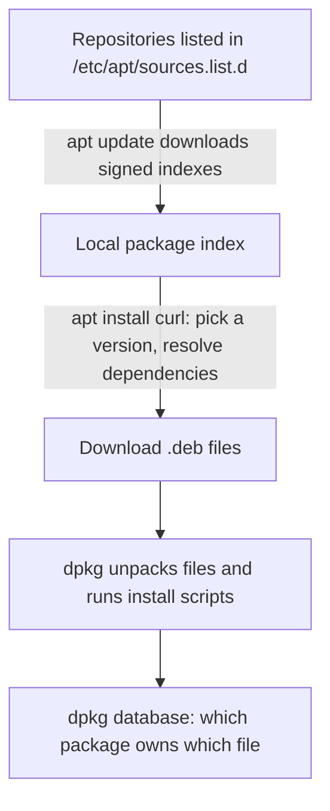

# Packages and updates

> **Status: AI draft, 2026-11-16.** Not yet verified by me. Commands and output were run in a throwaway Ubuntu 24.04 container; the dnf column is from the dnf documentation and was not run.

## In one line

A package manager installs software from signed repositories, resolves its dependencies and records every file it owns. `apt update` refreshes the list of available versions, `apt upgrade` installs newer ones, and holding or pinning stops a package from moving when you need it to stay put.

## The plain idea

Installing software by downloading files from websites does not scale: you have to find each library it needs, trust whoever made the download, and remember what you put where so you can remove or update it later. A **package manager** does all of that.

Software comes as **packages**: an archive of files plus a description of what it needs. Packages are published in **repositories**, servers with an index of every package and version, signed so you can tell they have not been tampered with. Your machine keeps a local copy of each repository's index and a database of what it has installed.

## How it works



1. **Sources.** Each repository is listed in `/etc/apt/sources.list.d/`. Ubuntu 24.04 uses the `.sources` format, with `Types`, `URIs`, `Suites` and the key used to verify signatures.
2. **`apt update`** downloads each repository's index and checks its signature. It installs nothing. If you skip it, `apt` works from stale indexes and may try to download versions that are gone.
3. **`apt install <pkg>`** picks the best version from the indexes (the highest version, unless pinning says otherwise), works out the dependencies, downloads everything and hands it to **dpkg**, the lower-level tool that unpacks files and runs each package's install scripts.
4. **The dpkg database** remembers every file each package installed, so it can list them, find which package owns a file, and remove them cleanly.

Red Hat family systems (RHEL, Amazon Linux, Fedora) use the same model with different tools:

| Task | Debian and Ubuntu | RHEL and Amazon Linux |
|---|---|---|
| Package format | `.deb` | `.rpm` |
| High-level tool | `apt` | `dnf` (formerly `yum`) |
| Low-level tool | `dpkg` | `rpm` |
| Refresh indexes | `apt update` | `dnf makecache` (dnf refreshes on its own schedule too) |
| Install | `apt install curl` | `dnf install curl` |
| Upgrade everything | `apt upgrade` | `dnf upgrade` |
| Which package owns a file | `dpkg -S /usr/bin/curl` | `rpm -qf /usr/bin/curl` |
| Files in a package | `dpkg -L curl` | `rpm -ql curl` |
| Repository config | `/etc/apt/sources.list.d/` | `/etc/yum.repos.d/` |

### Versions, holds and pins

- **Holding** a package (`apt-mark hold`) stops `apt upgrade` from changing it. Useful when a newer version is known to break something.
- **Pinning** sets priorities between repositories or versions in `/etc/apt/preferences.d/`, for example to always prefer a vendor's repository for one package.
- **Installing an exact version**: `apt install curl=<version>`, using a version shown by `apt-cache policy`.

### Updates and reboots

Security fixes arrive as new package versions in the updates and security repositories. Two details matter on servers:

- **Running processes keep the old code.** A process loaded the old library when it started. Until it restarts, it still runs the vulnerable version, even though the new one is on disk. `needrestart` lists such processes.
- **A kernel update needs a reboot** to take effect. On Ubuntu, `/var/run/reboot-required` exists when one is pending.

`unattended-upgrades` installs security updates automatically on Ubuntu. Many teams prefer building a fresh, patched image and replacing servers instead of patching them in place ([Vulnerability and patch management](../security/vulnerability-and-patch-management.md)).

## A concrete example

A third-party tool, `sample-tool`, must be installed from its vendor's repository, not Ubuntu's.

1. Download the vendor's signing key and store it under `/etc/apt/keyrings/`.
2. Add a source file that names the repository and **that** key (`Signed-By:`), so the key is trusted for this repository only.
3. `apt update`, then `apt-cache policy sample-tool` to confirm the candidate version comes from the vendor's URL.
4. `apt install sample-tool`.
5. Record the installed version. If a later version breaks things, `apt-mark hold sample-tool` until it is fixed, and put a review date on the hold.

## Why not just...?

- **...download the binary and copy it into `/usr/local/bin`?** It works once. Nothing tracks it, nothing updates it when a security fix comes out, and nobody knows it is there. Use the package, or record it in your image build.
- **...run `apt upgrade` on every production server by hand on Friday afternoon?** Upgrades can restart services and change behaviour. Roll out through environments, a few servers at a time, with a way back.
- **...trust a repository key system-wide?** A key added to the global trust store can sign packages for any repository. Scoping it with `Signed-By` limits the damage if that vendor's key is ever compromised.

## Commands to know

Which version would be installed, and from where:

```console
# apt-cache policy curl
curl:
  Installed: (none)
  Candidate: 8.5.0-2ubuntu10.16
  Version table:
     8.5.0-2ubuntu10.16 500
        500 http://archive.ubuntu.com/ubuntu noble-updates/main amd64 Packages
```

`Candidate` is the version `apt install` would choose. `500` is the priority of that repository.

After installing, what it is and what it put on disk:

```console
# dpkg -l curl
ii curl 8.5.0-2ubuntu10.16 amd64 command line tool for transferring data with URL syntax
# dpkg -L curl | grep bin
/usr/bin
/usr/bin/curl
# dpkg -S /usr/bin/curl
curl: /usr/bin/curl
```

`ii` means installed and wanted.

Holding a package, and what is waiting to be upgraded:

```console
# apt-mark hold curl
curl set on hold.
# apt-mark showhold
curl
# apt list --upgradable
Listing...
apt/noble-updates,noble-security 2.8.4ubuntu0.1 amd64 [upgradable from: 2.8.3]
libapt-pkg6.0t64/noble-updates,noble-security 2.8.4ubuntu0.1 amd64 [upgradable from: 2.8.3]
```

The repository definition:

```console
# grep -E "^(Types|URIs|Suites)" /etc/apt/sources.list.d/ubuntu.sources
Types: deb
URIs: http://archive.ubuntu.com/ubuntu/
Suites: noble noble-updates noble-backports
```

The index is fetched over HTTP, which is safe because the index is signed and every package's checksum is in it.

| Command | What it does |
|---|---|
| `apt update && apt install -y <pkg>` | Refresh, then install without a prompt. In a Dockerfile, keep both in one `RUN` line ([Images and Dockerfiles](../containers/images-and-dockerfiles.md)). |
| `apt remove <pkg>`, `apt purge <pkg>` | Remove; `purge` also deletes its configuration files. |
| `apt autoremove` | Remove dependencies nothing needs any more. |
| `apt show <pkg>` | Description, dependencies and size. |
| `apt-mark unhold <pkg>` | Let it upgrade again. |
| `ls /var/run/reboot-required` | A reboot is pending, usually for a kernel. |

## How it breaks

| Symptom | Layer | Check | Likely cause |
|---|---|---|---|
| `E: Unable to locate package` | Index | Was `apt update` run? `apt-cache policy <pkg>` | Stale or missing index, wrong repository, or wrong package name |
| `404 Not Found` while downloading | Index age | Run `apt update` again | The index points at a version that has since been replaced |
| `NO_PUBKEY` or signature errors | Repository key | Check `Signed-By` and the key file | Key missing or expired |
| `Could not get lock /var/lib/dpkg/lock-frontend` | Concurrency | `ps aux` for apt or unattended-upgrades | Another apt process is running, often automatic updates at boot |
| A service still reported vulnerable after patching | Running processes | `needrestart`; process start time vs package install time | The process was not restarted |
| Kernel still old after upgrade | Kernel | `uname -r` against the installed kernel packages | No reboot yet |
| An upgrade broke an application | Version change | `/var/log/apt/history.log` | A dependency moved; hold or pin it and test before upgrading |

## Interview questions

**1. What is the difference between `apt update` and `apt upgrade`?**

<details markdown="1">
<summary>Answer</summary>

- `apt update` refreshes the local copy of each repository's index; it installs nothing.
- `apt upgrade` installs newer versions of installed packages, according to the index.
- Run update first, or upgrade works from stale information.

</details>

**2. How do you find which package installed a given file, and what files a package installed?**

<details markdown="1">
<summary>Answer</summary>

- Debian and Ubuntu: `dpkg -S <file>` and `dpkg -L <pkg>`.
- RHEL family: `rpm -qf <file>` and `rpm -ql <pkg>`.
- Both read the local package database.

</details>

**3. How do you stop one package from being upgraded?**

<details markdown="1">
<summary>Answer</summary>

- `apt-mark hold <pkg>` (or `dnf versionlock` on the RHEL family).
- Or pin a version or repository priority in `/etc/apt/preferences.d/`.
- Record why and when to revisit, so the hold does not become a permanent unpatched package.

</details>

**4. You patched OpenSSL on a server, but a scanner still reports the vulnerability. Why?**

<details markdown="1">
<summary>Answer</summary>

- Running processes still have the old library loaded in memory.
- They must be restarted; `needrestart` or comparing process start times with the install time finds them.
- For a kernel vulnerability, a reboot is needed.

</details>

**5. How do you add a third-party repository safely?**

<details markdown="1">
<summary>Answer</summary>

- Download the vendor's key from an official source into `/etc/apt/keyrings/`.
- Reference it with `Signed-By` in that repository's source file, so it is trusted only there.
- Run `apt update` and check with `apt-cache policy` that the package comes from the expected source.

</details>

**6. Should production servers patch themselves automatically?**

<details markdown="1">
<summary>Answer</summary>

- Automatic security updates close gaps quickly but can restart or change services without warning.
- Many teams instead rebuild images with patches and roll them out through environments.
- Either way: staged rollout, monitoring after the change, and a way to roll back.

</details>

## Try it

**Step 1.** Start a container and refresh the index.

```bash
docker run --rm -it ubuntu:24.04 bash
apt-get update -qq
```

**Step 2.** Before installing, predict what `Installed:` will say, then check where the candidate version comes from.

```bash
apt-cache policy curl
apt-get install -y -qq curl
apt-cache policy curl | head -3
```

**Step 3.** Find which package owns a file you did not install yourself.

```bash
dpkg -S /usr/bin/ls
dpkg -L coreutils | grep bin/ls
```

**Step 4.** Type `exit`. The container is deleted.

## Zoom out

Packages are how software gets onto servers and into container images, so the same questions come back in image builds and vulnerability scans ([Registries and image security](../containers/registries-and-image-security.md)). Without a package manager, nobody knows what is installed or how to patch it. The principle to carry: an update is not finished until the processes using it have been restarted.

## Sources

- [apt(8) manual page](https://manpages.ubuntu.com/manpages/noble/man8/apt.8.html)
- [dpkg(1) manual page](https://man7.org/linux/man-pages/man1/dpkg.1.html)
- [apt_preferences(5): pinning](https://manpages.ubuntu.com/manpages/noble/man5/apt_preferences.5.html)
- [sources.list(5): the deb822 sources format and Signed-By](https://manpages.ubuntu.com/manpages/noble/man5/sources.list.5.html)
- [Ubuntu Server documentation: package management](https://documentation.ubuntu.com/server/how-to/software/package-management/)
- [dnf documentation](https://dnf.readthedocs.io/en/latest/command_ref.html)
