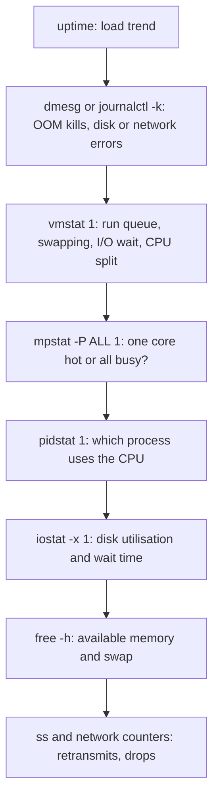

# Performance triage

> **Status: AI draft, 2026-11-16.** Not yet verified by me. Commands and output were run in a throwaway container with two busy processes; a container sees the host's CPUs and totals, so those numbers describe the laptop it ran on, and addresses are rewritten to example ranges.

## In one line

When a server is slow, check each resource (CPU, memory, disk, network) for utilisation, saturation and errors, in a fixed order of quick commands: `uptime`, `dmesg`, `vmstat`, `mpstat`, `pidstat`, `iostat`, `free`. Find which resource is the bottleneck before changing anything.

## The plain idea

"The server is slow" is a symptom, not a diagnosis. Something is the bottleneck, and it is almost always one of four resources: CPU, memory, disk or network. Checking them in a fixed order is faster than guessing, and it stops you from fixing the wrong thing, such as adding CPUs to a machine that is waiting on its disk.

For each resource, ask three questions. This is the **USE method**:

- **Utilisation:** how busy is it, as a share of the time?
- **Saturation:** is work queuing because it is full?
- **Errors:** is it failing?

A resource at 100% utilisation with no queue is working hard. A resource with a growing queue is the bottleneck.

## How it works

### The first 60 seconds



Each step answers one question, and the answers decide where to dig.

### Load average

`uptime` shows three **load averages**: over the last 1, 5 and 15 minutes. On Linux, load counts processes that are running, waiting for a CPU, **or** in uninterruptible sleep (state `D`), usually waiting for disk or NFS ([Processes and signals](processes-and-signals.md)). Compare it with the CPU count from `nproc`:

| Load on a 4-CPU machine | Likely meaning |
|---|---|
| About 1 | Mostly idle. |
| About 4 | Fully used, no queue. |
| 12 and CPUs are busy | CPU saturated: processes wait for a turn. |
| 12 and CPUs are idle | Processes stuck in `D`: look at disk or network storage. |

The three numbers together show the trend: a 1-minute value well above the 15-minute value means the problem is new.

### Reading `vmstat 1`

| Column | Meaning | Worrying when |
|---|---|---|
| `r` | Processes running or waiting for a CPU | Consistently above the CPU count |
| `b` | Processes blocked, mostly on I/O | Consistently above 0 |
| `si`, `so` | Memory swapped in and out per second | Anything but 0 for long ([Memory and the OOM killer](memory-and-oom.md)) |
| `us`, `sy` | CPU time in programs and in the kernel | `sy` high: many system calls, context switches or interrupts |
| `id` | Idle CPU | Near 0 |
| `wa` | Time CPUs sat idle while I/O was outstanding | High: storage is the bottleneck |
| `st` | **Steal**: time a virtual machine wanted CPU but the hypervisor gave it to someone else | High on a cloud VM: noisy neighbours or burst credits used up |

The first line of `vmstat` is an average since boot. Read the lines after it.

### Telling the bottlenecks apart

| Pattern | Bottleneck |
|---|---|
| High `us`, `r` above CPU count, one or more processes near 100% in `pidstat` | CPU |
| One core at 100% in `mpstat`, the rest idle | A single-threaded program, or one hot interrupt |
| High `wa`, non-zero `b`, `iostat` `%util` near 100% and high `await` | Disk |
| `si` and `so` non-zero, `available` low, OOM kills in `dmesg` | Memory |
| CPUs and disks quiet, but requests slow, with retransmits or timeouts | Network, or a slow dependency further away |

`iostat -x` columns worth knowing: `r/s` and `w/s` (operations per second), `r_await` and `w_await` (average milliseconds per request, queue included), `aqu-sz` (average queue length) and `%util` (share of time the device was busy). On fast SSDs and cloud volumes, `%util` near 100% does not always mean saturated, because they serve many requests in parallel; latency (`await`) is the better signal.

### When the numbers are not enough

**strace** shows each system call a process makes: every file it opens, every read and write, and how long each took. `strace -p <pid>` attaches to a running process. Reach for it when a process is stuck or slow and the counters do not say why, for example to see that it is waiting on a network connection or retrying a missing file. It slows the traced program down a lot, so use it briefly in production.

## A concrete example

An API server is slow since 10:00. It has 4 CPUs.

1. `uptime`: load 9.8, 9.1, 3.2. The 15-minute value is low, so this started recently, and 9.8 on 4 CPUs is a queue.
2. `dmesg -T | tail`: nothing unusual. No OOM kills, no disk errors.
3. `vmstat 1`: `r` is 9 to 11, `us` 92, `id` 0, `wa` 0, `si` and `so` 0. CPU saturated; disk and memory fine.
4. `mpstat -P ALL 1`: all four cores busy, so it is not one single-threaded program.
5. `pidstat 1`: the Java process uses 380% CPU. Something inside the application is doing far more work than usual.
6. Next steps move inside the application: a thread dump, or the traffic: did requests per second jump at 10:00, or did one new endpoint start doing heavy work? Adding CPUs would hide this for a while; finding what changed fixes it.

## Why not just...?

- **...look at `top` and restart whatever is at the top?** `top` shows CPU users, not the bottleneck. If the machine is waiting on disk, the process at the top of `top` may be a victim, not the cause, and a restart only resets the symptom.
- **...add more CPUs or memory?** A bigger machine that waits on the same disk is just as slow. Measure first, then scale the resource that is actually saturated.
- **...read the first line of `vmstat`?** It is the average since boot, which hides a problem that started ten minutes ago. Use the following lines.

## Commands to know

CPU count and load:

```console
# nproc
12
# uptime
up 16 min,  0 user,  load average: 0.79, 0.73, 0.58
```

The container was started with `--cpus 2`, yet `nproc` reports all 12 host CPUs: a CPU quota limits how much time the container gets, not how many CPUs it can see. Programs that size their thread pools from `nproc` can be fooled by this.

Two processes spinning on the CPU, seen by each tool:

```console
# vmstat 1 3
procs -----------memory---------- ---swap-- -----io---- -system-- -------cpu-------
 r  b   swpd   free   buff  cache   si   so    bi    bo   in   cs us sy id wa st gu
 2  0      0 6828976 165588 4022060    0    0  3576  1561 10557   11  5  3 92  1  0  0
 2  0      0 6831212 165588 4022100    0    0     0    24 13076 13566 22  3 75  0  0  0
 2  0      0 6837284 165588 4022104    0    0     0    32 11981 12830 19  2 78  0  0  0
# pidstat 1 1
Average:      UID       PID    %usr %system  %guest   %wait    %CPU   CPU  Command
Average:        0      3165  100.00    0.00    0.00    1.00  100.00     -  sh
Average:        0      3166  100.00    0.00    0.00    1.00  100.00     -  sh
# top -b -n 1
    PID USER      PR  NI    VIRT    RES    SHR S  %CPU  %MEM     TIME+ COMMAND
   3165 root      20   0    2812   1792   1692 R  90.9   0.0   0:06.21 sh
   3166 root      20   0    2812   1792   1692 R  90.9   0.0   0:06.21 sh
```

`r` is 2: two runnable processes. On a 12-CPU machine that is no queue, so this machine is busy, not saturated. In `pidstat`, each process uses a whole CPU (100% means one core).

One core per row with `mpstat` (trimmed to six of the twelve):

```console
# mpstat -P ALL 1 1
Average:       6  100.00    0.00    0.00    0.00    0.00    0.00    0.00    0.00    0.00    0.00
Average:       7    5.00    0.00    2.00    0.00    0.00    0.00    0.00    0.00    0.00   93.00
Average:       8    7.00    0.00    3.00    0.00    0.00    0.00    0.00    0.00    0.00   90.00
```

The columns are `CPU`, `%usr`, `%nice`, `%sys`, `%iowait`, `%irq`, `%soft`, `%steal`, `%guest`, `%gnice` and `%idle`. Core 6 is fully busy in user space; the others are mostly idle.

What a program asks the kernel to do:

```console
# strace -c -f ls /
% time     seconds  usecs/call     calls    errors syscall
------ ----------- ----------- --------- --------- ----------------
 26.63    0.000139          69         2           getdents64
 12.07    0.000063           7         8           close
 10.54    0.000055           9         6           openat
# strace -e trace=openat cat /etc/hostname
openat(AT_FDCWD, "/etc/hostname", O_RDONLY) = 3
```

`-c` prints a summary table instead of each call, `-f` follows child processes, `-e trace=openat` shows only file opens, and `-p <pid>` attaches to a running process.

| Command | What it shows |
|---|---|
| `iostat -x 1` | Per-disk operations, latency (`r_await`, `w_await`), queue (`aqu-sz`) and `%util`. From the `sysstat` package. |
| `sar -u`, `sar -r`, `sar -d` | CPU, memory and disk history, if the sysstat collector is enabled: answers "what happened at 03:00?". |
| `free -h` | Memory, with `available` as the number that matters. |
| `ss -s` | Socket counts by state. `nstat` or `netstat -s` for retransmits. |
| `dmesg -T`, `journalctl -k` | Kernel messages: OOM kills, disk errors, dropped packets. |

## How it breaks

| Symptom | Layer | Check | Likely cause |
|---|---|---|---|
| Load high, CPUs busy, `r` above CPU count | CPU | `pidstat 1`, `top` | A busy process, more traffic, a code change, or too small an instance |
| Load high, CPUs idle | Disk or network storage | `vmstat` `b` and `wa`; `ps` for state `D`; `iostat -x` | Slow or saturated disk, a hung NFS mount |
| `st` high on a cloud VM | Hypervisor | `vmstat`, `mpstat` `%steal` | Burstable instance out of credits, or a busy host |
| Swapping, `available` low | Memory | `free -h`, `vmstat` `si`/`so` | Working set bigger than RAM, a leak |
| CPU throttled in a container, latency spikes, CPU not at 100% | cgroup CPU quota | `cat /sys/fs/cgroup/cpu.stat` (`nr_throttled`) | The container hits its CPU limit in short bursts |
| Everything looks idle but requests are slow | Dependencies | Application latency per dependency; `ss` for retransmits | A slow database or API downstream, DNS or connection pool exhaustion |

## Interview questions

**1. What does load average mean on Linux, and how do you judge whether 8 is high?**

<details markdown="1">
<summary>Answer</summary>

- The average number of processes running, waiting for a CPU, or in uninterruptible sleep, over 1, 5 and 15 minutes.
- Compare it with the CPU count: 8 on 16 CPUs is fine; 8 on 2 CPUs is a queue.
- Because `D`-state processes count, high load with idle CPUs points at I/O.

</details>

**2. What is the USE method?**

<details markdown="1">
<summary>Answer</summary>

- For every resource, check Utilisation, Saturation and Errors.
- Utilisation is how busy it is; saturation is queued work; errors are failures.
- It gives a complete, fast checklist instead of guessing.

</details>

**3. In `vmstat`, what do `r`, `b`, `wa` and `st` tell you?**

<details markdown="1">
<summary>Answer</summary>

- `r`: processes runnable; above the CPU count means CPU saturation.
- `b`: processes blocked, usually on I/O.
- `wa`: time the CPU was idle with I/O outstanding.
- `st`: time stolen by the hypervisor on a virtual machine.

</details>

**4. A server's load is 20 on 4 CPUs, but CPU is 80% idle. What is happening and what do you run?**

<details markdown="1">
<summary>Answer</summary>

- Many processes are in uninterruptible sleep, waiting on I/O.
- `vmstat 1` for `b` and `wa`; `ps -eo stat,pid,cmd` and look for `D`.
- `iostat -x 1` for disk latency and utilisation; check `dmesg` and the mounts for a hung NFS share.

</details>

**5. A containerised service has high latency but its CPU use never reaches its limit. What could it be?**

<details markdown="1">
<summary>Answer</summary>

- CPU throttling: the quota is enforced over short periods, so bursts are throttled even if the average is below the limit.
- Check `nr_throttled` and `throttled_usec` in `/sys/fs/cgroup/cpu.stat`, or the container's throttling metric.
- Raise or remove the CPU limit, or reduce bursts; also check downstream dependencies.

</details>

**6. When would you use `strace`, and what is the risk?**

<details markdown="1">
<summary>Answer</summary>

- When a process is stuck or slow and the counters do not explain it: it shows each system call, such as a blocking read or a repeated failed open.
- `-p` attaches to a running process; `-c` summarises; `-e` filters.
- It slows the target a lot, so use it briefly on production processes.

</details>

**7. Users say a web app is slow. Walk me through your first five minutes on the server.**

<details markdown="1">
<summary>Answer</summary>

- Confirm and scope it: which endpoints, since when, all users or some.
- `uptime` and `dmesg` for load trend and kernel errors.
- `vmstat 1`, `mpstat`, `pidstat`, `iostat -x`, `free -h` to find the saturated resource.
- If the host is fine, look outward: database latency, network retransmits, connection pools, recent deploys.

</details>

## Try it

**Step 1.** Start a container and install the tools.

```bash
docker run --rm -it --cpus 2 ubuntu:24.04 bash
apt-get update -qq && apt-get install -y -qq procps sysstat
nproc
```

**Step 2.** Start two busy loops for 30 seconds. Before running the three tools, predict what `r` in `vmstat` and `%CPU` in `pidstat` will show.

```bash
timeout 30 sh -c 'while :; do :; done' &
timeout 30 sh -c 'while :; do :; done' &
vmstat 1 5
pidstat 1 1
mpstat -P ALL 1 1
```

**Step 3.** Type `exit`. The container is deleted.

## Zoom out

The same resources, with the same saturation signals, show up as metrics once you have monitoring: the USE method maps directly onto node and container dashboards ([Signals and methods](../observability/signals-and-methods.md)). Without a method, troubleshooting is guessing at the loudest number. The principle to carry: find the saturated resource before you change anything.

## Sources

- [Brendan Gregg: the USE method](https://www.brendangregg.com/usemethod.html)
- [vmstat(8) manual page](https://man7.org/linux/man-pages/man8/vmstat.8.html)
- [sysstat documentation: mpstat, pidstat, iostat, sar](https://sysstat.github.io/)
- [proc(5): /proc/loadavg](https://man7.org/linux/man-pages/man5/proc.5.html)
- [strace(1) manual page](https://man7.org/linux/man-pages/man1/strace.1.html)
- [Linux kernel documentation: Control Group v2, CPU controller](https://docs.kernel.org/admin-guide/cgroup-v2.html)
