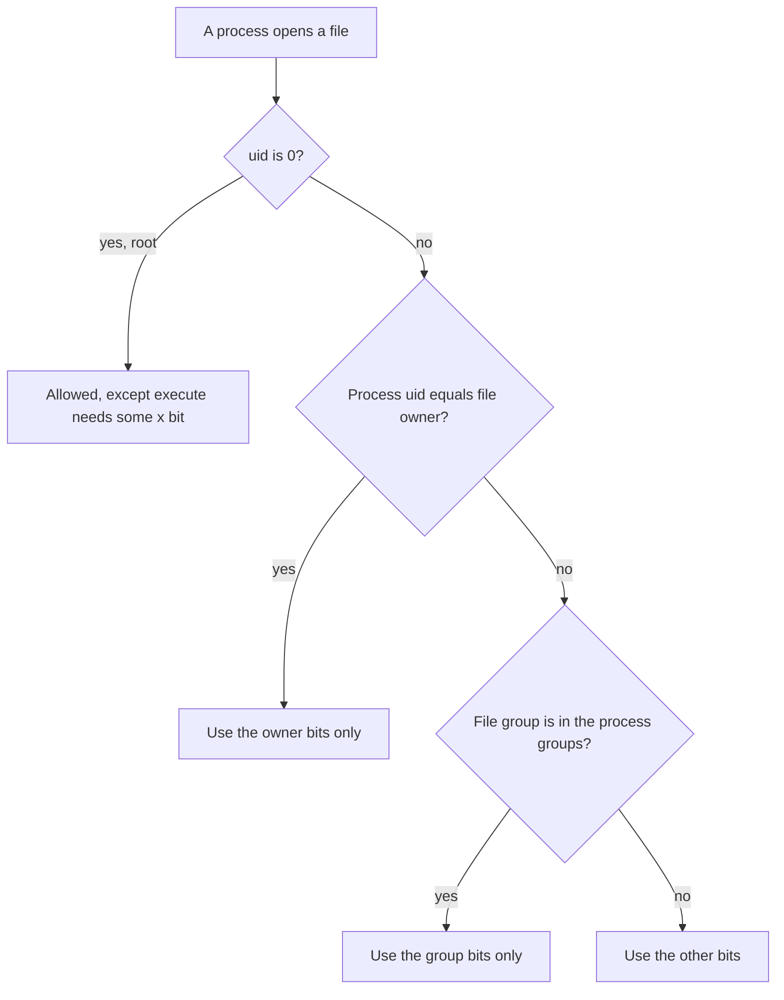

# Users, groups and permissions

> **Status: AI draft, 2026-11-16.** Not yet verified by me. Commands and output were run in a throwaway container; addresses are rewritten to example ranges.

## In one line

Every process runs as a user with a set of groups, and every file records an owner, a group and three sets of read, write and execute bits. The kernel picks exactly one set (owner, else group, else other) and allows only what that set says.

## The plain idea

Think of a shared office cupboard with three signs on the door: one for the person who owns it, one for their team, and one for everybody else. A guard looks at you, picks the first sign that describes you, and follows that sign only. If you are on the team, the "everybody else" sign no longer applies to you, even if it is more generous.

On Linux the person is a **user**, the team is a **group**, and the signs are the file's **permission bits**. "Permission denied" always has an exact answer you can read off the screen: who is asking, which sign applied, and what it allowed.

## How it works

### Who is asking

A **user** is a number, the **uid**, with a name attached for humans. A **group** is also a number, the **gid**. One user can belong to many groups. Every process carries its user and its list of groups; a program you start inherits yours.

| File | What it holds |
|---|---|
| `/etc/passwd` | One line per user: name, uid, primary gid, home directory, login shell. Readable by everyone. |
| `/etc/group` | One line per group, with its extra members. |
| `/etc/shadow` | Password hashes. Readable only by root and the `shadow` group. |

The **root** user has uid 0. The kernel skips the read and write checks for root, and lets it execute a file if at least one `x` bit is set anywhere.

### What a file records

```console
# ls -l report.txt
-rw-r----- 1 app deploy 6 Nov 16 02:55 report.txt
```

| Part | Here | Meaning |
|---|---|---|
| First character | `-` | Type: `-` file, `d` directory, `l` symlink |
| Characters 2 to 4 | `rw-` | What the owner may do |
| Characters 5 to 7 | `r--` | What members of the file's group may do |
| Characters 8 to 10 | `---` | What everyone else may do |
| Owner, group | `app deploy` | The uid and gid stored in the file's inode, shown as names |

### The rule: first match wins



Exactly one set is used. The sets are never added together. That is why `-rw----r--` locks the file's own group out while strangers can read it.

### What the bits mean

| Bit | On a file | On a directory |
|---|---|---|
| `r` (4) | Read the contents | List the names inside |
| `w` (2) | Change the contents | Create, delete or rename entries inside |
| `x` (1) | Run it as a program | Enter it and reach things inside by name |

The directory column surprises people. Deleting a file is a change to its directory, so it needs `w` on the directory, not on the file. A directory with `x` but no `r` lets you open a file whose name you already know, but not list the names.

**Octal** writes each set as a sum: `r`=4, `w`=2, `x`=1. So `rwxr-x---` is 7, 5, 0, written `750`. Common modes: `644` for files anyone may read, `640` for files only a group may read, `755` for programs and directories, `600` for private keys.

### Defaults and special bits

- **umask** removes bits from new files and directories. New files start from `666`, directories from `777`. With umask `022` they become `644` and `755`; with `027` they become `640` and `750`.
- **setuid** (`s` in the owner's `x` position) runs a program as its owner, not as you. `/usr/bin/passwd` is setuid root so a normal user can update `/etc/shadow` through it.
- **setgid** on a directory makes new files inside inherit the directory's group, which helps shared team folders.
- **Sticky bit** (`t` in the other `x` position) on a directory means only a file's owner may delete it. `/tmp` has it, so users cannot delete each other's files there.

### When group changes take effect

A process's group list is fixed when the login session starts. `usermod -aG docker ci` changes `/etc/group` immediately, but a shell that is already open keeps its old list. The user must log in again (or start a new login shell) to pick it up. Without `-a`, `usermod -G` replaces the user's groups instead of adding to them.

## A concrete example

A deploy script must be run by the `ci` user and the `app` user, both in group `deploy`, and by nobody else.

1. `chown app:deploy /srv/deploy.sh`: `app` owns it and the group is `deploy`.
2. `chmod 750 /srv/deploy.sh`: owner `rwx`, group `r-x`, others nothing.
3. `ci` runs it. `ci` is not the owner but is in `deploy`, so the group set `r-x` applies. A script needs `r` as well as `x`, because the shell has to read the lines.
4. `guest` runs it. Not the owner, not in the group, so `---` applies: `Permission denied`.
5. Someone suggests `chmod 777` "to fix it". That makes the script writable by every user on the machine, so anyone could change what `ci` executes next. The right fix is the group membership.

## Why not just...?

- **...`chmod 777`?** The error goes away because everyone gets everything. Any user or compromised process can now change the file, and the next person who runs it runs their code.
- **...run it with `sudo`?** That proves root can do it, which was never in doubt. The user who hit the error still cannot, and you have made the job depend on root.
- **...test the fix as root?** Root bypasses read and write checks, so a test as root passes whatever the bits say. Test as the user who failed: `su - <user> -c '<command>'`.

## Commands to know

Who a user is, and which groups they have:

```console
# id app
uid=1001(app) gid=1001(app) groups=1001(app)
# grep -E "^(root|app):" /etc/passwd
root:x:0:0:root:/root:/bin/bash
app:x:1001:1001::/home/app:/bin/sh
```

The same file read by a group member, then by an outsider, with mode `640`:

```console
# ls -l report.txt
-rw-r----- 1 app deploy 6 Nov 16 02:55 report.txt
# su ci -c "cat /srv/demo/report.txt"
hello
# su ci -c "echo more >> /srv/demo/report.txt"
bash: line 1: /srv/demo/report.txt: Permission denied
# su guest -c "cat /srv/demo/report.txt"
cat: /srv/demo/report.txt: Permission denied
```

`su <user> -c '<command>'` runs one command as that user. `>>` appends to the file, which needs `w`.

The group locked out while others can read, with mode `604`:

```console
# ls -l report.txt
-rw----r-- 1 app deploy 6 Nov 16 02:55 report.txt
# su ci -c "cat /srv/demo/report.txt"
cat: /srv/demo/report.txt: Permission denied
# su guest -c "cat /srv/demo/report.txt"
hello
```

Symbolic and numeric `chmod`:

```console
# chmod u=rw,g=r,o= report.txt
# ls -l report.txt
-rw-r----- 1 app deploy 6 Nov 16 02:55 report.txt
# chmod g+w report.txt
# ls -l report.txt
-rw-rw---- 1 app deploy 6 Nov 16 02:55 report.txt
```

`u`, `g`, `o` and `a` are owner, group, others and all; `+` adds, `-` removes, `=` sets exactly.

umask, setuid and the sticky bit:

```console
# su app -c "umask; touch /tmp/x1; umask 027; touch /tmp/x2; ls -l /tmp/x1 /tmp/x2"
0002
-rw-rw-r-- 1 app app 0 Nov 16 02:55 /tmp/x1
-rw-r----- 1 app app 0 Nov 16 02:55 /tmp/x2
# ls -l /usr/bin/passwd
-rwsr-xr-x 1 root root 64152 May 30  2024 /usr/bin/passwd
# ls -ld /tmp
drwxrwxrwt 1 root root 4096 Nov 16 02:54 /tmp
# su ci -c "rm -f /tmp/appfile"
rm: cannot remove '/tmp/appfile': Operation not permitted
```

A new group only shows up in a new login session:

```console
# su - ci -c "id -nG"
ci deploy
# usermod -aG ops ci
# su - ci -c "id -nG"
ci deploy ops
```

| Command | What it does |
|---|---|
| `chown user:group <file>` | Change owner and group. Only root may give a file away. |
| `chgrp <group> <file>` | Change only the group. |
| `chmod -R` | Apply recursively. Careful: it gives files and directories the same bits; `X` (capital) adds execute only to directories. |
| `sudo -l` | List what the current user may run with sudo. |
| `visudo` | Edit `/etc/sudoers` safely; it checks the syntax before saving. |

## How it breaks

| Symptom | Layer | Check | Likely cause |
|---|---|---|---|
| `Permission denied` reading a file | File bits | `ls -l <file>`; `id <user>`; decide which set applies | The applicable set lacks `r`, often because the user is in the group and the group set is stricter |
| `Permission denied` on a file whose bits look fine | Directories on the path | `namei -l <path>` shows every directory's bits | A parent directory lacks `x` for that user |
| Cannot delete a file you own | Directory bits | `ls -ld <dir>` | No `w` on the directory, or the sticky bit and someone else owns the file |
| Still denied after adding the user to a group | Session | `id` in the failing shell vs `id <user>` | The session started before the change; log in again |
| A script gives `Permission denied` | Execute bit | `ls -l <script>` | No `x`, or the filesystem is mounted `noexec` |
| A service cannot read its config after a deploy | Ownership | `ls -l`; `ps -o user= -p <pid>` | Files were copied as root and the service runs as another user |

## Interview questions

**1. Explain the output `-rwxr-x--- 1 app deploy deploy.sh`. Who can do what?**

<details markdown="1">
<summary>Answer</summary>

- It is a regular file owned by user `app` and group `deploy`.
- The owner may read, write and run it; group members may read and run it; everyone else has no access.
- The mode in octal is `750`.

</details>

**2. How does Linux decide which permission set applies to a process?**

<details markdown="1">
<summary>Answer</summary>

- If the process runs as root, read and write checks are skipped.
- If its uid matches the file's owner, the owner bits are used.
- Otherwise, if the file's group is one of its groups, the group bits are used.
- Otherwise the other bits are used.
- Exactly one set applies; they are never combined.

</details>

**3. What do `r`, `w` and `x` mean on a directory?**

<details markdown="1">
<summary>Answer</summary>

- `r` lists the names in it.
- `w` creates, deletes or renames entries, so deleting a file needs `w` on its directory.
- `x` lets you enter it and reach entries by name.
- `x` without `r` lets you open a file whose name you know, without listing.

</details>

**4. What are umask, setuid and the sticky bit?**

<details markdown="1">
<summary>Answer</summary>

- umask removes bits from the permissions of newly created files and directories; `022` gives `644` files and `755` directories.
- setuid on a program runs it as the file's owner; `passwd` uses it to update `/etc/shadow`.
- The sticky bit on a directory lets only a file's owner delete it; `/tmp` uses it.

</details>

**5. A colleague fixed "permission denied" with `chmod -R 777`. What do you say?**

<details markdown="1">
<summary>Answer</summary>

- It removes every protection: any user or compromised process can now modify the files, including code that others execute.
- It hides the real cause, which is usually the wrong owner, the wrong group or a missing group membership.
- Fix: find which user the process runs as, set the owner or group to match, and grant the minimum bits.

</details>

**6. You added `ci` to the `docker` group, but `docker ps` still says permission denied. Why?**

<details markdown="1">
<summary>Answer</summary>

- The Docker socket is group-owned by `docker` with mode `660`, so access depends on group membership.
- A process's groups are fixed at login, so the open session still has the old list.
- `id` in that shell will not show `docker`; a new login (or `newgrp docker`) will.
- Also check the change used `usermod -aG`; without `-a` the user's other groups were replaced.

</details>

**7. An application running as `app` cannot read `/opt/sample-app/config/app.yaml`, yet the file is mode `644`. What do you check?**

<details markdown="1">
<summary>Answer</summary>

- Every directory on the path needs `x` for that user: `namei -l /opt/sample-app/config/app.yaml`.
- Confirm the user the process really runs as: `ps -o user= -p <pid>`.
- Check for other controls such as SELinux or AppArmor denials, or a container running with a different uid.

</details>

## Try it

**Step 1.** Start a throwaway container and create three users, two of them in one group.

```bash
docker run --rm -it ubuntu:24.04 bash
groupadd deploy
useradd -m -s /bin/bash -G deploy ci
useradd -m -s /bin/bash -G deploy app
useradd -m -s /bin/bash guest
mkdir -p /srv/demo && cd /srv/demo && echo hello > report.txt && chown app:deploy report.txt
```

**Step 2.** Set mode `604`. Before the next two commands, predict which user can read the file and which set of bits applies to each.

```bash
chmod 604 report.txt && ls -l report.txt
su ci -c "cat /srv/demo/report.txt"
su guest -c "cat /srv/demo/report.txt"
```

**Step 3.** Write a script that `app` may read, write and run, group `deploy` may read and run, and nobody else may touch. Choose the number before you type it, then test it as `ci` and `guest`.

```bash
printf '#!/bin/bash\necho deployed\n' > deploy.sh && chown app:deploy deploy.sh
chmod 750 deploy.sh
su ci -c /srv/demo/deploy.sh
su guest -c /srv/demo/deploy.sh
```

**Step 4.** Type `exit`. The container is deleted.

## Zoom out

Permissions are the first answer to "who is allowed?", and the same question comes back at every layer: a container's uid deciding what it can write on a volume ([Pod security](../kubernetes/pod-security.md)), Kubernetes [RBAC](../kubernetes/rbac-and-service-accounts.md), and [IAM policies](../aws-core/iam-policies.md). Without them any program could rewrite any file. The principle to carry: find the identity, find the one rule that applies to it, and read what that rule allows.

## Sources

- [path_resolution(7): how the kernel checks access](https://man7.org/linux/man-pages/man7/path_resolution.7.html)
- [chmod(1) manual page](https://man7.org/linux/man-pages/man1/chmod.1.html)
- [inode(7): file mode bits](https://man7.org/linux/man-pages/man7/inode.7.html)
- [umask(2) manual page](https://man7.org/linux/man-pages/man2/umask.2.html)
- [usermod(8) manual page](https://man7.org/linux/man-pages/man8/usermod.8.html)
- [credentials(7): user and group identifiers](https://man7.org/linux/man-pages/man7/credentials.7.html)
