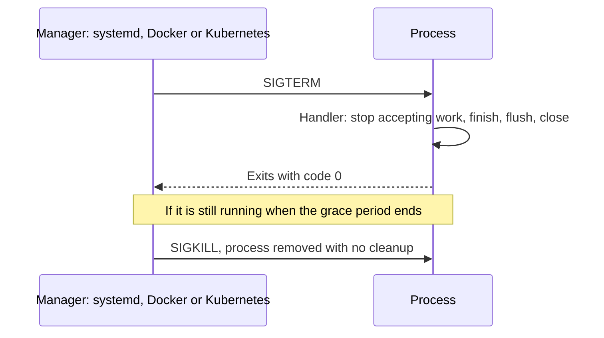

# Processes and signals

> **Status: AI draft, 2026-11-16.** Not yet verified by me. Commands and output were run in a throwaway container; addresses are rewritten to example ranges.

## In one line

A process is a running program with a PID, a parent, an owner and open files. You talk to it with signals: SIGTERM asks it to stop and can be handled, SIGKILL cannot, and the exit code (143, 137) tells you which one ended it.

## The plain idea

A program on disk is a recipe. A **process** is someone cooking it: the recipe plus everything that is happening right now, such as the memory in use, the files open on the counter, and who started the cooking. Several processes can run the same program at once, each with its own state.

Processes do not take orders by being edited. You send them short notes called **signals**. Some notes say "please finish up and leave", and a well-written program does exactly that: it saves its work and exits. One note, SIGKILL, is not delivered to the program at all. The kernel removes the process on the spot, with no chance to clean up.

## How it works

### Where processes come from


1. A process calls **fork** to make a copy of itself. The copy, the **child**, gets a new **PID** (process ID) and records its parent's PID as its **PPID**.
2. The child calls **exec** to replace its program with another one. It keeps its PID, its open files and its owner.
3. When it finishes, it leaves an **exit code** (0 to 255). The parent collects it with **wait**.

**PID 1** is the first process the kernel starts, normally systemd on a server. It adopts any process whose parent dies first. Inside a container, PID 1 is whatever program the container started, which matters for signals (below).

### States

| `STAT` | State | Meaning |
|---|---|---|
| `R` | Running | On a CPU or ready to be. |
| `S` | Sleeping | Waiting for something that can be interrupted: input, a timer, a network reply. Most processes most of the time. |
| `D` | Uninterruptible sleep | Waiting on I/O, often disk or NFS. Signals wait until it returns. Many `D` processes point at a storage problem. |
| `T` | Stopped | Paused, for example by Ctrl+Z. |
| `Z` | Zombie | Finished, but the parent has not collected the exit code. It uses no memory, only a process-table entry. Many zombies point at a parent that never calls wait. |

### Signals

A **signal** is a small numbered message the kernel delivers to a process. For most signals the program may install a **handler**: code that runs when the signal arrives. Two cannot be handled or ignored: SIGKILL and SIGSTOP.

| Signal | Number | Default action | Typical use |
|---|---|---|---|
| SIGHUP | 1 | Terminate | Terminal closed. Many daemons treat it as "reload your config". |
| SIGINT | 2 | Terminate | Ctrl+C. |
| SIGKILL | 9 | Terminate, cannot be caught | Last resort. No cleanup happens. |
| SIGTERM | 15 | Terminate | The polite stop: `kill` sends it by default, and so do systemd, Docker and Kubernetes. |
| SIGSTOP / SIGCONT | 19 / 18 | Pause / resume | Ctrl+Z sends the similar SIGTSTP. |

When a process is ended by a signal, the shell reports its exit code as **128 plus the signal number**. That is why two numbers show up all over logs:

| Exit code | Meaning |
|---|---|
| 0 | Success |
| 1 | General failure, chosen by the program |
| 126 | Found but not executable |
| 127 | Command not found |
| 130 | 128 + 2: interrupted with Ctrl+C |
| 137 | 128 + 9: SIGKILL. Often the out-of-memory killer, or a stop that timed out |
| 143 | 128 + 15: SIGTERM |

### The polite stop, then the hard one



Every process manager follows this pattern. `docker stop` waits 10 seconds by default before SIGKILL; Kubernetes waits for the pod's `terminationGracePeriodSeconds`. A program that ignores SIGTERM always ends with 137 and loses whatever it had in progress.

### Limits on a process

Each process has resource limits. The one that bites most often is the maximum number of open **file descriptors**: every open file, socket and pipe uses one. `ulimit -n` shows the soft limit for the shell; the per-process view is `/proc/<pid>/limits`. A busy server that hits it fails with "Too many open files".

**nice** values (-20 to 19) set CPU priority: a higher number is nicer to others and gets less CPU. `nice -n 10 <cmd>` starts a command at lower priority; `renice` changes a running one.

## A concrete example

A Java service is restarted by its process manager, and the log says `exited with code 137`.

1. 137 is 128 + 9, so SIGKILL ended it. Something either killed it on purpose or gave up waiting.
2. Check the kernel log for the out-of-memory killer: `journalctl -k | grep -i oom` or `dmesg | grep -i oom`. A line naming the process means it ran out of memory ([Memory and the OOM killer](memory-and-oom.md)).
3. If there is no OOM line, check the stop sequence. If the manager sent SIGTERM and the service did not exit within the grace period, the follow-up SIGKILL also gives 137.
4. In a container, check whether the service is PID 1 behind a shell. `CMD java -jar app.jar` in shell form runs `/bin/sh -c`, the shell becomes PID 1, and the shell does not pass SIGTERM on. The service never hears the polite request, so every stop ends in a kill. Exec form, `CMD ["java", "-jar", "app.jar"]`, fixes it ([Images and Dockerfiles](../containers/images-and-dockerfiles.md)).

## Why not just...?

- **...always use `kill -9`?** It works every time, but the program gets no chance to finish writes, release locks or close connections cleanly. Corrupt files, stale lock files and half-finished jobs follow. Send SIGTERM, wait, and use SIGKILL only if it does not exit.
- **...kill a zombie?** It is already dead; there is nothing to kill. The fix is its parent: make the parent call wait, or end the parent so PID 1 adopts and reaps the zombie.
- **...run the app with `nohup` instead of a service manager?** `nohup` only stops SIGHUP from ending it. Nothing restarts it if it crashes, nothing collects its logs, and nothing starts it after a reboot. That is what [systemd](systemd.md) is for.

## Commands to know

```console
# ps -o pid,ppid,stat,cmd
    PID    PPID STAT CMD
      1       0 Ss   bash -c ...
     91       1 S    sleep 300
     92       1 S    sleep 301
     93       1 R    ps -o pid,ppid,stat,cmd
# pgrep -a sleep
91 sleep 300
92 sleep 301
```

`ps -o` picks the columns. `ps aux` shows every process with its user, CPU and memory. `pgrep -a <pattern>` finds processes by name and prints their command lines. `pstree -p` draws the parent-child tree.

Exit codes after each signal:

```console
# kill %1; wait %1; echo "exit code after SIGTERM: $?"
exit code after SIGTERM: 143
# kill -9 %2; wait %2; echo "exit code after SIGKILL: $?"
exit code after SIGKILL: 137
```

`kill <pid>` sends SIGTERM; `kill -9 <pid>` or `kill -KILL <pid>` sends SIGKILL. `%1` means job 1 of this shell. `kill -l` lists every signal.

A program that handles SIGTERM:

```console
# bash -c 'trap "echo got SIGTERM, cleaning up; exit 0" TERM; sleep 100 & wait' &
# kill $!
got SIGTERM, cleaning up
# wait $!; echo "exit code: $?"
exit code: 0
```

`trap '<commands>' TERM` installs a handler in a shell script. The script cleaned up and chose its own exit code.

Codes the shell itself produces:

```console
# bash -c "exit 3"; echo "exit 3 -> $?"
exit 3 -> 3
# nosuchcmd; echo "missing command -> $?"
missing command -> 127
# /tmp/noexec.sh; echo "not executable -> $?"
not executable -> 126
```

Everything about one process is under `/proc/<pid>`:

```console
# tr "\0" " " < /proc/104/cmdline
sleep 200
# grep -E "^(State|PPid|VmRSS)" /proc/104/status
State:	S (sleeping)
PPid:	1
VmRSS:	    1500 kB
# ls -l /proc/104/cwd
lrwxrwxrwx 1 root root 0 Nov 16 02:55 /proc/104/cwd -> /srv/demo
# ulimit -n
1024
```

| Command | What it does |
|---|---|
| `top`, then `P` or `M` | Live view sorted by CPU or memory. |
| `pkill -f <pattern>` | Signal every process whose full command line matches. Check with `pgrep -af` first. |
| `ls -l /proc/<pid>/fd` | The process's open files and sockets. |
| `jobs`, `fg`, `bg`, Ctrl+Z | Shell job control. |
| `nohup <cmd> &` | Run in the background and ignore SIGHUP. |

## How it breaks

| Symptom | Layer | Check | Likely cause |
|---|---|---|---|
| Exit code 137 | Signal | `journalctl -k` or `dmesg` for `oom`; the manager's stop timeout | Out-of-memory kill, or SIGKILL after a stop timed out |
| Exit code 143 | Signal | Who sent SIGTERM: a deploy, a scale-down, systemd | A normal stop. A problem only if it was unexpected |
| A container takes exactly 10 seconds to stop | PID 1 | `docker exec <c> ps -o pid,cmd` | The app is not PID 1, or does not handle SIGTERM, so Docker waits and then kills it |
| Many `Z` processes | Parent process | `ps -o pid,ppid,stat,cmd` and look at the PPID | The parent never collects exit codes |
| Processes stuck in `D`, high load average, low CPU | Storage | `ps -eo stat,cmd` and look for `D`; `dmesg` | A slow or hung disk or NFS mount |
| `Too many open files` | Limits | `cat /proc/<pid>/limits`; count the entries in `ls /proc/<pid>/fd` | The descriptor limit is too low, or the program leaks connections |

## Interview questions

**1. What is the difference between a program and a process?**

<details markdown="1">
<summary>Answer</summary>

- A program is a file on disk.
- A process is a running instance of it, with a PID, a parent, an owner, memory and open files.
- Many processes can run the same program, each with its own state.

</details>

**2. What is the difference between SIGTERM and SIGKILL?**

<details markdown="1">
<summary>Answer</summary>

- SIGTERM (15) asks the process to stop; it can catch it, clean up and exit.
- SIGKILL (9) cannot be caught or ignored; the kernel removes the process with no cleanup.
- Managers send SIGTERM, wait a grace period, then SIGKILL.

</details>

**3. A container exits with code 137. What does that tell you, and what do you check?**

<details markdown="1">
<summary>Answer</summary>

- 137 is 128 + 9: the process was ended by SIGKILL.
- Check for an out-of-memory kill: the kernel log, or `OOMKilled` in `docker inspect` or `kubectl describe pod`.
- If not OOM, check whether a stop timed out after SIGTERM was ignored.

</details>

**4. What is a zombie process, and how do you get rid of one?**

<details markdown="1">
<summary>Answer</summary>

- A process that has exited but whose parent has not collected its exit code with wait.
- It uses no memory, only a process-table entry, so a few are harmless.
- You cannot kill it; fix or end the parent so PID 1 adopts and reaps it.

</details>

**5. What do exit codes 126, 127 and 130 mean?**

<details markdown="1">
<summary>Answer</summary>

- 126: the file was found but is not executable.
- 127: the command was not found.
- 130: 128 + 2, interrupted by SIGINT (Ctrl+C).

</details>

**6. Why does `docker stop` take 10 seconds for some containers, and how do you fix it?**

<details markdown="1">
<summary>Answer</summary>

- Docker sends SIGTERM to PID 1 and waits 10 seconds by default before SIGKILL.
- If PID 1 is a shell (shell-form `CMD`), it does not pass SIGTERM to the app, so nothing happens until the kill.
- Fix: exec-form `CMD`/`ENTRYPOINT`, `exec` in wrapper scripts, a small init such as `--init`, and a SIGTERM handler in the app.

</details>

**7. A server has load average 30 but CPU is mostly idle. What is going on?**

<details markdown="1">
<summary>Answer</summary>

- On Linux, load average counts processes that are runnable and those in uninterruptible sleep (`D`).
- Idle CPU with high load usually means many processes waiting on I/O.
- Check `ps` for `D` states, `iostat` or `vmstat` for I/O wait, and `dmesg` for disk or NFS errors.

</details>

## Try it

**Step 1.** Start a throwaway container and two background sleeps.

```bash
docker run --rm -it ubuntu:24.04 bash
sleep 300 &
sleep 301 &
ps -o pid,ppid,stat,cmd
```

**Step 2.** Predict the exit code of each, then check.

```bash
kill %1; wait %1; echo $?
kill -9 %2; wait %2; echo $?
```

**Step 3.** Start a script that handles SIGTERM, then send it SIGTERM. Predict the exit code before you run the last line.

```bash
bash -c 'trap "echo cleaning up; exit 0" TERM; sleep 100 & wait' &
kill $!
wait $!; echo $?
```

**Step 4.** Type `exit`. The container is deleted.

## Zoom out

Every process manager you will meet, from systemd to `docker stop` to a Kubernetes pod being terminated, uses the same SIGTERM, grace period, SIGKILL sequence ([Probes and graceful shutdown](../kubernetes/probes-and-graceful-shutdown.md)). Without signals there is no clean way to stop a program. The principle to carry: read the exit code first, because it often tells you who ended the process and how.

## Sources

- [signal(7) manual page](https://man7.org/linux/man-pages/man7/signal.7.html)
- [ps(1) manual page](https://man7.org/linux/man-pages/man1/ps.1.html)
- [proc(5) manual page](https://man7.org/linux/man-pages/man5/proc.5.html)
- [fork(2) manual page](https://man7.org/linux/man-pages/man2/fork.2.html)
- [GNU Bash manual: Exit status](https://www.gnu.org/software/bash/manual/html_node/Exit-Status.html)
- [Docker documentation: docker container stop](https://docs.docker.com/reference/cli/docker/container/stop/)
- [getrlimit(2): resource limits](https://man7.org/linux/man-pages/man2/getrlimit.2.html)
