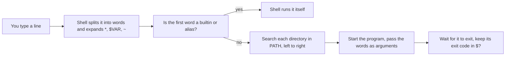
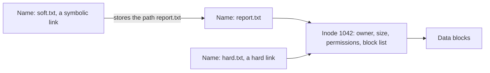

# Shell and filesystem basics

> **Status: AI draft, 2026-11-16.** Not yet verified by me. Commands and output were run in a throwaway container; addresses are rewritten to example ranges.

## In one line

The shell is a program that reads your command, finds the program it names by searching `PATH`, and starts it. Everything it works on lives in one tree of files that starts at `/`, where devices, processes and settings also appear as files.

## The plain idea

When you type `ls -l /var/log`, nothing magic happens. A program called the **shell** reads the line, splits it into words, works out that `ls` is the name of a program on disk, starts that program, and hands it the other words as arguments. When the program finishes, the shell prints a new prompt and waits.

The things you work on are arranged as one big tree. There are no drive letters. Every disk, USB stick or network share is attached somewhere inside that single tree, which starts at `/`, the **root directory**. Linux pushes the idea further than most systems: a running process, a hardware device and a kernel setting can all be read as if they were files. That is what people mean by "everything is a file", and it is why a handful of tools (`cat`, `ls`, `grep`) go such a long way.

## How it works

### What the shell does with a line



1. **Split and expand.** The shell breaks the line into words on spaces, then replaces patterns: `*.log` becomes the list of matching file names, `$HOME` becomes its value, `~` becomes your home directory. Quotes stop this: `"$name"` stays one word even if the value contains a space.
2. **Builtins first.** Some commands are part of the shell itself, because they must change the shell's own state. `cd` is one: a separate program could change only its own directory, not the shell's. `type` tells you which kind a command is.
3. **Search `PATH`.** `PATH` is a list of directories separated by colons. The shell looks in each one, left to right, and runs the first file it finds with that name. If none matches, you get `command not found`.
4. **Run and wait.** The shell starts the program as a child process and waits for it. The program's **exit code** (0 means success) is kept in `$?`.

**bash** and **sh** are both shells. `sh` is the minimal standard shell; on Ubuntu it is a small, fast shell called dash. `bash` adds features such as arrays and `[[ ]]` tests. A script's first line, the **shebang** (`#!/bin/bash`), tells the kernel which program should run the file. A script written for bash but started by sh fails on the bash-only lines.

### The filesystem tree

| Path | What lives there |
|---|---|
| `/etc` | System-wide configuration, as text files. |
| `/var` | Data that changes while the system runs: `/var/log` for logs, `/var/lib` for application state. |
| `/home` | One directory per user. `/root` is the administrator's home. |
| `/tmp` | Scratch space anyone can write to. Often cleared on reboot. |
| `/usr` | Installed programs and libraries. `/usr/bin` holds most commands. |
| `/opt` | Software installed outside the package manager. |
| `/proc` | Not on disk. The kernel's view of every running process (`/proc/<pid>`) and of itself. |
| `/sys` | Not on disk. Devices and kernel settings. |
| `/dev` | Device files: disks, terminals, `/dev/null`. |

A path that starts with `/` is **absolute**: it always means the same file. Any other path is **relative** to your current directory, which `pwd` prints. `.` means the current directory and `..` its parent.

### Files, inodes and links

A file has two parts. The data lives in blocks on disk. Everything else (size, owner, permissions, timestamps, and where the blocks are) lives in a record called an **inode**, identified by a number. A **directory** is a list that maps names to inode numbers. So a file name is not part of the file: it is an entry in a directory that points at the inode.



- A **hard link** is a second name for the same inode. Both names are equal; the data stays until the last name is removed. Hard links cannot cross filesystems, because inode numbers are only unique within one.
- A **symbolic link** (symlink) is a tiny file that contains a path. Open it and the kernel follows the path. If the target is deleted, the symlink is left dangling.

## A concrete example

You deploy a new release by unpacking it to `/opt/sample-app/releases/v2` and pointing a symlink `/opt/sample-app/current` at it. The service always starts `/opt/sample-app/current/bin/server`.

1. Before the switch, `current` points at `releases/v1`.
2. `ln -sfn releases/v2 /opt/sample-app/current` replaces the link in one step. `-s` makes a symlink, `-f` replaces an existing one, `-n` treats an existing link to a directory as a file instead of descending into it.
3. Restart the service. It follows `current` into `v2`.
4. To roll back, point `current` at `v1` again and restart. Nothing was copied or deleted.

This is why symlinks show up in release tooling, and why `ls -l` showing `->` is worth reading carefully when a "wrong version" is running.

## Why not just...?

- **...hard-code full paths to every program?** Scripts would break on every distribution that installs things in a slightly different place. `PATH` lets the same script run anywhere. The flip side: when two versions of a tool exist, the first one in `PATH` wins, and `which` or `type` shows which.
- **...use a hard link for the release switch?** You cannot hard-link a directory, and a hard link cannot cross filesystems. A symlink can do both.
- **...delete a log file to free space?** If a process still has the file open, its inode and data stay until the process closes it. The name is gone but the space is not. [Disks and filesystems](disks-and-filesystems.md) covers this case.

## Commands to know

Which program will run, and from where:

```console
# type cd ls echo
cd is a shell builtin
ls is /usr/bin/ls
echo is a shell builtin
# echo "$PATH"
/usr/local/sbin:/usr/local/bin:/usr/sbin:/usr/bin:/sbin:/bin
```

`type` asks the shell itself, so it knows about builtins and aliases. `which` only searches `PATH`.

The inode behind a name:

```console
# stat /tmp/a.txt
  File: /tmp/a.txt
  Size: 6         	Blocks: 8          IO Block: 4096   regular file
Device: 0,61	Inode: 10232751    Links: 1
Access: (0644/-rw-r--r--)  Uid: (    0/    root)   Gid: (    0/    root)
```

`Links: 1` counts the names pointing at this inode.

Hard and symbolic links, and what happens when the original name is removed:

```console
# ln /tmp/a.txt /tmp/hard.txt
# ln -s /tmp/a.txt /tmp/soft.txt
# ls -li /tmp/a.txt /tmp/hard.txt /tmp/soft.txt
10232751 -rw-r--r-- 2 root root  6 Nov 16 02:54 /tmp/a.txt
10232751 -rw-r--r-- 2 root root  6 Nov 16 02:54 /tmp/hard.txt
10232780 lrwxrwxrwx 1 root root 10 Nov 16 02:54 /tmp/soft.txt -> /tmp/a.txt
# rm /tmp/a.txt
# cat /tmp/hard.txt
hello
# cat /tmp/soft.txt
cat: /tmp/soft.txt: No such file or directory
```

`ls -i` prints the inode number first. The hard link shares inode `10232751` and the link count is 2. The symlink has its own inode and only stores a path.

Globbing and quoting:

```console
# ls
app.log  app.log.1  error.log  notes.txt  sample app
# echo *.log
app.log error.log
# echo "*.log"
*.log
# ls $name
ls: cannot access 'sample': No such file or directory
ls: cannot access 'app': No such file or directory
# ls "$name"
sample app
```

`*` matches any characters and `?` exactly one. The shell expands the pattern before the command runs; quotes stop the expansion. Without quotes, a variable whose value has a space becomes two words.

| Command | What it does |
|---|---|
| `pwd`, `cd <dir>`, `cd -` | Print the current directory; change it; go back to the previous one. |
| `ls -la` | List all files, including names starting with `.`, in long form. |
| `cp -r <src> <dst>`, `mv <src> <dst>`, `rm -r <dir>` | Copy, move or rename, delete. `-r` recurses into directories. There is no undo. |
| `mkdir -p a/b/c` | Create a directory and any missing parents. |
| `find /var/log -name "*.log" -mtime +7` | Files under `/var/log` named `*.log` and modified more than 7 days ago. |
| `file <path>` | Guess what a file contains from its bytes. Not installed in the minimal Ubuntu image. |

## How it breaks

| Symptom | Layer | Check | Likely cause |
|---|---|---|---|
| `command not found` for a tool you installed | `PATH` search | `echo "$PATH"`; `type <cmd>`; `ls -l <expected dir>` | Its directory is not in `PATH`, or it was installed for another user |
| An old version of a tool runs | `PATH` order | `type -a <cmd>` lists every match in order | An earlier `PATH` directory holds an older copy |
| `No such file or directory` when the file is clearly there | Paths or links | `ls -l` for `->`; `readlink -f <path>` | A dangling symlink, a relative path run from another directory, or a script whose shebang names a missing interpreter |
| A command acts on the wrong files, or on two names | Shell expansion | Run it with `echo` in front to see the expanded words | Missing quotes round a variable or pattern |
| `cd` in a script has no effect afterwards | Builtins and processes | Was the script run with `./script` or `source script`? | The script ran in a child shell; its directory change ended with it |

## Interview questions

**1. What happens between typing `ls -l` and seeing its output?**

<details markdown="1">
<summary>Answer</summary>

- The shell splits the line into words and expands patterns and variables.
- It checks for an alias or builtin, then searches each directory in `PATH` for a file named `ls`.
- It starts that program as a child process with `-l` as an argument and waits.
- The program writes to the terminal; the shell records its exit code in `$?`.

</details>

**2. Why is `cd` a shell builtin and not a program in `/usr/bin`?**

<details markdown="1">
<summary>Answer</summary>

- The current directory belongs to each process.
- A separate program would change its own directory and then exit, leaving the shell where it was.
- Only code running inside the shell process can change the shell's directory.

</details>

**3. What is an inode, and what does a directory actually contain?**

<details markdown="1">
<summary>Answer</summary>

- An inode is the record of a file's metadata: owner, permissions, size, timestamps, and where its data blocks are.
- It does not hold the file name.
- A directory is a list of names, each pointing at an inode number.

</details>

**4. What is the difference between a hard link and a symbolic link?**

<details markdown="1">
<summary>Answer</summary>

- A hard link is another name for the same inode; all names are equal, and the data stays until the last one is removed.
- A symlink is a separate small file that stores a path, followed when opened.
- Deleting the target leaves a symlink dangling but does not affect a hard link.
- Hard links cannot cross filesystems or point at directories; symlinks can.

</details>

**5. A script works when you run it, but fails in cron with `command not found`. Why?**

<details markdown="1">
<summary>Answer</summary>

- Cron runs jobs with a minimal environment and a short `PATH`.
- A tool in a directory such as `/usr/local/bin` or a user directory is not found.
- Fix: use full paths in the script, or set `PATH` at the top of the script or crontab.
- Check by printing `$PATH` from inside the job.

</details>

**6. `rm -rf $DIR/*` deleted far more than intended. What went wrong?**

<details markdown="1">
<summary>Answer</summary>

- `$DIR` was empty or unset, so the command became `rm -rf /*`.
- Unquoted variables are expanded and split by the shell before `rm` runs.
- Guards: `set -u` to fail on unset variables, `"${DIR:?}"` to stop if it is empty, quoting, and testing with `echo` first.

</details>

**7. Two versions of `terraform` are installed and the wrong one runs. How do you find out why?**

<details markdown="1">
<summary>Answer</summary>

- `type -a terraform` lists every match in `PATH` order; the first one wins.
- `echo "$PATH"` shows the order of directories.
- Fix by removing the old copy, reordering `PATH`, or calling the full path.
- After changing what is installed, `hash -r` clears bash's remembered locations.

</details>

## Try it

**Step 1.** Start a throwaway container.

```bash
docker run --rm -it ubuntu:24.04 bash
```

**Step 2.** Make a file, a hard link and a symlink. Predict what `ls -li` shows in the first column and the link count before you run it.

```bash
echo hello > /tmp/a.txt
ln /tmp/a.txt /tmp/hard.txt
ln -s /tmp/a.txt /tmp/soft.txt
ls -li /tmp/a.txt /tmp/hard.txt /tmp/soft.txt
```

**Step 3.** Remove the original name. Predict which of the two `cat` commands still works.

```bash
rm /tmp/a.txt
cat /tmp/hard.txt
cat /tmp/soft.txt
```

**Step 4.** See quoting change a command. Predict how many files each `ls` asks for.

```bash
cd /tmp && name="sample app" && touch "$name"
ls $name
ls "$name"
```

**Step 5.** Type `exit`. The container is deleted.

## Zoom out

Every later topic stands on this one: permissions are stored in the inode ([Users, groups and permissions](permissions.md)), processes appear under `/proc` ([Processes and signals](processes-and-signals.md)), and containers give a process its own view of this same tree ([What a container is](../containers/what-is-a-container.md)). The principle to carry: when a command does something surprising, find out exactly which program ran and exactly which words it received.

## Sources

- [GNU Bash manual: Shell operation and expansions](https://www.gnu.org/software/bash/manual/bash.html)
- [Filesystem Hierarchy Standard 3.0](https://refspecs.linuxfoundation.org/FHS_3.0/fhs/index.html)
- [inode(7) manual page](https://man7.org/linux/man-pages/man7/inode.7.html)
- [ln(1) manual page](https://man7.org/linux/man-pages/man1/ln.1.html)
- [path_resolution(7) manual page](https://man7.org/linux/man-pages/man7/path_resolution.7.html)
