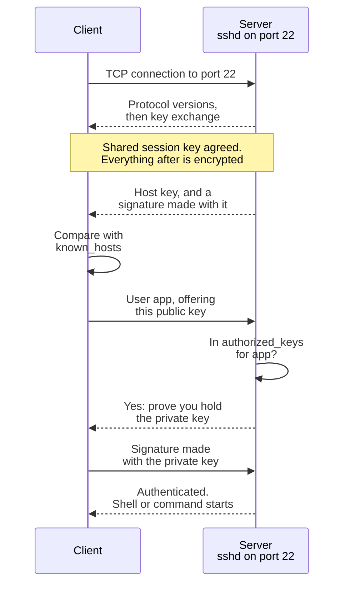
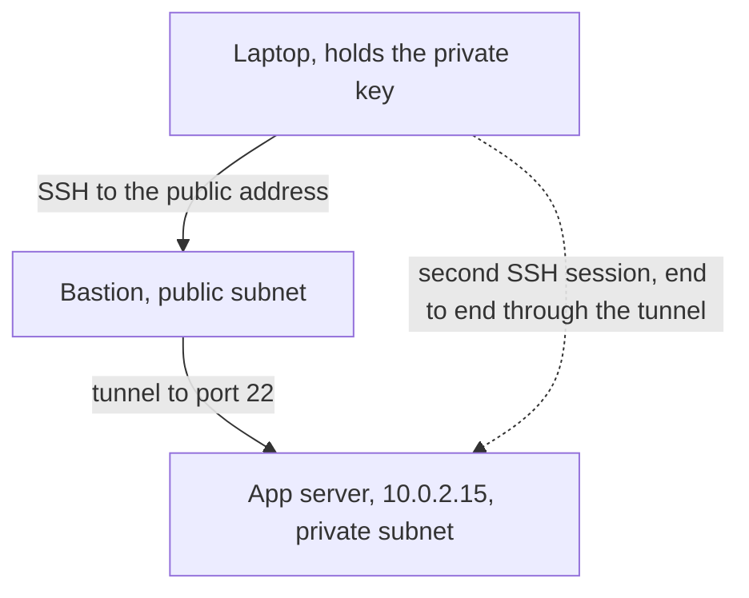

# SSH

> **Status: AI draft, 2026-11-16.** Not yet verified by me. Commands and output were run in a throwaway container with its own SSH server; key fingerprints are replaced with a placeholder.

## In one line

SSH opens an encrypted shell on another machine. The client first checks the server's host key against `known_hosts`, then proves who you are, usually with a key pair whose public half is in the server's `authorized_keys`. Bastions, `ProxyJump` and port forwarding are built on the same connection.

## The plain idea

Logging in to a remote server has two trust problems. You need to know you reached the real server and not an impostor. The server needs to know you are allowed in. **SSH** (Secure Shell) solves both and encrypts everything after.

The server proves itself with a **host key**: your client remembers it the first time and complains loudly if it ever changes. You prove yourself with a **key pair**: a private key that never leaves your machine, and a public key that you copy to every server you want to reach. The server sends a challenge only the private key can answer. No password crosses the network.

## How it works

### One connection, step by step



1. **Key exchange.** Client and server agree on a fresh session key without ever sending it, so a listener on the network learns nothing.
2. **Server authentication.** The server signs the exchange with its **host key**. The client looks the key up in `~/.ssh/known_hosts`. The first time, it asks you to accept it (or, with `StrictHostKeyChecking=accept-new`, adds it automatically). If a stored key no longer matches, the client refuses with a "REMOTE HOST IDENTIFICATION HAS CHANGED" warning: either the server was rebuilt, or someone is in the middle.
3. **User authentication.** The client offers a public key. If the server finds it in that user's `~/.ssh/authorized_keys`, it asks for a signature that only the matching private key can make. Passwords are a fallback that hardened servers turn off.
4. **Session.** A shell, a single command, a file copy or a tunnel runs inside the encrypted connection.

### Keys and files

| File | Side | Purpose |
|---|---|---|
| `~/.ssh/id_ed25519` | Client | Your private key. Mode `600`. Never copied anywhere. |
| `~/.ssh/id_ed25519.pub` | Client | Your public key. Safe to share. |
| `~/.ssh/known_hosts` | Client | Host keys of servers you have accepted. |
| `~/.ssh/config` | Client | Per-host settings: names, users, keys, jump hosts. |
| `~/.ssh/authorized_keys` | Server | Public keys allowed to log in as this user. |
| `/etc/ssh/sshd_config` | Server | Server settings. |
| `/etc/ssh/ssh_host_*_key` | Server | The server's host keys. |

**ed25519** is the modern default key type: short keys, fast and strong. RSA keys still work and need at least 3072 bits today.

The server is strict about permissions. If the user's home directory, `~/.ssh` or `authorized_keys` can be written by other users, sshd ignores the key, because anyone could have added theirs. The client is just as strict about the private key's mode.

### Bastions and `ProxyJump`

Private servers usually have no public address. You reach them through a **bastion** (jump host): a hardened machine in a public subnet that accepts SSH and forwards you on. `ProxyJump` does this in one command, and your private key never leaves your laptop, because the second connection is tunnelled through the first and authenticated end to end.



**Agent forwarding** (`ssh -A`) is the older way: it lets the bastion use your local `ssh-agent` to log in onward. Anyone with root on the bastion can use your agent while you are connected, so prefer `ProxyJump`.

On AWS, Systems Manager Session Manager can replace bastions altogether, with no inbound port at all ([Systems Manager](../aws-services/systems-manager.md)).

### Port forwarding

| Flag | Direction | Example use |
|---|---|---|
| `-L 5432:db.internal:5432` | Local: a port on your laptop reaches a host the server can see | Connect a local database client to a private database |
| `-R 8080:localhost:3000` | Remote: a port on the server reaches your laptop | Show a local service to the remote side |
| `-D 1080` | Dynamic: a SOCKS proxy through the server | Browse internal web pages through the server |

## A concrete example

You need a shell on `10.0.2.15`, a private app server, through the bastion at `203.0.113.10`.

```text
Host bastion
    HostName 203.0.113.10
    User ubuntu
    IdentityFile ~/.ssh/id_ed25519

Host app-1
    HostName 10.0.2.15
    User ubuntu
    ProxyJump bastion
```

1. With this in `~/.ssh/config`, `ssh app-1` connects to the bastion, opens a tunnel to `10.0.2.15:22`, and runs a second SSH session through it.
2. The app server checks your key against its own `authorized_keys`. The bastion never sees your private key or the session contents.
3. To reach the app server's private database from your laptop: `ssh -L 5432:db.internal:5432 app-1`, then point your client at `localhost:5432`.

## Why not just...?

- **...use passwords?** They can be guessed and phished, and bots try them against every public server all day. Keys cannot be guessed, and turning password login off removes the whole attack.
- **...copy your private key to the bastion?** Anyone with root on the bastion, or anyone who breaks into it later, gets your key. `ProxyJump` gives the same reach with the key staying on your laptop.
- **...delete the line from `known_hosts` whenever SSH complains about a changed key?** That warning is the only thing standing between you and someone in the middle. Find out why the key changed (a rebuilt server, a reused address) before removing it, with `ssh-keygen -R <host>`.

## Commands to know

Create a key pair:

```bash
ssh-keygen -t ed25519 -C "ci@example.com"
```

`-t` is the key type, `-C` a comment that ends up in the public key, `-f` picks the file name, and `-N ""` sets an empty passphrase (only for automation).

First connection, which records the host key:

```console
# ssh -o StrictHostKeyChecking=accept-new app@localhost "whoami; echo connected"
Warning: Permanently added 'localhost' (ED25519) to the list of known hosts.
app
connected
```

Running a single command remotely, as here, is how scripts use SSH.

The handshake in verbose mode, trimmed to the lines that matter:

```console
# ssh -v app@localhost true
debug1: Connecting to localhost [::1] port 22.
debug1: Server host key: ssh-ed25519 SHA256:<fingerprint>
debug1: Authentications that can continue: publickey,password
debug1: Offering public key: /root/.ssh/id_ed25519 ED25519 SHA256:<fingerprint>
debug1: Server accepts key: /root/.ssh/id_ed25519 ED25519 SHA256:<fingerprint>
Authenticated to localhost ([::1]:22) using "publickey".
```

`-v` is the first thing to try when a login fails: it shows whether you reached the server, which keys were offered and which the server accepted. `-vvv` gives more.

The same login after making the user's home directory writable by everyone:

```console
# chmod 777 /home/app
# ssh -o BatchMode=yes app@localhost true
app@localhost: Permission denied (publickey,password).
```

Nothing about the key changed. sshd refused it because the directory holding `authorized_keys` was writable by others. The server's log, not the client, says why. `BatchMode=yes` stops ssh from asking for a password.

Key file permissions on the client:

```console
# ls -l /root/.ssh
-rw------- 1 root root 411 Nov 16 03:07 id_ed25519
-rw-r--r-- 1 root root 96 Nov 16 03:07 id_ed25519.pub
-rw------- 1 root root 978 Nov 16 03:07 known_hosts
```

A host alias from `~/.ssh/config`:

```console
# cat /root/.ssh/config
Host app-local
  HostName localhost
  User app
  IdentityFile ~/.ssh/id_ed25519
# ssh app-local "echo via config"
via config
```

| Command | What it does |
|---|---|
| `ssh-copy-id user@host` | Append your public key to the server's `authorized_keys`. |
| `ssh -J bastion -l ubuntu 10.0.2.15` | `ProxyJump` on the command line; `-l` names the remote user. |
| `ssh -f -N -L 9000:localhost:22 host` | Background a local port forward with no remote command. |
| `scp file user@host:/tmp/`, `rsync -avz dir/ user@host:dir/` | Copy files over SSH. `rsync` copies only what changed. |
| `ssh-keygen -R host` | Remove a host's stored key from `known_hosts`, once you know why it changed. |
| `ssh-keygen -lf /etc/ssh/ssh_host_ed25519_key.pub` | Print a host key's fingerprint, to compare with what the client shows. |
| `eval "$(ssh-agent)"` then `ssh-add` | Hold a decrypted key in memory so you type its passphrase once. |

Server hardening in `/etc/ssh/sshd_config`: `PasswordAuthentication no`, `PermitRootLogin no` (or `prohibit-password`), `AllowUsers` or `AllowGroups` to limit who may log in. Check the file with `sshd -t` before reloading, so a typo does not lock you out, and keep an existing session open while you test a new one.

## How it breaks

| Symptom | Layer | Check | Likely cause |
|---|---|---|---|
| `Connection timed out` | Network | `nc -vz host 22`; security group, NACL, route | Port 22 blocked, wrong address, no route |
| `Connection refused` | Server process | `systemctl status ssh` on the server | sshd not running, or listening on another port |
| `Permission denied (publickey)` | Authentication | `ssh -v`; the server log (`journalctl -u ssh`) | Wrong user, key not in `authorized_keys`, or bad permissions on home, `~/.ssh` or the file |
| `REMOTE HOST IDENTIFICATION HAS CHANGED` | Host key | Compare the fingerprint with the server's real key | Server rebuilt or address reused; or a real attack |
| `UNPROTECTED PRIVATE KEY FILE` | Client key permissions | `ls -l ~/.ssh/id_*` | Private key readable by others; `chmod 600` it |
| Connection drops after some idle minutes | Idle timeouts | NAT or firewall idle timeout | Set `ServerAliveInterval 60` in the client config |

## Interview questions

**1. What happens when you run `ssh user@host`?**

<details markdown="1">
<summary>Answer</summary>

- A TCP connection to port 22, then a key exchange that creates a shared session key.
- The server proves its identity with its host key, which the client checks against `known_hosts`.
- The user authenticates, usually by proving possession of a private key whose public key is in `authorized_keys`.
- A shell or command runs inside the encrypted channel.

</details>

**2. What are `known_hosts` and `authorized_keys`, and on which side does each live?**

<details markdown="1">
<summary>Answer</summary>

- `known_hosts` is on the client: host keys of servers it has accepted, so it can detect impostors.
- `authorized_keys` is on the server, per user: public keys allowed to log in as that user.

</details>

**3. Why is `ProxyJump` safer than agent forwarding?**

<details markdown="1">
<summary>Answer</summary>

- With agent forwarding, root on the bastion can use your agent to authenticate as you while you are connected.
- With `ProxyJump`, the bastion only forwards an encrypted TCP stream; authentication to the target happens end to end from your laptop.
- The private key never leaves the laptop in either case, but only `ProxyJump` keeps its use off the bastion.

</details>

**4. You get `Permission denied (publickey)` with a key you know is correct. What do you check?**

<details markdown="1">
<summary>Answer</summary>

- `ssh -v` to see which key was offered and to which user.
- On the server: the key is in the right user's `authorized_keys`, and home, `~/.ssh` (700) and `authorized_keys` (600) are not writable by others.
- The server log, which states the reason for the refusal.
- `sshd_config` settings such as `AllowUsers` or a disabled key type.

</details>

**5. SSH warns that the remote host identification has changed. What do you do?**

<details markdown="1">
<summary>Answer</summary>

- Do not just delete the line: it can mean someone is intercepting the connection.
- Find out whether the server was rebuilt or its address reused, and get the real fingerprint from a trusted channel.
- Only then remove the old key with `ssh-keygen -R host` and accept the new one.

</details>

**6. How do you reach a database in a private subnet from your laptop?**

<details markdown="1">
<summary>Answer</summary>

- Local port forwarding through a host that can reach it: `ssh -L 5432:db-host:5432 bastion`.
- Then connect the client to `localhost:5432`.
- Alternatives: a VPN, or Session Manager port forwarding on AWS, which needs no open inbound port.

</details>

**7. How would you harden SSH on a public server?**

<details markdown="1">
<summary>Answer</summary>

- Keys only: `PasswordAuthentication no`; no direct root login.
- Restrict who may log in (`AllowUsers` or `AllowGroups`) and where from (security group or firewall).
- Keep the server patched; consider removing public SSH entirely in favour of a bastion or Session Manager.
- Test with `sshd -t` and a second session before closing the first.

</details>

## Try it

**Step 1.** Start a container with an SSH server and a user.

```bash
docker run --rm -it ubuntu:24.04 bash
apt-get update -qq && apt-get install -y -qq openssh-server openssh-client
mkdir -p /run/sshd && ssh-keygen -A && /usr/sbin/sshd
useradd -m -s /bin/bash app
```

**Step 2.** Create a key, install it for `app`, and log in.

```bash
ssh-keygen -t ed25519 -N "" -f ~/.ssh/id_ed25519
mkdir -p /home/app/.ssh && cp ~/.ssh/id_ed25519.pub /home/app/.ssh/authorized_keys
chown -R app:app /home/app/.ssh && chmod 700 /home/app/.ssh && chmod 600 /home/app/.ssh/authorized_keys
ssh -o StrictHostKeyChecking=accept-new app@localhost whoami
```

**Step 3.** Predict what happens if the home directory becomes writable by everyone, then try it and put it back.

```bash
chmod 777 /home/app
ssh -o BatchMode=yes app@localhost whoami
chmod 750 /home/app
```

**Step 4.** Type `exit`. The container is deleted.

## Zoom out

SSH is the front door to every server, and the same trust model comes back elsewhere: Git over SSH uses these keys ([Remotes, pull requests and access](../git/remotes-and-collaboration.md)), and TLS uses certificates to solve the same "is this the real server?" problem ([TLS and certificates](../networking/tls.md)). Without it, remote administration means passwords on the wire. The principle to carry: each side must prove who it is, and a changed identity is an alarm, not an inconvenience.

## Sources

- [OpenSSH manual pages: ssh, sshd, ssh_config, sshd_config, ssh-keygen](https://www.openssh.org/manual.html)
- [ssh(1) manual page](https://man.openbsd.org/ssh)
- [sshd(8) manual page: authorized_keys and StrictModes](https://man.openbsd.org/sshd)
- [ssh_config(5) manual page: ProxyJump](https://man.openbsd.org/ssh_config)
- [RFC 4253: the SSH transport layer protocol](https://www.rfc-editor.org/rfc/rfc4253.html)
- [AWS Systems Manager: Session Manager](https://docs.aws.amazon.com/systems-manager/latest/userguide/session-manager.html)
