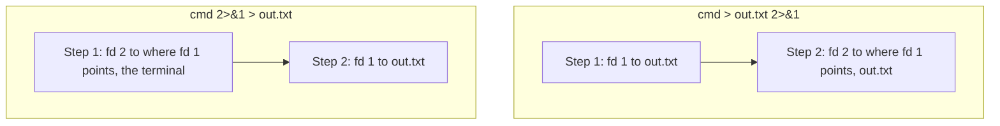
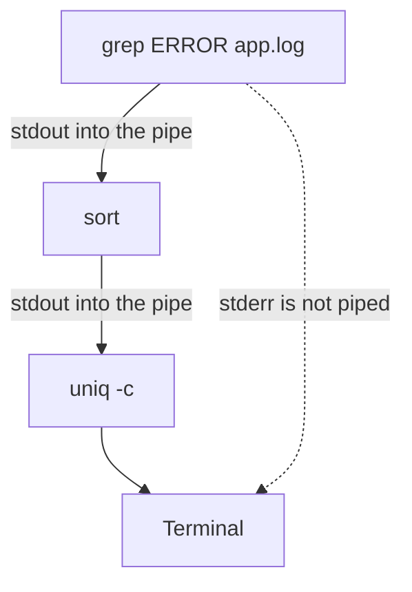

# Streams, pipes and redirection

> **Status: AI draft, 2026-11-16.** Not yet verified by me. Commands and output were run in a throwaway container; addresses are rewritten to example ranges.

## In one line

Every process starts with three open streams: stdin (0), stdout (1) and stderr (2). Redirection points them at files, and a pipe connects one process's stdout to the next one's stdin. The order of redirections matters, and a pipeline's exit code is the last command's unless you set `pipefail`.

## The plain idea

A program does not know or care where its output goes. It writes to "output number 1" and reads from "input number 0". Whether those lead to your terminal, a file or another program is decided by whoever started it, usually the shell, before the program runs.

That one idea is why small tools combine so well. `grep` does not need a "read from a log file" option or a "send results to wc" option. The shell wires its input and output, and each tool does one job.

Programs also get a second output, **stderr**, kept for error messages. It exists so that errors still reach your screen when the normal output is going into a file or a pipe.

## How it works

### File descriptors

The kernel gives every process a table of open files. Each entry is a small number, a **file descriptor**. Three are open from the start:

| Descriptor | Name | Default |
|---|---|---|
| 0 | **stdin** (standard input) | Your keyboard, through the terminal |
| 1 | **stdout** (standard output) | Your terminal |
| 2 | **stderr** (standard error) | Your terminal |

Redirection does not change the program. Before starting it, the shell opens a file and puts it in slot 0, 1 or 2. You can see the table of any process in `/proc/<pid>/fd`.

### Redirection operators

| You write | Effect |
|---|---|
| `cmd > file` | stdout to `file`, **replacing** its contents |
| `cmd >> file` | stdout to `file`, **appending** |
| `cmd 2> file` | stderr to `file` |
| `cmd > file 2>&1` | stdout to `file`, then stderr to wherever stdout now points: both into `file` |
| `cmd &> file` | bash shorthand for the line above |
| `cmd < file` | stdin read from `file` |
| `cmd 2> /dev/null` | Throw stderr away. `/dev/null` discards everything written to it |

### Why the order of `2>&1` matters

`2>&1` means "make descriptor 2 point to **where descriptor 1 points right now**". It copies a pointer; it does not create a lasting link. The shell processes redirections left to right.



In the first form both streams end up in the file. In the second, errors still go to the terminal, because when `2>&1` ran, descriptor 1 still pointed at the terminal.

### Pipes



`a | b` starts both programs at the same time and connects a's stdout to b's stdin through a kernel buffer called a **pipe**. Data flows as it is produced; `b` does not wait for `a` to finish. Only stdout goes through the pipe. stderr still goes to the terminal unless you add `2>&1` before the `|`.

### A pipeline's exit code

By default, a pipeline's exit code is the **last** command's. So `failing-command | tee log.txt` reports success, because `tee` succeeded. Two fixes:

- `set -o pipefail` makes the pipeline fail if any command in it fails. Scripts should set it.
- `${PIPESTATUS[@]}` in bash holds the exit code of every command in the last pipeline.

### Other plumbing

- **tee** copies its input to a file and to stdout, so you can keep a log and still see the output.
- **xargs** turns lines of input into arguments for another command: `find ... | xargs rm`.
- **Command substitution**, `$(cmd)`, runs a command and puts its output into the line.
- A **here-document**, `cmd <<EOF ... EOF`, feeds several lines to stdin. With `<<'EOF'` (quoted) the shell does not expand variables inside it.

### Buffering

Programs usually buffer stdout: when it goes to a terminal it is flushed line by line, but when it goes to a pipe or file it is written in larger blocks. stderr is normally unbuffered. That is why output can appear late, or out of order with error messages, in a log file. `grep --line-buffered` and `stdbuf -oL <cmd>` force line-by-line output.

## A concrete example

A nightly backup job runs `backup.sh > /var/log/backup.log`, and the log looks fine even on nights the backup failed.

1. The errors went to stderr, and only stdout was redirected. In a cron job, stderr may be mailed to a mailbox nobody reads, or discarded.
2. Change the line to `backup.sh >> /var/log/backup.log 2>&1`. Now both streams are appended to the log, in the right order.
3. Inside the script, the key step was `pg_dump sample_db | gzip > dump.gz`. When `pg_dump` failed, `gzip` still succeeded, so the script's check of `$?` passed. Add `set -o pipefail` at the top, and the failure now stops the script with a non-zero code.
4. The monitoring that watches the job's exit code now sees the failure.

## Why not just...?

- **...use `>` everywhere?** `>` truncates the file first. Running a job twice with `>` keeps only the last run, and `cmd > file` where `cmd` reads `file` destroys the input before it is read.
- **...use `cmd 2>&1 > file` because it reads naturally?** It does not do what it says: errors stay on the terminal. Write the file redirection first.
- **...use `cat file | grep x`?** It works, and the cost is usually small. `grep x file` does the same with one process fewer, and lets `grep` report the file name.

## Commands to know

stdout to a file, stderr still on the screen:

```console
# ls /srv/demo /nope > /tmp/out.txt
ls: cannot access '/nope': No such file or directory
# cat /tmp/out.txt
/srv/demo:
report.txt
run.sh
```

Both into the file, then the wrong order:

```console
# ls /srv/demo /nope > /tmp/out.txt 2>&1
# cat /tmp/out.txt
ls: cannot access '/nope': No such file or directory
/srv/demo:
report.txt
run.sh
# ls /srv/demo /nope 2>&1 > /tmp/out.txt
ls: cannot access '/nope': No such file or directory
```

Replace versus append:

```console
# echo one > /tmp/f; echo two >> /tmp/f; echo three > /tmp/f; cat /tmp/f
three
```

A pipeline's exit code:

```console
# false | true; echo "without pipefail: $?"
without pipefail: 0
# set -o pipefail; false | true; echo "with pipefail: $?"
with pipefail: 1
# ls /nope 2>/dev/null | wc -l; echo "PIPESTATUS: ${PIPESTATUS[@]}"
0
PIPESTATUS: 2 0
```

`tee`, `xargs` and a here-document:

```console
# echo "deploy started" | tee /tmp/deploy.log | tr a-z A-Z
DEPLOY STARTED
# cat /tmp/deploy.log
deploy started
# printf "a.tmp\nb.tmp\n" | xargs rm -v
removed 'a.tmp'
removed 'b.tmp'
# cat <<EOF
home: $HOME
EOF
home: /root
```

| Command | What it does |
|---|---|
| `cmd 2>&1`, then a pipe to `grep x` | Search errors and output together. |
| `xargs -0` with `find -print0` | Handle file names that contain spaces or newlines safely. |
| `xargs -n 1 -P 4` | One argument per command, four commands at a time. |
| `exec > >(tee -a run.log) 2>&1` | At the top of a bash script: send all later output to the terminal and a log. |
| `ls -l /proc/<pid>/fd` | Where a running process's descriptors point. |

## How it breaks

| Symptom | Layer | Check | Likely cause |
|---|---|---|---|
| A log file is missing the error messages | Redirection | Look for `2>&1` and its position | Only stdout was redirected, or `2>&1` came before `> file` |
| A script reports success although a step failed | Pipeline exit code | `echo "${PIPESTATUS[@]}"` after the pipeline | No `set -o pipefail`; the last command succeeded |
| A file is empty after `sort file > file` | Truncation | Is the same file both input and output? | The shell truncated the output file before `sort` read it |
| Output appears late or in bursts in a pipe | Buffering | Does it change with `stdbuf -oL`? | The producer buffers stdout when it is not a terminal |
| `xargs` breaks on some file names | Argument splitting | Names with spaces or quotes | Pipe `find -print0` into `xargs -0` |

## Interview questions

**1. What are stdin, stdout and stderr, and why does stderr exist?**

<details markdown="1">
<summary>Answer</summary>

- File descriptors 0, 1 and 2, open in every process from the start.
- stdin is input, stdout is normal output, stderr is error output.
- stderr is separate so errors still reach the user when stdout goes to a file or pipe.

</details>

**2. What is the difference between `cmd > file 2>&1` and `cmd 2>&1 > file`?**

<details markdown="1">
<summary>Answer</summary>

- Redirections are applied left to right, and `2>&1` copies where fd 1 points at that moment.
- In the first, stdout goes to the file, then stderr follows it: both land in the file.
- In the second, stderr is pointed at the terminal first, then stdout moves to the file: errors stay on screen.

</details>

**3. What does a pipe do, and does the second command wait for the first to finish?**

<details markdown="1">
<summary>Answer</summary>

- It connects one process's stdout to the next one's stdin through a kernel buffer.
- Both run at the same time; data flows as it is produced.
- Only stdout is piped; stderr is not unless redirected first.

</details>

**4. What is `set -o pipefail` for?**

<details markdown="1">
<summary>Answer</summary>

- By default a pipeline returns the last command's exit code, hiding earlier failures.
- `pipefail` makes the pipeline return a failure if any command in it fails.
- `PIPESTATUS` shows each command's code.

</details>

**5. A cron job's log shows nothing on nights it failed. What do you change?**

<details markdown="1">
<summary>Answer</summary>

- Redirect both streams: `>> job.log 2>&1`, in that order, and append rather than overwrite.
- Add `set -euo pipefail` so failures inside pipelines stop the script with a non-zero code.
- Make sure something alerts on the job's exit code.

</details>

**6. A colleague runs `sort data.txt > data.txt` and the file is now empty. Why?**

<details markdown="1">
<summary>Answer</summary>

- The shell sets up redirections before starting the command.
- `>` truncated `data.txt` to zero bytes before `sort` opened it for reading.
- Write to a temporary file and move it, or use `sort -o data.txt data.txt`, which reads everything first.

</details>

## Try it

**Step 1.** Start a throwaway container.

```bash
docker run --rm -it ubuntu:24.04 bash
```

**Step 2.** Predict, for each line, what appears on the screen and what ends up in `/tmp/out.txt`. Then run them and `cat` the file after each.

```bash
ls / /nope > /tmp/out.txt
ls / /nope > /tmp/out.txt 2>&1
ls / /nope 2>&1 > /tmp/out.txt
```

**Step 3.** Predict both exit codes before you run them.

```bash
false | true; echo $?
set -o pipefail; false | true; echo $?
```

**Step 4.** Type `exit`. The container is deleted.

## Zoom out

Containers and Kubernetes rely on the same streams: a container's stdout and stderr are what `docker logs` and `kubectl logs` show, collected by the runtime ([How Kubernetes logging works](../observability/kubernetes-logging.md)). Without redirection every tool would need its own file and filter options. The principle to carry: a program writes to numbers, and whoever starts it decides where those numbers lead.

## Sources

- [GNU Bash manual: Redirections](https://www.gnu.org/software/bash/manual/html_node/Redirections.html)
- [GNU Bash manual: Pipelines](https://www.gnu.org/software/bash/manual/html_node/Pipelines.html)
- [pipe(7) manual page](https://man7.org/linux/man-pages/man7/pipe.7.html)
- [stdin(3) manual page](https://man7.org/linux/man-pages/man3/stdin.3.html)
- [xargs(1) manual page](https://man7.org/linux/man-pages/man1/xargs.1.html)
- [tee(1) manual page](https://man7.org/linux/man-pages/man1/tee.1.html)
