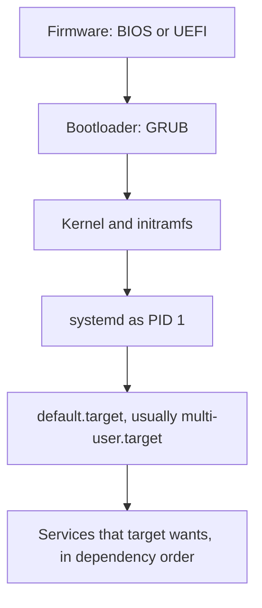

# Boot, systemd and services

> **Status: AI draft, 2026-11-16.** Not yet verified by me. Commands are from the official documentation and were not run; output is illustrative.

## In one line

systemd is PID 1 on most Linux servers: it starts services from unit files, restarts them when they fail, captures their logs in the journal, and orders startup by dependencies. `systemctl status` and `journalctl -u` are the first two commands for any service problem.

## The plain idea

When a server boots, something has to start the database, the web server, the log shipper and the SSH daemon, in a sensible order, and keep them running. On most current distributions that something is **systemd**.

You describe each service in a small text file: what command to run, as which user, what it depends on, and what to do if it dies. systemd reads these files, starts everything, watches every process it started, restarts what crashes, and keeps each service's output in one searchable log. One tool, `systemctl`, starts, stops and inspects them all.

## How it works

### Boot, briefly



1. The **firmware** finds a bootable disk and starts the **bootloader** (GRUB on most servers).
2. GRUB loads the **kernel** and a small temporary filesystem, the **initramfs**, which holds the drivers needed to find the real root disk.
3. The kernel mounts the root filesystem and starts **PID 1**, which is systemd.
4. systemd starts the **default target** and everything it needs.

### Units

Everything systemd manages is a **unit**, described by a unit file. The suffix says the type:

| Type | What it manages | Example |
|---|---|---|
| `.service` | A process or a one-off command | `nginx.service` |
| `.timer` | A schedule that starts a service ([Cron and timers](cron-and-timers.md)) | `backup.timer` |
| `.socket` | A listening socket that starts a service on the first connection | `docker.socket` |
| `.target` | A named group of units, used as a synchronisation point | `multi-user.target`, `network-online.target` |
| `.mount` | A mounted filesystem | `data.mount` |

Packaged unit files live in `/usr/lib/systemd/system/` (or `/lib/systemd/system/`). Your own, and your overrides, go in `/etc/systemd/system/`, which takes precedence.

### Anatomy of a service unit

```ini
[Unit]
Description=Sample API
After=network-online.target
Wants=network-online.target

[Service]
User=app
WorkingDirectory=/opt/sample-app
Environment=PORT=8080
EnvironmentFile=-/etc/sample-app/env
ExecStart=/opt/sample-app/bin/server
Restart=on-failure
RestartSec=5

[Install]
WantedBy=multi-user.target
```

| Line | Meaning |
|---|---|
| `After=` | Ordering only: start after these units if they are being started. It does not pull them in. |
| `Wants=` | A soft dependency: start these too. `Requires=` is the hard version: if the required unit fails, this one is stopped. |
| `User=` | Run as this user instead of root. |
| `Environment=`, `EnvironmentFile=` | Set environment variables. The `-` before the path means "ignore the file if it is missing". |
| `ExecStart=` | The command, with a full path. systemd does not use a shell, so pipes and `$VAR` expansion need `/bin/sh -c`. |
| `Restart=on-failure` | Restart if the process exits non-zero or is killed by a signal. `always` restarts even after a clean exit. |
| `RestartSec=` | Wait this long before restarting. |
| `WantedBy=` | What `systemctl enable` hooks this unit into, so it starts at boot. |

**Service types.** The default, `Type=simple`, assumes the process started by `ExecStart` is the service and stays in the foreground. A program that forks into the background needs `Type=forking`. A command that runs and finishes uses `Type=oneshot`. Most modern programs should simply stay in the foreground.

**Restart limits.** If a service fails too often in a short window (by default 5 starts within 10 seconds), systemd gives up and leaves it `failed` until you reset it. `StartLimitIntervalSec=` and `StartLimitBurst=` in `[Unit]` change the window.

### Stopping

`systemctl stop` sends SIGTERM to the service's processes, waits (90 seconds by default, `TimeoutStopSec=`), then sends SIGKILL ([Processes and signals](processes-and-signals.md)). Every process the service started is in the service's own cgroup, so none are left behind.

### supervisord compared

Some applications, especially containers that run several processes, use **supervisord** instead: a Python program that starts and restarts processes listed in its own config file, controlled with `supervisorctl`.

| | systemd | supervisord |
|---|---|---|
| Runs as | PID 1 on the host | An ordinary process, often started by systemd or as a container's entrypoint |
| Scope | The whole system: boot, mounts, timers, sockets | Only the programs listed in its config |
| Logs | Journal | Its own log files per program |
| Typical use | Every service on a server | Several processes inside one container, or older setups |

## A concrete example

A new service, `sample-api`, will not stay up after a deploy.

1. `systemctl status sample-api` shows `Active: activating (auto-restart) (Result: exit-code)`, with the last few log lines underneath. It is crashing and being restarted.
2. `journalctl -u sample-api -n 50 --no-pager` shows `Error: open /etc/sample-app/config.yaml: permission denied`.
3. `systemctl cat sample-api` shows `User=app`. The config file was copied as root with mode `600`, so the `app` user cannot read it ([Users, groups and permissions](permissions.md)).
4. Fix the ownership, then `systemctl restart sample-api`.
5. If it had stopped restarting and shown `start request repeated too quickly`, also run `systemctl reset-failed sample-api` to clear the start limit.

## Why not just...?

- **...start it with `nohup ./server &` from a shell?** Nothing restarts it when it crashes, it does not start after a reboot, its output goes to a stray file, and stopping it means hunting for its PID.
- **...edit the packaged unit file in `/usr/lib/systemd/system`?** The next package upgrade overwrites it. Use `systemctl edit <unit>`, which writes an override in `/etc/systemd/system/<unit>.d/` that survives upgrades.
- **...put `After=network.target` and assume the network is ready?** `network.target` means the network stack has started, not that an address is configured. For a service that must connect out at start, use `network-online.target` with both `After=` and `Wants=`, or better, make the service retry.

## Commands to know

Status, the first command for any service:

```console
$ systemctl status sample-api
● sample-api.service - Sample API
     Loaded: loaded (/etc/systemd/system/sample-api.service; enabled; preset: enabled)
     Active: active (running) since Mon 2026-11-16 09:12:04 UTC; 3min ago
   Main PID: 2311 (server)
      Tasks: 9 (limit: 4598)
     Memory: 41.2M
        CPU: 1.204s
     CGroup: /system.slice/sample-api.service
             └─2311 /opt/sample-app/bin/server
```

`Loaded` shows the unit file path and whether it is **enabled** (starts at boot). `Active` shows the state and since when. `CGroup` lists every process belonging to the service.

| Command | What it does |
|---|---|
| `systemctl start`, `stop`, `restart` `<unit>` | Change the state now. |
| `systemctl reload <unit>` | Ask the service to reload its config without restarting, if the unit supports it. |
| `systemctl enable --now <unit>` | Start at boot, and start now. `disable` reverses it. |
| `systemctl daemon-reload` | Re-read unit files after you change one. Without it, systemd keeps using the old version. |
| `systemctl cat <unit>` | The unit file and every override, as systemd sees them. |
| `systemctl edit <unit>` | Create an override file. |
| `systemctl list-units --failed` | Every unit in the failed state. |
| `systemctl is-active <unit>`, `is-enabled <unit>` | One-word answers, for scripts. |
| `journalctl -u <unit> -f` | Follow the unit's logs ([Logs](logs.md)). |
| `systemd-analyze blame` | How long each unit took during boot. |

## How it breaks

| Symptom | Layer | Check | Likely cause |
|---|---|---|---|
| `activating (auto-restart)` in a loop | The program | `journalctl -u <unit> -n 50` | It crashes at start: bad config, permissions, a missing dependency |
| `start request repeated too quickly` | Start limit | `systemctl status` | Restarted too often; fix the cause, then `systemctl reset-failed` |
| A change to the unit file has no effect | Unit cache | Did you run `daemon-reload`? | systemd still uses the old definition |
| Service not running after a reboot | Enablement | `systemctl is-enabled <unit>` | Started by hand but never enabled |
| `status=203/EXEC` | `ExecStart` | `systemctl cat`; `ls -l` the binary | Wrong path, no execute bit, or a script with a bad shebang |
| Works from a shell, fails as a service | Environment | Compare `User=`, `WorkingDirectory=`, environment | systemd does not load your shell profile; relative paths and variables differ |
| `Active: active (exited)` for a long-running program | Service type | Does the program fork into the background? | `Type=simple` with a program that daemonises itself |

## Interview questions

**1. What is systemd, and what is a unit?**

<details markdown="1">
<summary>Answer</summary>

- The init system and service manager, running as PID 1 on most Linux distributions.
- It starts, stops, supervises and logs services, and orders the boot by dependencies.
- A unit is anything it manages, described by a file: services, timers, sockets, targets, mounts.

</details>

**2. What is the difference between `After=` and `Requires=`?**

<details markdown="1">
<summary>Answer</summary>

- `After=` is ordering only: if both start, this one starts later.
- `Requires=` (and the softer `Wants=`) pulls the other unit in.
- They are usually used together: `Wants=` or `Requires=` to start it, `After=` to wait for it.

</details>

**3. You edited a unit file and restarted the service, but nothing changed. Why?**

<details markdown="1">
<summary>Answer</summary>

- systemd caches unit definitions.
- Run `systemctl daemon-reload` after editing, then restart.
- `systemctl cat` shows the definition systemd is actually using, including overrides.

</details>

**4. A service keeps restarting. Walk me through your investigation.**

<details markdown="1">
<summary>Answer</summary>

- `systemctl status` for the state, exit code and last log lines.
- `journalctl -u <unit>` around the restarts for the real error.
- `systemctl cat` to check `ExecStart`, `User`, environment and working directory.
- Reproduce as that user with the same environment; fix the cause, then `reset-failed` if the start limit was hit.

</details>

**5. How do you change a setting of a packaged service without your change being lost on upgrade?**

<details markdown="1">
<summary>Answer</summary>

- `systemctl edit <unit>` creates a drop-in override in `/etc/systemd/system/<unit>.d/`.
- Overrides survive package upgrades and take precedence.
- `daemon-reload` and restart to apply.

</details>

**6. What happens when you run `systemctl stop` on a service?**

<details markdown="1">
<summary>Answer</summary>

- systemd sends SIGTERM to the service's processes (all of its cgroup by default).
- It waits up to `TimeoutStopSec` (90 seconds by default).
- Anything still running then gets SIGKILL.

</details>

**7. When would you choose supervisord over systemd?**

<details markdown="1">
<summary>Answer</summary>

- Inside a container that must run several processes, where systemd is not PID 1.
- On older setups that already use it.
- On a normal server, systemd is already there and does more: boot ordering, journal, cgroups, timers.

</details>

## Try it

*Untested: written from documentation.* Run this on a Linux virtual machine with systemd, not in a plain container.

**Step 1.** Create a service that writes a line every 5 seconds.

```bash
sudo tee /etc/systemd/system/hello.service >/dev/null <<'EOF'
[Unit]
Description=Hello loop

[Service]
ExecStart=/bin/sh -c 'while true; do echo hello; sleep 5; done'
Restart=on-failure
EOF
sudo systemctl daemon-reload
sudo systemctl start hello
```

**Step 2.** Inspect it, and follow its log.

```bash
systemctl status hello
journalctl -u hello -f
```

**Step 3.** Kill its main process with SIGKILL and predict what systemd does, then check `status` again.

```bash
sudo systemctl kill -s KILL hello
systemctl status hello
```

**Step 4.** Clean up.

```bash
sudo systemctl stop hello
sudo rm /etc/systemd/system/hello.service
sudo systemctl daemon-reload
```

## Zoom out

systemd keeps services alive on a single server; Kubernetes does the same job across many machines, with the same ideas of desired state, restart policies and graceful stops ([Architecture and the reconcile loop](../kubernetes/architecture.md)). Without a supervisor, a crash at 3 a.m. stays down until someone notices. The principle to carry: `status` for what happened, the journal for why, `cat` for how it is configured.

## Sources

- [systemd.service(5)](https://www.freedesktop.org/software/systemd/man/latest/systemd.service.html)
- [systemd.unit(5)](https://www.freedesktop.org/software/systemd/man/latest/systemd.unit.html)
- [systemd.kill(5): stopping and SIGTERM](https://www.freedesktop.org/software/systemd/man/latest/systemd.kill.html)
- [systemctl(1)](https://www.freedesktop.org/software/systemd/man/latest/systemctl.html)
- [bootup(7): the boot process](https://www.freedesktop.org/software/systemd/man/latest/bootup.html)
- [systemd: network targets explained](https://systemd.io/NETWORK_ONLINE/)
- [Supervisor documentation](https://supervisord.org/)
