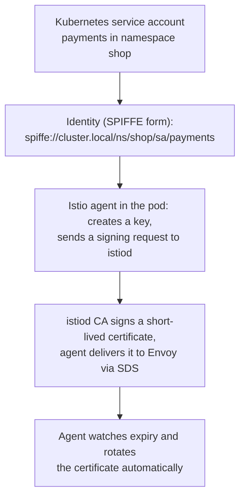

# mTLS and authorization

> **Status: AI draft, 2026-11-16.** Not yet verified by me. Written from the Istio security documentation; Istio was not installed for these notes.

## In one line

Istio gives every workload an identity derived from its Kubernetes service account, issues it short-lived certificates that rotate automatically, and uses them for mutual TLS between proxies. PeerAuthentication sets whether mTLS is optional (PERMISSIVE) or required (STRICT); AuthorizationPolicy decides who may call what; RequestAuthentication validates end-user JWTs.

## The plain idea

Inside a cluster, "only the orders service may call payments" is hard to enforce with IP addresses, because pod IPs change constantly ([Pod networking and NetworkPolicy](../kubernetes/pod-networking-and-network-policy.md)). A mesh uses **identities** instead: each workload proves who it is with a certificate, every connection is encrypted and authenticated in both directions (mutual TLS), and policies are written in terms of identities, namespaces, paths and methods. The applications do nothing; their proxies do it ([TLS and certificates](../networking/tls.md)).

## How it works

### Workload identity and certificates



- The identity is tied to the **service account**, so give each workload its own service account ([RBAC and service accounts](../kubernetes/rbac-and-service-accounts.md)).
- Keys stay in the pod; certificates are short-lived and renewed automatically, so there is no manual certificate rotation.
- In AuthorizationPolicy, an identity appears as a principal like `cluster.local/ns/shop/sa/orders`.

### PeerAuthentication: is mTLS required?

| Mode | Behaviour |
|---|---|
| `PERMISSIVE` (effective default when unset) | Accepts both mTLS and plaintext; lets meshed and non-meshed workloads coexist |
| `STRICT` | Accepts only mTLS; plaintext connections are rejected |
| `DISABLE` | No mTLS |

Policies can be mesh-wide (in the root namespace), per namespace, per workload, and per port.

**Migrating safely to STRICT**:

1. Inject sidecars everywhere that needs to talk to the service; leave `PERMISSIVE`.
2. Check the proxies' telemetry that traffic between workloads already uses mTLS (Istio's automatic mTLS sends mTLS whenever the destination has a proxy).
3. Find remaining plaintext callers (jobs without sidecars, components outside the mesh, health checkers) and fix or exempt them.
4. Switch one namespace to `STRICT`, watch for connection resets, then expand.

### AuthorizationPolicy: who may do what

```yaml
apiVersion: security.istio.io/v1
kind: AuthorizationPolicy
metadata:
  name: payments-allow-orders
  namespace: shop
spec:
  selector:
    matchLabels: { app: payments }
  action: ALLOW
  rules:
    - from:
        - source:
            principals: ["cluster.local/ns/shop/sa/orders"]
      to:
        - operation:
            methods: ["POST"]
            paths: ["/charge"]
```

- **Actions**: `ALLOW`, `DENY`, `CUSTOM` (delegate to an external authorizer) and `AUDIT`.
- **Evaluation order**: `CUSTOM` first, then `DENY`, then `ALLOW`. A request matching a `DENY` is denied. If a workload has any `ALLOW` policy, requests matching none of them are denied.
- **No policy at all** on a workload means everything is allowed: Istio's authorization is opt-in.
- A common baseline: an "allow nothing" policy per namespace (`ALLOW` with no rules), then explicit allows.
- Principal-based rules require mTLS: without it, the caller's identity is unknown.

### RequestAuthentication: end-user JWTs

- Tells the proxy how to validate JWTs (issuer, JWKS) on incoming requests ([OAuth 2.0, OIDC and JWTs](../security/oauth-oidc-jwt.md)).
- A request with an **invalid** token is rejected; a request with **no** token is accepted unless an AuthorizationPolicy requires one, typically with `requestPrincipals: ["*"]` in an `ALLOW` rule or `notRequestPrincipals: ["*"]` in a `DENY` rule.
- So RequestAuthentication alone does not force authentication; pair it with AuthorizationPolicy.

### What mTLS does and does not protect

| Protects | Does not protect |
|---|---|
| Eavesdropping and tampering on the network between pods | A compromised workload: its own identity is valid |
| Impersonation of one workload by another (with authorization policies) | Application bugs, injection attacks, leaked user credentials |
| Gives verifiable caller identity for policies and logs | Traffic that bypasses the proxy (host network pods, non-meshed paths) |
| | Data at rest, or egress to the internet unless configured |

## A concrete example

The `shop` namespace hardening plan:

1. All workloads have their own service accounts and sidecars.
2. `PeerAuthentication` `STRICT` for `shop`, after a week in `PERMISSIVE` showed no plaintext callers.
3. An allow-nothing policy, then: `frontend` may call `orders` on `/api/*`; `orders` may `POST /charge` on `payments`; the ingress gateway may call `frontend`.
4. `RequestAuthentication` on `frontend` with the Cognito user pool's issuer, and a policy requiring a valid request principal on `/api/*` ([Cognito](../serverless/cognito.md)).
5. Kubernetes NetworkPolicies remain as a second layer at L3/L4.

## Why not just...?

- **...switch the whole mesh to STRICT on day one?** Any caller without a sidecar (a job, a monitoring probe, a legacy VM) breaks at once. Migrate namespace by namespace from PERMISSIVE.
- **...rely on RequestAuthentication to block anonymous users?** It only rejects bad tokens; requests without tokens pass unless a policy requires a principal.
- **...use NetworkPolicy instead of a mesh?** NetworkPolicy works on IPs and ports with no encryption or L7 rules; the mesh adds identity, encryption and path-level policy. They complement each other.

## Commands to know

These were not run for this page.

| Command | What it does |
|---|---|
| `kubectl get peerauthentication,authorizationpolicy,requestauthentication -A` | Security policies in the mesh. |
| `istioctl x describe pod <pod>` | Effective mTLS mode and policies for a pod. |
| `istioctl proxy-config secret <pod>` | The certificates Envoy holds, with validity dates. |
| `istioctl x authz check <pod>` | Authorization policies applied to a workload. |
| `kubectl logs <pod> -c istio-proxy` | Access logs; `RBAC: access denied` responses come from AuthorizationPolicy. |

## How it breaks

| Symptom | Layer | Check | Likely cause |
|---|---|---|---|
| `connection reset` or 503 `UF`/`URX` after enabling STRICT | mTLS | Caller has a sidecar? | Plaintext caller to a STRICT workload |
| `403 RBAC: access denied` | Authorization | Policies on the destination | No ALLOW matches, or a DENY matches |
| Policy has no effect | Selection | `selector` labels, namespace | Policy in the wrong namespace or selecting no pods |
| Requests without a token get through | Authentication | AuthorizationPolicy | RequestAuthentication without a policy requiring principals |
| `401 Jwt issuer is not configured` or JWKS errors | JWT validation | Issuer and JWKS URI | Wrong issuer, or the proxy cannot reach the JWKS endpoint |
| Health checks fail after STRICT | Probes | Probe rewriting | Kubelet probes are plaintext; Istio rewrites probes when injected, unless disabled |

## Interview questions

**1. How does Istio identify workloads?**

<details markdown="1">
<summary>Answer</summary>

- By the Kubernetes service account, in SPIFFE form (`spiffe://<trust-domain>/ns/<ns>/sa/<sa>`).
- istiod's CA signs short-lived certificates for each workload; the agent rotates them.
- Policies refer to principals like `cluster.local/ns/shop/sa/orders`.

</details>

**2. PERMISSIVE vs STRICT?**

<details markdown="1">
<summary>Answer</summary>

- PERMISSIVE accepts mTLS and plaintext, for migration and mixed environments.
- STRICT accepts only mTLS.
- Migrate by confirming all callers use mTLS, then switching per namespace.

</details>

**3. How are AuthorizationPolicies evaluated?**

<details markdown="1">
<summary>Answer</summary>

- CUSTOM first, then DENY, then ALLOW.
- Any matching DENY denies; if ALLOW policies exist, a request must match one.
- No policies means allow all.

</details>

**4. Does RequestAuthentication require a token?**

<details markdown="1">
<summary>Answer</summary>

- No: it rejects invalid tokens but accepts requests without one.
- Require authentication with an AuthorizationPolicy on request principals.
- Then use JWT claims in further policy rules if needed.

</details>

**5. What does mTLS not protect you from?**

<details markdown="1">
<summary>Answer</summary>

- A compromised workload, which holds a valid identity.
- Application-level attacks and leaked user credentials.
- Traffic that bypasses the proxies.

</details>

**6. After switching a namespace to STRICT, a CronJob starts failing. Why?**

<details markdown="1">
<summary>Answer</summary>

- The Job's pods probably run without a sidecar (opted out or not injected), so they send plaintext.
- Inject the sidecar (handling Job completion), or add a port or workload exception.
- Check the destination proxy's logs for rejected plaintext.

</details>

## Try it

Without installing Istio:

1. Write a namespace-wide allow-nothing policy and two ALLOW policies for a three-service app.
2. Write the RequestAuthentication and AuthorizationPolicy that require a JWT from `https://login.example.com` on `/api/*` only.
3. List every caller of one of your services and mark which would break under STRICT mTLS.

## Zoom out

Mesh security is zero-trust networking inside the cluster: identity per workload, encryption by default, least-privilege policies, alongside RBAC, Pod Security and NetworkPolicy ([Hardening and benchmarks](../security/hardening-and-benchmarks.md)). When something breaks, the proxy logs say whether policy or the network was at fault ([Mesh troubleshooting](mesh-troubleshooting.md)).

## Sources

- [Istio documentation: security concepts](https://istio.io/latest/docs/concepts/security/)
- [Istio documentation: PeerAuthentication reference](https://istio.io/latest/docs/reference/config/security/peer_authentication/)
- [Istio documentation: AuthorizationPolicy reference](https://istio.io/latest/docs/reference/config/security/authorization-policy/)
- [Istio documentation: RequestAuthentication reference](https://istio.io/latest/docs/reference/config/security/request_authentication/)
- [Istio documentation: security policy examples](https://istio.io/latest/docs/ops/configuration/security/security-policy-examples/)
