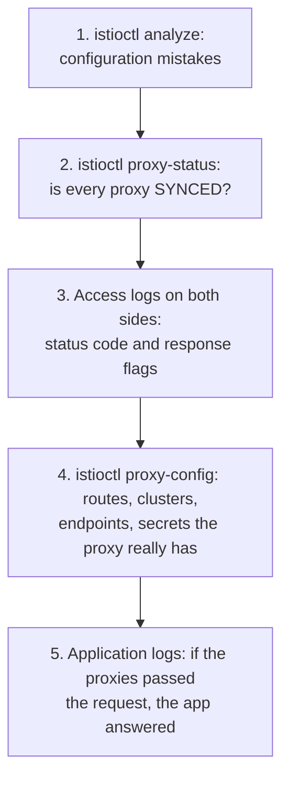

# Mesh troubleshooting

> **Status: AI draft, 2026-11-16.** Not yet verified by me. Written from the Istio and Envoy documentation; Istio was not installed for these notes, so the commands have no sample output.

## In one line

Debug a mesh from the outside in: `istioctl analyze` for configuration mistakes, `istioctl proxy-status` to see whether proxies have their configuration (SYNCED or STALE), `istioctl proxy-config` to read the listeners, routes, clusters and endpoints a proxy actually uses, and Envoy access logs, whose response flags (NR, UH, UF, URX, UT, DC) say whether the mesh or the application failed.

## The plain idea

With a mesh, every request passes through two proxies that each make decisions: routing, retries, mTLS, authorization. When a request fails, the first question is **who said no?** The application, the caller's proxy, the destination's proxy, or the network between them. The mesh gives you good tools to answer that, as long as you look at what the proxies actually have, not at the YAML you think you applied.

## How it works

### The order

### istioctl analyze

Checks Istio and Kubernetes resources together and reports problems such as a VirtualService pointing at a subset no DestinationRule defines, a Gateway with no matching selector, ports without protocol names, or namespaces missing injection labels. Run it before applying changes and in CI.

### proxy-status

Lists every proxy with the state of each configuration type (CDS clusters, LDS listeners, EDS endpoints, RDS routes) and which istiod it talks to:

| State | Meaning |
|---|---|
| `SYNCED` | The proxy acknowledged the latest configuration istiod sent |
| `NOT SENT` | istiod has nothing to send for that type (often normal) |
| `STALE` | istiod sent an update the proxy has not acknowledged: a networking problem between them, or istiod overloaded |

### proxy-config

| Command | Shows | Typical question |
|---|---|---|
| `istioctl proxy-config listeners <pod>` | Ports the proxy listens on | Is there a listener for this port at all? |
| `istioctl proxy-config routes <pod>` | Routing tables | Does my VirtualService route exist and match? |
| `istioctl proxy-config clusters <pod>` | Destinations and their policies (TLS mode, load balancing) | Is mTLS configured as expected for this destination? |
| `istioctl proxy-config endpoints <pod>` | Endpoint IPs and their health | Are there healthy endpoints behind this cluster? |
| `istioctl proxy-config secret <pod>` | Certificates the proxy holds | Is the workload certificate valid and not expired? |

These map to the Envoy concepts on [Traffic management](traffic-management.md).

### Access logs and response flags

Envoy's access log line shows the status code followed by **response flags**, which explain mesh-generated failures. Common ones:

| Flag | Meaning | Usual cause |
|---|---|---|
| `NR` | No route configured | VirtualService or DestinationRule mismatch, wrong host name |
| `UH` | No healthy upstream hosts | Subset selects no pods, all endpoints failing health or ejected by outlier detection |
| `UF` | Upstream connection failure | Often an mTLS mismatch (plaintext vs STRICT), or the app not listening |
| `URX` | Upstream retry limit (or connect attempt limit) exceeded | The destination kept failing through all retries |
| `UT` | Upstream request timeout | Route timeout shorter than the backend's response time |
| `UO` | Upstream overflow | Connection pool or circuit breaker limits in the DestinationRule |
| `DC` | Downstream connection terminated | The caller hung up (its own timeout, client cancelled) |

**A 503 with a flag** was produced by a proxy; **a 503 with no flag** in the destination's inbound log usually came from the application itself. Comparing the caller's outbound line with the destination's inbound line tells you which side failed ([Sidecars and traffic flow](sidecars-and-traffic-flow.md), [HTTP](../networking/http.md)).

### The usual causes of 503

| Cause | Signs |
|---|---|
| No healthy upstream | `UH`; `proxy-config endpoints` shows none or all unhealthy; subset labels do not match pods |
| mTLS mismatch | `UF` or `URX`, connection resets; a STRICT destination receiving plaintext, or a DestinationRule TLS mode disagreeing with the destination ([mTLS and authorization](mesh-security.md)) |
| Port naming or protocol | HTTP features missing, or a server-first protocol broken by detection; ports not named or no `appProtocol` |
| Routing | `NR`; VirtualService host or gateway binding wrong |
| Overflow | `UO`; connection pool limits too low for real traffic |
| Authorization | `403` with `RBAC: access denied`, not 503 |

## A concrete example

After a deploy, `frontend` calls to `reviews` return 503:

1. `istioctl analyze -n shop`: a warning that VirtualService `reviews` refers to subset `v3`, which the DestinationRule does not define.
2. The frontend proxy's access log shows `503 UH` for the outbound call, and `reviews` pods show no inbound line: the mesh rejected it before it left.
3. `istioctl proxy-config endpoints deploy/frontend -n shop` shows no endpoints for the `v3` cluster.
4. The new pods are labelled `version: 3` instead of `version: v3`. Fixing the label restores traffic; the analyze check is added to CI.

## Why not just...?

- **...restart the proxies or istiod first?** It may hide the evidence (STALE state, logs) and usually does not fix a configuration error. Look first, then change.
- **...read the YAML to see what should happen?** The proxy may not have it (STALE), or another resource may override it. Read the proxy's actual configuration with `proxy-config`.
- **...blame the mesh for every 503?** Check the flags: a 503 the application returned passes through the proxies unchanged.

## Commands to know

These were not run for this page.

| Command | What it does |
|---|---|
| `istioctl analyze -A` | Check all namespaces for configuration problems. |
| `istioctl proxy-status` | Sync state of every proxy. |
| `istioctl proxy-config routes deploy/frontend -n shop -o json` | Full routing configuration of one proxy. |
| `istioctl proxy-config endpoints deploy/frontend -n shop` | Endpoints and health per cluster. |
| `kubectl logs deploy/frontend -n shop -c istio-proxy --tail=50` | Recent access log lines with response flags. |
| `istioctl x describe pod <pod>` | Policies and routes that apply to a pod. |
| `istioctl proxy-config log <pod> --level debug` | Raise Envoy's log level temporarily. |

## How it breaks

| Symptom | First check | Likely cause |
|---|---|---|
| 503 `UH` | `proxy-config endpoints` | Subset or Service selects no ready pods |
| 503 `UF` after enabling STRICT | Caller has a sidecar? DestinationRule TLS mode | Plaintext caller or conflicting TLS settings |
| 404 `NR` | Routes, VirtualService host | No matching route |
| Config change ignored | `proxy-status` | Proxy STALE, or resource selects nothing (`analyze`) |
| 504 `UT` | Route timeout vs backend latency | Timeout too short, or slow backend |
| 403 `RBAC: access denied` | AuthorizationPolicy | No ALLOW matches, or a DENY matches |

## Interview questions

**1. How do you start debugging a 503 in an Istio mesh?**

Answer

- Read the access logs on both sides: status code and response flags.
- A flag means a proxy produced the error (UH, UF, NR, UO, UT); no flag in the destination's log points to the app.
- Then `proxy-config endpoints` and `routes` on the caller, and `istioctl analyze`.

**2. What does `istioctl proxy-status` tell you?**

Answer

- Whether each proxy has acknowledged the latest configuration for clusters, listeners, endpoints and routes.
- STALE means an update was sent but not acknowledged.
- Use it when a change seems to have no effect.

**3. What do the response flags UH, UF and NR mean?**

Answer

- UH: no healthy upstream hosts.
- UF: upstream connection failure, often mTLS mismatch.
- NR: no route configured for the request.

**4. How do you tell an application error from a mesh error?**

Answer

- Compare the caller's outbound log line with the destination's inbound line.
- Mesh errors carry response flags or never reach the destination; app errors show a normal inbound request returning an error code.
- Application logs confirm.

**5. What is `istioctl proxy-config` used for?**

Answer

- Reading a proxy's actual listeners, routes, clusters, endpoints and secrets.
- It shows what Envoy will do, not what the YAML intended.
- It is the main tool for routing, TLS and endpoint problems.

**6. A VirtualService weight change has no effect. What do you check?**

Answer

- `istioctl analyze` for errors; `proxy-status` for STALE proxies.
- `proxy-config routes` on a caller: is the new weight there?
- Whether callers' traffic passes through the mesh at all, and the VirtualService host matches what callers use.

## Try it

Without installing Istio:

1. For each response flag in the table, write the first command you would run.
2. Write two access log lines (caller outbound and destination inbound) for a request that fails because the application returned 500, and two for a request rejected with `UH`.
3. Draft a one-page mesh runbook for your on-call rotation using the order diagram above.

## Zoom out

Mesh troubleshooting follows the same layered approach as the Kubernetes and network playbooks: find which layer said no, then read that layer's real state ([Troubleshooting playbook](../kubernetes/troubleshooting.md), [The debugging walk](../start/debugging-walk.md)).

## Sources

- [Istio documentation: diagnose configuration with istioctl analyze](https://istio.io/latest/docs/ops/diagnostic-tools/istioctl-analyze/)
- [Istio documentation: debugging Envoy and istiod (proxy-status, proxy-config)](https://istio.io/latest/docs/ops/diagnostic-tools/proxy-cmd/)
- [Istio documentation: traffic management problems (response flags)](https://istio.io/latest/docs/ops/common-problems/network-issues/)
- [Envoy documentation: access logging and response flags](https://www.envoyproxy.io/docs/envoy/latest/configuration/observability/access_log/usage)
