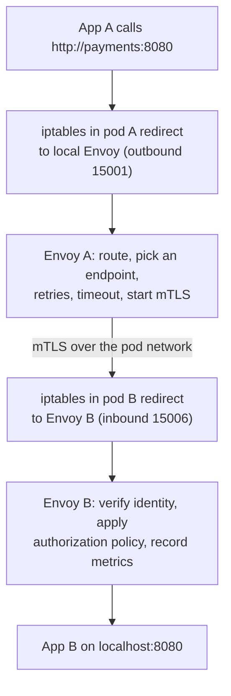

# Sidecars and traffic flow

> **Status: AI draft, 2026-11-16.** Not yet verified by me. Written from the Istio documentation; Istio was not installed for these notes.

## In one line

Istio injects an Envoy sidecar into each pod through a mutating webhook, redirects the pod's traffic into it with iptables rules (from an init container or the CNI agent), and reads each port's protocol from its name or `appProtocol`. Most surprises are protocol detection and start-up order.

## The plain idea

The application keeps calling `http://payments:8080` as if nothing changed. Underneath, the pod's network namespace has been rewired so every packet leaving or entering the app goes through the local Envoy first ([What a container is](../containers/what-is-a-container.md), [Firewalls and connection tracking](../networking/firewalls.md)). That Envoy, configured by istiod, adds mTLS, routing, retries and telemetry, then hands the traffic to the Envoy in the destination pod, which passes it to the destination app.

## How it works

### Injection

- Label a namespace `istio-injection=enabled` (or `istio.io/rev=<revision>` when running control plane revisions); a pod can opt out with the label `sidecar.istio.io/inject: "false"`.
- When a pod is created, Istio's **mutating admission webhook** adds the `istio-proxy` container (and, without the CNI agent, the `istio-init` init container) to the pod spec ([CRDs, operators and admission webhooks](../kubernetes/crds-and-operators.md)).
- Existing pods are only changed when they are recreated: restart Deployments after labelling a namespace or upgrading Istio.

### Redirecting traffic into the proxy

| Method | How | Trade-off |
|---|---|---|
| `istio-init` init container (default) | Writes iptables rules in the pod's network namespace before the app starts | Pods need the `NET_ADMIN` and `NET_RAW` capabilities, which strict Pod Security levels forbid ([Pod security](../kubernetes/pod-security.md)) |
| Istio CNI node agent | A DaemonSet configures the redirection from the node as pods start | No elevated capabilities in application pods |

The rules send outbound traffic to Envoy's outbound port (15001) and inbound traffic to its inbound port (15006). Other ports used by the sidecar include 15000 (Envoy admin, pod-local), 15020 (merged Prometheus metrics), 15021 (health checks) and 15090 (Envoy's own Prometheus endpoint); applications must not use them.

### The path of one request

Both proxies log the request and emit metrics, so one request appears twice in access logs (outbound in A, inbound in B), which is useful for telling which side failed ([Mesh troubleshooting](mesh-troubleshooting.md)).

### Protocol detection

Envoy needs to know whether a port carries HTTP, HTTP/2, gRPC or plain TCP to apply L7 features. Istio decides from the Service definition:

- the port **name**: `name: <protocol>[-<suffix>]`, such as `http-web`, `grpc-api`, `tcp-db`;
- or the **`appProtocol`** field (takes precedence when both are set);
- otherwise it tries automatic detection, which does not work for "server-first" protocols where the server speaks first (many databases).

A database port detected wrongly, or an HTTP port treated as TCP (no L7 retries, routing or metrics), are classic causes of confusing behaviour ([Services and DNS](../kubernetes/services-and-dns.md)).

### Startup and shutdown ordering

- **Startup**: if the app starts before its proxy is ready, its first outbound calls fail. Setting `holdApplicationUntilProxyStarts: true` (globally or per pod) puts the proxy first and blocks the other containers until it is ready.
- **Shutdown**: if the proxy exits before the app finishes in-flight requests, those requests fail; configure drain durations and graceful shutdown so the proxy outlives the app's work ([Probes and graceful shutdown](../kubernetes/probes-and-graceful-shutdown.md)).
- **Jobs**: a sidecar that never exits keeps a Job's pod running after the work finishes; Kubernetes native sidecar containers (init containers with `restartPolicy: Always`) solve this where used ([Jobs and CronJobs](../kubernetes/jobs-and-cronjobs.md)).

### Resource overhead

Each sidecar requests CPU and memory and uses more with traffic and configuration size; across hundreds of pods this is significant ([Requests, limits and QoS](../kubernetes/resources-and-qos.md)). Limiting which services each proxy needs to know about (the `Sidecar` resource's egress hosts) shrinks proxy memory in large meshes. Ambient mode avoids per-pod proxies entirely ([Why a mesh, and Istio architecture](why-a-mesh.md)).

## A concrete example

A team enables injection for `team-a`:

1. `kubectl label namespace team-a istio-injection=enabled`, then a rolling restart of each Deployment; pods now show `2/2` containers.
2. The Istio CNI agent is installed so pods need no `NET_ADMIN`, keeping the namespace at Pod Security `baseline`.
3. Service ports are renamed `http-web` and `tcp-postgres`, so HTTP gets L7 features and the database connection is treated as TCP.
4. `holdApplicationUntilProxyStarts` is set mesh-wide after an app crashed on startup trying to reach its config service.
5. Sidecar requests are tuned from observed usage.

## Why not just...?

- **...label the namespace and wait?** Injection happens only at pod creation. Restart workloads, and verify they show the extra container.
- **...leave port names generic?** Protocol detection may guess wrong, and server-first protocols fail detection. Name ports or set `appProtocol`.
- **...run sidecars with tiny resource requests to save money?** A CPU-starved proxy adds latency to every request in the pod. Size proxies from real usage.

## Commands to know

These were not run for this page.

| Command | What it does |
|---|---|
| `kubectl get namespace -L istio-injection,istio.io/rev` | Which namespaces inject sidecars. |
| `kubectl get pod <pod> -o jsonpath='{.spec.containers[*].name}'` | Is `istio-proxy` present? |
| `istioctl x check-inject -n team-a <pod>` | Why a pod was or was not injected. |
| `kubectl rollout restart deployment -n team-a <name>` | Recreate pods so they get (or lose) the sidecar. |
| `kubectl logs <pod> -c istio-proxy` | The sidecar's access and error logs. |
| `kubectl exec <pod> -c istio-proxy -- pilot-agent request GET stats` | Envoy statistics from inside the pod. |

## How it breaks

| Symptom | Layer | Check | Likely cause |
|---|---|---|---|
| Pod has no sidecar | Injection | Namespace label, pod label, webhook | Label missing or wrong revision, pod created before labelling, opted out |
| Pod rejected with capability errors | Redirection | Pod Security level | `istio-init` needs `NET_ADMIN`/`NET_RAW`; use the Istio CNI agent |
| App fails on startup, works after restart | Startup order | App logs, timing | App started before the proxy; use `holdApplicationUntilProxyStarts` |
| Errors during every rollout | Shutdown order | Termination timing | Proxy exits before the app drains |
| Database connections fail or hang | Protocol | Service port name, `appProtocol` | Server-first protocol not declared as TCP |
| Job pods never complete | Lifecycle | Container status | Sidecar keeps running after the main container exits |

## Interview questions

**1. How does a sidecar get into a pod?**

Answer

- The namespace (or pod) is labelled for injection.
- When the pod is created, Istio's mutating webhook adds the proxy container (and an init container unless the CNI agent is used).
- Existing pods need recreating.

**2. How is traffic redirected into Envoy?**

Answer

- iptables rules in the pod's network namespace send outbound traffic to Envoy's outbound port and inbound to its inbound port.
- Set by the `istio-init` init container (needs `NET_ADMIN`) or by the Istio CNI node agent.
- The app is unaware and still calls normal Service names.

**3. Why do Service port names matter in Istio?**

Answer

- They (or `appProtocol`) tell Istio the protocol, which decides whether L7 features apply.
- Wrong or missing values lead to wrong detection; server-first protocols cannot be detected automatically.
- Name them like `http-web`, `grpc-api`, `tcp-db`.

**4. What startup and shutdown problems do sidecars cause, and how are they solved?**

Answer

- Startup: the app runs before the proxy is ready; fix with `holdApplicationUntilProxyStarts`.
- Shutdown: the proxy stops before in-flight requests finish; fix with drain settings and graceful shutdown.
- Jobs never finishing; native sidecar containers or ambient mode avoid it.

**5. Describe the path of a request between two meshed pods.**

Answer

- App A to local Envoy (redirected), which routes, retries and starts mTLS to pod B.
- Envoy B terminates mTLS, checks authorization, and forwards to app B on localhost.
- Both proxies log and emit metrics for the request.

**6. How would you reduce sidecar overhead in a large mesh?**

Answer

- Right-size proxy requests from usage.
- Limit each proxy's configuration scope with the `Sidecar` resource.
- Consider ambient mode for namespaces that only need mTLS and L4.

## Try it

Without installing Istio:

1. For a Service with ports 80 (web), 5432 (PostgreSQL) and 9090 (gRPC), write port names that make Istio's protocol selection correct.
2. On a kind cluster, look at a pod's network namespace with `kubectl debug` and `ip addr`; then sketch where the iptables redirection would sit ([Network tools on Linux](../networking/network-tools.md)).
3. Write the pod annotation that keeps the app from starting before its proxy.

## Zoom out

Sidecars are the Kubernetes pod pattern applied to networking ([Pods](../kubernetes/pods.md)); routing and security on top of them are on [Traffic management](traffic-management.md) and [mTLS and authorization](mesh-security.md), and debugging them on [Mesh troubleshooting](mesh-troubleshooting.md).

## Sources

- [Istio documentation: installing the sidecar (injection)](https://istio.io/latest/docs/setup/additional-setup/sidecar-injection/)
- [Istio documentation: Istio CNI node agent](https://istio.io/latest/docs/setup/additional-setup/cni/)
- [Istio documentation: application requirements (ports)](https://istio.io/latest/docs/ops/deployment/application-requirements/)
- [Istio documentation: protocol selection](https://istio.io/latest/docs/ops/configuration/traffic-management/protocol-selection/)
- [Istio documentation: sidecar injection problems (startup ordering)](https://istio.io/latest/docs/ops/common-problems/injection/)
