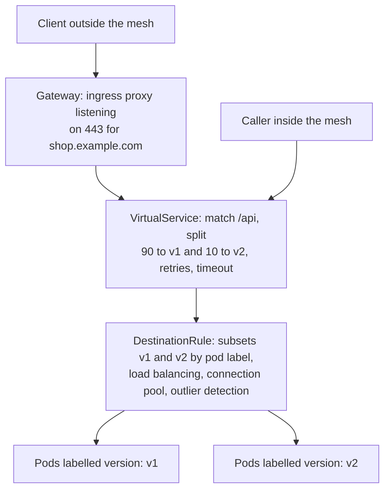

# Traffic management

> **Status: AI draft, 2026-11-16.** Not yet verified by me. Written from the Istio documentation; Istio was not installed for these notes.

## In one line

In Istio a Gateway admits traffic, a VirtualService decides where each request goes (path and header matches, weights, retries, timeouts, faults), and a DestinationRule defines subsets and how to reach them (load balancing, connection limits, outlier detection).

## The plain idea

A Kubernetes Service spreads requests evenly over all its pods ([Services and DNS](../kubernetes/services-and-dns.md)). That is not enough to say "send 10% of traffic to version 2", "send requests with header `x-beta: true` to the new build", "give up after 2 seconds and retry once", or "stop sending traffic to a pod that keeps failing". Istio's traffic resources add those decisions to every proxy, so they apply to every caller without code changes.

## How it works

### The resources



| Resource | Answers | Key fields |
|---|---|---|
| **Gateway** (Istio API) | Which ports, hosts and certificates an ingress or egress proxy serves | `servers` with port, hosts, TLS |
| **VirtualService** | Where does a request to this host go? | `hosts`, `gateways`, `http` routes with `match`, `route` (destination, subset, weight), `retries`, `timeout`, `fault`, `mirror` |
| **DestinationRule** | How is traffic sent to this destination once chosen? | `subsets` (by labels), `trafficPolicy`: `loadBalancer`, `connectionPool`, `outlierDetection`, TLS mode |
| **ServiceEntry** | Adds external services to the mesh registry | Hosts, ports, resolution |

### Retries, timeouts and faults

- **Timeouts** on HTTP routes are disabled by default; set them per route.
- **Retries**: if a route sets none, the mesh default applies: 2 attempts on `connect-failure`, `refused-stream`, `unavailable` and `cancelled` (customisable in mesh config). Set `perTryTimeout` so retries fit inside the overall timeout, and only retry idempotent operations ([High availability and failure domains](../operations/high-availability.md)).
- **Fault injection** adds delays or aborts for a share of requests, to test how callers cope; while faults are enabled on the client side, that route's timeouts and retries are not applied.

### Outlier detection and connection pools

- **Outlier detection** (passive health checking): an endpoint that returns consecutive 5xx errors is ejected from the load-balancing pool for a period, which works like a circuit breaker per pod.
- **Connection pool** limits cap connections and pending or concurrent requests to a destination; excess requests fail fast instead of piling up.

### A canary by weight

```yaml
apiVersion: networking.istio.io/v1
kind: DestinationRule
metadata:
  name: reviews
spec:
  host: reviews
  subsets:
    - name: v1
      labels: { version: v1 }
    - name: v2
      labels: { version: v2 }
---
apiVersion: networking.istio.io/v1
kind: VirtualService
metadata:
  name: reviews
spec:
  hosts: [reviews]
  http:
    - match:
        - headers:
            x-beta: { exact: "true" }
      route:
        - destination: { host: reviews, subset: v2 }
    - route:
        - destination: { host: reviews, subset: v1 }
          weight: 90
        - destination: { host: reviews, subset: v2 }
          weight: 10
      timeout: 3s
      retries:
        attempts: 2
        perTryTimeout: 1s
```

Testers send `x-beta: true` to reach v2 every time; everyone else gets a 90/10 split. Moving to 50/50 or 100/0 is an edit to two numbers, often driven by a progressive delivery tool ([Deployment strategies](../cicd/deployment-strategies.md)).

### How it maps to Envoy

| Istio | Envoy concept |
|---|---|
| Gateway servers, service ports | **Listeners** (where traffic arrives) |
| VirtualService routes | **Routes** (match, then choose a cluster, with retries and timeouts) |
| Destination host plus subset, DestinationRule policies | **Clusters** (a group of endpoints and how to connect: load balancing, TLS, pools, outlier detection) |
| Pod IPs from Kubernetes | **Endpoints** |

`istioctl proxy-config listeners|routes|clusters|endpoints <pod>` shows exactly this, which is the main debugging tool ([Mesh troubleshooting](mesh-troubleshooting.md)).

### Kubernetes Gateway API

Istio implements the Kubernetes Gateway API (Gateway, HTTPRoute) for ingress and, with GAMMA, for traffic inside the mesh, and states it intends to make Gateway API the default traffic management API in the future ([Ingress and Gateway API](../kubernetes/ingress-and-gateway-api.md)). With Gateway API, Istio can also deploy the gateway proxies automatically from a Gateway resource.

## A concrete example

`sample-app`'s checkout service rolls out v2:

1. v2 pods deployed with label `version: v2`; DestinationRule subsets for v1 and v2, with outlier detection (eject after 5 consecutive 5xx for 30 seconds).
2. VirtualService: internal testers by header to v2; everyone else 95/5.
3. Error rate and p99 latency per subset come from the proxies' metrics; at 95/5 for an hour without regressions, the weight moves to 75/25, then 50/50, then 0/100 ([SLOs and error budgets](../observability/slos.md)).
4. Timeouts of 3 seconds with 2 retries for the idempotent `GET` routes only; no retries on `POST /orders`.

## Why not just...?

- **...do canaries with replica counts?** 1 of 10 pods gives roughly 10%, but only in steps of 10%, and header-based routing is impossible. Weighted routes decouple traffic share from pod count.
- **...retry everything three times?** Retries multiply load during an outage and can repeat non-idempotent operations. Retry only safe requests, with budgets and per-try timeouts.
- **...configure retries both in the app and the mesh?** They multiply (3 × 3 = 9 attempts). Choose one layer.

## Commands to know

These were not run for this page.

| Command | What it does |
|---|---|
| `kubectl get virtualservices,destinationrules,gateways -n team-a` | Traffic resources in a namespace. |
| `istioctl analyze -n team-a` | Detects common mistakes (subsets with no matching pods, missing hosts). |
| `istioctl proxy-config routes deploy/frontend -n team-a` | Routes as the caller's proxy sees them. |
| `istioctl proxy-config clusters deploy/frontend -n team-a --fqdn reviews.team-a.svc.cluster.local` | Clusters (subsets) for a destination. |
| `istioctl proxy-config endpoints deploy/frontend -n team-a` | Endpoints and their health for every cluster the proxy knows. |
| `istioctl x describe pod <pod>` | Which VirtualServices and DestinationRules apply to a pod. |

To see one subset only, filter by cluster name, which has the form `outbound|9080|v2|reviews.team-a.svc.cluster.local`: add `--cluster "outbound|9080|v2|reviews.team-a.svc.cluster.local"` (quoted, because of the pipes).

## How it breaks

| Symptom | Layer | Check | Likely cause |
|---|---|---|---|
| 503 with `NR` (no route) | Routing | VirtualService hosts and matches | No route matches, or host name mismatch |
| 503 `UH` for a subset | Subsets | Pod labels vs subset labels | Subset selects no pods ([Mesh troubleshooting](mesh-troubleshooting.md)) |
| Weights ignored | Scope | Which proxy applies the rule | VirtualService not bound to the gateway or mesh, or traffic bypasses the mesh |
| Requests time out at odd durations | Timeouts | Route timeout vs app timeouts | Mesh and app timeouts or retries stacking |
| Healthy pods getting no traffic | Outlier detection | Ejection stats | Too aggressive ejection thresholds |
| Duplicate side effects | Retries | Retry policy on non-idempotent routes | Retries on `POST` |

## Interview questions

**1. What do VirtualService and DestinationRule each do?**

<details markdown="1">
<summary>Answer</summary>

- VirtualService: routing decisions: matches, weights, retries, timeouts, faults.
- DestinationRule: what the destinations are (subsets) and how to connect (load balancing, pools, outlier detection, TLS).
- Routing chooses a subset; the DestinationRule defines it.

</details>

**2. How do you run a canary with Istio?**

<details markdown="1">
<summary>Answer</summary>

- Label pods by version; define subsets in a DestinationRule.
- VirtualService with weighted routes (and optionally header matches for testers).
- Shift weights while watching per-subset metrics.

</details>

**3. What is outlier detection?**

<details markdown="1">
<summary>Answer</summary>

- Passive health checking: endpoints with consecutive errors are ejected from load balancing for a period.
- Protects callers from a bad pod without waiting for readiness probes.
- Tune thresholds so healthy pods are not ejected by brief errors.

</details>

**4. What are Istio's default retries and timeouts?**

<details markdown="1">
<summary>Answer</summary>

- Route timeouts are disabled by default.
- The default retry policy is 2 attempts on connect failures, refused streams, unavailable and cancelled.
- Set explicit per-route values, and avoid retries on non-idempotent requests.

</details>

**5. How do Istio resources map to Envoy configuration?**

<details markdown="1">
<summary>Answer</summary>

- Gateways and ports become listeners; VirtualServices become routes.
- Destinations and subsets with DestinationRule policies become clusters; pods become endpoints.
- `istioctl proxy-config` shows each.

</details>

**6. A canary at 10% receives no traffic. What do you check?**

<details markdown="1">
<summary>Answer</summary>

- Do v2 pods carry the subset's labels, and are they ready?
- Is the VirtualService applied to the caller's traffic (host names, gateway binding)?
- `istioctl proxy-config routes` and `endpoints` on a caller.

</details>

## Try it

Without installing Istio:

1. Write a VirtualService that sends `/api/v2/*` to subset v2 and everything else to v1, with a 2-second timeout.
2. Write a DestinationRule that ejects a pod after 5 consecutive 5xx errors for 30 seconds and caps concurrent requests at 100.
3. Rewrite the canary above as a Gateway API `HTTPRoute` with weighted `backendRefs` ([Ingress and Gateway API](../kubernetes/ingress-and-gateway-api.md)).

## Zoom out

Traffic management is the mesh's version of deployment strategies and resilience patterns, applied at every hop ([Deployment strategies](../cicd/deployment-strategies.md), [High availability and failure domains](../operations/high-availability.md)). Security policies use the same proxies ([mTLS and authorization](mesh-security.md)).

## Sources

- [Istio documentation: traffic management concepts](https://istio.io/latest/docs/concepts/traffic-management/)
- [Istio documentation: VirtualService reference](https://istio.io/latest/docs/reference/config/networking/virtual-service/)
- [Istio documentation: DestinationRule reference](https://istio.io/latest/docs/reference/config/networking/destination-rule/)
- [Istio documentation: Kubernetes Gateway API](https://istio.io/latest/docs/tasks/traffic-management/ingress/gateway-api/)
- [Istio documentation: debugging with proxy-config](https://istio.io/latest/docs/ops/diagnostic-tools/proxy-cmd/)
