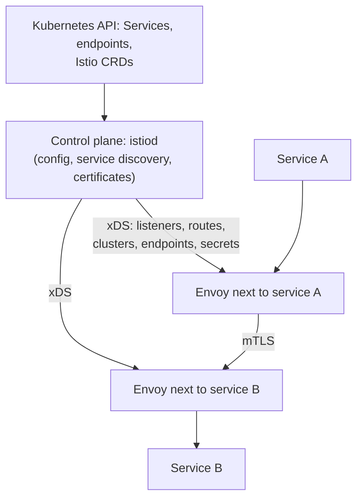

# Why a mesh, and Istio architecture

> **Status: AI draft, 2026-11-16.** Not yet verified by me. Written from the Istio documentation; Istio was not installed for these notes.

## In one line

A service mesh moves cross-cutting network work (mutual TLS, retries, timeouts, traffic shifting, telemetry) out of every application into proxies that sit on the traffic path. In Istio the data plane is Envoy proxies (sidecars, or ztunnel and waypoints in ambient mode) and the control plane, istiod, pushes their configuration over xDS.

## The plain idea

With dozens of services calling each other, every team re-implements the same things: encrypt the connection, retry on failure, time out slow calls, send 10% of traffic to the new version, record latency per caller. Each implementation differs by language and library, and none of it is consistent.

A mesh puts a small proxy next to every workload (or on every node) and sends all of the workload's traffic through it. The proxies do the networking work the same way for every service, and a central control plane tells them what to do. Applications go back to speaking plain HTTP to `http://payments`.

## How it works

### Data plane and control plane

- **Data plane**: Envoy proxies (an extended Envoy) on every request path. They enforce routing, retries, timeouts, mTLS and policy, and report telemetry ([Load balancers and proxies](../networking/load-balancers-and-proxies.md)).
- **Control plane (istiod)**: watches the Kubernetes API (Services, endpoints, Istio custom resources), turns them into Envoy configuration, issues workload certificates, and streams configuration to every proxy.
- **xDS** is Envoy's discovery API: the control plane pushes listeners, routes, clusters, endpoints and secrets, and proxies update without restarting ([CRDs, operators and admission webhooks](../kubernetes/crds-and-operators.md)).

### What moves out of the application

| Concern | Mesh feature | Page |
|---|---|---|
| Encryption and identity between services | Automatic mTLS with workload certificates | [mTLS and authorization](mesh-security.md) |
| Who may call whom | AuthorizationPolicy | [mTLS and authorization](mesh-security.md) |
| Retries, timeouts, circuit breaking | VirtualService and DestinationRule settings | [Traffic management](traffic-management.md) |
| Canary and blue-green by weight or header | Weighted routes | [Traffic management](traffic-management.md) |
| Golden-signal metrics, access logs, trace spans per hop | Proxy telemetry | [Tracing and OpenTelemetry](../observability/tracing.md) |

### Sidecar mode vs ambient mode

| | Sidecar mode | Ambient mode |
|---|---|---|
| Where the proxy runs | An Envoy container in every pod | A per-node **ztunnel** (DaemonSet) for L4 and mTLS; optional **waypoint** proxies (Envoy) for L7 features |
| Pod changes | Injection adds a container; restarts needed | No sidecar; pods join by namespace label |
| L7 features (routing, L7 policy) | Always available | Only where a waypoint is deployed |
| Resource cost | A proxy per pod | Shared proxies per node and per waypoint |

Istio's documentation lists the full feature set in both modes, with ambient needing waypoints for L7 traffic management, L7 authorization and L7 telemetry ([Sidecars and traffic flow](sidecars-and-traffic-flow.md)).

### What a mesh costs

- **Latency**: each hop goes through one or two extra proxies.
- **Resources**: CPU and memory for every proxy (sidecar mode multiplies by pod count).
- **Complexity**: new failure modes (proxy config, certificate, protocol detection problems), new CRDs, a new layer to debug ([Mesh troubleshooting](mesh-troubleshooting.md)).
- **Upgrades**: the control plane and every proxy must be upgraded in a supported order, usually by revision.

## A concrete example

A platform with 40 services adopts Istio to meet a requirement for encryption between all services:

1. Install istiod with a revision label; enable injection namespace by namespace.
2. Start with `PERMISSIVE` mTLS, check that every workload talks mTLS, then switch to `STRICT` ([mTLS and authorization](mesh-security.md)).
3. Add default timeouts and limited retries for internal calls; canaries for the two busiest services by weight.
4. Use the proxies' metrics for a RED dashboard per service without changing application code ([Signals and methods](../observability/signals-and-methods.md)).
5. Write a mesh troubleshooting runbook before the first incident.

## Why not just...?

- **...put retries and TLS in each application's libraries?** Every language and team does it differently, and changing a policy means redeploying every service. A mesh centralises it, at the cost of the extra layer.
- **...adopt a mesh for three services?** The operational cost (control plane, upgrades, new failure modes) may outweigh the benefit. Kubernetes NetworkPolicy, a good ingress and TLS at the edge may be enough ([Pod networking and NetworkPolicy](../kubernetes/pod-networking-and-network-policy.md)).
- **...enable every mesh feature at once?** Each feature is a new way to break traffic. Start with mTLS and telemetry, then add traffic policies where needed.

## Commands to know

These were not run for this page.

| Command | What it does |
|---|---|
| `istioctl version` | Control plane and data plane versions. |
| `istioctl proxy-status` | Every proxy and whether its configuration is in sync with istiod. |
| `kubectl get pods -n istio-system` | istiod and gateways. |
| `kubectl label namespace team-a istio-injection=enabled` | Enable sidecar injection for a namespace (or `istio.io/rev=<revision>`). |
| `kubectl label namespace team-a istio.io/dataplane-mode=ambient` | Add a namespace to the ambient mesh. |
| `istioctl analyze -n team-a` | Find configuration problems ([Mesh troubleshooting](mesh-troubleshooting.md)). |

## How it breaks

| Symptom | Layer | Check | Likely cause |
|---|---|---|---|
| Traffic fails after enabling the mesh | Data plane | `istioctl analyze`, proxy logs | Protocol detection, port naming, or mTLS mode mismatch |
| Config change has no effect | Control plane | `istioctl proxy-status` | Proxy not synced (STALE), or the resource does not select the workload |
| Latency rose after adoption | Proxy overhead | Proxy CPU limits, hop count | Proxies CPU-throttled; extra hops |
| Upgrade broke some services | Versions | Proxy versions vs control plane | Proxies on unsupported versions; pods not restarted after upgrade |
| Pods stuck at startup | Injection | Init or CNI logs | Traffic redirection not ready; app starts before its proxy ([Sidecars and traffic flow](sidecars-and-traffic-flow.md)) |

## Interview questions

**1. What problems does a service mesh solve?**

Answer

- Consistent mTLS and service identity, authorization between services.
- Traffic control (retries, timeouts, weighted routing) without application changes.
- Uniform telemetry for every hop.

**2. Explain Istio's data plane and control plane.**

Answer

- Data plane: Envoy proxies (sidecars, or ztunnel and waypoints in ambient mode) on the traffic path.
- Control plane: istiod watches Kubernetes and Istio resources, issues certificates, and pushes configuration.
- Configuration travels over xDS.

**3. What is xDS?**

Answer

- Envoy's family of discovery APIs: listeners, routes, clusters, endpoints, secrets.
- The control plane streams updates; proxies apply them without restarting.
- `istioctl proxy-status` shows whether each proxy is in sync.

**4. Sidecar mode or ambient mode?**

Answer

- Sidecar: an Envoy per pod, all features everywhere, highest resource cost, pod restarts to change.
- Ambient: per-node ztunnel for mTLS and L4, waypoints added only where L7 features are needed; lower overhead, no sidecars.
- Choose by the features needed per namespace and the cost tolerance.

**5. What does a mesh cost you?**

Answer

- Extra latency and resources for proxies.
- Operational complexity: new CRDs, failure modes, debugging tools, upgrade sequencing.
- People's time to learn and run it.

**6. When would you not use a service mesh?**

Answer

- Few services, simple traffic, no strict internal encryption requirement.
- No team capacity to operate and upgrade it.
- When NetworkPolicy, ingress TLS and libraries already meet the requirements.

## Try it

Without installing Istio:

1. Draw a request from service A to service B in sidecar mode, then in ambient mode with a waypoint, labelling each proxy.
2. List three features you would enable first in a new mesh, and three you would postpone.
3. For a cluster you know, estimate the extra memory if every pod got a sidecar.

## Zoom out

A mesh extends the ideas of Services and Ingress to every hop between services ([Services and DNS](../kubernetes/services-and-dns.md), [Ingress and Gateway API](../kubernetes/ingress-and-gateway-api.md)). The other mesh pages cover how traffic gets into the proxies, how it is routed, how it is secured, and how to debug it.

## Sources

- [Istio documentation: architecture](https://istio.io/latest/docs/ops/deployment/architecture/)
- [Istio documentation: data plane modes](https://istio.io/latest/docs/overview/dataplane-modes/)
- [Istio documentation: ambient mode overview](https://istio.io/latest/docs/ambient/overview/)
- [Istio documentation: traffic management concepts](https://istio.io/latest/docs/concepts/traffic-management/)
- [Envoy proxy documentation](https://www.envoyproxy.io/docs/envoy/latest/)
