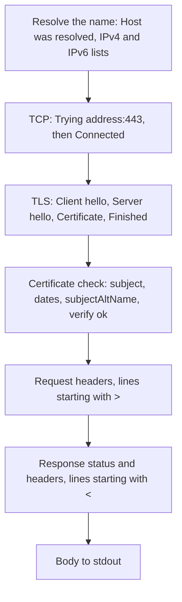

# curl -v, line by line

> **Status: AI draft, 2026-11-16.** Not yet verified by me. The transcript was captured in a throwaway container; the server's addresses are rewritten to example ranges and CDN-specific headers are trimmed.

## In one line

`curl -v` prints every stage of a request in order: name resolution, the TCP connection, the TLS handshake and certificate check, the request headers (`>`) and the response headers (`<`). Reading where the transcript stops tells you which layer failed.

## The plain idea

When a web request fails, the browser shows one vague message. `curl -v` is the opposite: it narrates every step, the way a delivery tracker shows "picked up, in transit, out for delivery". Each stage maps to a layer you already know: DNS, then TCP, then TLS, then HTTP ([Layers and encapsulation](layers.md)).

So the transcript is a debugging tool in itself. If it stops after "Trying 203.0.113.10:443...", the problem is the TCP connection. If it gets through TLS and shows `< HTTP/2 502`, the network is fine and a proxy is reporting a backend problem. Being able to read every line, out loud, is a common interview exercise.

## How it works

`curl -v` writes three kinds of lines to stderr:

| Prefix | Meaning |
|---|---|
| `*` | curl explaining what it is doing: resolving, connecting, TLS, decisions |
| `>` | A header line curl **sent** |
| `<` | A header line curl **received** |

The response body goes to stdout, which is why `-o /dev/null` is often added: you see the narration without the page.



If any stage fails, the transcript stops there with an error, and every later stage is missing. That makes the last line before the error the most important one.

## A concrete example

The full transcript of `curl -v -o /dev/null https://example.com/`, in five parts. Progress-meter lines are removed.

### Part 1: name resolution and the TCP connection

```text
* Host example.com:443 was resolved.
* IPv6: 2001:db8::10
* IPv4: 203.0.113.10, 203.0.113.11
*   Trying 203.0.113.10:443...
* Connected to example.com (203.0.113.10) port 443
```

| Line | What it means |
|---|---|
| `Host example.com:443 was resolved.` | DNS answered ([DNS](dns.md)). A failure here reads `Could not resolve host` and nothing else follows. |
| `IPv6: ...` and `IPv4: ...` | Every address returned. curl tries them in turn if one fails. |
| `Trying 203.0.113.10:443...` | The TCP handshake has started ([TCP and UDP](tcp-and-udp.md)). |
| `Connected to example.com (203.0.113.10) port 443` | The handshake completed. The network path and the port are fine. |

### Part 2: the TLS handshake

```text
* ALPN: curl offers h2,http/1.1
* TLSv1.3 (OUT), TLS handshake, Client hello (1):
*  CAfile: /etc/ssl/certs/ca-certificates.crt
*  CApath: /etc/ssl/certs
* TLSv1.3 (IN), TLS handshake, Server hello (2):
* TLSv1.3 (IN), TLS handshake, Encrypted Extensions (8):
* TLSv1.3 (IN), TLS handshake, Certificate (11):
* TLSv1.3 (IN), TLS handshake, CERT verify (15):
* TLSv1.3 (IN), TLS handshake, Finished (20):
* TLSv1.3 (OUT), TLS change cipher, Change cipher spec (1):
* TLSv1.3 (OUT), TLS handshake, Finished (20):
* SSL connection using TLSv1.3 / TLS_AES_256_GCM_SHA384 / X25519 / id-ecPublicKey
* ALPN: server accepted h2
```

| Line | What it means |
|---|---|
| `ALPN: curl offers h2,http/1.1` | curl asks to speak HTTP/2, or HTTP/1.1 as a fallback. |
| `(OUT) ... Client hello` | curl's first TLS message: versions, ciphers, its key share, and the server name (SNI). |
| `CAfile`, `CApath` | The trusted root certificates curl will check the chain against. |
| `(IN) ... Server hello` | The server chose the version and cipher. From here the handshake is encrypted. |
| `Certificate (11)` | The server sent its certificate chain. |
| `CERT verify (15)` | The server proved it holds the private key for that certificate. |
| `Finished` in both directions | Both sides confirmed the handshake was not tampered with. |
| `TLSv1.3 / TLS_AES_256_GCM_SHA384 / X25519 / id-ecPublicKey` | Version, cipher, key exchange, and the type of the certificate's key. |
| `ALPN: server accepted h2` | The conversation will be HTTP/2. |

([TLS and certificates](tls.md) explains each step.)

### Part 3: the certificate check

```text
* Server certificate:
*  subject: CN=example.com
*  start date: Sep 26 22:49:11 2026 GMT
*  expire date: Dec 25 22:56:35 2026 GMT
*  subjectAltName: host "example.com" matched cert's "example.com"
*  issuer: C=US; O=SSL Corporation; CN=Cloudflare TLS Issuing ECC CA 3
*  SSL certificate verify ok.
```

| Line | What to check |
|---|---|
| `subject` | Whose certificate this is. |
| `start date`, `expire date` | Whether it is in date. The most common TLS outage is the second one passing. |
| `subjectAltName: host ... matched` | The name you asked for is covered. A mismatch stops here with `no alternative certificate subject name matches`. |
| `issuer` | The intermediate CA that signed it. |
| `SSL certificate verify ok.` | The chain leads to a trusted root. Otherwise you see `unable to get local issuer certificate`. |

### Part 4: the request

```text
* using HTTP/2
> GET / HTTP/2
> Host: example.com
> User-Agent: curl/8.5.0
> Accept: */*
>
```

| Line | What it means |
|---|---|
| `> GET / HTTP/2` | Method, path, protocol ([HTTP](http.md)). |
| `> Host: example.com` | The site being asked for. Routing on proxies and Ingress controllers depends on it. |
| `> User-Agent`, `> Accept` | Which client, and which formats it accepts. |
| `>` on its own | The blank line that ends the headers. A `GET` has no body. |

With HTTP/2, curl also logs the same request as separate fields such as `[:method: GET]` and `[:authority: example.com]`; that is how HTTP/2 encodes it.

### Part 5: the response

```text
< HTTP/2 200
< date: Mon, 16 Nov 2026 03:18:51 GMT
< content-type: text/html; charset=utf-8
< last-modified: Mon, 16 Nov 2026 00:30:20 GMT
< allow: GET, HEAD
< accept-ranges: bytes
< age: 3420
< alt-svc: h3=":443"; ma=86400
<
```

| Line | What it means |
|---|---|
| `< HTTP/2 200` | The status code: the single most important response line. |
| `content-type` | What the body is. |
| `age: 3420` | Served from a cache, 3,420 seconds old. |
| `alt-svc: h3=":443"` | The server also offers HTTP/3 on port 443. |
| `<` on its own | End of the headers; the body follows on stdout. |

## Why not just...?

- **...use a browser's developer tools?** They show much of the same, but not on a server, inside a pod, or in a script. `curl` is on almost every machine and gives the same output every time.
- **...use `curl -k` when the certificate check fails?** It skips the check that the verbose output was telling you about. Read the certificate lines instead: name, dates or chain.
- **...use `-v` for everything?** For timing, `-w` with timing variables is easier to read; for just the status, `-s -o /dev/null -w "%{http_code}"`. Use `-v` when you need to see which stage failed.

## Commands to know

What each failure looks like, and where the transcript stops:

| Failure | Last lines of `curl -v` | Layer |
|---|---|---|
| Name does not resolve | `Could not resolve host: <name>` | DNS |
| Nothing listening | `Trying <ip>:443...` then `Connection refused` | TCP |
| Packets dropped | `Trying <ip>:443...` then, after the timeout, `Connection timed out` | Network path |
| Untrusted chain | After `Certificate`: `SSL certificate problem: unable to get local issuer certificate` | TLS |
| Wrong name | `no alternative certificate subject name matches target host name` | TLS |
| Expired | `SSL certificate problem: certificate has expired` | TLS |
| Server or proxy error | A full transcript ending in `< HTTP/2 502`, `503` or `504` | HTTP |

Useful options with `-v`:

| Option | What it does |
|---|---|
| `-o /dev/null` | Discard the body, keep the narration. |
| `-s` with `-v` | Hide the progress meter. |
| `-I` | Send `HEAD`: headers only. |
| `-L` | Follow redirects, showing each hop. |
| `-H 'Host: shop.example.com'` | Set a header, here to test host-based routing. |
| `--resolve shop.example.com:443:203.0.113.10` | Use this address for that name, without touching DNS, while SNI and the certificate check still use the name. |
| `--connect-to shop.example.com:443:backend.internal:8443` | Connect somewhere else entirely, keeping the request's name. |
| `-w '%{time_namelookup} %{time_connect} %{time_appconnect} %{time_starttransfer}\n'` | Time each stage ([HTTP](http.md)). |
| `-k` | Skip certificate verification: only to look at a broken server, never as a fix. |

## How it breaks

| Symptom | Layer | Check | Likely cause |
|---|---|---|---|
| Stops at `Could not resolve host` | DNS | `dig <name>` | Typo, missing record, wrong resolver |
| Hangs on `Trying ...` | Network | `nc -vz <ip> 443` | Security group, firewall or route |
| `Connection refused` right after `Trying` | Port | `ss -tlnp` on the server | Service not listening on that address or port |
| Fails after `Client hello` with a handshake error | TLS versions | `openssl s_client -tls1_2` | No common TLS version or cipher; or a proxy in the way |
| Certificate error | TLS | The certificate lines | Expired, wrong name, or missing intermediate |
| Full transcript, then `< HTTP/2 502/503/504` | Behind the proxy | Proxy logs, backend health | Backend down, none healthy, or too slow |
| `< HTTP/2 301` with a `location` header | Redirect | Add `-L` | The resource moved, or HTTP to HTTPS |

## Interview questions

**1. In `curl -v` output, what do lines starting with `*`, `>` and `<` mean?**

<details markdown="1">
<summary>Answer</summary>

- `*`: curl's own narration (resolving, connecting, TLS, decisions).
- `>`: headers curl sent.
- `<`: headers curl received.
- The body goes to stdout, separately.

</details>

**2. Walk me through the stages `curl -v https://example.com` shows.**

<details markdown="1">
<summary>Answer</summary>

- Name resolution to a list of addresses.
- TCP connection to one of them on port 443.
- TLS handshake, then certificate checks: name, dates, chain.
- Request headers sent, then the status line and response headers.

</details>

**3. The transcript stops at `Trying 203.0.113.10:443...` and eventually times out. What does that tell you?**

<details markdown="1">
<summary>Answer</summary>

- DNS worked; the TCP handshake never completed.
- No reply at all means packets are dropped: a security group, firewall, NACL or missing route.
- A refusal instead would have meant the host answered but nothing listens on the port.

</details>

**4. How do you test a new server's certificate before DNS points at it?**

<details markdown="1">
<summary>Answer</summary>

- `curl -v --resolve name:443:<new-ip> https://name/`.
- The connection goes to the new address, but SNI and the name check use the real name.
- Check the certificate lines: name match, dates and `verify ok`.

</details>

**5. `curl -v` shows `SSL certificate verify ok` and then `< HTTP/2 502`. Where is the problem?**

<details markdown="1">
<summary>Answer</summary>

- DNS, TCP and TLS all worked; a proxy or load balancer answered.
- `502` means that proxy got no valid response from its backend.
- Look at the proxy's logs and the backend's health, not the network to the proxy.

</details>

**6. What does `ALPN: server accepted h2` mean?**

<details markdown="1">
<summary>Answer</summary>

- During the TLS handshake, client and server agreed to speak HTTP/2.
- ALPN (application-layer protocol negotiation) lets them choose the protocol without an extra round trip.
- If the server only accepted `http/1.1`, the request would use HTTP/1.1.

</details>

## Try it

**Step 1.** Start a container with curl.

```bash
docker run --rm -it ubuntu:24.04 bash
apt-get update -qq && apt-get install -y -qq curl ca-certificates
```

**Step 2.** Run a verbose request and, before reading the output, write down the stages you expect in order. Then mark each one in the transcript.

```bash
curl -sv -o /dev/null https://example.com/
```

**Step 3.** Make it fail three ways and note where each transcript stops.

```bash
curl -sv -o /dev/null https://no-such-name.example.invalid/
curl -sv -o /dev/null --connect-timeout 3 https://1.1.1.1:81/
curl -sv -o /dev/null --connect-to wrong.example.com:443:github.com:443 https://wrong.example.com/
```

The third command connects to github.com but asks for `wrong.example.com`, so the name check fails. Watch out when you invent a test name: a server holding a wildcard certificate such as `*.example.com` would accept `wrong.example.com`, and the check would pass.

**Step 4.** Type `exit`. The container is deleted.

## Zoom out

`curl -v` is the debugging walk in one command: it walks DNS, TCP, TLS and HTTP in order and stops at the first failure ([The debugging walk](../start/debugging-walk.md)). It works the same from a laptop, a node or a debug container in a pod. The principle to carry: find the last stage that succeeded, and the problem is in the next one.

## Sources

- [curl manual page](https://curl.se/docs/manpage.html)
- [Everything curl: verbose output](https://everything.curl.dev/usingcurl/verbose/)
- [RFC 8446: TLS 1.3 handshake messages](https://www.rfc-editor.org/rfc/rfc8446)
- [RFC 7301: TLS application-layer protocol negotiation (ALPN)](https://www.rfc-editor.org/rfc/rfc7301)
- [RFC 9113: HTTP/2](https://www.rfc-editor.org/rfc/rfc9113)
