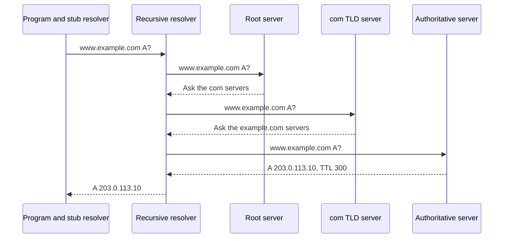
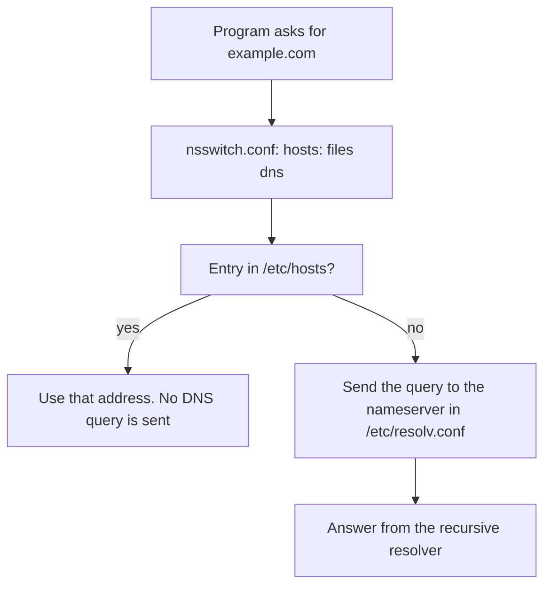

# DNS

> **Status: AI draft, 2026-11-15.** Not yet verified by me. Commands and output were run in a throwaway container; addresses and name-server names are rewritten to example values.

## In one line

DNS turns a name such as `www.example.com` into the IP address a connection needs. A resolver asks a chain of name servers (root, then `.com`, then the domain's own) and caches each answer for as long as its TTL allows.

## The plain idea

Computers connect to numbers. People remember names. Something has to translate, the way the contacts app on your phone turns "Mum" into a number you never learned.

One giant contact list would not work for the internet: there are too many names, owned by too many people, changing all the time. So the list is split into a tree of directories, and each directory knows only the next level down. The top one knows who is in charge of `.com`. The `.com` directory knows who is in charge of `example.com`. The servers for `example.com` know the actual addresses. This system is the **Domain Name System (DNS)**.

Your program does not walk that tree itself. It asks a helper that does the walking and remembers what it learned. The helper is a **recursive resolver**. The analogy stops being true in two places: answers expire after a set time, and two people asking the same question can be given different answers.

DNS happens before everything else. There is no TCP connection, no TLS and no HTTP status code until the name has become an address. When DNS fails, nothing after it is even attempted.

## How it works

### The pieces

| Piece | Where it runs | What it does |
|---|---|---|
| **Stub resolver** | A library inside your operating system | Sends one question to the configured resolver and waits for a complete answer. It does no walking. |
| **Recursive resolver** | Your router, your provider, your cloud network, or a public one such as `1.1.1.1` | Walks the tree on your behalf and caches what it learns. |
| **Root servers** | 13 named servers, `a` to `m`, each served from many locations | Know which servers handle each top-level domain (`.com`, `.org`, `.in`). |
| **TLD servers** | Run by each top-level domain's registry | Know which servers are in charge of each domain under them. |
| **Authoritative servers** | Run by the domain's owner or their DNS provider | Hold the domain's real records and give the final answer. |

Two more words. A **zone** is the part of the tree that one owner manages, such as everything under `example.com`. A **record** is one line in a zone: a name, a TTL, a type and a value.

### One lookup, step by step



1. **The program asks the operating system for an address.** The system checks its local sources in the order listed in `/etc/nsswitch.conf`. The usual line is `hosts: files dns`: the file `/etc/hosts` first, DNS second.
2. **The stub resolver sends the question** to the server named in `/etc/resolv.conf`. It goes over UDP port 53. If the answer is too big for one UDP message, the question is repeated over TCP port 53.
3. **The recursive resolver checks its cache.** If it has an answer that has not expired, it replies at once and the rest never happens.
4. **Otherwise it asks a root server.** The root does not know the address. It replies with a **referral**: "ask the servers for `.com`", with their names.
5. **It asks a `.com` server**, which replies with another referral: "ask the servers for `example.com`".
6. **It asks an authoritative server for `example.com`**, which holds the record and returns the address.
7. **It caches every answer** it received, each for that record's own TTL, and returns the final one to your machine.

The question from your machine is a **recursive query**: "do all the work and give me the answer". The questions the resolver sends are **iterative queries**: each server gives the best pointer it has, and the resolver follows it.

### Record types

| Type | Maps a name to | Note |
|---|---|---|
| `A` | An IPv4 address | |
| `AAAA` | An IPv6 address | |
| `CNAME` | Another name | An alias. A name with a CNAME can have no other records, which is why the top of a zone (`example.com` itself) cannot be one. |
| `NS` | The name servers for a zone | This is what a referral is made of. |
| `SOA` | The zone's administrative record | One per zone. Its last field (MINIMUM), capped by the SOA's own TTL, sets how long "no such name" is cached. |
| `MX` | Mail servers, with a priority | |
| `TXT` | Free text | Used for domain-ownership proofs and mail policy. |
| `PTR` | A name, from an address | The reverse lookup. |
| `SRV` | A host and port for a service | |

### TTL and caching

Every record carries a **TTL** (time to live): the number of seconds a resolver may keep the answer. Ask a resolver twice and you can watch the number count down. These two commands ran three seconds apart:

```console
$ dig +noall +answer example.com A
example.com.		183	IN	A	203.0.113.10
$ dig +noall +answer example.com A
example.com.		180	IN	A	203.0.113.10
```

This is what people mean by "DNS propagation". Nothing is pushed anywhere. Each resolver keeps its old answer until its own copy expires, then asks again. A "no such name" answer is cached too, so a record you create a minute after someone looked for it can stay invisible to them for a while.

### Where one machine looks



> **Gotcha:** `dig` talks DNS directly. It never reads `/etc/hosts`. Your application does. When the two disagree, that file is the first suspect.

`/etc/resolv.conf` can also hold a `search` list: suffixes the stub resolver tries when you give it a short name. That matters most inside Kubernetes, and [Services and DNS](../kubernetes/services-and-dns.md) covers it.

## A concrete example

A server in a private network runs `curl https://www.example.com`. Its `/etc/resolv.conf` says `nameserver 10.0.0.2`.

1. `curl` asks the system for the address. `/etc/hosts` has no entry, so the stub resolver sends the question to `10.0.0.2`.
2. The resolver's cache is empty. It asks a root server, is referred to the `.com` servers, asks one, is referred to `ns1.example.net`, and asks that.
3. `ns1.example.net` answers `203.0.113.10` with a TTL of 300.
4. The resolver caches it and replies. `curl` opens a TCP connection to `203.0.113.10` on port 443. DNS's part is finished.
5. Twenty seconds later the same command runs again. The resolver answers from its cache, with 280 seconds left on the record. No outside server is asked.
6. The owner now changes the record to `203.0.113.11`. This server keeps receiving `203.0.113.10` until those 280 seconds run out. A server that never asked before receives the new address straight away.

Step 6 is why two people can see different results for the same name at the same moment, and both be right.

## Why not just...?

- **...put every name in `/etc/hosts`?** It works on one machine. With a hundred machines you have a hundred files to edit every time an address changes, and one stale line sends traffic to the wrong place with no error.
- **...use IP addresses and skip names?** Addresses change: load balancers scale, failovers move, cloud resources are replaced. TLS certificates are usually issued for names; IP address certificates exist, but Let's Encrypt issues them only as short-lived certificates (as of November 2026). One address often serves many sites and picks between them by the name in the request.
- **...set every TTL to 0 so changes are instant?** Then every single request pays for a full lookup, and your authoritative servers carry all of that load. Some resolvers enforce a minimum anyway (unverified). Choose a TTL by how quickly you need to move, and lower it ahead of a planned change.

## Commands to know

`dig` asks a DNS question and prints the whole reply.

```console
$ dig example.com A

; <<>> DiG 9.18.39-0ubuntu0.24.04.9-Ubuntu <<>> example.com A
;; global options: +cmd
;; Got answer:
;; ->>HEADER<<- opcode: QUERY, status: NOERROR, id: 10460
;; flags: qr rd ra ad; QUERY: 1, ANSWER: 2, AUTHORITY: 0, ADDITIONAL: 1

;; QUESTION SECTION:
;example.com.			IN	A

;; ANSWER SECTION:
example.com.		212	IN	A	203.0.113.10
example.com.		212	IN	A	203.0.113.11

;; Query time: 18 msec
;; SERVER: 10.0.0.2#53(10.0.0.2) (UDP)
```

| Part | Meaning |
|---|---|
| `status: NOERROR` | The lookup worked. `NXDOMAIN` means the name does not exist. `SERVFAIL` means the resolver could not get an answer. |
| `flags: qr rd ra` | `qr`: this is a reply. `rd`: you asked for recursion. `ra`: the server offers it. `aa` appears when the reply comes straight from an authoritative server. |
| `ANSWER: 2` | Two records came back. A name can have several addresses. |
| `212` | The TTL left on this cached answer, in seconds. |
| `SERVER` | Who answered. Always check this line: it tells you which resolver you were really asking. |

| Command | What it shows |
|---|---|
| `dig +short example.com A` | Only the values. Good in scripts. |
| `dig +noall +answer example.com A` | Only the answer records, with TTLs. `+noall` switches every section off, `+answer` switches that one back on. |
| `dig @1.1.1.1 example.com A` | Asks that server instead of the one in `/etc/resolv.conf`. Use it to compare resolvers, or to ask an authoritative server directly. |
| `dig example.com NS` | Which servers are authoritative for the zone. |
| `dig +trace example.com A` | Walks the tree itself from the root, printing each referral. |
| `getent ahostsv4 example.com` | Resolves the way an application does, `/etc/hosts` included. |
| `cat /etc/resolv.conf` | Which resolver this machine uses, and its search list. |

`+trace` shows the chain from the diagram. This output is trimmed; a line of `...` marks each cut.

```console
$ dig +trace example.com A
.			51124	IN	NS	a.root-servers.net.
.			51124	IN	NS	b.root-servers.net.
...
com.			172800	IN	NS	a.gtld-servers.net.
com.			172800	IN	NS	b.gtld-servers.net.
...
example.com.		172800	IN	NS	ns1.example.net.
example.com.		172800	IN	NS	ns2.example.net.
...
example.com.		300	IN	A	203.0.113.10
example.com.		300	IN	A	203.0.113.11
```

A name that does not exist, and a resolver that cannot be reached, look different:

```console
$ dig nosuchname.invalid A
;; ->>HEADER<<- opcode: QUERY, status: NXDOMAIN, id: 41950
;; flags: qr aa rd ra; QUERY: 1, ANSWER: 0, AUTHORITY: 1, ADDITIONAL: 1

$ dig @203.0.113.1 example.com A +time=2 +tries=1
;; communications error to 203.0.113.1#53: timed out
;; no servers could be reached
```

`+time=2` waits two seconds for a reply, and `+tries=1` asks once. The first result is an answer: "there is no such name". The second is no answer at all.

## How it breaks

| Symptom | Layer | Check | Likely cause |
|---|---|---|---|
| `Could not resolve host`, and `dig` shows `status: NXDOMAIN` | The name | `dig <name>`; read the question section for the name that was really asked | A typo, a record that was never created, or a search suffix that was added to the name |
| Lookups hang, then `no servers could be reached` | The path to the resolver | `cat /etc/resolv.conf`; `dig @<resolver> <name> +time=2 +tries=1` | Wrong resolver address, a firewall blocking port 53, or no route to the resolver |
| `status: SERVFAIL` | Between the resolver and the authoritative servers | `dig +trace <name>` to see where the chain stops | Authoritative servers down or misconfigured, or a failed DNSSEC check |
| `dig` gives the right address but the application connects elsewhere | The machine's own lookup order | `getent ahostsv4 <name>`; `grep <name> /etc/hosts` | A stale `/etc/hosts` line, or the application caching an old answer |
| The old address is still served after a change | Caching | Run `dig <name>` twice and watch the TTL; ask an authoritative server with `dig @<ns> <name>` | The TTL has not run out on that resolver |
| Resolves inside the network but not outside, or to different addresses | Two zones for one name | `dig @<internal resolver> <name>` against `dig @1.1.1.1 <name>` | A private zone and a public zone hold different records (split-horizon) |
| `status: NOERROR` with `ANSWER: 0` | Record type | Ask for the other type: `A` instead of `AAAA`, or the reverse | The name exists but has no record of the type requested |

## Interview questions

**1. What does DNS do, and what does a user see when it fails?**

<details markdown="1">
<summary>Answer</summary>

- It translates a name into the IP address needed to open a connection.
- It runs before TCP, TLS and HTTP, so nothing else starts until it succeeds.
- A failure shows as "could not resolve host" or a hang. There is never an HTTP status code, because no request was sent.

</details>

**2. What is the difference between a recursive resolver and an authoritative server?**

<details markdown="1">
<summary>Answer</summary>

- A recursive resolver holds no records of its own. It walks the tree for clients and caches the results.
- An authoritative server holds the real records for a zone and gives the final answer for it.
- A reply straight from an authoritative server carries the `aa` flag. A cached reply from a resolver shows a TTL that is counting down.

</details>

**3. What is the difference between an A record and a CNAME, and why can the top of a zone not be a CNAME?**

<details markdown="1">
<summary>Answer</summary>

- An A record maps a name to an IPv4 address. A CNAME maps a name to another name, which then has to be resolved in turn.
- A name that has a CNAME can have no other records.
- The top of a zone must have SOA and NS records, so it cannot also be a CNAME.
- Cloud providers work round this with their own alias-style records.

</details>

**4. What is a TTL, and what does "DNS propagation" really mean?**

<details markdown="1">
<summary>Answer</summary>

- A TTL is the number of seconds a resolver may cache a record.
- Nothing is pushed out when a record changes. Each resolver keeps its copy until that copy expires, then asks again.
- So a change is seen at different times by different clients, for up to the old TTL.
- Lowering the TTL well before a planned change shortens that window.

</details>

**5. Walk me through what `dig +trace www.example.com` does.**

<details markdown="1">
<summary>Answer</summary>

- It does the resolver's job itself. Only its first query, for the list of root servers, goes to your usual resolver.
- It asks a root server and gets a referral to the `.com` servers.
- It asks a `.com` server and gets a referral to the domain's authoritative servers.
- It asks an authoritative server and gets the final records.
- It is the tool for finding which level of the chain is broken or still holds old data.

</details>

**6. You changed an A record ten minutes ago. Some users still reach the old server. Why, and how do you confirm it?**

<details markdown="1">
<summary>Answer</summary>

- Their resolvers cached the old record and its TTL has not expired.
- Ask an authoritative server directly with `dig @<ns> <name>` to confirm the new value is really published.
- Ask the affected resolver and watch the TTL count down on the old value.
- Consider caches closer to the user as well: the operating system, the browser, the application.
- The fix is to wait. Next time, lower the TTL beforehand.

</details>

**7. `curl` says "Could not resolve host" on one server, but the same name resolves on your laptop. What do you check, in order?**

<details markdown="1">
<summary>Answer</summary>

- Which resolver the server uses: `cat /etc/resolv.conf`.
- Whether that resolver answers at all: `dig <name>`, and read the `status` and `SERVER` lines.
- A timeout points at the path to the resolver: wrong address, a firewall on port 53, no route.
- `NXDOMAIN` points at the name or the zone: the server may be asking a resolver that only sees a private zone, or a search suffix changed the name.
- Compare with a public resolver: `dig @1.1.1.1 <name>`.

</details>

**8. `dig` returns the correct address, but the application still connects to the wrong one. What could explain it?**

<details markdown="1">
<summary>Answer</summary>

- `dig` bypasses `/etc/hosts`, and the application does not. Check that file and `getent ahostsv4 <name>`.
- The application or its runtime may cache DNS answers itself, sometimes for its whole lifetime.
- A long-lived connection that was opened before the change is still pointing at the old address.
- The application may be using a different resolver, for example inside a container.

</details>

## Try it

**Step 1.** Start a throwaway container and install `dig`. The `--rm` flag deletes the container when you leave.

```bash
docker run --rm -it ubuntu:24.04 bash
apt-get update -qq && apt-get install -y -qq dnsutils
```

**Step 2.** See which resolver this machine uses, then ask it a question twice. Before the second command, predict what happens to the number in the second column.

```bash
cat /etc/resolv.conf
dig +noall +answer example.com A
dig +noall +answer example.com A
```

**Step 3.** Add a line to `/etc/hosts`, then resolve the name in two ways. Predict both results before you run them.

```bash
echo "203.0.113.99 example.com" >> /etc/hosts
getent ahostsv4 example.com
dig +short example.com A
```

What came back when this was run:

```console
# getent ahostsv4 example.com
203.0.113.99    STREAM example.com
203.0.113.99    DGRAM
203.0.113.99    RAW
# dig +short example.com A
203.0.113.10
203.0.113.11
```

`getent` followed the system's lookup order and stopped at the file. `dig` went to DNS and never saw it.

**Step 4.** Ask for a name that does not exist, then ask a server that will never reply. Read the `status` line of the first and the last line of the second.

```bash
dig nosuchname.invalid A
dig @203.0.113.1 example.com A +time=2 +tries=1
```

**Step 5.** Type `exit`. The container, and your `/etc/hosts` change with it, is gone.

## Zoom out

DNS is the first hop of every request, as [One request, end to end](../start/request-path.md) shows. The same mechanism comes back with different owners: the resolver inside an AWS VPC and Route 53 zones in [Route 53 and ACM](../aws-core/route53-and-acm.md), and CoreDNS inside a cluster in [Services and DNS](../kubernetes/services-and-dns.md). Without it nothing can be reached by name, and the failure carries no status code to guide you. The principle to keep: when something "cannot connect", prove the name first, and ask which resolver answered and from what cache.

## Sources

- [RFC 1034: Domain names, concepts and facilities](https://www.rfc-editor.org/rfc/rfc1034)
- [RFC 1035: Domain names, implementation and specification](https://www.rfc-editor.org/rfc/rfc1035)
- [RFC 2308: Negative caching of DNS queries](https://www.rfc-editor.org/rfc/rfc2308)
- [RFC 7766: DNS transport over TCP](https://www.rfc-editor.org/rfc/rfc7766)
- [Let's Encrypt: 6-day and IP address certificates are generally available](https://letsencrypt.org/2026/01/15/6day-and-ip-general-availability)
- [IANA: root servers](https://www.iana.org/domains/root/servers)
- [dig manual page](https://manpages.ubuntu.com/manpages/noble/man1/dig.1.html)
- [resolv.conf manual page](https://man7.org/linux/man-pages/man5/resolv.conf.5.html)
- [nsswitch.conf manual page](https://man7.org/linux/man-pages/man5/nsswitch.conf.5.html)
