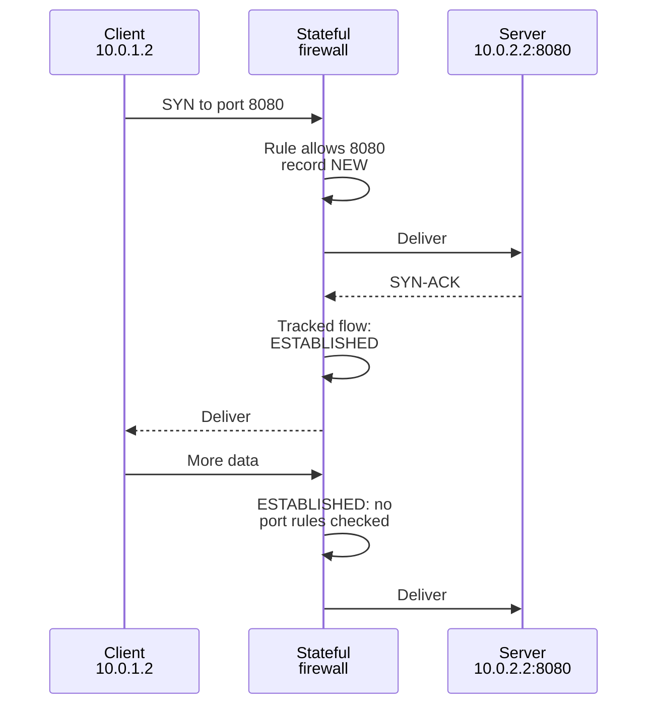
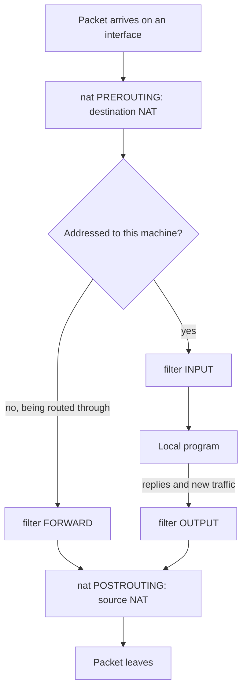

# Firewalls and connection tracking

> **Status: AI draft, 2026-11-16.** Not yet verified by me. Commands and output were run in network namespaces inside a throwaway privileged container; addresses are rewritten to example ranges.

## In one line

A firewall allows or blocks packets by address, protocol and port. A stateful one remembers connections it has allowed (connection tracking), so replies are let back in automatically; a stateless one judges every packet alone, so you must allow replies yourself. DROP looks like a timeout to the client, REJECT like a refusal.

## The plain idea

A firewall is a guard with a list of rules at a door. For each packet it reads a few labels (where from, where to, which protocol, which port) and goes down the list until a rule matches: let it through, or not.

The interesting part is replies. When you call a web server, its answer comes back to you from port 443 to some random high port on your machine. A guard who only knows "allow outgoing to port 443" would block the answer, because the answer is incoming. A **stateful** guard keeps a note of every conversation it let out and recognises the reply as part of it. A **stateless** guard has no notes, so you have to write a rule for the replies too. That one difference explains most of the gap between AWS security groups and network ACLs ([Security groups and NACLs](../aws-core/security-groups-and-nacls.md)).

## How it works

### Matching a packet

A rule matches on some of the **5-tuple**: source address, destination address, protocol (TCP, UDP, ICMP), source port, destination port. Rules are checked in order; the first match decides. If nothing matches, the **default policy** applies. Good practice is **default deny**: block everything, then allow what is needed.

### Connection tracking



The kernel's **conntrack** table records each flow and its state:

| State | Meaning |
|---|---|
| `NEW` | The first packet of a connection not seen before |
| `ESTABLISHED` | Part of a connection that has seen traffic both ways |
| `RELATED` | A new flow linked to an existing one, such as an ICMP error about it |
| `INVALID` | Matches nothing sensible; usually dropped |

So a typical stateful rule set is short: allow `ESTABLISHED,RELATED`, allow `NEW` connections to the ports you serve, drop the rest. Connection tracking also powers NAT ([Routing and NAT](routing-and-nat.md)). The table has a size limit; a server with a huge number of connections can fill it, and new connections are then dropped with a kernel message saying the table is full.

### DROP or REJECT

| Action | What the client sees | When to use it |
|---|---|---|
| **DROP** | Nothing. It retries until its timeout ([TCP and UDP](tcp-and-udp.md)) | Facing the internet: gives scanners nothing to learn |
| **REJECT** | An immediate error: a TCP reset ("connection refused") or an ICMP unreachable | Inside your own network: failures are fast and obvious |

From the client side, a REJECT is indistinguishable from "nothing is listening". Remember that when you read a refusal.

### Linux: iptables and nftables

Linux filters packets in the kernel with **netfilter**. Rules live in **tables** of **chains**, and packets walk specific chains depending on where they are going:



| Chain | Sees |
|---|---|
| `INPUT` | Packets for this machine |
| `OUTPUT` | Packets this machine sends |
| `FORWARD` | Packets routed through this machine: routers, and container or pod traffic on a host |
| `PREROUTING`, `POSTROUTING` (nat table) | Where destination and source NAT happen |

**iptables** is the classic tool. **nftables** (`nft`) is its successor with a single, cleaner rule language; on current distributions, the `iptables` command is often a front end that writes nftables rules. **ufw** (Ubuntu) and **firewalld** (RHEL family) are simpler front ends that generate these rules for you. Docker and Kubernetes (kube-proxy) also write their own rules, so a host's rule set is rarely only yours.

### The same ideas in the cloud and in clusters

| Here | Stateful? | Applies to | Has deny rules? |
|---|---|---|---|
| iptables or nftables with conntrack | Yes | A host | Yes |
| AWS security group | Yes | A network interface | No, allow only |
| AWS network ACL | No | A subnet | Yes, in numbered order |
| Kubernetes NetworkPolicy | Yes | Pods selected by labels | No, allow only once a pod is selected |

## A concrete example

A web server must accept HTTPS from anyone and SSH only from an administration subnet, and nothing else.

```bash
iptables -P INPUT DROP
iptables -A INPUT -i lo -j ACCEPT
iptables -A INPUT -m conntrack --ctstate ESTABLISHED,RELATED -j ACCEPT
iptables -A INPUT -p tcp --dport 443 -j ACCEPT
iptables -A INPUT -p tcp -s 10.0.200.0/24 --dport 22 -j ACCEPT
```

1. Default policy `DROP`: anything not allowed below is dropped.
2. Allow loopback: local programs talk to each other over `lo`.
3. Allow replies to connections already allowed. Without this line, the server's own outgoing calls (DNS, package updates) would get no answers.
4. Allow new connections to 443 from anywhere, and to 22 only from `10.0.200.0/24`.
5. Order matters. Put the `ESTABLISHED` rule near the top: most packets belong to existing connections, and matching them early is cheaper.

On a remote server, add the SSH rule **before** setting the policy to `DROP`, or you lock yourself out mid-change.

## Why not just...?

- **...allow everything inside the private network?** Then one compromised machine can reach every other. Least privilege applies to networks too: allow only the paths each service needs.
- **...rely on the cloud security group and skip host firewalls (or the reverse)?** Each layer covers different mistakes. Many teams use cloud rules as the main control and keep host firewalls simple; what matters is knowing where the rules are, so a debug session checks every layer.
- **...block ICMP completely?** It hides you from `ping`, but also blocks the "packet too big" messages TCP needs to size packets, causing hangs on large transfers. Allow at least the ICMP types for errors.

## Commands to know

A DROP rule and a REJECT rule, as seen by a client ([TCP and UDP](tcp-and-udp.md) has the full comparison):

```console
# ip netns exec server iptables -A INPUT -p tcp --dport 9091 -j DROP
# ip netns exec client nc -vz -w3 10.0.2.2 9091
nc: connect to 10.0.2.2 port 9091 (tcp) timed out: Operation now in progress
# ip netns exec server iptables -A INPUT -p tcp --dport 9092 -j REJECT --reject-with tcp-reset
# ip netns exec client nc -vz -w3 10.0.2.2 9092
nc: connect to 10.0.2.2 port 9092 (tcp) failed: Connection refused
```

The rules with their packet counters, which show whether a rule is actually matching:

```console
# ip netns exec server iptables -L INPUT -n -v --line-numbers
Chain INPUT (policy ACCEPT 18 packets, 924 bytes)
num pkts bytes target prot opt in out source destination
1 3 180 DROP 6 -- * * 0.0.0.0/0 0.0.0.0/0 tcp dpt:9091
2 1 60 REJECT 6 -- * * 0.0.0.0/0 0.0.0.0/0 tcp dpt:9092 reject-with tcp-reset
```

The DROP rule matched 3 packets: the client's SYN and two retries. The REJECT rule matched once, because the client gave up after the reset. `-n` skips name lookups, `-v` adds counters, `--line-numbers` numbers the rules.

Default deny with connection tracking, and its effect in each direction:

```console
# iptables -P INPUT DROP
# iptables -A INPUT -i lo -j ACCEPT
# iptables -A INPUT -m conntrack --ctstate ESTABLISHED,RELATED -j ACCEPT
# iptables -A INPUT -p tcp --dport 8080 -j ACCEPT
# ip netns exec client nc -vz -w2 10.0.2.2 8080
Connection to 10.0.2.2 8080 port [tcp/http-alt] succeeded!
# ip netns exec server ping -c1 -W1 10.0.1.2
64 bytes from 10.0.1.2: icmp_seq=1 ttl=63 time=0.055 ms
# ip netns exec client ping -c1 -W1 10.0.2.2
1 packets transmitted, 0 received, 100% packet loss, time 0ms
```

Port 8080 is allowed in. The server can ping out, because the reply comes back as `ESTABLISHED`. The client cannot ping the server, because a new ICMP request matches no rule and the policy drops it.

The rule set in the form you would save and reload:

```console
# iptables -S INPUT
-P INPUT DROP
-A INPUT -p tcp -m tcp --dport 9091 -j DROP
-A INPUT -p tcp -m tcp --dport 9092 -j REJECT --reject-with tcp-reset
-A INPUT -i lo -j ACCEPT
-A INPUT -m conntrack --ctstate RELATED,ESTABLISHED -j ACCEPT
-A INPUT -p tcp -m tcp --dport 8080 -j ACCEPT
```

| Command | What it does |
|---|---|
| `iptables -I INPUT 1 ...` | Insert a rule at the top, instead of appending (`-A`). |
| `iptables -D INPUT <n>` | Delete rule number `n`. |
| `iptables -t nat -L -n -v` | The NAT table. |
| `iptables-save`, `iptables-restore` | Save and load the whole rule set; rules are lost on reboot otherwise. |
| `nft list ruleset` | Everything, in nftables form, including rules written through the `iptables` command. |
| `conntrack -L`, `conntrack -C` | Tracked connections, and how many. |
| `ufw status verbose`, `firewall-cmd --list-all` | The front ends' views. |

## How it breaks

| Symptom | Layer | Check | Likely cause |
|---|---|---|---|
| Connection times out | Filter | Rule counters before and after a test (`iptables -L -n -v`) | A DROP rule or default policy is matching |
| Connection refused, but the service is listening | Filter | Look for REJECT rules | A REJECT rule answers before the packet reaches the program |
| Outgoing calls from the server get no reply | Return traffic | Is there an `ESTABLISHED,RELATED` rule? Is the filter stateless? | Replies blocked: missing stateful rule, or a stateless ACL without the ephemeral port range |
| Locked out of SSH after a change | Order | Console access | Policy set to DROP before the SSH rule was added |
| New connections randomly dropped on a very busy host | Conntrack table | `conntrack -C` against the maximum; kernel log "table full" | Connection-tracking table full |
| Rules you added vanish | Persistence or ownership | After reboot? After a Docker or kube-proxy restart? | Rules not saved, or rewritten by a tool that manages the chain |

## Interview questions

**1. What is the difference between a stateful and a stateless firewall?**

<details markdown="1">
<summary>Answer</summary>

- Stateful tracks connections, so replies to allowed traffic are let through automatically.
- Stateless judges each packet alone, so return traffic needs its own rule, usually for the ephemeral port range.
- AWS security groups are stateful; network ACLs are stateless.

</details>

**2. What is the difference between DROP and REJECT?**

<details markdown="1">
<summary>Answer</summary>

- DROP discards silently; the client waits and times out.
- REJECT answers with a TCP reset or ICMP error; the client fails at once with "refused" or "unreachable".
- DROP reveals less to scanners; REJECT makes internal failures faster to diagnose.

</details>

**3. Explain connection tracking and the ESTABLISHED state.**

<details markdown="1">
<summary>Answer</summary>

- The kernel records each flow (5-tuple and state) in the conntrack table.
- Packets belonging to a flow already allowed are ESTABLISHED (or RELATED, such as ICMP errors about it).
- One rule allowing ESTABLISHED and RELATED lets all replies through, so the rest of the rules only need to describe new connections.

</details>

**4. Which iptables chains does a packet pass through when it is routed through a host, for example a container's traffic?**

<details markdown="1">
<summary>Answer</summary>

- nat PREROUTING (destination NAT), then filter FORWARD, then nat POSTROUTING (source NAT).
- INPUT and OUTPUT are only for traffic to and from the host itself.
- Docker and kube-proxy write rules into these chains.

</details>

**5. You allowed port 443 inbound on a host, but HTTPS connections still time out. What do you check?**

<details markdown="1">
<summary>Answer</summary>

- Rule order and counters: is an earlier DROP matching first? Do the 443 rule's counters increase during a test?
- Other layers: cloud security groups, network ACLs, other host tools that manage their own chains.
- The return path: stateless filters need the ephemeral ports allowed outbound or inbound.
- That the service listens on the right address (`ss -tlnp`).

</details>

**6. How do you change firewall rules on a remote server without locking yourself out?**

<details markdown="1">
<summary>Answer</summary>

- Add the rule for your own access before tightening the default policy.
- Keep an existing session open and test a new connection before closing it.
- Schedule an automatic rollback (for example, restore the saved rules in five minutes unless cancelled), or keep console access ready.

</details>

## Try it

**Step 1.** Start a privileged container with the tools and a listener on port 8080.

```bash
docker run --rm -it --privileged ubuntu:24.04 bash
apt-get update -qq && apt-get install -y -qq iptables netcat-openbsd iputils-ping
nc -lk 127.0.0.1 8080 >/dev/null &
```

**Step 2.** Add a DROP rule and a REJECT rule, and predict what each `nc` will report and how long each takes.

```bash
iptables -A INPUT -p tcp --dport 9091 -j DROP
iptables -A INPUT -p tcp --dport 9092 -j REJECT --reject-with tcp-reset
time nc -vz -w3 127.0.0.1 9091
time nc -vz -w3 127.0.0.1 9092
iptables -L INPUT -n -v --line-numbers
```

**Step 3.** Type `exit`. The container, and its rules, are deleted.

## Zoom out

Packet filtering is everywhere on the path: host firewalls, cloud security groups and ACLs, Kubernetes NetworkPolicy, and mesh authorization policies above them ([Pod networking and NetworkPolicy](../kubernetes/pod-networking-and-network-policy.md)). When a connection fails, each of these is a place to look. The principle to carry: a timeout usually means a silent DROP somewhere, and the job is to find which layer's rule it was.

## Sources

- [iptables(8) manual page](https://man7.org/linux/man-pages/man8/iptables.8.html)
- [iptables-extensions(8): conntrack and REJECT](https://man7.org/linux/man-pages/man8/iptables-extensions.8.html)
- [nft(8) manual page](https://manpages.ubuntu.com/manpages/noble/man8/nft.8.html)
- [conntrack(8) manual page](https://manpages.ubuntu.com/manpages/noble/man8/conntrack.8.html)
- [Amazon VPC documentation: compare security groups and network ACLs](https://docs.aws.amazon.com/vpc/latest/userguide/infrastructure-security.html)
- [Kubernetes documentation: Network Policies](https://kubernetes.io/docs/concepts/services-networking/network-policies/)
