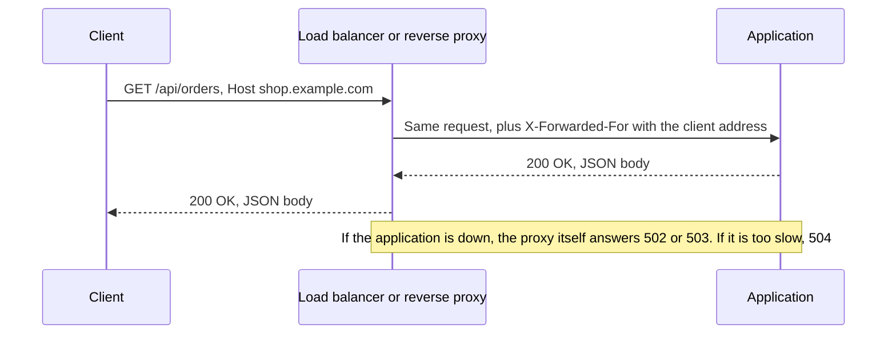

# HTTP

> **Status: AI draft, 2026-11-16.** Not yet verified by me. Commands and output were run in a throwaway container against public sites and a local Nginx; addresses are rewritten to example ranges and some response headers are trimmed.

## In one line

HTTP is a request and response protocol: the client sends a method, a path and headers; the server answers with a status code, headers and a body. The status code's first digit says whose problem it is: 2xx success, 3xx go elsewhere, 4xx the request was wrong, 5xx the server or something behind it failed.

## The plain idea

HTTP is a very structured conversation. The client says what it wants to do (**method**: get, create, change, delete), to which thing (**path**), plus some notes (**headers**: who it is, what formats it accepts, its credentials). The server replies with a three-digit **status code** saying how it went, its own headers, and usually a **body**: the page, the JSON, the file.

The most useful skill is reading the status code as a clue to **where** the problem is. A `404` proves the request reached a server that understood it. A `502` proves a proxy was reached but the program behind it was not. And no status code at all means the request never got that far: DNS, TCP or TLS failed first ([The debugging walk](../start/debugging-walk.md)).

## How it works

### A request and a response

```text
GET /api/orders?limit=10 HTTP/1.1
Host: shop.example.com
Accept: application/json
Authorization: Bearer <token>

```

```text
HTTP/1.1 200 OK
Content-Type: application/json
Content-Length: 512
Cache-Control: no-store

{"orders": [ ... ]}
```

The first line of the request is the method, the path (with an optional query string after `?`) and the version. Headers follow, one per line, then a blank line, then an optional body. The response's first line is the version, the status code and a short reason.



### Methods

| Method | Meaning | Safe (no change) | Idempotent (repeating is harmless) |
|---|---|---|---|
| `GET` | Read a resource | Yes | Yes |
| `HEAD` | Like GET, headers only | Yes | Yes |
| `POST` | Create, or trigger an action | No | No |
| `PUT` | Replace a resource with this one | No | Yes |
| `PATCH` | Change part of a resource | No | Not necessarily |
| `DELETE` | Remove a resource | No | Yes |

**Idempotent** matters for retries: a proxy or client may safely retry a timed-out `GET` or `PUT`, but retrying a `POST` can create a second order.

### Status codes, and who produced them

| Code | Meaning | Usually produced by |
|---|---|---|
| `200 OK` | Success | The application |
| `201 Created` | Something was created | The application |
| `204 No Content` | Success, empty body | The application |
| `301 Moved Permanently`, `308` | Go to the `Location` URL, for good | Application or proxy (for example HTTP to HTTPS) |
| `302 Found`, `307` | Go to `Location`, this time | Application, often a login redirect |
| `304 Not Modified` | Your cached copy is still valid | Server or cache |
| `400 Bad Request` | Malformed request | Application or proxy |
| `401 Unauthorized` | No valid credentials: **who are you?** | Application or auth layer |
| `403 Forbidden` | Credentials known but not allowed: **you may not** | Application, WAF, proxy |
| `404 Not Found` | No such path | Application, or a proxy with no matching route |
| `405 Method Not Allowed` | Path exists, method not supported | Application |
| `408`, `413`, `429` | Request timeout, body too large, too many requests | Proxy or application |
| `500 Internal Server Error` | The application failed handling a valid request | The application |
| `502 Bad Gateway` | A proxy could not get a valid response from the backend: refused, reset, garbage | The proxy or load balancer |
| `503 Service Unavailable` | No backend available, or the server is overloaded or in maintenance | Proxy (no healthy targets) or application |
| `504 Gateway Timeout` | A proxy waited for the backend longer than its timeout | The proxy or load balancer |

The 5xx codes from a proxy are the most useful in an incident: a `502` or `504` means the proxy is fine and the backend is not ([Load balancers and proxies](load-balancers-and-proxies.md), [Nginx as a reverse proxy](nginx.md)).

### Headers that matter in operations

| Header | Why it matters |
|---|---|
| `Host` | Which site this request is for. One address and port can serve many sites; routing, virtual hosts and Ingress rules all use it. |
| `Content-Type`, `Accept` | The format of the body, and the formats the client wants. |
| `Authorization` | Credentials, often `Bearer <token>`. Never log it. |
| `Cookie`, `Set-Cookie` | Session state stored by the browser. |
| `Cache-Control`, `ETag`, `Age` | Whether and how long a response may be cached, by browsers and CDNs. |
| `Location` | Where a redirect points. |
| `X-Forwarded-For`, `X-Forwarded-Proto` | Added by proxies: the original client address and scheme. Without them the application sees only the proxy. |
| `Connection`, keep-alive | Whether the TCP connection is reused for the next request. |

### Versions

- **HTTP/1.1**: text, one request at a time per connection (keep-alive reuses the connection). Browsers open several connections in parallel.
- **HTTP/2**: binary, many requests at once over one TCP connection (**multiplexing**), compressed headers. Almost always over TLS. Which version to use is agreed during the TLS handshake (**ALPN**).
- **HTTP/3**: HTTP/2's ideas over QUIC, which runs on UDP and avoids one lost packet stalling every stream on the connection.

### Cookies and CORS

**Cookies** let a server store a small value in the browser, sent back on every later request to that site: usually a session ID. **CORS** (cross-origin resource sharing) is a browser rule: JavaScript from one site may not read responses from another site unless that site allows it with `Access-Control-Allow-Origin` headers. For some requests the browser first sends an `OPTIONS` **preflight** to ask. CORS errors appear only in browsers; `curl` ignores CORS entirely, which is a quick way to tell a CORS problem from a server problem.

## A concrete example

After a deploy, the checkout page fails for users. Reading only status codes:

1. Browser requests to `/api/checkout` return `502`. The load balancer answered, so DNS, TCP, TLS and the load balancer are fine.
2. A `502` from a proxy means its backend refused, reset, or sent something invalid. The load balancer's target health shows the new pods failing their health check.
3. The pods' logs show a crash at startup: a missing environment variable.
4. Had it been `504`, the pods would have been up but too slow; had it been `503`, there would have been no healthy targets at all; had it been `500`, the application itself would have caught an error and reported it.

## Why not just...?

- **...return `200` with an error message in the body?** Every load balancer, monitor and retry policy reads the status code. A failure reported as `200` is invisible to them: no alerts, no retries, cached as if correct.
- **...retry every failed request automatically?** Retrying a `POST` can create duplicates, and retrying during an overload makes it worse. Retry idempotent requests, with backoff and a limit.
- **...treat `401` and `403` as the same?** `401` means the caller is not authenticated: fix the token. `403` means the caller is known but not allowed: fix the permissions. They lead to different fixes.

## Commands to know

Only the response headers:

```console
# curl -sI https://example.com/
HTTP/2 200
date: Mon, 16 Nov 2026 03:18:51 GMT
content-type: text/html; charset=utf-8
last-modified: Mon, 16 Nov 2026 00:30:20 GMT
allow: GET, HEAD
accept-ranges: bytes
age: 3421
alt-svc: h3=":443"; ma=86400
```

`-I` sends a `HEAD` request. `age` says the response came from a cache and is 3,421 seconds old. `alt-svc` advertises HTTP/3 on port 443. The CDN's own headers are trimmed.

A redirect, and where it points:

```console
# curl -sI http://github.com/
HTTP/1.1 301 Moved Permanently
Location: https://github.com/
```

`-L` would follow it.

Timing of each phase, in seconds:

```console
# curl -s -o /dev/null -w "dns=%{time_namelookup} connect=%{time_connect} tls=%{time_appconnect} first_byte=%{time_starttransfer} total=%{time_total} code=%{http_code}\n" https://example.com/
dns=0.003527 connect=0.051389 tls=0.110840 first_byte=0.162938 total=0.163026 code=200
```

The values are cumulative. Here DNS took 4 ms, the TCP connection about 48 ms more, TLS about 59 ms more, and the server took about 52 ms to send the first byte. This one command tells you which phase is slow.

A 502 and a 504 from a reverse proxy, with the proxy's own explanation:

```console
# curl -s -o /dev/null -w "%{http_code}\n" http://127.0.0.1:8080/
502
# tail -1 /var/log/nginx/error.log
[error] 2211#2211: *1 connect() failed (111: Connection refused) while connecting to upstream, ... upstream: "http://127.0.0.1:9000/"
# curl -s -o /dev/null -w "%{http_code}\n" http://127.0.0.1:8080/
504
# tail -1 /var/log/nginx/error.log
[error] 2213#2213: *5 upstream timed out (110: Connection timed out) while reading response header from upstream, ... upstream: "http://127.0.0.1:9000/"
```

The first time, nothing listened on the backend port; the second time, the backend accepted the connection but never answered.

| Command | What it does |
|---|---|
| `curl -v <url>` | Every phase, both sets of headers ([curl -v, line by line](curl-v-annotated.md)). |
| `curl -X POST -H 'Content-Type: application/json' -d '{"a":1}' <url>` | Send a method, a header and a body. |
| `curl -H 'Host: shop.example.com' http://203.0.113.10/` | Ask a specific server for a specific site: tests virtual hosts and Ingress rules. |
| `curl -L`, `curl -k` | Follow redirects; skip certificate checks (testing only, see [TLS](tls.md)). |
| `curl --http1.1`, `curl --http2` | Force a version. |

## How it breaks

| Symptom | Layer | Check | Likely cause |
|---|---|---|---|
| No status code; "could not resolve" or "connection refused" | Below HTTP | DNS and TCP checks | The request never reached an HTTP server |
| `404` for a path that exists | Routing | `curl -H 'Host: ...'`; proxy or Ingress rules | Wrong `Host` header, path rewrite, or the route sends traffic to the wrong backend |
| `401` | Authentication | Is a token sent? Has it expired? | Missing or expired credentials |
| `403` | Authorisation or a WAF | Application logs; WAF logs | Not allowed, or blocked by a firewall rule |
| `502` | Proxy to backend | Proxy error log; backend health | Backend down, crashing, refusing, or wrong port |
| `503` | No capacity | Target health; autoscaling; maintenance mode | No healthy targets, or overload |
| `504` | Proxy timeout | Backend latency; proxy timeout settings | Backend too slow, or a downstream call hangs |
| Redirect loop | Redirect rules | `curl -sIL` | Proxy terminates TLS and the app, seeing HTTP, redirects to HTTPS again; missing `X-Forwarded-Proto` handling |
| Browser shows a CORS error, `curl` works | Browser policy | Response headers on the preflight | Missing or wrong `Access-Control-Allow-*` headers |

## Interview questions

**1. What is the difference between a `401` and a `403`?**

<details markdown="1">
<summary>Answer</summary>

- `401`: not authenticated; credentials are missing or invalid.
- `403`: authenticated, or the request is identifiable, but not allowed to do this.
- The fixes differ: get a valid token for `401`; change permissions or policy for `403`.

</details>

**2. What do `502`, `503` and `504` each mean, and who usually sends them?**

<details markdown="1">
<summary>Answer</summary>

- All three usually come from a proxy or load balancer, not the application.
- `502`: it got no valid response from the backend: refused, reset or invalid.
- `503`: no backend available, or the service is overloaded or in maintenance.
- `504`: the backend did not answer within the proxy's timeout.

</details>

**3. What does idempotent mean, and why does it matter for retries?**

<details markdown="1">
<summary>Answer</summary>

- Repeating the request has the same effect as doing it once.
- `GET`, `PUT` and `DELETE` are idempotent; `POST` is not.
- Retrying a non-idempotent request can duplicate work, such as charging twice; use idempotency keys or retry only idempotent calls.

</details>

**4. What is the `Host` header for?**

<details markdown="1">
<summary>Answer</summary>

- It names the site the client wants, because one address can host many sites.
- Virtual hosts, Ingress rules and load balancer host rules route on it.
- `curl -H 'Host: name' http://<ip>/` tests a specific backend with a specific site.

</details>

**5. What does HTTP/2 change compared with HTTP/1.1?**

<details markdown="1">
<summary>Answer</summary>

- Binary framing and many concurrent requests over one connection (multiplexing).
- Header compression.
- In practice it runs over TLS, negotiated with ALPN; HTTP/3 moves the same ideas onto QUIC over UDP.

</details>

**6. After moving TLS termination to a load balancer, the site loops between redirects. Why?**

<details markdown="1">
<summary>Answer</summary>

- The load balancer now talks plain HTTP to the application.
- The application sees an HTTP request and redirects to HTTPS, which arrives as HTTP again.
- Fix: make the application trust `X-Forwarded-Proto` from the load balancer, or do the redirect at the load balancer.

</details>

**7. Users report slowness. How would you use `curl` to find which part of a request is slow?**

<details markdown="1">
<summary>Answer</summary>

- `curl -w` with `time_namelookup`, `time_connect`, `time_appconnect`, `time_starttransfer` and `time_total`.
- Large DNS or connect times point at the network; large TLS at the handshake; large time to first byte at the server.
- Compare from inside and outside the network, and directly against a backend to separate proxy from application.

</details>

## Try it

**Step 1.** Start a container with curl.

```bash
docker run --rm -it ubuntu:24.04 bash
apt-get update -qq && apt-get install -y -qq curl ca-certificates
```

**Step 2.** Predict the status code and the first header of each, then run them.

```bash
curl -sI http://github.com/ | head -2
curl -sI https://example.com/ | head -1
curl -s -o /dev/null -w "%{http_code}\n" https://example.com/does-not-exist
```

**Step 3.** Time a request and decide which phase took longest.

```bash
curl -s -o /dev/null -w "dns=%{time_namelookup} connect=%{time_connect} tls=%{time_appconnect} first_byte=%{time_starttransfer} total=%{time_total}\n" https://example.com/
```

**Step 4.** Type `exit`. The container is deleted.

## Zoom out

HTTP is the top of the stack for most of what you run: load balancers, Ingress controllers, API gateways and service meshes all read and act on it ([Ingress and Gateway API](../kubernetes/ingress-and-gateway-api.md), [API Gateway](../serverless/api-gateway.md)). Its status codes are the first evidence in nearly every incident. The principle to carry: a status code tells you how far the request got and who answered it.

## Sources

- [RFC 9110: HTTP semantics, methods and status codes](https://www.rfc-editor.org/rfc/rfc9110)
- [RFC 9112: HTTP/1.1](https://www.rfc-editor.org/rfc/rfc9112)
- [RFC 9113: HTTP/2](https://www.rfc-editor.org/rfc/rfc9113)
- [RFC 9114: HTTP/3](https://www.rfc-editor.org/rfc/rfc9114)
- [MDN: HTTP response status codes](https://developer.mozilla.org/en-US/docs/Web/HTTP/Reference/Status)
- [MDN: Cross-origin resource sharing (CORS)](https://developer.mozilla.org/en-US/docs/Web/HTTP/Guides/CORS)
- [curl documentation: the --write-out option](https://curl.se/docs/manpage.html)
