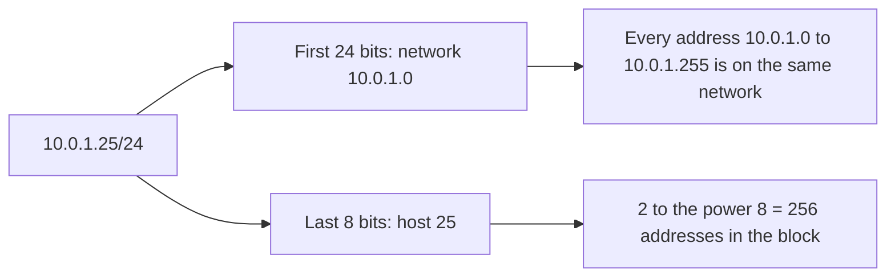

# IP addresses and subnetting

> **Status: AI draft, 2026-11-16.** Not yet verified by me. Commands and output were run in a throwaway container with Python's `ipaddress` module; addresses are rewritten to example ranges.

## In one line

An IPv4 address is 32 bits, split into a network part and a host part; the `/n` in CIDR notation says how many bits are the network. A `/24` holds 256 addresses, and each step down in the prefix doubles the size, so splitting a `/16` into equal subnets is counting in powers of two.

## The plain idea

A street address has two parts: the street, which tells the post office where to deliver, and the house number on that street. An IP address works the same way. The first part says which **network** the machine is on; the rest says which **host** it is within that network. Routers look only at the network part to decide where to send a packet ([Routing and NAT](routing-and-nat.md)).

Where the split falls is not fixed. The **prefix length**, the `/24` in `10.0.1.0/24`, says how many of the leading bits are the network part. The rest are for hosts. Choosing prefixes so that networks are the right size and never overlap is **subnetting**, and you do it every time you design a VPC or a cluster's network.

## How it works

### An address is 32 bits

`10.0.1.25` is four numbers from 0 to 255, each one byte (8 bits), so 32 bits in total:

```text
10       .0        .1        .25
00001010  00000000  00000001  00011001
```

### The prefix splits it



With `/n`, there are `32 - n` host bits, so the block holds **2 to the power (32 - n)** addresses.

| Prefix | Host bits | Addresses | Mask | Typical use |
|---|---|---|---|---|
| `/32` | 0 | 1 | 255.255.255.255 | One host, in a route or rule |
| `/28` | 4 | 16 | 255.255.255.240 | A small subnet |
| `/26` | 6 | 64 | 255.255.255.192 | |
| `/24` | 8 | 256 | 255.255.255.0 | A classic subnet |
| `/20` | 12 | 4,096 | 255.255.240.0 | A roomy subnet for pods or nodes |
| `/19` | 13 | 8,192 | 255.255.224.0 | |
| `/16` | 16 | 65,536 | 255.255.0.0 | A whole VPC |
| `/0` | 32 | All | 0.0.0.0 | "Everywhere": the default route |

The rule to remember: **one bit less of prefix doubles the block**. A `/23` is two `/24`s; a `/25` is half of one.

The **netmask** is the same information written as an address: 24 one-bits followed by 8 zero-bits is `255.255.255.0`.

### Network and broadcast addresses

In a block, the first address (all host bits zero) names the network itself, and the last (all host bits one) is the **broadcast** address. Neither is given to a host, so a `/24` has 254 usable addresses. Cloud providers reserve more: AWS reserves 5 in every subnet, the first four and the last ([VPC basics](../aws-core/vpc-basics.md)).

### Special ranges

| Range | Meaning |
|---|---|
| `10.0.0.0/8`, `172.16.0.0/12`, `192.168.0.0/16` | **Private** (RFC 1918): free to use inside any network, not routed on the internet. Reaching the internet from them needs NAT. |
| `100.64.0.0/10` | Shared address space for carrier-grade NAT; sometimes used for extra pod ranges. |
| `127.0.0.0/8` | Loopback: the machine itself. |
| `169.254.0.0/16` | Link-local. `169.254.169.254` is the cloud metadata service on AWS and others. |
| Everything else, mostly | **Public**: globally routable and unique. |

### Do two ranges overlap?

Two blocks overlap if one contains the other's network address. Blocks only ever nest or stay apart: a `/24` can sit wholly inside a `/20`, but two blocks never partly overlap. Overlaps matter because two networks with overlapping ranges cannot be connected by peering or VPN without NAT: a packet for `10.0.1.5` could belong to either side.

### IPv6, briefly

IPv6 addresses are 128 bits, written in hexadecimal groups such as `2001:db8::10`. A standard subnet is a `/64`, which holds more addresses than all of IPv4. There is no need for NAT to save addresses, but you still need firewalls.

## A concrete example

Split the VPC range `10.0.0.0/16` into six equal subnets: three public and three private, one of each per Availability Zone.

1. **How many bits do you need?** Six subnets need at least 3 bits, because 2 bits make only 4 blocks and 3 bits make 8. So the new prefix is `/16 + 3 = /19`.
2. **How big is each block?** `/19` leaves 13 host bits: 8,192 addresses.
3. **Where does each one start?** Each `/19` is 32 values wide in the third byte (8,192 / 256 = 32). So they start at `10.0.0.0`, `10.0.32.0`, `10.0.64.0`, `10.0.96.0`, `10.0.128.0` and `10.0.160.0`.
4. **What is left?** Two `/19`s, `10.0.192.0/19` and `10.0.224.0/19`, remain free for later.

| Subnet | First address | Last address | Use |
|---|---|---|---|
| `10.0.0.0/19` | 10.0.0.0 | 10.0.31.255 | Public, zone a |
| `10.0.32.0/19` | 10.0.32.0 | 10.0.63.255 | Public, zone b |
| `10.0.64.0/19` | 10.0.64.0 | 10.0.95.255 | Public, zone c |
| `10.0.96.0/19` | 10.0.96.0 | 10.0.127.255 | Private, zone a |
| `10.0.128.0/19` | 10.0.128.0 | 10.0.159.255 | Private, zone b |
| `10.0.160.0/19` | 10.0.160.0 | 10.0.191.255 | Private, zone c |

In real designs public subnets are often much smaller than private ones, because only load balancers and NAT gateways live there. The same arithmetic applies: pick each size, then place blocks on boundaries that are multiples of their size.

## Why not just...?

- **...give every VPC `10.0.0.0/16`?** It works until two of them need to talk, through peering, a transit gateway or a VPN. Overlapping ranges cannot be routed to each other. Plan non-overlapping ranges across every network you might ever connect, including offices.
- **...make every subnet a `/28` to save addresses?** Kubernetes on AWS gives each pod an address from the subnet ([Networking with the VPC CNI](../eks/vpc-cni.md)), so small subnets run out quickly, and resizing a subnet means replacing it.
- **...use public addresses inside the network?** Public ranges belong to someone. If you use them privately, traffic for that real owner gets routed into your network instead.

## Commands to know

Python's `ipaddress` module checks subnet arithmetic without any extra tools:

```console
# python3
>>> import ipaddress as ip
>>> n = ip.ip_network("10.0.0.0/16")
>>> n.num_addresses, n.netmask, n.broadcast_address
(65536, IPv4Address('255.255.0.0'), IPv4Address('10.0.255.255'))
>>> [(p, ip.ip_network(f"10.0.0.0/{p}").num_addresses) for p in (24, 20, 26, 28)]
[(24, 256), (20, 4096), (26, 64), (28, 16)]
```

Splitting the `/16` into `/19`s, the first six:

```console
>>> for s in list(n.subnets(new_prefix=19))[:6]: print(s, s[0], s[-1], s.num_addresses)
10.0.0.0/19 10.0.0.0 10.0.31.255 8192
10.0.32.0/19 10.0.32.0 10.0.63.255 8192
10.0.64.0/19 10.0.64.0 10.0.95.255 8192
10.0.96.0/19 10.0.96.0 10.0.127.255 8192
10.0.128.0/19 10.0.128.0 10.0.159.255 8192
10.0.160.0/19 10.0.160.0 10.0.191.255 8192
```

Overlap and membership:

```console
>>> ip.ip_network("10.0.1.0/24").overlaps(ip.ip_network("10.0.0.0/20"))
True
>>> ip.ip_network("10.0.32.0/19").overlaps(ip.ip_network("10.0.64.0/19"))
False
>>> ip.ip_address("10.0.37.9") in ip.ip_network("10.0.32.0/19")
True
>>> ip.ip_address("192.168.1.10").is_private, ip.ip_address("8.8.8.8").is_private
(True, False)
```

These lines were run as a script; the interactive prompts are shown for readability.

| Command or tool | What it does |
|---|---|
| `ip -br addr` | This machine's addresses with their prefixes. |
| `ipcalc 10.0.32.0/19` | Network, broadcast, mask and host range, if `ipcalc` is installed. |
| Terraform `cidrsubnet("10.0.0.0/16", 3, 1)` | Returns `10.0.32.0/19`: 3 extra bits, block number 1 ([Terraform language](../iac/language.md)). |
| `python3 -c 'import ipaddress; print(...)'` | Any check above, in one line. |

## How it breaks

| Symptom | Layer | Check | Likely cause |
|---|---|---|---|
| Peering or VPN connected, but traffic to some addresses goes nowhere | Address plan | Compare both sides' ranges for overlap | Overlapping ranges: the local route wins |
| A subnet "runs out of IPs" | Sizing | Count addresses in use against the block size | Subnet too small, for example pods taking one address each |
| Two hosts on the "same network" cannot reach each other directly | Prefix | Compare their prefixes with `ip addr` | Different prefix lengths, so each thinks the other is remote |
| A security group or firewall rule matches too much or too little | Rule range | Work out the block for the CIDR in the rule | A `/16` where a `/32` was meant, or the reverse |
| A new subnet cannot be created in the VPC | Plan | List existing subnets and the VPC range | The block does not fit on a boundary, or overlaps an existing one |

## Interview questions

**1. How many addresses are in a `/24`, a `/20` and a `/28`?**

<details markdown="1">
<summary>Answer</summary>

- `/24`: 2 to the power 8 = 256.
- `/20`: 2 to the power 12 = 4,096.
- `/28`: 2 to the power 4 = 16.
- Usable hosts are fewer: minus network and broadcast, and AWS reserves 5 per subnet.

</details>

**2. What does `/16` mean in `10.0.0.0/16`?**

<details markdown="1">
<summary>Answer</summary>

- The first 16 bits are the network part; the remaining 16 are for hosts.
- So the block covers `10.0.0.0` to `10.0.255.255`, 65,536 addresses.
- The equivalent netmask is `255.255.0.0`.

</details>

**3. What are the private IPv4 ranges, and why do they need NAT to reach the internet?**

<details markdown="1">
<summary>Answer</summary>

- `10.0.0.0/8`, `172.16.0.0/12`, `192.168.0.0/16`.
- Anyone may use them internally, so they are not unique and are not routed on the internet.
- NAT rewrites the private source address to a public one on the way out, and back on the reply.

</details>

**4. Split `10.0.0.0/16` into 6 equal subnets. What prefix and what ranges?**

<details markdown="1">
<summary>Answer</summary>

- 6 subnets need 3 extra bits (2 to the power 3 = 8), so `/19`.
- Each has 8,192 addresses and steps 32 in the third byte.
- `10.0.0.0/19`, `10.0.32.0/19`, `10.0.64.0/19`, `10.0.96.0/19`, `10.0.128.0/19`, `10.0.160.0/19`, with two `/19`s left over.

</details>

**5. Does `10.0.1.0/24` overlap with `10.0.0.0/20`? How do you tell quickly?**

<details markdown="1">
<summary>Answer</summary>

- Yes. A `/20` starting at `10.0.0.0` covers `10.0.0.0` to `10.0.15.255`, which contains `10.0.1.0/24`.
- Blocks either nest or do not overlap at all; check whether one block's range contains the other's network address.

</details>

**6. Two teams want to peer their VPCs, but both used `10.0.0.0/16`. What are the options?**

<details markdown="1">
<summary>Answer</summary>

- Peering and routing need non-overlapping ranges, so it cannot work as is.
- Re-address one VPC (new subnets and migration), or add a secondary range for the parts that must talk.
- Or put NAT or PrivateLink-style service exposure between them instead of routing.
- Prevent it with a central address plan.

</details>

**7. A Kubernetes cluster on AWS stops scheduling pods with IP allocation errors. How is that a subnetting problem?**

<details markdown="1">
<summary>Answer</summary>

- With the AWS VPC CNI, every pod takes an address from the node's subnet.
- Small subnets run out long before CPU or memory does.
- Fixes: bigger or additional subnets, a secondary VPC range for pods, or prefix delegation.

</details>

## Try it

**Step 1.** Start a container with Python.

```bash
docker run --rm -it ubuntu:24.04 bash
apt-get update -qq && apt-get install -y -qq python3-minimal
```

**Step 2.** On paper, split `10.0.0.0/16` into 6 equal subnets and write down the prefix and the six ranges. Then check your answer.

```bash
python3 -c 'import ipaddress as ip; [print(s) for s in list(ip.ip_network("10.0.0.0/16").subnets(new_prefix=19))[:6]]'
```

**Step 3.** Predict each answer, then check: does `10.0.48.0/20` overlap `10.0.32.0/19`? Is `10.0.200.7` inside `10.0.192.0/19`?

```bash
python3 -c 'import ipaddress as ip; print(ip.ip_network("10.0.48.0/20").overlaps(ip.ip_network("10.0.32.0/19")), ip.ip_address("10.0.200.7") in ip.ip_network("10.0.192.0/19"))'
```

**Step 4.** Type `exit`. The container is deleted.

## Zoom out

Address plans are the foundation of every VPC, subnet, security group rule and cluster network you will build ([VPC basics](../aws-core/vpc-basics.md), [Peering, Transit Gateway and VPN](../aws-core/vpc-connectivity.md)). Mistakes here are the most expensive to fix later, because changing a range means replacing what lives in it. The principle to carry: plan ranges for every network you might one day connect, and make sure none overlap.

## Sources

- [RFC 4632: Classless Inter-Domain Routing (CIDR)](https://www.rfc-editor.org/rfc/rfc4632)
- [RFC 1918: Address allocation for private internets](https://www.rfc-editor.org/rfc/rfc1918)
- [RFC 6598: Shared address space, 100.64.0.0/10](https://www.rfc-editor.org/rfc/rfc6598)
- [Python documentation: the ipaddress module](https://docs.python.org/3/library/ipaddress.html)
- [Amazon VPC documentation: subnet CIDR blocks and reserved addresses](https://docs.aws.amazon.com/vpc/latest/userguide/subnet-sizing.html)
- [Terraform documentation: cidrsubnet function](https://developer.hashicorp.com/terraform/language/functions/cidrsubnet)
