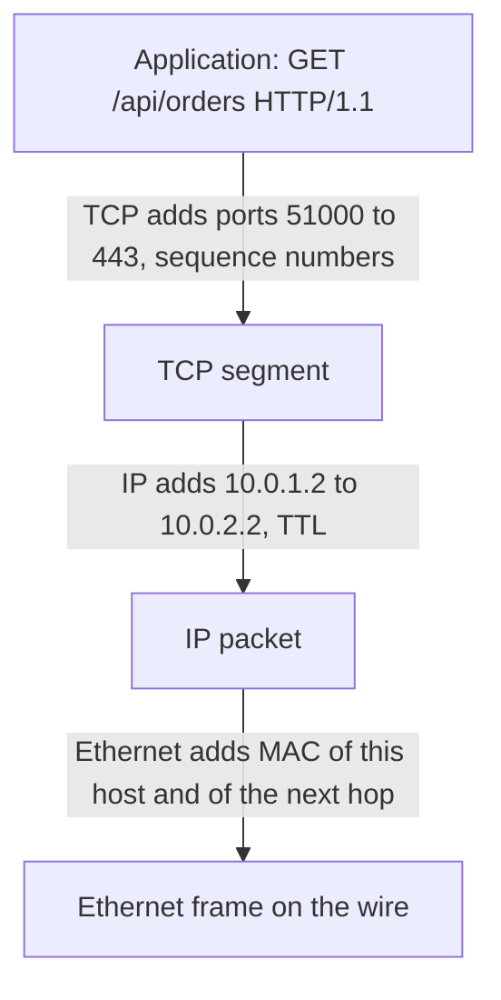

# Layers and encapsulation

> **Status: AI draft, 2026-11-16.** Not yet verified by me. Commands and output were run in a throwaway container and in network namespaces inside it; addresses are rewritten to example ranges.

## In one line

Networking is split into layers so each solves one problem: links move frames between neighbours (L2, MAC addresses), IP moves packets across networks (L3), TCP and UDP deliver to the right program (L4, ports), and the application speaks its own protocol (L7, such as HTTP). Each layer wraps the one above it, and each failure belongs to a layer.

## The plain idea

Sending a letter abroad involves several people who each care about one thing. You write the letter and put it in an envelope with a name. The post office cares only about the country and city. The local carrier cares only about the street and door. Nobody reads anything except their own label, and each one can be replaced without the others noticing.

Network traffic works the same way. Each **layer** adds its own label (a **header**) around the data handed down from above and reads only its own label on the way back up. The application's message gets a TCP header naming the port; that becomes the cargo of an IP packet naming the machine; that becomes the cargo of an Ethernet frame naming the next device on the wire. This wrapping is **encapsulation**.

The reason to learn it: when something "cannot connect", the question is which layer failed. The layer tells you which tool to use and who owns the fix.

## How it works

### The layers you use in practice

Interviewers use the **OSI** model's numbers (seven layers), while the internet actually runs on the simpler **TCP/IP** model. In practice you need four of them, and their OSI numbers:

| Layer | OSI number | What it does | Address it uses | Unit | Examples |
|---|---|---|---|---|---|
| Link | L2 | Moves data between devices on the same network segment | MAC address (`02:42:ac:11:00:02`) | Frame | Ethernet, Wi-Fi, ARP |
| Network | L3 | Moves data between networks, hop by hop | IP address (`10.0.2.2`) | Packet | IPv4, IPv6, ICMP |
| Transport | L4 | Delivers data to the right program, reliably (TCP) or not (UDP) | Port (`8080`) | Segment (TCP) or datagram (UDP) | TCP, UDP |
| Application | L7 | The conversation itself | Names, paths, methods | Message | HTTP, DNS, TLS, SSH |

OSI layers 5 and 6 (session and presentation) do not map onto separate pieces in TCP/IP; TLS is usually described as sitting between L4 and L7. Layer 1 is the physical signal: cables, radio, light.

### Encapsulation



On the way out, each layer adds a header. On the way in, each layer checks and removes its own header and passes the rest up. A router only looks as far as the IP header: it replaces the Ethernet header at every hop, but leaves the IP addresses alone (unless it does NAT, see [Routing and NAT](routing-and-nat.md)).

### How a packet reaches the next device: ARP

An IP address says which machine; the wire needs a MAC address. To send to an address on the same subnet, a host broadcasts an **ARP** request, "who has 10.0.1.1?", and the owner replies with its MAC. The answer is cached in the **neighbour table** (`ip neigh`). To send to an address on another subnet, the host does not ARP for the destination at all: it ARPs for its **gateway** and hands the packet to it.

### Who reads which layer

| Device or software | Works at | Decides on |
|---|---|---|
| Switch | L2 | MAC addresses |
| Router | L3 | IP addresses and the route table |
| Security group, iptables, NACL | L3 and L4 | Addresses, protocols and ports |
| Network Load Balancer | L4 | Connections (IP and port) |
| Application Load Balancer, Nginx, Ingress, a mesh sidecar | L7 | HTTP host, path, headers |

### Size limits: MTU

Each link has a **maximum transmission unit** (MTU), the biggest packet it carries, usually 1500 bytes on Ethernet. Tunnels and overlays (VPNs, some container networks) add headers, which leaves less room. When packets are too big and the signal to shrink them is blocked, small requests work and large ones hang: a classic, confusing failure.

## A concrete example

A pod cannot reach a database at `10.0.20.15:5432`. Walking up the layers turns "it does not work" into one specific fault.

1. **L3: is the address reachable?** `ping 10.0.20.15` may be blocked by policy, so it proves little by itself. `ip route get 10.0.20.15` shows which route and gateway would be used.
2. **L4: is the port open?** `nc -vz 10.0.20.15 5432`. "Connection refused" means the machine answered but nothing listens on that port. A timeout means packets are being dropped somewhere: a security group, a NACL, a missing route back ([TCP and UDP](tcp-and-udp.md)).
3. **L7: does the application accept the conversation?** If the port connects, the database's own error message (authentication, TLS required, database does not exist) is now the evidence.

Each step either passes, and you move up, or fails, and you know which team and which tool to use.

## Why not just...?

- **...test everything with `ping`?** `ping` uses ICMP, a different protocol from your application's TCP. Many networks block ICMP, so a failed ping proves little, and a working ping does not prove the port is open.
- **...memorise all seven OSI layers in depth?** Interviews mostly use L2, L3, L4 and L7 as shorthand, as in "an L4 load balancer" or "an L7 rule". Knowing what each of those four reads and decides on is what matters.
- **...treat a timeout and a refusal as the same error?** They point at different layers and different owners. A refusal means you reached the host; a timeout means something silently dropped the packets.

## Commands to know

Interfaces and addresses, and the route table, inside a container:

```console
# ip -br addr
lo               UNKNOWN        127.0.0.1/8 ::1/128
eth0@if43        UP             172.17.0.2/16
# ip route
default via 172.17.0.1 dev eth0
172.17.0.0/16 dev eth0 proto kernel scope link src 172.17.0.2
```

`-br` gives brief, one-line-per-interface output. The container's L3 address is `172.17.0.2`, and anything not on its own subnet goes to the gateway `172.17.0.1`.

Three layers in one captured packet, a TCP connection request:

```console
# tcpdump -n -i s-eth0 'tcp port 8080'
IP 10.0.1.2.44054 > 10.0.2.2.8080: Flags [S], seq <client-isn>, win 64240, options [mss 1460,...], length 0
```

`IP` and the two addresses are L3. `.44054` and `.8080` are the L4 ports, and `Flags [S]` is TCP's connection request. `length 0` means no L7 data has been sent yet. Raw sequence numbers are replaced with a placeholder.

| Command | Layer | What it shows |
|---|---|---|
| `ip link` | L2 | Interfaces, their MAC addresses and MTU. |
| `ip neigh` | L2 | The ARP or neighbour table: IP to MAC for this subnet. |
| `ip addr`, `ip route`, `ip route get <ip>` | L3 | Addresses, routes, and the route for one destination. |
| `ping`, `traceroute` | L3 (ICMP) | Reachability and the path, where ICMP is allowed. |
| `ss -tln`, `nc -vz <ip> <port>` | L4 | Listening ports; whether a port accepts connections. |
| `curl -v`, `dig`, `openssl s_client` | L7 | HTTP, DNS and TLS conversations. |

## How it breaks

| Symptom | Layer | Check | Likely cause |
|---|---|---|---|
| `Network is unreachable` | L3 | `ip route` | No route to that destination, often no default route |
| `No route to host` | L2 or L3 | `ip neigh`; firewall rules | The neighbour does not answer ARP, or a REJECT rule replied with ICMP |
| Connection timeout | L3 or L4 | `ip route get`; firewall, security group, NACL; the return route | Packets dropped silently somewhere along the path |
| Connection refused | L4 | `ss -tlnp` on the target | Nothing listening on that port, or listening on another address |
| Small requests work, large ones hang | L2 or L3 | `ip link` for MTU; `ping -M do -s 1472 <ip>` | MTU mismatch, with the "packet too big" signal blocked |
| HTTP 4xx or 5xx | L7 | `curl -v` | The network worked; the application or proxy answered with an error |

## Interview questions

**1. What happens at L2, L3, L4 and L7? Give one example protocol and one device for each.**

<details markdown="1">
<summary>Answer</summary>

- L2 moves frames on one segment by MAC address: Ethernet, ARP; a switch.
- L3 moves packets between networks by IP address: IP, ICMP; a router.
- L4 delivers to a program by port, reliably or not: TCP, UDP; a Network Load Balancer or a security group rule.
- L7 is the application protocol: HTTP, DNS; an Application Load Balancer or Nginx.

</details>

**2. What is encapsulation?**

<details markdown="1">
<summary>Answer</summary>

- Each layer wraps the data from the layer above with its own header.
- HTTP data goes inside a TCP segment, inside an IP packet, inside an Ethernet frame.
- On receipt each layer removes its header and passes the rest up, so layers can change independently.

</details>

**3. What is the difference between a MAC address and an IP address?**

<details markdown="1">
<summary>Answer</summary>

- A MAC address identifies a network interface on the local segment (L2); it is used only for the next hop.
- An IP address identifies a host's position in the routed network (L3) and stays the same end to end (unless NAT rewrites it).
- ARP maps one to the other on a local subnet.

</details>

**4. What does ARP do, and does a host ARP for a destination on another subnet?**

<details markdown="1">
<summary>Answer</summary>

- ARP asks "who has this IP?" on the local segment and learns the owner's MAC address.
- For a destination on another subnet, the host ARPs for its gateway instead and sends the packet there.
- Results are cached in the neighbour table.

</details>

**5. What is the difference between an L4 and an L7 load balancer?**

<details markdown="1">
<summary>Answer</summary>

- L4 sees addresses and ports and forwards connections without reading the content.
- L7 terminates the connection and reads HTTP: host, path, headers, cookies, and can route on them.
- L7 can do more (path routing, TLS termination, header rewrites); L4 is simpler and faster and works for any TCP or UDP protocol.

</details>

**6. A service cannot reach a database. How do you use the layers to narrow it down?**

<details markdown="1">
<summary>Answer</summary>

- L3: resolve the name, then check the route (`ip route get`).
- L4: `nc -vz <ip> <port>`: refused means reached the host with nothing listening; timeout means something is dropping packets.
- L7: once connected, read the database's own error (authentication, TLS, database name).
- Each result tells you which team or component owns the next step.

</details>

**7. Small API responses work through a VPN, but large downloads hang. What layer and what cause?**

<details markdown="1">
<summary>Answer</summary>

- An MTU problem: the tunnel adds headers, so full-size packets no longer fit.
- Normally the sender is told to use smaller packets; if those ICMP messages are blocked, large packets vanish.
- Test with `ping -M do -s <size>`; fix by lowering the MTU or clamping the TCP MSS on the tunnel.

</details>

## Try it

**Step 1.** Start a container with the networking tools.

```bash
docker run --rm -it ubuntu:24.04 bash
apt-get update -qq && apt-get install -y -qq iproute2 iputils-ping netcat-openbsd
```

**Step 2.** Look at each layer of this container. Predict the default gateway before running `ip route`.

```bash
ip link
ip -br addr
ip route
```

**Step 3.** Test a public host at L3 and at L4, and compare what each proves.

```bash
ping -c 2 1.1.1.1
nc -vz -w 3 1.1.1.1 443
nc -vz -w 3 1.1.1.1 81
```

The last command should time out. Decide which layer that points to before you read on: the host is up, so something drops packets to that port.

**Step 4.** Type `exit`. The container is deleted.

## Zoom out

Every later networking page fills in one layer: [IP addresses and subnetting](ip-and-subnetting.md) and [Routing and NAT](routing-and-nat.md) for L3, [TCP and UDP](tcp-and-udp.md) for L4, and [HTTP](http.md), [DNS](dns.md) and [TLS](tls.md) above them. The whole path is drawn in [One request, end to end](../start/request-path.md). The principle to carry: name the layer before you name the fix.

## Sources

- [RFC 1122: Requirements for internet hosts, communication layers](https://www.rfc-editor.org/rfc/rfc1122)
- [RFC 826: the Address Resolution Protocol](https://www.rfc-editor.org/rfc/rfc826)
- [RFC 791: Internet Protocol](https://www.rfc-editor.org/rfc/rfc791)
- [ip(8) manual page](https://man7.org/linux/man-pages/man8/ip.8.html)
- [MDN: An overview of HTTP](https://developer.mozilla.org/en-US/docs/Web/HTTP/Guides/Overview)
- [tcpdump(1) manual page](https://www.tcpdump.org/manpages/tcpdump.1.html)
