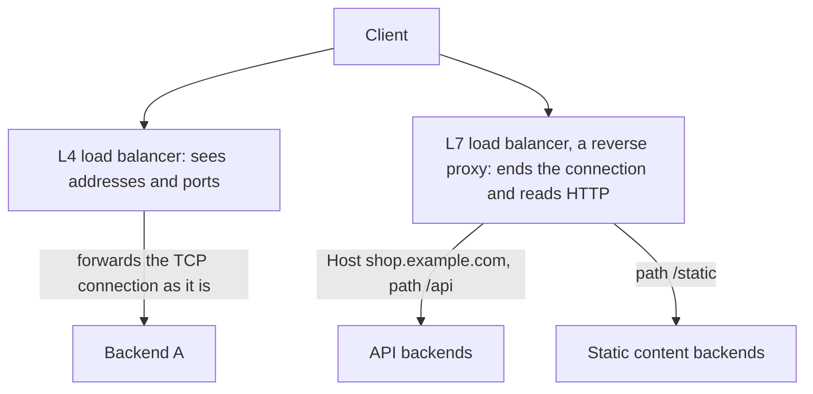

# Load balancers and proxies

> **Status: AI draft, 2026-11-16.** Not yet verified by me. Commands and output were run in a throwaway container with Nginx in front of two small backends; addresses are rewritten to example ranges.

## In one line

A load balancer spreads requests across healthy backends and hides them behind one address. An L4 balancer forwards connections by address and port; an L7 balancer (a reverse proxy) reads HTTP and routes on host, path and headers. Health checks decide who gets traffic, and the proxy's own 502, 503 and 504 tell you which side failed.

## The plain idea

A busy restaurant does not let customers pick a cook. A host at the door takes each order and passes it to whichever cook is free, and stops sending orders to a cook who has gone home. Customers only ever see the door.

A **load balancer** is that host. Clients connect to one name and address; behind it sit several copies of the application (**backends** or **targets**). The balancer picks one per connection or request, keeps checking that each is alive, and stops sending traffic to those that fail. You can add, remove or replace backends without clients noticing.

A **proxy** is anything that receives a request and makes its own request onward on the client's behalf. A **reverse proxy** sits in front of servers (Nginx, an Application Load Balancer, an Ingress controller). A **forward proxy** sits in front of clients, for example a corporate proxy that all outbound web traffic must use.

## How it works

### L4 and L7



| | L4 (transport) | L7 (application) |
|---|---|---|
| Sees | Source and destination address and port | The whole HTTP request: host, path, headers, cookies |
| Connection | Passes the client's TCP connection through (or NATs it) | Ends the client's connection and opens its own to the backend |
| Can route on | Port, address | Host, path, header, method, query string |
| TLS | Usually passes it through; can terminate in some products | Terminates it to read HTTP; can re-encrypt |
| Protocols | Any TCP or UDP | HTTP, HTTP/2, gRPC, WebSocket |
| Examples | AWS Network Load Balancer, kube-proxy for Services | AWS Application Load Balancer, Nginx, Envoy, Ingress controllers |

([ALB and NLB](../aws-core/load-balancers.md) covers the AWS versions.)

### Choosing a backend

| Algorithm | How it picks | Good for |
|---|---|---|
| Round robin | Each backend in turn | Similar backends, similar requests |
| Least connections | The backend with fewest active connections | Requests of very different lengths |
| Hash (source address, header, cookie) | The same key always maps to the same backend | Caches, or sticky behaviour |
| Weighted | In proportion to configured weights | Canary releases, unequal backends |

**Sticky sessions** (session affinity) send one client to the same backend every time, usually with a cookie. They help applications that keep session state in memory, at the cost of uneven load and lost sessions when that backend goes away. Storing sessions outside the application (a database or cache) removes the need.

### Health checks

The balancer regularly requests a **health check** path (such as `/healthz`) on each backend, or opens a TCP connection to it. After a set number of failures the backend is marked unhealthy and gets no new traffic; after a set number of passes it is put back. Two cautions:

- A health check that only proves the process is up can pass while the application cannot do its job. One that checks every dependency can take all backends out at once when a shared database blips. Check what this instance needs to serve, not the whole world ([Probes and graceful shutdown](../kubernetes/probes-and-graceful-shutdown.md)).
- **Passive** health checking also exists: the proxy notices failures on real requests and avoids that backend for a while. Nginx does this by default.

### Removing a backend cleanly

**Connection draining** (deregistration delay) stops sending new requests to a backend that is being removed but lets in-flight requests finish, up to a timeout. Without it, every deploy or scale-in cuts off some requests.

### Who is the client?

An L7 proxy opens its own connection to the backend, so the backend sees the proxy's address as the client. The proxy passes the original along in headers:

| Header | Carries |
|---|---|
| `X-Forwarded-For` | The chain of client addresses: the original client first, then each proxy that forwarded it |
| `X-Forwarded-Proto` | `http` or `https`, as the client used it |
| `X-Forwarded-Host` or `Host` | The host the client asked for |

The application must trust these headers only from its own proxies, because a client can send a fake `X-Forwarded-For`. An L4 balancer can preserve the client address directly, or add it with the **PROXY protocol**, a short header at the start of the connection that the backend must be configured to read.

### Three status codes, three meanings

When the backend is the problem, the proxy answers for it:

| Code | What the proxy is saying | First check |
|---|---|---|
| `502 Bad Gateway` | "I reached for a backend and got a refusal, a reset, or a response I could not use." | Backend process, port, crash logs |
| `503 Service Unavailable` | "I have no healthy backend to send this to." | Health check results; did every target fail at once? |
| `504 Gateway Timeout` | "The backend accepted the request but did not answer in time." | Backend latency; slow dependencies; timeout settings |

### Timeouts form a chain

A request passes several timers: the client's, the load balancer's idle timeout, the proxy's read timeout, the application's own, and its database client's. If an outer timeout is shorter than an inner one, the outer one gives up first and the user sees a 504 while the backend is still working. If an idle timeout in the middle is shorter than a backend's keep-alive, the backend can reuse a connection the proxy has already closed, giving random 502s. Line them up: each inner timeout shorter than the one outside it.

## A concrete example

After a deploy, users see intermittent `502` errors, about 1 in 20 requests.

1. The load balancer's metrics show the 502s come from it, not from the application.
2. Its access logs show the failing requests were all sent to targets being replaced by the deploy.
3. Old pods were stopped as soon as the new ones were ready, but the load balancer still had them registered for a few seconds, so requests went to processes that were already gone.
4. Fix: give old pods time to be deregistered before they stop (a `preStop` pause, and a deregistration delay longer than the slowest request), and make the application finish in-flight requests on SIGTERM.

## Why not just...?

- **...use DNS with several A records instead of a load balancer?** Clients and resolvers cache DNS answers, so a dead server keeps getting traffic until the TTL runs out, and there is no health checking or per-request balancing.
- **...make the health check call the database too, to be thorough?** When the database has a hiccup, every backend fails its check together, the load balancer has nothing healthy, and a partial problem becomes a full outage of `503`s.
- **...turn on sticky sessions to fix logins that "randomly" fail?** It hides the real problem, session state kept in one instance's memory, and makes scale-in and deploys log users out. Move the session to shared storage.

## Commands to know

Nginx as a small L7 load balancer in front of two backends on ports 9001 and 9002:

```nginx
upstream app {
    zone app 64k;
    server 127.0.0.1:9001;
    server 127.0.0.1:9002;
}
server {
    listen 8080;
    location / {
        proxy_pass http://app;
        proxy_set_header Host $host;
        proxy_set_header X-Forwarded-For $proxy_add_x_forwarded_for;
        proxy_set_header X-Forwarded-Proto $scheme;
        proxy_connect_timeout 2s;
    }
}
```

Round robin across the two:

```console
# for i in 1 2 3 4 5 6; do curl -s http://127.0.0.1:8080/; done
backend 9001
backend 9002
backend 9001
backend 9002
backend 9001
backend 9002
```

That alternation needed the `zone` line. Without it, each Nginx worker process keeps its own round-robin position, so six fresh connections that landed on six different workers all went to the first backend:

```console
# for i in 1 2 3 4 5 6; do curl -s http://127.0.0.1:8080/; done
backend 9001
backend 9001
backend 9001
backend 9001
backend 9001
backend 9001
```

A good lesson about measuring balance: test with many requests over many connections, and know where the balancer keeps its state.

One backend stopped. Users still get `200`, and the proxy logs the failed attempt it retried elsewhere:

```console
# for i in 1 2 3 4; do curl -s -o /dev/null -w "%{http_code} " http://127.0.0.1:8080/; done
200 200 200 200
# grep "connect() failed" /var/log/nginx/error.log
[error] 2215#2215: *32 connect() failed (111: Connection refused) while connecting to upstream, ... upstream: "http://127.0.0.1:9002/"
```

What a backend sees behind the proxy, when the client also sends its own `X-Forwarded-For`:

```console
# curl -s -H "Host: shop.example.com" -H "X-Forwarded-For: 203.0.113.50" http://127.0.0.1:8080/headers
Host: shop.example.com
X-Forwarded-For: 203.0.113.50, 127.0.0.1
X-Forwarded-Proto: http
```

`$proxy_add_x_forwarded_for` appended the address the proxy saw to whatever the client sent. The first entry, `203.0.113.50`, was supplied by the client and could be fake; only the entries added by your own proxies can be trusted.

| Command | What it does |
|---|---|
| `curl -s -o /dev/null -w "%{http_code}\n" <url>` in a loop | Watch status codes during a deploy. |
| `curl -H 'Host: <name>' http://<lb-address>/` | Test host-based routing before DNS points at the balancer. |
| `curl -v --resolve <name>:443:<ip> https://<name>/` | Send to one specific balancer node or backend, keeping TLS and the name intact. |
| The balancer's target health view (`aws elbv2 describe-target-health`, `kubectl get endpointslices`) | Which backends it currently considers healthy. |

## How it breaks

| Symptom | Layer | Check | Likely cause |
|---|---|---|---|
| `503` from the balancer | Health | Target health: are all unhealthy? | Every backend failing its check: bad deploy, or a check that depends on a shared component |
| `502` from the balancer | Backend connection | Backend logs and ports; was a deploy running? | Backend crashed, wrong port, or traffic sent to targets being stopped |
| `504` from the balancer | Timeout | Backend latency; compare timeouts along the chain | Slow backend or dependency; a proxy timeout shorter than the work |
| Random `502`s under steady load | Keep-alive | Compare backend keep-alive with the balancer's idle timeout | Backend closes idle connections the balancer still reuses |
| One backend gets most of the traffic | Balancing | Per-backend request counts | Sticky sessions, hashing on a skewed key, long-lived connections (HTTP/2, gRPC) pinned to one backend |
| Application logs show only the balancer's address | Client address | `X-Forwarded-For` handling in the app | App not reading or not trusting the forwarded header |
| Users logged out after a deploy | Session state | Where sessions are stored | Sessions in instance memory with sticky sessions |

## Interview questions

**1. What is the difference between an L4 and an L7 load balancer?**

<details markdown="1">
<summary>Answer</summary>

- L4 forwards connections using addresses and ports and does not read the content.
- L7 terminates the connection and reads HTTP, so it can route by host, path or header, and terminate TLS.
- L4 suits any TCP or UDP protocol and very high throughput; L7 gives smarter routing and HTTP features.

</details>

**2. How do health checks work, and how can a bad one cause an outage?**

<details markdown="1">
<summary>Answer</summary>

- The balancer probes each backend on a schedule and removes it after a set number of failures, re-adding it after a set number of passes.
- A check that tests shared dependencies fails on every backend at once when that dependency blips, leaving no healthy targets: a full `503` outage.
- A check that is too shallow keeps broken instances in rotation.

</details>

**3. What do `502`, `503` and `504` from a load balancer tell you?**

<details markdown="1">
<summary>Answer</summary>

- `502`: it could not get a valid response: backend refused, reset or crashed.
- `503`: no healthy backend available.
- `504`: the backend did not answer within the timeout.
- All three mean the balancer itself is working and the problem is behind it.

</details>

**4. What is connection draining, and why does it matter during deploys?**

<details markdown="1">
<summary>Answer</summary>

- When a backend is removed, the balancer stops new requests to it but lets in-flight ones finish, up to a timeout.
- Without it, every deploy or scale-in cuts off requests.
- The application must also handle SIGTERM by finishing current work.

</details>

**5. How does the application learn the real client address behind a proxy, and what is the risk?**

<details markdown="1">
<summary>Answer</summary>

- From `X-Forwarded-For` (L7) or the PROXY protocol or client address preservation (L4).
- Clients can send their own fake `X-Forwarded-For`, so only trust entries added by your own proxies.
- Configure the application or framework with the list of trusted proxies.

</details>

**6. Users get occasional `502`s under normal load, with no deploys. What would you check?**

<details markdown="1">
<summary>Answer</summary>

- Keep-alive mismatch: the backend's idle timeout shorter than the balancer's, so the balancer reuses a closed connection.
- Backend restarts or crashes, such as OOM kills.
- Backends at their connection or worker limit refusing connections.
- Correlate the balancer's logs (which target, which error) with backend logs and metrics.

</details>

**7. When would you choose sticky sessions, and what is the better alternative?**

<details markdown="1">
<summary>Answer</summary>

- Only when an application keeps per-user state in memory and cannot be changed quickly.
- They cause uneven load and lose sessions when an instance goes away.
- Better: stateless instances with sessions in a shared store, or signed tokens.

</details>

## Try it

**Step 1.** Start a container with Nginx, curl and Python, and two tiny backends.

```bash
docker run --rm -it ubuntu:24.04 bash
apt-get update -qq && apt-get install -y -qq nginx curl python3-minimal
for p in 9001 9002; do mkdir -p /srv/b$p; echo "backend $p" > /srv/b$p/index.html; done
(cd /srv/b9001 && exec python3 -m http.server 9001 --bind 127.0.0.1 >/dev/null 2>&1) &
(cd /srv/b9002 && exec python3 -m http.server 9002 --bind 127.0.0.1 >/dev/null 2>&1) &
```

**Step 2.** Configure Nginx as a balancer and start it.

```bash
cat > /etc/nginx/sites-enabled/default <<'EOF'
upstream app { zone app 64k; server 127.0.0.1:9001; server 127.0.0.1:9002; }
server { listen 8080; location / { proxy_pass http://app; proxy_connect_timeout 2s; } }
EOF
nginx
```

**Step 3.** Predict the six responses, then run it. Then stop backend 9002, predict the status codes, and check.

```bash
for i in 1 2 3 4 5 6; do curl -s http://127.0.0.1:8080/; done
pkill -f "http.server 9002"
for i in 1 2 3 4; do curl -s -o /dev/null -w "%{http_code} " http://127.0.0.1:8080/; done; echo
```

**Step 4.** Type `exit`. The container is deleted.

## Zoom out

Load balancing appears at every layer you will run: cloud load balancers in front of clusters ([ALB and NLB](../aws-core/load-balancers.md)), Ingress controllers and Services inside them ([Services and DNS](../kubernetes/services-and-dns.md)), and sidecars between services ([Traffic management](../mesh/traffic-management.md)). Each one adds health checks, timeouts and its own error codes to the path. The principle to carry: when a proxy reports an error, it is telling you about the hop behind it.

## Sources

- [Nginx documentation: HTTP load balancing](https://nginx.org/en/docs/http/load_balancing.html)
- [Nginx documentation: ngx_http_upstream_module, including zone](https://nginx.org/en/docs/http/ngx_http_upstream_module.html)
- [Nginx documentation: ngx_http_proxy_module](https://nginx.org/en/docs/http/ngx_http_proxy_module.html)
- [MDN: X-Forwarded-For](https://developer.mozilla.org/en-US/docs/Web/HTTP/Reference/Headers/X-Forwarded-For)
- [RFC 9110: HTTP semantics, status codes 502, 503, 504](https://www.rfc-editor.org/rfc/rfc9110.html)
- [Elastic Load Balancing documentation: target group health checks](https://docs.aws.amazon.com/elasticloadbalancing/latest/application/target-group-health-checks.html)
