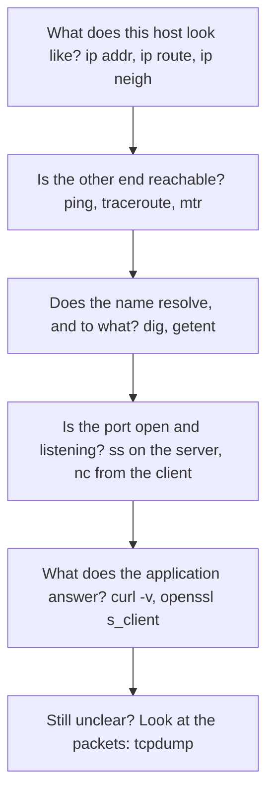

# Network tools on Linux

> **Status: AI draft, 2026-11-16.** Not yet verified by me. Commands and output were run in throwaway containers and network namespaces; every address outside the container itself, including the resolver and the hops past the first, is rewritten to example ranges.

## In one line

A small set of tools answers most network questions, one layer at a time: `ip` for addresses, routes and neighbours; `ping`, `traceroute` and `mtr` for reachability and path; `dig` for names; `ss` and `nc` for ports; `curl` for HTTP and TLS; and `tcpdump` when you need to see the packets themselves.

## The plain idea

Each tool answers one question about one layer ([Layers and encapsulation](layers.md)). Picking the right one is most of the skill: there is no point capturing packets when `ss` would have shown that nothing listens on the port, and no point reading HTTP headers when the name does not resolve.

The order on this page follows the order you check in ([The debugging walk](../start/debugging-walk.md)): what does this machine look like, can it reach the other end, does the name resolve, is the port open, what does the application say, and finally, what is really on the wire.

## How it works



| Question | Tool | Layer |
|---|---|---|
| Which interfaces and addresses do I have? | `ip -br addr`, `ip link` | L2, L3 |
| Where would a packet to X go? | `ip route`, `ip route get X` | L3 |
| Is the neighbour or gateway answering ARP? | `ip neigh` | L2 |
| Is X reachable, how fast, how lossy? | `ping`, `mtr` | L3 (ICMP) |
| Which routers lie on the path? | `traceroute`, `mtr` | L3 |
| What does a name resolve to, and from which server? | `dig`, `getent ahostsv4` | L7 (DNS) |
| What is listening here, and which program owns it? | `ss -tlnp` | L4 |
| Can I open a TCP connection to X:port? | `nc -vz`, `curl telnet://` | L4 |
| What does the web server answer, and how long does each phase take? | `curl -v`, `curl -w` | L7 |
| What certificate does the server present? | `openssl s_client` | TLS |
| What packets actually arrive and leave? | `tcpdump` | All |

Older tools still appear in documentation and on older servers: `ifconfig` (now `ip addr`), `route` (now `ip route`), `arp` (now `ip neigh`) and `netstat` (now `ss`). They come from the `net-tools` package, which minimal images do not include.

**Network namespaces** (`ip netns`) give you separate, complete network stacks on one machine, each with its own interfaces, routes and firewall rules. Containers are built on them, and they make a free lab for practising everything on this page ([Routing and NAT](routing-and-nat.md) builds one).

## A concrete example

From a pod, a call to `https://api.example.com` fails. Working down the list:

1. `ip -br addr` and `ip route`: the pod has an address and a default route. Fine.
2. `dig api.example.com`: `status: NOERROR`, two addresses. The name is fine.
3. `nc -vz -w3 api.example.com 443`: timed out. A refusal would have pointed at the server; a timeout means something drops the packets.
4. `traceroute -n -T -p 443 api.example.com` (TCP-based traceroute): the path stops after the node's gateway. The problem is between the cluster and the outside.
5. The same `nc` from the node itself works. So the node can get out, but the pod cannot: an egress NetworkPolicy, or the pod's traffic not being NATed. Look there ([Pod networking and NetworkPolicy](../kubernetes/pod-networking-and-network-policy.md)).

Each step removed a layer from suspicion, and the step that failed named the next place to look.

## Why not just...?

- **...start with `tcpdump`?** It shows everything, which is the problem: without a hypothesis you drown in packets. Use the cheap tools first to find the layer, then capture with a narrow filter to confirm.
- **...trust `ping` as the reachability test?** ICMP is often blocked, so a failing ping proves little, and a working ping does not mean your port is open. Test the actual protocol and port with `nc` or `curl`.
- **...use `nslookup` everywhere?** It works, but it does its own resolution and hides details such as TTLs and flags. `dig` shows the whole answer, and `getent` shows what applications really get.

## Commands to know

The interface, with its MAC address and MTU:

```console
# ip link show eth0
2: eth0@if91: <BROADCAST,MULTICAST,UP,LOWER_UP> mtu 1500 qdisc noqueue state UP mode DEFAULT group default
    link/ether ca:11:b9:6d:c0:1d brd ff:ff:ff:ff:ff:ff link-netnsid 0
```

`UP,LOWER_UP` means the interface is enabled and the link is connected. `mtu 1500` is the largest packet it carries.

Reachability, and the neighbour table it filled:

```console
# ping -c 3 172.17.0.1
PING 172.17.0.1 (172.17.0.1) 56(84) bytes of data.
64 bytes from 172.17.0.1: icmp_seq=1 ttl=64 time=0.065 ms
64 bytes from 172.17.0.1: icmp_seq=2 ttl=64 time=0.074 ms
64 bytes from 172.17.0.1: icmp_seq=3 ttl=64 time=0.079 ms

--- 172.17.0.1 ping statistics ---
3 packets transmitted, 3 received, 0% packet loss, time 2065ms
rtt min/avg/max/mdev = 0.065/0.072/0.079/0.005 ms
# ip neigh
172.17.0.1 dev eth0 lladdr 3a:e4:d4:a5:43:bb REACHABLE
```

`-c 3` sends three and stops. `ttl=64` with no routers in between: the gateway is on the same link. `REACHABLE` means ARP for the gateway is answered; `FAILED` or `INCOMPLETE` would mean it is not.

The path, with loss and latency per hop:

```console
# mtr -n -r -c 3 1.1.1.1
HOST: <container>                Loss%   Snt   Last   Avg  Best  Wrst StDev
  1.|-- 172.17.0.1                 0.0%     3    0.1   0.1   0.1   0.1   0.0
  2.|-- 192.168.1.1                0.0%     3    3.8   3.3   2.1   4.1   1.1
  3.|-- 198.51.100.1               0.0%     3    6.2   5.8   5.0   6.2   0.7
  4.|-- 203.0.113.1                0.0%     3   17.8  18.4  16.6  20.6   2.1
...
```

Hops 2 onwards are rewritten. `-n` shows numbers instead of names, `-r` prints one report instead of running live, `-c 3` sends three probes per hop. Loss that appears at one hop but not at the hops after it is usually that router de-prioritising its own replies, not real loss.

A DNS query and its answer, on the wire:

```console
# tcpdump -n -i eth0 -c 2 'udp port 53'
IP 172.17.0.2.57597 > 10.0.0.2.53: 46903+ [1au] A? example.com. (52)
IP 10.0.0.2.53 > 172.17.0.2.57597: 46903$ 2/0/1 A 203.0.113.10, A 203.0.113.11 (72)
```

The question (`A? example.com.`) went from an ephemeral port to port 53, and the answer came back with two A records. `46903` is the query ID that pairs them.

Other outputs on these pages: `ip route` and `ip route get` in [Routing and NAT](routing-and-nat.md), `dig` in [DNS](dns.md), `ss` and `nc` in [TCP and UDP](tcp-and-udp.md), `curl -v` in [curl -v, line by line](curl-v-annotated.md), `openssl s_client` in [TLS and certificates](tls.md).

`tcpdump` filters you will reuse:

| Filter | Captures |
|---|---|
| `host 10.0.2.2` | Traffic to or from one address |
| `port 443`, `tcp port 5432` | One port |
| `src 10.0.1.2 and dst port 8080` | One direction |
| `'tcp[tcpflags] & tcp-syn != 0'` | Connection attempts only |
| `icmp` | Pings, unreachables, time exceeded |

Useful options: `-n` (no name lookups, which also avoids generating DNS traffic), `-i any` (all interfaces), `-c 20` (stop after 20 packets), `-w file.pcap` (save for Wireshark), `-A` (print payloads as text, for plain HTTP).

| Command | What it does |
|---|---|
| `ip -br addr`, `ip -s link` | Addresses in brief; interface counters, including errors and drops. |
| `ss -tanp`, `ss -s` | All TCP sockets with owners; totals by state. |
| `traceroute -n -T -p 443 <host>` | Traceroute with TCP SYNs to port 443, which passes firewalls that block ICMP and UDP. |
| `ip netns add lab`, `ip netns exec lab <cmd>` | Make a network namespace and run a command inside it. |
| `nsenter -t <pid> -n <cmd>` | Run a command inside a running container's network namespace, from the host. |

## How it breaks

| Symptom | Layer | Check | Likely cause |
|---|---|---|---|
| `ip`, `ss` or `dig` not found | Tooling | Package names: `iproute2`, `dnsutils` or `bind-utils`, `netcat-openbsd` | Minimal image; use a debug container instead of installing into production |
| `tcpdump: permission denied` | Privileges | Run as root, or with the `NET_RAW` and `NET_ADMIN` capabilities | Capturing needs raw socket access |
| `traceroute` shows only `* * *` | ICMP or UDP filtered | Try `traceroute -T -p 443` | Middle routers drop or do not answer probes |
| `ping` fails, `curl` works | ICMP filtered | Test the real port with `nc` | ICMP blocked by policy; not a fault |
| Capture shows SYNs leaving, nothing coming back | Path or filter | Capture at the other end too | Dropped on the way, or the reply takes another path |
| `ss -p` shows no process names | Privileges | Run as root | Only root sees other users' processes |

## Interview questions

**1. Which tool do you use to see which ports a server is listening on, and which program owns each?**

<details markdown="1">
<summary>Answer</summary>

- `ss -tlnp` (TCP, listening, numeric, processes), or `-ulnp` for UDP.
- Needs root to see other users' processes.
- Check the address too: `127.0.0.1:8080` accepts only local connections, `0.0.0.0:8080` all of them.

</details>

**2. What is the difference between `ping`, `traceroute` and `mtr`?**

<details markdown="1">
<summary>Answer</summary>

- `ping` tests reachability and round-trip time to one host with ICMP echo.
- `traceroute` lists the routers on the path, using increasing TTLs.
- `mtr` combines them, measuring loss and latency at every hop continuously.

</details>

**3. How do you test whether a TCP port is reachable without the application's client?**

<details markdown="1">
<summary>Answer</summary>

- `nc -vz -w3 <host> <port>`: succeeded, refused or timed out.
- Alternatives: `curl -v telnet://<host>:<port>`, or bash's `/dev/tcp/<host>/<port>`.
- Refused means the host answered with nothing listening; a timeout means something drops packets.

</details>

**4. How would you capture only the traffic to and from port 5432 on all interfaces, and save it?**

<details markdown="1">
<summary>Answer</summary>

- `tcpdump -n -i any -w db.pcap 'tcp port 5432'`.
- `-n` avoids name lookups, `-i any` covers every interface, `-w` saves for Wireshark.
- Add `-c` or a time limit so it does not run forever on a busy server.

</details>

**5. A container image has no networking tools. How do you debug its network?**

<details markdown="1">
<summary>Answer</summary>

- In Kubernetes, attach an ephemeral debug container with a tools image (`kubectl debug`), which shares the pod's network namespace.
- On a Docker host, run a tools container in the same network namespace (`--network container:<name>`), or use `nsenter -t <pid> -n` from the host.
- Avoid installing tools into production images.

</details>

**6. `traceroute` to a host shows `* * *` from hop 5 onwards, but the website loads. What does that mean?**

<details markdown="1">
<summary>Answer</summary>

- Those routers do not answer traceroute probes, or a firewall drops them.
- It does not mean traffic is lost: the real traffic is getting through.
- `traceroute -T -p 443` uses TCP probes that look like real traffic and often get further.

</details>

## Try it

**Step 1.** Start a container with the tools.

```bash
docker run --rm -it --cap-add NET_ADMIN --cap-add NET_RAW ubuntu:24.04 bash
apt-get update -qq && apt-get install -y -qq iproute2 iputils-ping tcpdump dnsutils netcat-openbsd curl
```

**Step 2.** Describe this host, then predict which interface and gateway a packet to `1.1.1.1` will use before running `ip route get`.

```bash
ip -br addr; ip route; ip route get 1.1.1.1
```

**Step 3.** Capture a DNS lookup while you make it. Predict how many packets you will see.

```bash
tcpdump -n -i eth0 -c 2 'udp port 53' &
sleep 1; dig +short example.com
```

**Step 4.** Test a port that is open and one that is not, and name the layer each result points to.

```bash
nc -vz -w3 1.1.1.1 443; nc -vz -w3 1.1.1.1 81
```

**Step 5.** Type `exit`. The container is deleted.

## Zoom out

The same tools work on a laptop, a server, a node and, through a debug container, inside a pod, which is why they are worth knowing by heart ([Troubleshooting playbook](../kubernetes/troubleshooting.md), [VPC troubleshooting](../aws-core/vpc-troubleshooting.md)). Without them, network problems become guesses about other teams' systems. The principle to carry: use the cheapest tool that answers the next question, and capture packets only to confirm a specific suspicion.

## Sources

- [ip(8) manual page](https://man7.org/linux/man-pages/man8/ip.8.html)
- [ip-netns(8) manual page](https://man7.org/linux/man-pages/man8/ip-netns.8.html)
- [ss(8) manual page](https://man7.org/linux/man-pages/man8/ss.8.html)
- [ping(8) manual page](https://man7.org/linux/man-pages/man8/ping.8.html)
- [mtr(8) manual page](https://manpages.ubuntu.com/manpages/noble/man8/mtr.8.html)
- [tcpdump(1) manual page](https://www.tcpdump.org/manpages/tcpdump.1.html)
- [pcap-filter(7): capture filter syntax](https://www.tcpdump.org/manpages/pcap-filter.7.html)
- [nsenter(1) manual page](https://man7.org/linux/man-pages/man1/nsenter.1.html)
