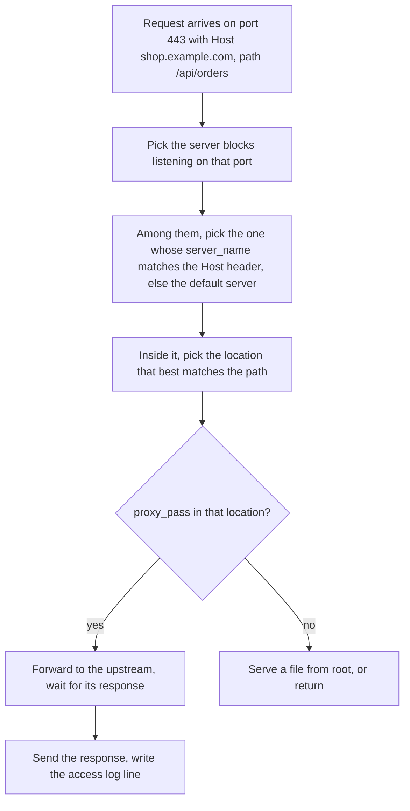

# Nginx as a reverse proxy

> **Status: AI draft, 2026-11-16.** Not yet verified by me. Commands and output were run in a throwaway Ubuntu 24.04 container with Nginx in front of small local backends; addresses are rewritten to example ranges.

## In one line

Nginx picks a `server` block by port and `Host` header, then a `location` by path, and `proxy_pass` forwards the request to an upstream. Its error log names the reason behind every 502 and 504, `nginx -t` checks a change, and `nginx -s reload` applies it without dropping connections.

## The plain idea

Nginx is a fast, small web server that is most often used as a **reverse proxy**: it accepts requests from clients and passes them to the real application behind it ([Load balancers and proxies](load-balancers-and-proxies.md)). In front of the application it can terminate TLS, route different paths to different services, balance across several copies, cache, and serve static files directly.

Its configuration is a set of nested blocks. The skill is reading a config the way Nginx does: which block will this request land in, and where will it be sent?

## How it works

### Processes

Nginx runs one **master** process (as root, so it can bind to ports 80 and 443 and read keys) and several **worker** processes (as an unprivileged user) that handle the connections. Each worker serves thousands of connections at once with an event loop instead of one thread per connection. `worker_processes auto;` starts one worker per CPU core.

The master handles signals: `nginx -s reload` makes it read the new config, start new workers and let the old ones finish their current requests, so a reload drops no traffic. A **restart** stops everything and does drop connections.

### Config structure

```nginx
http {
    upstream app {                        # a named group of backends
        server 10.0.2.11:8080;
        server 10.0.2.12:8080;
    }
    server {                              # one virtual host
        listen 443 ssl;
        server_name shop.example.com;
        ssl_certificate     /etc/nginx/tls/shop.crt;
        ssl_certificate_key /etc/nginx/tls/shop.key;

        location /api/ {                  # requests whose path starts with /api/
            proxy_pass http://app;
        }
        location / {
            root /srv/www;                # serve files directly
        }
    }
}
```

### How a request finds its way



**Location matching** works in this order:

| Form | Example | Matches |
|---|---|---|
| `=` exact | `location = /healthz` | Only that exact path; checked first |
| Prefix | `location /api/` | The longest matching prefix wins |
| `^~` prefix | `location ^~ /static/` | A prefix that, if it is the longest match, stops regex checking |
| Regex | `location ~ \.php$` | Checked in file order after prefixes; the first regex match wins over a plain prefix |

**`proxy_pass` and the trailing slash.** `proxy_pass http://app;` (no path) passes the original path unchanged: `/api/orders` goes to the backend as `/api/orders`. `proxy_pass http://app/;` (with a path, here `/`) replaces the matched location prefix: inside `location /api/`, `/api/orders` becomes `/orders`. This one character causes many "404 from the backend" puzzles.

### Headers to the backend

Nginx opens its own connection to the backend, so the backend sees Nginx as the client. Pass the originals along:

```nginx
proxy_set_header Host              $host;
proxy_set_header X-Forwarded-For   $proxy_add_x_forwarded_for;
proxy_set_header X-Forwarded-Proto $scheme;
```

By default Nginx sends the upstream's name as `Host`, not the client's, which breaks applications that build links or route on the host.

### Timeouts and the errors they cause

| Directive | Default | Too short gives |
|---|---|---|
| `proxy_connect_timeout` | 60s | Slow or failed connects become `504` (a refused connect is a `502` at once) |
| `proxy_read_timeout` | 60s | `504` when the backend takes longer to start answering |
| `proxy_send_timeout` | 60s | Failures sending large request bodies |
| `client_max_body_size` | 1m | `413 Request Entity Too Large` on uploads |

### Upstreams and balancing

An `upstream` block lists backends; Nginx balances across them with round robin by default, and `least_conn` or `hash` on request. It passively marks a backend as failed for `fail_timeout` (10 seconds by default) after `max_fails` errors (1 by default), and retries the request on the next backend if nothing has been sent to the client yet. Without a `zone` directive, each worker process keeps its own balancing state; with `zone`, they share it.

### Logs

The **access log** has one line per request, by default with the client address, time, request line, status, body size, referrer and user agent. The **error log** explains failures, including every upstream problem, in plain words. A custom `log_format` with `$upstream_addr`, `$upstream_status`, `$request_time` and `$upstream_response_time` shows which backend answered and whether the time went in Nginx or in the backend.

## A concrete example

After moving an API behind Nginx, every call returns `404`, from the application, not from Nginx.

1. The config has `location /api/ { proxy_pass http://app/; }`, with a trailing slash.
2. A request for `/api/orders` reaches the backend as `/orders`, a path the application does not have.
3. Either remove the slash (`proxy_pass http://app;`) so the full path passes through, or change the application's routes, whichever matches how the backend expects its paths.
4. Check with `curl -v` through Nginx, and with the backend's access log showing the path it really received.

## Why not just...?

- **...restart Nginx after every config change?** A restart drops live connections and, if the new config is broken, leaves you with no proxy at all. `nginx -t && nginx -s reload` checks first, then swaps in place.
- **...raise every timeout to 300 seconds to stop the 504s?** Users still wait, workers and connections are held longer, and the slow backend stays slow. Find why the backend is slow; set timeouts to what a real request needs.
- **...put the backend's logic into Nginx with many `if` and `rewrite` rules?** Nginx's `if` inside `location` has surprising behaviour, and complex rewrite chains are hard to test. Keep routing simple and put logic in the application.

## Commands to know

Check the configuration before applying it:

```console
# nginx -t
nginx: the configuration file /etc/nginx/nginx.conf syntax is ok
nginx: configuration file /etc/nginx/nginx.conf test is successful
```

The master and its workers. The container could see 12 CPUs, so `worker_processes auto` started 12 workers (output trimmed):

```console
# ps -o pid,user,cmd -C nginx
    PID USER     CMD
   2210 root     nginx: master process nginx
   2211 www-data nginx: worker process
   2212 www-data nginx: worker process
...
```

The configuration used for the next three tests: one upstream on port 9000, with short timeouts so failures show quickly.

```nginx
upstream app { server 127.0.0.1:9000; }
server {
  listen 8080;
  location / {
    proxy_pass http://app;
    proxy_set_header Host $host;
    proxy_set_header X-Forwarded-For $proxy_add_x_forwarded_for;
    proxy_set_header X-Forwarded-Proto $scheme;
    proxy_connect_timeout 2s;
    proxy_read_timeout 3s;
  }
}
```

Nothing listening on the backend port gives `502`, and the error log says why:

```console
# curl -s -o /dev/null -w "%{http_code}\n" http://127.0.0.1:8080/
502
# tail -1 /var/log/nginx/error.log
[error] 2211#2211: *1 connect() failed (111: Connection refused) while connecting to upstream, client: 127.0.0.1, server: , request: "GET / HTTP/1.1", upstream: "http://127.0.0.1:9000/", host: "127.0.0.1:8080"
```

A backend that answers:

```console
# curl -s -w "%{http_code}\n" http://127.0.0.1:8080/
hello from the app
200
```

A backend that accepts the connection but never replies gives `504` after `proxy_read_timeout`:

```console
# curl -s -o /dev/null -w "%{http_code}\n" http://127.0.0.1:8080/
504
# tail -1 /var/log/nginx/error.log
[error] 2213#2213: *5 upstream timed out (110: Connection timed out) while reading response header from upstream, client: 127.0.0.1, server: , request: "GET / HTTP/1.1", upstream: "http://127.0.0.1:9000/", host: "127.0.0.1:8080"
```

The access log lines for those three requests:

```console
# tail -3 /var/log/nginx/access.log
127.0.0.1 - - [16/Nov/2026:03:18:52 +0000] "GET / HTTP/1.1" 502 166 "-" "curl/8.5.0"
127.0.0.1 - - [16/Nov/2026:03:18:53 +0000] "GET / HTTP/1.1" 200 19 "-" "curl/8.5.0"
127.0.0.1 - - [16/Nov/2026:03:18:57 +0000] "GET / HTTP/1.1" 504 176 "-" "curl/8.5.0"
```

The `504` line was written 4 seconds after the one before: the 3-second read timeout plus the time to start.

Apply a change without dropping connections:

```console
# nginx -s reload
2026/11/16 03:18:57 [notice] 2245#2245: signal process started
```

| Command | What it does |
|---|---|
| `nginx -t` | Test the configuration. Always before a reload. |
| `nginx -T` | Test and print the whole effective configuration, all included files merged. |
| `nginx -s reload` or `systemctl reload nginx` | Re-read the configuration gracefully. |
| `tail -f /var/log/nginx/error.log` | Watch upstream errors live. |
| `curl -H 'Host: shop.example.com' http://127.0.0.1/` | Test which `server` block a host lands in. |

## How it breaks

| Symptom | Layer | Check | Likely cause |
|---|---|---|---|
| `502`, error log `connect() failed (111: Connection refused)` | Backend | Is the backend listening on that address and port? | Backend down, wrong port, or listening on another interface |
| `502`, error log `upstream prematurely closed connection` | Backend | Backend logs at that time | Backend crashed mid-request, or closed a keep-alive connection Nginx reused |
| `504`, error log `upstream timed out` | Backend latency | Backend timing; `proxy_read_timeout` | Slow backend or dependency, or a timeout shorter than the work |
| `404` from the backend after adding a proxy | Path | Backend access log: which path arrived? | Trailing slash on `proxy_pass` stripping the prefix |
| Wrong site served | Server selection | `nginx -T` for `server_name`; `curl -H 'Host: ...'` | No matching `server_name`, so the default server answered |
| `413 Request Entity Too Large` | Body size | `client_max_body_size` | Upload bigger than the limit |
| Reload has no effect, or fails | Config | `nginx -t` output | Syntax error: the old configuration stays in use |
| Backend sees every request from the proxy's address | Headers | `proxy_set_header` lines | `X-Forwarded-For` not set, or not trusted by the app |

## Interview questions

**1. How does Nginx decide which `server` and `location` handle a request?**

<details markdown="1">
<summary>Answer</summary>

- `server`: by the listening address and port, then the `Host` header against `server_name`, falling back to the default server.
- `location`: exact `=` matches first, then the longest prefix, then regexes in order (unless `^~` stopped them).
- The chosen location's directives decide whether it proxies or serves files.

</details>

**2. What is the difference between `proxy_pass http://app;` and `proxy_pass http://app/;`?**

<details markdown="1">
<summary>Answer</summary>

- Without a path, the original request URI is passed unchanged.
- With a path (even `/`), the part of the URI matching the location is replaced by that path.
- So in `location /api/`, `/api/orders` arrives as `/api/orders` in the first case and as `/orders` in the second.

</details>

**3. A user gets a `502` from Nginx. Where do you look and what might you find?**

<details markdown="1">
<summary>Answer</summary>

- The Nginx error log, which states the reason for each upstream failure.
- `connect() failed (111: Connection refused)`: nothing listening on the backend port.
- `upstream prematurely closed connection`: the backend crashed or closed the connection.
- Then the backend's own logs and health.

</details>

**4. What causes a `504` from Nginx, and how do you fix it properly?**

<details markdown="1">
<summary>Answer</summary>

- The backend did not send a response header within `proxy_read_timeout`.
- Find why the backend is slow: a slow query, a downstream call, overload.
- Raise the timeout only to cover legitimately long requests, keeping it below the client's and load balancer's timeouts.

</details>

**5. What is the difference between `nginx -s reload` and a restart?**

<details markdown="1">
<summary>Answer</summary>

- Reload: the master reads the new config, starts new workers, and old workers finish their requests; no connections are dropped.
- If the new config is invalid, reload keeps the old one running.
- A restart stops everything, dropping connections, and fails completely on a bad config. Run `nginx -t` first either way.

</details>

**6. Why should a reverse proxy set `Host` and `X-Forwarded-For` headers?**

<details markdown="1">
<summary>Answer</summary>

- Nginx opens its own connection, so without them the backend sees Nginx's address and the upstream name.
- `Host` preserves the site the client asked for, for routing and links.
- `X-Forwarded-For` and `X-Forwarded-Proto` carry the real client address and scheme; the app must trust them only from the proxy.

</details>

## Try it

**Step 1.** Start a container with Nginx, curl and netcat.

```bash
docker run --rm -it ubuntu:24.04 bash
apt-get update -qq && apt-get install -y -qq nginx curl netcat-openbsd
```

**Step 2.** Put Nginx in front of a backend port that has nothing on it yet, with short timeouts.

```bash
cat > /etc/nginx/sites-enabled/default <<'EOF'
upstream app { server 127.0.0.1:9000; }
server { listen 8080; location / { proxy_pass http://app; proxy_connect_timeout 2s; proxy_read_timeout 3s; } }
EOF
nginx -t && nginx
```

**Step 3.** Predict the status code before each request, then read the error log line it produced.

```bash
curl -s -o /dev/null -w "%{http_code}\n" http://127.0.0.1:8080/
tail -1 /var/log/nginx/error.log
nc -lk 127.0.0.1 9000 >/dev/null &
curl -s -o /dev/null -w "%{http_code}\n" http://127.0.0.1:8080/
tail -1 /var/log/nginx/error.log
```

The second backend accepts connections but never answers.

**Step 4.** Type `exit`. The container is deleted.

## Zoom out

Nginx's model of server blocks, locations and upstreams is the same model behind Ingress controllers and many API gateways, so reading one teaches you the others ([Ingress and Gateway API](../kubernetes/ingress-and-gateway-api.md)). Its error log is often the fastest route from a `502` to the real cause. The principle to carry: test the config, reload instead of restart, and read the error log before touching the backend.

## Sources

- [Nginx documentation: beginner's guide](https://nginx.org/en/docs/beginners_guide.html)
- [Nginx documentation: how Nginx processes a request](https://nginx.org/en/docs/http/request_processing.html)
- [Nginx documentation: location directive](https://nginx.org/en/docs/http/ngx_http_core_module.html#location)
- [Nginx documentation: ngx_http_proxy_module, proxy_pass and timeouts](https://nginx.org/en/docs/http/ngx_http_proxy_module.html)
- [Nginx documentation: ngx_http_upstream_module](https://nginx.org/en/docs/http/ngx_http_upstream_module.html)
- [Nginx documentation: controlling Nginx, reload and signals](https://nginx.org/en/docs/control.html)
