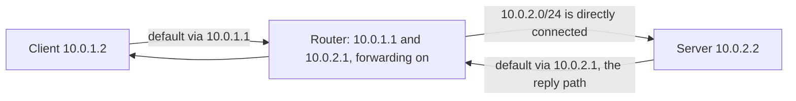
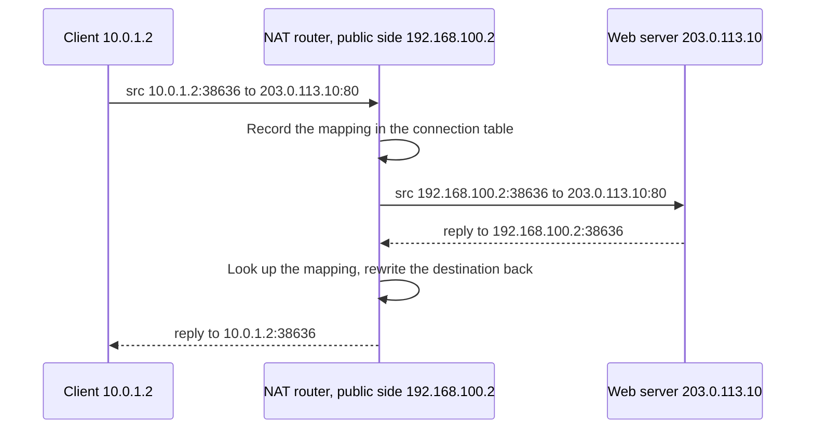

# Routing and NAT

> **Status: AI draft, 2026-11-16.** Not yet verified by me. Commands and output were run in network namespaces inside a throwaway privileged container; addresses are rewritten to example ranges.

## In one line

Every host and router picks where to send a packet by the most specific matching route in its route table, falling back to the default route; each router repeats that decision one hop at a time. NAT rewrites addresses on the way through, which is how private addresses reach the internet, and the reply has to come back through the same device.

## The plain idea

No machine knows the whole path to a destination. Each one only knows its next step, the way a traveller at a junction reads one signpost: "for Kochi, take the left road". The traveller does not need the full map; the next junction has its own signposts. On a network, those signposts are the **route table**, and each junction is a **router**.

Private networks add a second problem. Addresses such as `10.0.1.2` are used by millions of networks, so the internet cannot send replies to them. A device at the edge rewrites the private source address to its own public one on the way out, remembers the rewrite, and reverses it when the reply comes back. That rewriting is **NAT** (network address translation).

## How it works

### The route table

Each entry says: for destinations in this range, send the packet out of this interface, either directly or via this **gateway** (the next router).

```console
# ip -n client route
default via 10.0.1.1 dev c-eth0
10.0.1.0/24 dev c-eth0 proto kernel scope link src 10.0.1.2
```

- `10.0.1.0/24 dev c-eth0`: addresses on my own subnet are reached directly on that interface. The kernel adds this route when the address is configured.
- `default via 10.0.1.1`: anything else goes to the router `10.0.1.1`. `default` is short for `0.0.0.0/0`, which matches every address.

### Longest prefix match

When several routes match, the most specific one wins: the one with the longest prefix. A `/32` beats a `/24`, which beats the `/0` default.

| Destination | Routes that match | Chosen |
|---|---|---|
| `10.0.1.7` | `10.0.1.0/24`, `0.0.0.0/0` | `10.0.1.0/24`: direct, on the local link |
| `10.0.2.2` | `0.0.0.0/0` only | Default: via `10.0.1.1` |
| `10.0.2.2`, after adding `blackhole 10.0.2.0/24` | `10.0.2.0/24` (blackhole), `0.0.0.0/0` | The blackhole, because `/24` is more specific: the packet is dropped |

This is why adding one specific route can silently override a working default, and why removing a specific route makes traffic fall back to a broader one.

### Hop by hop



1. The client looks up `10.0.2.2`, finds only the default route, and sends the packet to `10.0.1.1`.
2. The router must be allowed to **forward**: pass on packets that are not addressed to itself. On Linux that is the `net.ipv4.ip_forward` setting.
3. The router finds `10.0.2.0/24` directly connected and delivers the packet.
4. The **reply is routed separately**. The server needs its own route back to `10.0.1.0/24`. A one-way route is a classic cause of timeouts: the request arrives, the reply goes nowhere.

Each router lowers the packet's **TTL** (time to live) by one. When it reaches zero the router drops the packet and returns an ICMP "time exceeded" message. That stops loops and is how `traceroute` discovers each hop: it sends packets with TTL 1, 2, 3 and records who answers.

### NAT



- **Source NAT** (SNAT) rewrites the source address of outgoing packets. Linux's `MASQUERADE` is SNAT to whatever address the outgoing interface has. Home routers, AWS NAT gateways and Kubernetes nodes sending pod traffic out all do this. Many private hosts share one public address, distinguished by port.
- **Destination NAT** (DNAT) rewrites the destination of incoming packets, so traffic to a public address and port reaches a private host. Port forwarding, load balancers and Kubernetes Services ([Services and DNS](../kubernetes/services-and-dns.md)) use it.
- NAT is **stateful**: the router keeps a table of active translations (**conntrack** on Linux). Replies must come back through the same device, or there is nothing to reverse the rewrite.

**Hairpinning**: a host inside a network calls its own service by its public address. The traffic goes out to the NAT device and has to turn round back inside. Some devices do not support it, and where it is supported the traffic may pay public-path costs. Use the private address or a private DNS name inside the network.

## A concrete example

A function in a private subnet must call a payment API on the internet. It times out.

1. The private subnet's route table has `10.0.0.0/16 local` and `0.0.0.0/0 via nat-gateway`. Someone deleted the NAT gateway, and the cloud marks the route as a **blackhole**: it still matches everything, so packets are dropped instead of falling through to anything else.
2. From the function's side, this looks exactly like a firewall drop: a timeout, not a refusal.
3. The fix is to point the default route at a working NAT gateway. For AWS services, a VPC endpoint avoids the NAT path entirely ([NAT, endpoints and PrivateLink](../aws-core/nat-endpoints-privatelink.md)).

The same mechanism, reproduced with Linux routes, is in "Commands to know" below.

## Why not just...?

- **...give every server a public address and skip NAT?** Every server is then directly reachable from the internet, so one mistaken firewall rule exposes it. Private addresses plus NAT keep inbound access closed by default.
- **...add a default route on every host pointing at the internet gateway?** The default route must point at a router that can actually carry the traffic onwards. A private host's default route points at NAT; only public subnets point straight at an internet gateway.
- **...route the request one way and let the reply find its own way?** If the reply takes a different path (asymmetric routing), stateful firewalls and NAT devices on the return path have no record of the connection and drop it.

## Commands to know

These were run in three network namespaces (`client`, `router`, `server`) linked like the diagram above.

No route to the destination yet:

```console
# ip netns exec client ping -c1 -W1 10.0.2.2
ping: connect: Network is unreachable
```

With the default route added, but forwarding turned off on the router, and then on:

```console
# ip netns exec router sysctl -w net.ipv4.ip_forward=0
net.ipv4.ip_forward = 0
# ip netns exec client ping -c2 -W1 10.0.2.2
2 packets transmitted, 0 received, 100% packet loss, time 1054ms
# ip netns exec router sysctl -w net.ipv4.ip_forward=1
net.ipv4.ip_forward = 1
# ip netns exec client ping -c1 -W1 10.0.2.2
1 packets transmitted, 1 received, 0% packet loss, time 0ms
```

`ip netns exec <name> <command>` runs a command inside a network namespace: an isolated copy of the network stack with its own interfaces and routes.

Which route will be used, and the path:

```console
# ip -n client route get 10.0.2.2
10.0.2.2 via 10.0.1.1 dev c-eth0 src 10.0.1.2 uid 0
    cache
# ip netns exec client traceroute -n -w1 -q1 10.0.2.2
traceroute to 10.0.2.2 (10.0.2.2), 30 hops max, 60 byte packets
 1  10.0.1.1  0.053 ms
 2  10.0.2.2  0.033 ms
# ip netns exec client ping -c1 -t1 10.0.2.2
From 10.0.1.1 icmp_seq=1 Time to live exceeded
```

`-t1` sends with a TTL of 1, so the first router discards it and says so.

A more specific blackhole route overriding the default:

```console
# ip -n client route add blackhole 10.0.2.0/24
# ip -n client route
default via 10.0.1.1 dev c-eth0
10.0.1.0/24 dev c-eth0 proto kernel scope link src 10.0.1.2
blackhole 10.0.2.0/24
# ip netns exec client curl -sS -m2 http://10.0.2.2:8080
curl: (7) Failed to connect to 10.0.2.2 port 8080 after 0 ms: Couldn't connect to server
```

A local blackhole fails at once. A blackhole on a router further along, as in the cloud example, shows up as a timeout instead.

NAT on the router, before and after, and the translation it remembers:

```console
# ip netns exec client curl -sS -m4 -o /dev/null -w "%{http_code}\n" http://example.com
000
# ip netns exec router iptables -t nat -A POSTROUTING -s 10.0.0.0/16 -o r-out -j MASQUERADE
# ip netns exec client curl -sS -m6 -o /dev/null -w "%{http_code}\n" http://example.com
200
# ip netns exec router conntrack -L
tcp 6 119 FIN_WAIT src=10.0.1.2 dst=203.0.113.10 sport=38636 dport=80 src=203.0.113.10 dst=192.168.100.2 sport=80 dport=38636 [ASSURED] mark=0 use=1
```

The conntrack line shows both directions: the original (from `10.0.1.2`) and the expected reply (to `192.168.100.2`, the router's outside address). `000` means curl got no HTTP response at all.

| Command | What it does |
|---|---|
| `ip route add 10.0.5.0/24 via 10.0.1.1` | Add a route. `ip route del` removes it. Not persistent across reboots. |
| `ip route get <ip>` | Exactly which route, gateway and source address the kernel would use. |
| `traceroute -n <ip>`, `mtr <ip>` | The path, hop by hop. `mtr` keeps measuring loss and latency per hop. |
| `sysctl net.ipv4.ip_forward` | Whether this machine forwards packets. |
| `iptables -t nat -L -n -v` | NAT rules and their packet counters. |
| `conntrack -L` | Active connections and translations. |

## How it breaks

| Symptom | Layer | Check | Likely cause |
|---|---|---|---|
| `Network is unreachable` | Local route table | `ip route` | No route, usually no default route |
| Timeout to a remote network | Path | `traceroute`; route tables at each hop; the return route | A missing route on the way there or back, a blackhole, or a firewall drop |
| Works from one subnet, not another | Route tables | Compare the subnets' route tables | One subnet's table lacks the route or has a different default |
| Private hosts cannot reach the internet | NAT | Default route of the private subnet; the NAT device's state | NAT missing or deleted, or the NAT is in a subnet without an internet route |
| Connections fail only through a firewall or NAT, intermittently | Return path | Packet capture on both sides | Asymmetric routing: replies bypass the stateful device |
| Traffic goes to the wrong place after a change | Route precedence | `ip route get <ip>` | A more specific route now matches |

## Interview questions

**1. What is a default route, and when is it used?**

<details markdown="1">
<summary>Answer</summary>

- The route for `0.0.0.0/0`, matching every destination.
- Used only when no more specific route matches, because of longest prefix match.
- It points at the gateway that knows how to reach everything else.

</details>

**2. Explain longest prefix match with an example.**

<details markdown="1">
<summary>Answer</summary>

- When several routes match a destination, the one with the longest prefix (most specific) wins.
- With `10.0.0.0/16 local` and `0.0.0.0/0 via nat`, traffic to `10.0.3.4` stays local and traffic to `8.8.8.8` goes to NAT.
- Adding `10.0.3.0/24` via a peering connection would take over just that range.

</details>

**3. What is NAT and why do private networks need it?**

<details markdown="1">
<summary>Answer</summary>

- Network address translation rewrites addresses in packets as they pass a device.
- Private ranges are not routable on the internet, so outgoing traffic gets a public source address (source NAT).
- The device keeps a table of translations to reverse them for replies, so replies must return through it.

</details>

**4. What is the difference between SNAT and DNAT?**

<details markdown="1">
<summary>Answer</summary>

- SNAT changes the source address: private hosts reaching out through a shared public address.
- DNAT changes the destination: traffic to a public address or port forwarded to a private host.
- Kubernetes Services use DNAT; a NAT gateway uses SNAT.

</details>

**5. Instances in a private subnet suddenly cannot reach the internet. What do you check?**

<details markdown="1">
<summary>Answer</summary>

- The private subnet's route table: does `0.0.0.0/0` point at a working NAT device, or is it a blackhole?
- The NAT device: does it exist, and is it in a public subnet whose route table points at the internet gateway?
- Security groups and NACLs on the path, and whether only one Availability Zone is affected.

</details>

**6. How does traceroute work?**

<details markdown="1">
<summary>Answer</summary>

- It sends packets with TTL 1, 2, 3 and so on.
- Each router lowers the TTL; the one that drops it to zero returns an ICMP "time exceeded", revealing itself.
- A row of `* * *` means that hop did not answer, which may be a filter, not a failure.

</details>

**7. A request reaches the server, but the client times out waiting for the reply. What could cause that at the routing level?**

<details markdown="1">
<summary>Answer</summary>

- The server has no route back to the client's network, or sends the reply via a different gateway.
- A stateful firewall or NAT on the return path never saw the request, so it drops the reply.
- Check `ip route get <client-ip>` on the server and capture packets on both sides.

</details>

## Try it

**Step 1.** Start a privileged container and build two namespaces joined by a router namespace.

```bash
docker run --rm -it --privileged ubuntu:24.04 bash
apt-get update -qq && apt-get install -y -qq iproute2 iputils-ping
ip netns add client; ip netns add router; ip netns add server
ip link add c-eth0 type veth peer name r-eth0; ip link add s-eth0 type veth peer name r-eth1
ip link set c-eth0 netns client; ip link set r-eth0 netns router; ip link set r-eth1 netns router; ip link set s-eth0 netns server
ip -n client addr add 10.0.1.2/24 dev c-eth0; ip -n router addr add 10.0.1.1/24 dev r-eth0
ip -n router addr add 10.0.2.1/24 dev r-eth1; ip -n server addr add 10.0.2.2/24 dev s-eth0
for n in client router server; do ip -n $n link set lo up; done
ip -n client link set c-eth0 up; ip -n router link set r-eth0 up; ip -n router link set r-eth1 up; ip -n server link set s-eth0 up
```

A **veth** pair is a virtual cable: whatever goes in one end comes out of the other.

**Step 2.** Predict the result of each ping, then run them one by one.

```bash
ip netns exec client ping -c1 -W1 10.0.2.2
ip -n client route add default via 10.0.1.1
ip netns exec client ping -c1 -W1 10.0.2.2
ip -n server route add default via 10.0.2.1
ip netns exec router sysctl -w net.ipv4.ip_forward=1
ip netns exec client ping -c1 -W1 10.0.2.2
```

The second ping fails even though the client has a route: think about the reply's path, and the router's forwarding setting.

**Step 3.** Type `exit`. The container and its namespaces are deleted.

## Zoom out

The same decisions happen in every cloud network: VPC route tables, NAT gateways, peering and transit gateways all follow longest prefix match and need a return path ([VPC basics](../aws-core/vpc-basics.md), [VPC troubleshooting](../aws-core/vpc-troubleshooting.md)). Kubernetes Services and pod traffic leaving a node rely on NAT as well. The principle to carry: trace both directions, and at every hop ask which route matched.

## Sources

- [ip-route(8) manual page](https://man7.org/linux/man-pages/man8/ip-route.8.html)
- [RFC 1812: requirements for IP version 4 routers](https://www.rfc-editor.org/rfc/rfc1812)
- [RFC 3022: traditional IP network address translator](https://www.rfc-editor.org/rfc/rfc3022)
- [iptables-extensions(8): MASQUERADE, SNAT and DNAT targets](https://man7.org/linux/man-pages/man8/iptables-extensions.8.html)
- [conntrack(8) manual page](https://manpages.ubuntu.com/manpages/noble/man8/conntrack.8.html)
- [traceroute(8) manual page](https://man7.org/linux/man-pages/man8/traceroute.8.html)
- [Amazon VPC documentation: route tables](https://docs.aws.amazon.com/vpc/latest/userguide/VPC_Route_Tables.html)
