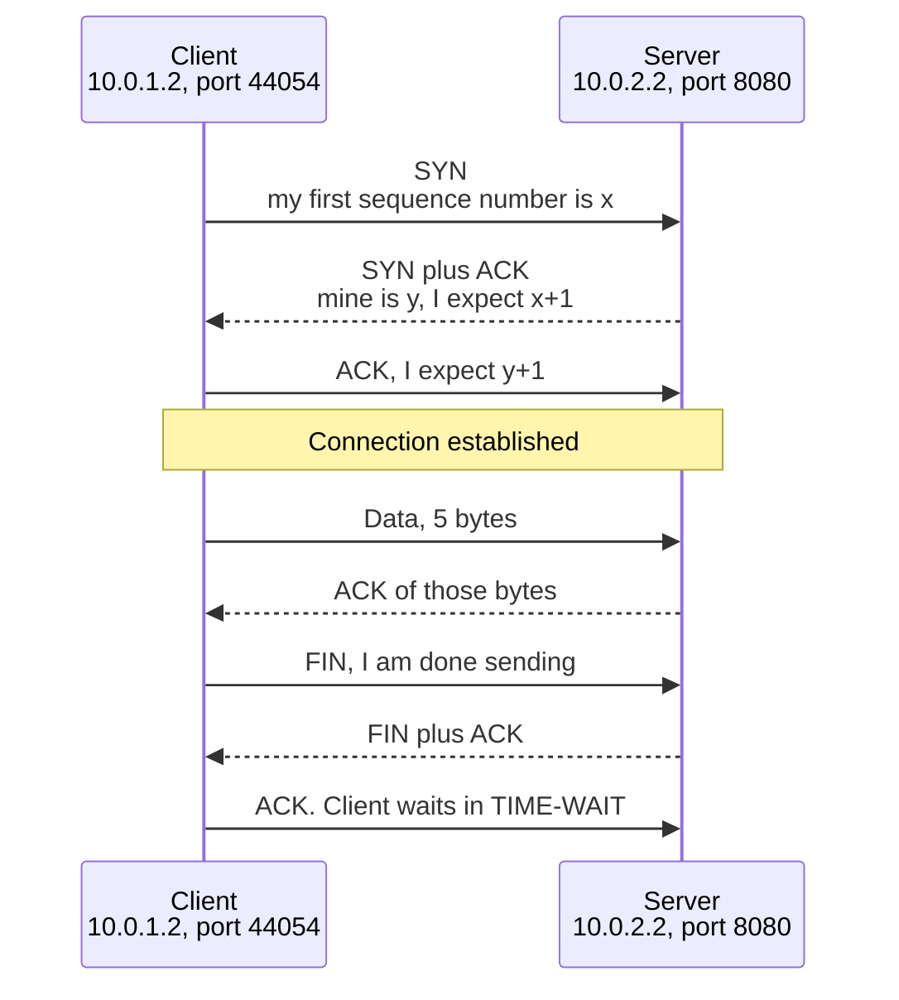

# TCP and UDP

> **Status: AI draft, 2026-11-16.** Not yet verified by me. Commands and output were run in network namespaces inside a throwaway privileged container; addresses are rewritten to example ranges and raw sequence numbers replaced with placeholders.

## In one line

Ports let one machine run many network programs. TCP sets up a connection with a three-way handshake and then guarantees ordered, reliable delivery; UDP just sends datagrams. "Connection refused" means the host answered and nothing listens there; a timeout means something dropped the packets.

## The plain idea

An IP address gets a packet to the right machine, but a machine runs many programs at once: a web server, a database, SSH. A **port** is a number from 0 to 65535 that says which program the data is for. A program **listens** on a port, and the kernel hands it anything that arrives there.

Then there are two ways to send. **TCP** is like a phone call: you dial, the other side picks up, you confirm you can hear each other, and only then talk. Everything arrives in order, and anything lost is resent. **UDP** is like posting postcards: each one travels on its own, with no set-up, no guaranteed order and no resending. It is faster to start and simpler, and the application deals with anything lost.

## How it works

### Sockets and the 4-tuple

A connection is identified by four values: source address, source port, destination address, destination port. The server listens on a fixed, well-known port (443). The client's side gets a temporary **ephemeral port**, picked by its kernel (on Linux, from 32768 to 60999 by default). That is how one server tells apart thousands of connections to the same port: every one has a different 4-tuple. A **socket** is the program's handle on one end of it.

### The three-way handshake



1. **SYN.** The client asks to open a connection and picks a random starting **sequence number**.
2. **SYN-ACK.** If something listens on that port, the server agrees and picks its own.
3. **ACK.** The client confirms. Both sides now know the other can send and receive.

Every byte sent afterwards is numbered, and the receiver **acknowledges** what it got. Anything not acknowledged in time is sent again (**retransmission**). The receiver also tells the sender how much it can accept at once (the **window**), so a fast sender cannot overwhelm a slow receiver. Closing takes a FIN from each side.

### What the answer to a SYN tells you

| What comes back | What it proves | Typical cause |
|---|---|---|
| SYN-ACK | The host is up and something listens on the port | Working |
| RST (reset) | The host is up, but nothing listens on that port, or a firewall rejected it | Service down, wrong port, listening only on `127.0.0.1`, a REJECT rule |
| Nothing, then a timeout | Something dropped the packets silently, in either direction | Security group, NACL, firewall DROP rule, missing route, host down |
| ICMP unreachable | A router or firewall reported it cannot deliver | No route at that router, a reject with ICMP |

This table is the most useful thing on the page: "refused" and "timed out" point at completely different layers and teams ([The debugging walk](../start/debugging-walk.md)).

### Connection states

| State in `ss` | Meaning |
|---|---|
| `LISTEN` | A server socket waiting for connections. |
| `SYN-SENT` | The client sent a SYN and is waiting. Many of these means the far side is not answering. |
| `ESTAB` | Established, data can flow. |
| `TIME-WAIT` | The side that closed first waits (on Linux, 60 seconds) so stray late packets of the old connection cannot be mistaken for a new one. Thousands are normal on busy clients. |
| `CLOSE-WAIT` | The other side closed, but this program has not closed its socket. Many of these means a program bug: it leaks connections. |

### Idle connections

Firewalls, NAT devices and load balancers keep a table of open connections and forget idle ones after a timeout. If a connection sits idle longer than that, the next packet is dropped or reset, although both ends still think it is open. **Keepalives** (TCP's own, or the application's) send small packets to keep it fresh. Connection pools in applications often need their idle timeout set below the network's.

### UDP

UDP has ports but no connection: no handshake, no acknowledgement, no ordering. A sender cannot tell from UDP alone whether anything arrived. It suits short request-and-reply exchanges and real-time traffic: DNS queries, time sync (NTP), and QUIC, the transport under HTTP/3, which builds its own reliability on top of UDP. Testing a UDP port is harder for the same reason: silence can mean "received" or "dropped".

### Well-known ports

| Port | Protocol |
|---|---|
| 22 | SSH |
| 53 | DNS (UDP, and TCP for large answers) |
| 80, 443 | HTTP, HTTPS |
| 123 | NTP (UDP) |
| 2049 | NFS, including EFS |
| 3306, 5432 | MySQL, PostgreSQL |
| 6379 | Redis |
| 8080 | A common alternative HTTP port |
| 9090, 9100 | Prometheus, node exporter |

## A concrete example

A service reports `connection timed out` when calling `10.0.2.2:5432`.

1. From the caller, `nc -vz -w3 10.0.2.2 5432`. It times out. That rules out "the database is down": a down database on a reachable host would give "refused" almost at once.
2. On the database host, `ss -tln` shows `LISTEN 0.0.0.0:5432`. It is listening on every address.
3. A capture on the database host, `tcpdump -n port 5432`, shows nothing arriving. The SYNs are dropped before they reach it.
4. The database's security group allows port 5432 only from the old application subnet. The new caller is in another subnet. Adding the rule fixes it ([Security groups and NACLs](../aws-core/security-groups-and-nacls.md)).

If step 3 had shown SYNs arriving and SYN-ACKs leaving with no ACK coming back, the problem would have been on the return path instead.

## Why not just...?

- **...use UDP everywhere because it is faster?** UDP is faster to start, but you then rebuild ordering, retransmission and flow control yourself. Most applications should use TCP, or QUIC through an HTTP/3 library.
- **...raise the client timeout when calls time out?** If packets are being dropped, a longer timeout only makes failures slower. Find what drops them.
- **...worry about thousands of `TIME-WAIT` sockets?** On a busy client that is normal and costs little. Thousands of `CLOSE-WAIT` sockets are the real warning sign: the program is not closing connections.

## Commands to know

What is listening, and which program owns it:

```console
# ss -tlnp
State  Recv-Q Send-Q Local Address:Port Peer Address:Port Process
LISTEN 0      1      10.0.2.2:8080      0.0.0.0:*         users:(("nc",pid=2532,fd=3))
```

`-t` TCP, `-l` listening only, `-n` numbers instead of names, `-p` the owning process (needs root for other users' processes). `-u` shows UDP instead.

The three answers to a connection attempt:

```console
# nc -vz -w2 10.0.2.2 8080
Connection to 10.0.2.2 8080 port [tcp/http-alt] succeeded!
# nc -vz -w2 10.0.2.2 9090
nc: connect to 10.0.2.2 port 9090 (tcp) failed: Connection refused
# nc -vz -w3 10.0.2.2 9091
nc: connect to 10.0.2.2 port 9091 (tcp) timed out: Operation now in progress
```

Nothing listened on 9090, so the server's kernel sent a reset at once. Port 9091 had a firewall rule that drops packets, so `nc` waited its full 3 seconds (`-w3`). A firewall rule that **rejects** with a TCP reset looks exactly like "refused":

```console
# iptables -A INPUT -p tcp --dport 9092 -j REJECT --reject-with tcp-reset
# nc -vz -w3 10.0.2.2 9092
nc: connect to 10.0.2.2 port 9092 (tcp) failed: Connection refused
```

A whole connection, captured on the server: handshake, 5 bytes of data, and the close.

```console
# tcpdump -n -i s-eth0 'tcp port 8080'
IP 10.0.1.2.44054 > 10.0.2.2.8080: Flags [S], seq <client-isn>, win 64240, options [mss 1460,...], length 0
IP 10.0.2.2.8080 > 10.0.1.2.44054: Flags [S.], seq <server-isn>, ack <client-isn+1>, win 65160, options [mss 1460,...], length 0
IP 10.0.1.2.44054 > 10.0.2.2.8080: Flags [.], ack 1, win 63, length 0
IP 10.0.1.2.44054 > 10.0.2.2.8080: Flags [P.], seq 1:6, ack 1, win 63, length 5
IP 10.0.2.2.8080 > 10.0.1.2.44054: Flags [.], ack 6, win 64, length 0
IP 10.0.1.2.44054 > 10.0.2.2.8080: Flags [F.], seq 6, ack 1, win 63, length 0
IP 10.0.2.2.8080 > 10.0.1.2.44054: Flags [F.], seq 1, ack 7, win 64, length 0
IP 10.0.1.2.44054 > 10.0.2.2.8080: Flags [.], ack 2, win 63, length 0
```

`S` is SYN, `.` is ACK, `P` is push (data), `F` is FIN, `R` would be reset. After the handshake tcpdump shows sequence numbers relative to the start, so `seq 1:6` means bytes 1 to 5. Timestamp options are trimmed.

After three short connections, the client side is in TIME-WAIT:

```console
# ss -tan
State     Recv-Q Send-Q Local Address:Port Peer Address:Port
TIME-WAIT 0      0      10.0.1.2:39050     10.0.2.2:8080
TIME-WAIT 0      0      10.0.1.2:39058     10.0.2.2:8080
TIME-WAIT 0      0      10.0.1.2:39060     10.0.2.2:8080
```

Each connection used a different ephemeral source port.

| Command | What it does |
|---|---|
| `ss -tan state established` | Only established connections. |
| `ss -s` | Totals by state. |
| `nc -vzu <ip> <port>` | A UDP "check", which usually cannot tell open from filtered. |
| `curl -v telnet://<ip>:<port>` | A TCP connection test where `nc` is not installed. |
| `bash -c 'exec 3<>/dev/tcp/<ip>/<port>'` | Bash's built-in TCP connect, when nothing else is available. |
| `tcpdump -n -i any 'tcp[tcpflags] & tcp-syn != 0'` | Only packets with the SYN flag. |

## How it breaks

| Symptom | Layer | Check | Likely cause |
|---|---|---|---|
| `Connection refused` | L4 at the target | `ss -tlnp` on the target | Service down, wrong port, or listening on `127.0.0.1` only |
| `Connection timed out` | Somewhere on the path | `tcpdump` on the target: do SYNs arrive? | Security group, NACL or firewall drop; missing route; wrong address |
| Many `SYN-SENT` sockets on the client | The far side | Capture on both ends | Drops on the way there, or SYN-ACKs lost on the way back |
| Many `CLOSE-WAIT` sockets | The local program | `ss -tanp state close-wait` | The program never closes connections the peer has closed |
| Requests fail after a quiet period, then work | Idle timeouts | Compare pool idle timeout with LB and NAT idle timeouts | A middlebox dropped the idle connection; the client reused a dead one |
| `Cannot assign requested address` on a busy client | Ephemeral ports | `ss -s`; the port range sysctl | Ephemeral ports used up by many short connections to one destination |

## Interview questions

**1. Walk me through the TCP three-way handshake.**

<details markdown="1">
<summary>Answer</summary>

- Client sends SYN with its initial sequence number.
- Server replies SYN-ACK with its own number and acknowledges the client's.
- Client sends ACK; both sides have confirmed they can send and receive.
- Sequence numbers then track every byte for ordering and retransmission.

</details>

**2. What is the difference between TCP and UDP? Give a use for each.**

<details markdown="1">
<summary>Answer</summary>

- TCP is connection-oriented: handshake, ordered and reliable delivery, flow control. HTTP/1.1 and HTTP/2, SSH, databases.
- UDP is connectionless: no set-up, no ordering or resend. DNS queries, NTP, video, QUIC.
- UDP has less overhead and latency; the application handles loss.

</details>

**3. What is the difference between "connection refused" and "connection timed out"?**

<details markdown="1">
<summary>Answer</summary>

- Refused: the target host replied with a reset, so it is reachable, but nothing listens on that port (or a reject rule answered).
- Timed out: no reply at all; packets were dropped somewhere, by a firewall, a security group, a missing route, or a down host.
- So refused points at the service; a timeout points at the network path.

</details>

**4. What is TIME-WAIT, and should thousands of them worry you?**

<details markdown="1">
<summary>Answer</summary>

- The state the side that closed first stays in for a while, so late packets of the old connection cannot be confused with a new one.
- Thousands are normal on busy clients making many short connections.
- They matter only if ephemeral ports run out; connection reuse (keep-alive, pools) fixes that.

</details>

**5. What is an ephemeral port?**

<details markdown="1">
<summary>Answer</summary>

- A temporary source port the client's kernel picks for each outgoing connection.
- It makes each connection's 4-tuple unique.
- Return traffic goes to it, which is why stateless firewalls such as NACLs must allow the ephemeral range inbound.

</details>

**6. A service cannot connect to a database on port 5432. `nc` times out. Walk through your next steps.**

<details markdown="1">
<summary>Answer</summary>

- Confirm the address the service resolves and the route to it.
- On the database host, check it listens on the right address (`ss -tln`) and capture to see whether SYNs arrive.
- No SYNs: inspect security groups, NACLs, firewalls and routes on the way there.
- SYNs arrive and SYN-ACKs leave: inspect the return path.

</details>

**7. Connections from an application pool fail with resets after the system has been quiet for a while. Why?**

<details markdown="1">
<summary>Answer</summary>

- A load balancer, NAT or firewall dropped the idle connection from its table.
- The pool still thinks the connection is open and reuses it; the next packet gets a reset or is dropped.
- Fix: set the pool's idle timeout below the middlebox's, enable keepalives, or validate connections before use.

</details>

## Try it

**Step 1.** Start a container with the tools and a listener on port 8080.

```bash
docker run --rm -it --privileged ubuntu:24.04 bash
apt-get update -qq && apt-get install -y -qq netcat-openbsd iproute2 iptables
nc -lk 127.0.0.1 8080 >/dev/null &
ss -tlnp
```

**Step 2.** Predict which of these three succeeds, which is refused, and which times out. Then run them.

```bash
iptables -A INPUT -p tcp --dport 9091 -j DROP
nc -vz -w3 127.0.0.1 8080
nc -vz -w3 127.0.0.1 9090
nc -vz -w3 127.0.0.1 9091
```

**Step 3.** Make three short connections and look at their states.

```bash
for i in 1 2 3; do nc -z 127.0.0.1 8080; done
ss -tan
```

**Step 4.** Type `exit`. The container is deleted.

## Zoom out

Every higher protocol rides on this: HTTP and TLS over TCP, DNS over UDP, HTTP/3 over QUIC ([HTTP](http.md), [TLS and certificates](tls.md)). Load balancers, security groups and NAT all keep track of TCP connections, so their timeouts and rules shape what you see ([Load balancers and proxies](load-balancers-and-proxies.md)). The principle to carry: a refusal is an answer, a timeout is silence, and they lead to different places.

## Sources

- [RFC 9293: Transmission Control Protocol](https://www.rfc-editor.org/rfc/rfc9293.html)
- [RFC 768: User Datagram Protocol](https://www.rfc-editor.org/rfc/rfc768.html)
- [RFC 9000: QUIC](https://www.rfc-editor.org/rfc/rfc9000.html)
- [ss(8) manual page](https://man7.org/linux/man-pages/man8/ss.8.html)
- [tcp(7) manual page](https://man7.org/linux/man-pages/man7/tcp.7.html)
- [Linux kernel documentation: ip-sysctl, ip_local_port_range](https://docs.kernel.org/networking/ip-sysctl.html)
- [IANA: service name and port number registry](https://www.iana.org/assignments/service-names-port-numbers/service-names-port-numbers.xhtml)
