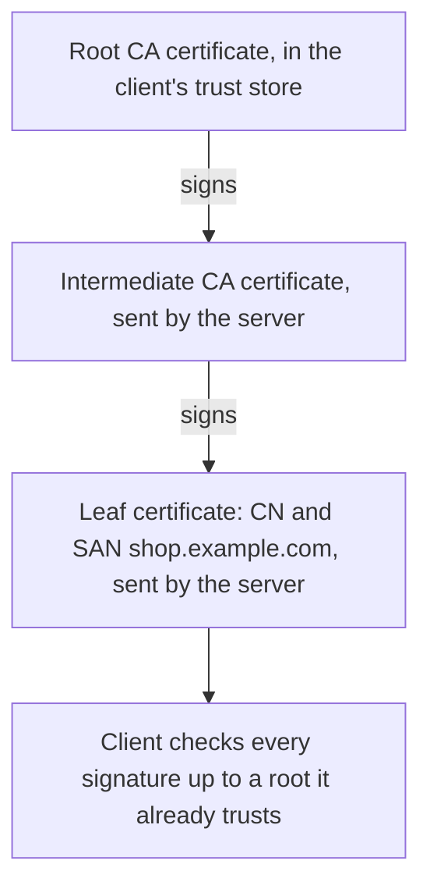
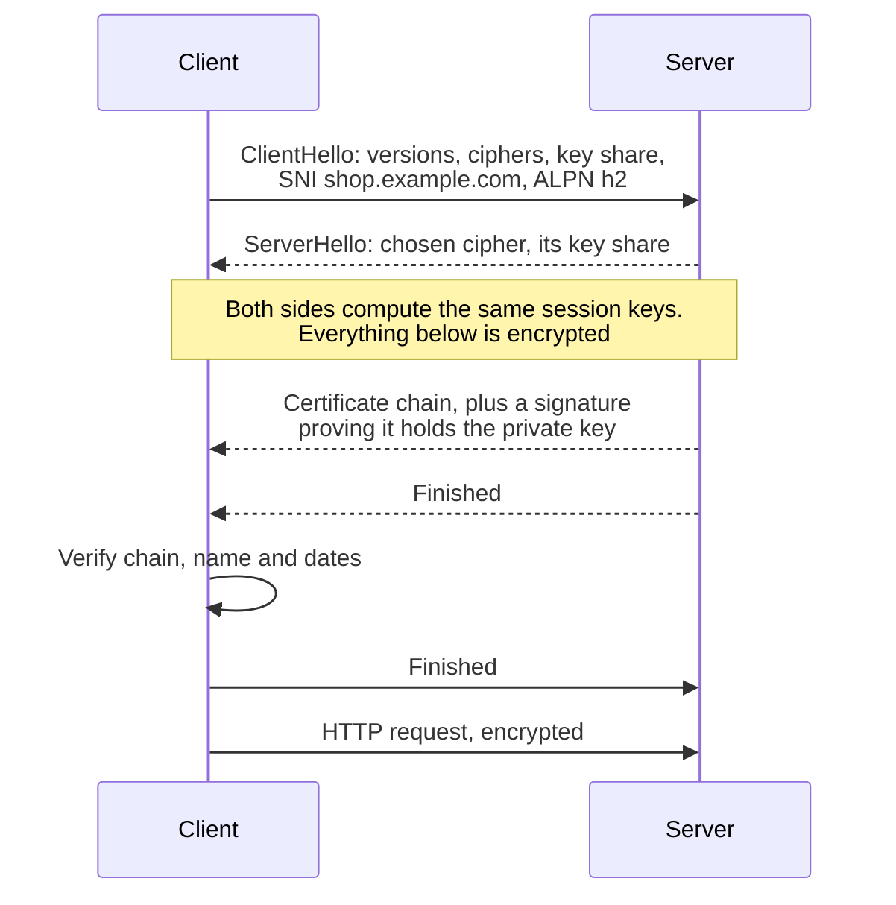

# TLS and certificates

> **Status: AI draft, 2026-11-16.** Not yet verified by me. Commands and output were run in a throwaway container, against a public site and against a local test server with a private test CA; addresses are rewritten to example ranges.

## In one line

TLS encrypts a connection and proves the server's identity. The server presents a certificate chain; the client checks that the chain leads to a CA it trusts, that the name matches, and that it is in date. The usual failures are an expired certificate, a wrong name, or a missing intermediate.

## The plain idea

Encryption alone is not enough. If you encrypt a conversation with an impostor, the impostor reads everything. So TLS answers two questions: "is this conversation private?" and "am I really talking to `shop.example.com`?".

The second answer comes from a **certificate**: a document that says "this public key belongs to `shop.example.com`", signed by a **certificate authority** (CA). Your operating system and browser ship with a short list of CAs they trust. If a trusted CA vouches for the certificate, and the name and dates are right, the client believes it. It is the same idea as a passport: you trust it because you trust the government that issued it, not because the person says so.

## How it works

### Keys, briefly

A **key pair** is two linked numbers. Something encrypted with the **public key** can only be decrypted with the **private key**, and a **signature** made with the private key can be checked by anyone holding the public key. The server keeps its private key secret; its certificate publishes the public key.

### The chain of trust



- The **leaf** certificate is the server's own: its names, its public key, its validity dates.
- One or more **intermediate** certificates link it to a root. Roots are kept offline; intermediates do the day-to-day signing.
- The **root** is already in the client's trust store (`/etc/ssl/certs` on Ubuntu). It is never sent.

The server must send the leaf **and** the intermediates. Browsers sometimes fetch a missing intermediate themselves, so a broken chain can work in Chrome and fail in `curl`, Java or Python.

### What the client checks

1. **The chain**: each certificate is signed by the next, ending at a trusted root.
2. **The name**: the host name you connected to appears in the certificate's **Subject Alternative Name** (SAN) list. The older Common Name (CN) field is ignored by modern clients. A **wildcard** `*.example.com` covers `api.example.com` but not `example.com` itself, and not `a.b.example.com`.
3. **The dates**: now is between `notBefore` and `notAfter`. A wrong clock on the client breaks this.
4. Optionally, **revocation**: whether the CA has withdrawn the certificate early.

### The TLS 1.3 handshake



- **SNI** (server name indication): the client puts the host name in its first message, so one address can serve many sites, each with its own certificate.
- **ALPN**: the client and server agree on the application protocol here, such as HTTP/2.
- The session keys come from a **key exchange** (the "key share"), not from the certificate. The certificate is only used to sign, which gives **forward secrecy**: a private key stolen later cannot decrypt recorded old traffic.
- TLS 1.3 needs one round trip before data flows; TLS 1.2 needed two. TLS 1.0 and 1.1 are deprecated and should be disabled.

### Where TLS ends

**TLS termination** is the point where the encrypted connection is decrypted. Common places: a CDN, a load balancer, an Ingress controller, a mesh sidecar, or the application itself. After termination the traffic is plain HTTP unless it is encrypted again (**re-encryption**, or end-to-end TLS). In **TLS passthrough** the load balancer forwards the encrypted bytes untouched and the backend terminates. Knowing where TLS ends tells you which certificate a client sees and where a certificate change must be made.

**Mutual TLS** (mTLS) adds the reverse check: the client also presents a certificate and the server verifies it. Service meshes use it between services ([mTLS and authorization](../mesh/mesh-security.md)).

### Getting certificates

Public certificates come from a CA after you prove you control the domain, usually by publishing a DNS record or serving a file. **ACME** is the protocol that automates this; Let's Encrypt and tools such as cert-manager use it, and cloud services such as AWS Certificate Manager renew automatically ([Route 53 and ACM](../aws-core/route53-and-acm.md)). Certificates are getting shorter-lived, which makes automated renewal a requirement, not a convenience.

## A concrete example

On Monday morning, API clients in Java start failing with a certificate error, while browsers work fine.

1. `openssl s_client -connect api.example.com:443 -servername api.example.com` shows the chain: only one certificate, the leaf.
2. The certificate was renewed on Friday, and the new bundle installed on the load balancer contained the leaf without the intermediate.
3. Browsers fetched the missing intermediate themselves. Java and `curl` did not, so they could not build a chain to a trusted root.
4. Re-upload the certificate with the full chain (leaf first, then intermediates). `s_client` now shows two certificates and `Verify return code: 0 (ok)`.
5. Add a check to the renewal process: verify the chain with a non-browser client, and alert on certificate expiry well before the date.

## Why not just...?

- **...use `curl -k` or turn off verification in the client?** The connection is still encrypted, but you no longer know who is on the other end, so anyone in the middle can read and change it. It turns a visible error into an invisible risk.
- **...use one wildcard certificate everywhere?** It is convenient, but one leaked private key exposes every service, and a wildcard covers only one level of names. Automated per-service certificates limit the damage.
- **...terminate TLS at the edge and run plain HTTP inside?** Common and often acceptable, but anything on the internal network can then read the traffic. Regulated data or zero-trust designs usually need encryption to the service too.

## Commands to know

The chain a real server sends:

```console
# openssl s_client -connect example.com:443 -servername example.com </dev/null
Certificate chain
 0 s:CN = example.com
   i:C = US, O = SSL Corporation, CN = Cloudflare TLS Issuing ECC CA 3
   v:NotBefore: Sep 26 22:49:11 2026 GMT; NotAfter: Dec 25 22:56:35 2026 GMT
 1 s:C = US, O = SSL Corporation, CN = Cloudflare TLS Issuing ECC CA 3
   i:C = US, O = SSL Corporation, CN = SSL.com TLS Transit ECC CA R2
...
Verify return code: 0 (ok)
```

Output trimmed. `s:` is each certificate's subject, `i:` its issuer, `v:` its validity. Certificate 0 is the leaf; its issuer is certificate 1, and so on up. `-servername` sends SNI; leave it out and many servers return a default certificate.

The leaf's names and dates:

```console
# openssl s_client -connect example.com:443 -servername example.com </dev/null | openssl x509 -noout -subject -issuer -dates -ext subjectAltName
subject=CN = example.com
issuer=C = US, O = SSL Corporation, CN = Cloudflare TLS Issuing ECC CA 3
notBefore=Sep 26 22:49:11 2026 GMT
notAfter=Dec 25 22:56:35 2026 GMT
X509v3 Subject Alternative Name:
    DNS:example.com, DNS:*.example.com
```

The three classic failures, reproduced against a local test server whose certificate covers `app.example.com` and is signed by a private test CA:

```console
# curl -sS --resolve app.example.com:8443:127.0.0.1 https://app.example.com:8443/
curl: (60) SSL certificate problem: unable to get local issuer certificate
# curl -sS --cacert ca.crt --resolve api.example.com:8443:127.0.0.1 https://api.example.com:8443/
curl: (60) SSL: no alternative certificate subject name matches target host name 'api.example.com'
# faketime "+10 days" curl -sS --cacert ca.crt --resolve app.example.com:8443:127.0.0.1 https://app.example.com:8443/
curl: (60) SSL certificate problem: certificate has expired
```

1. Without `--cacert ca.crt`, curl does not trust the private CA: the same error as a missing intermediate.
2. With the CA trusted but the wrong name: `api` is not in the SAN list.
3. With the clock moved 10 days ahead by `faketime`, past the 7-day certificate's end date.

`--resolve name:port:address` sends the request to a chosen address while keeping the name for SNI and the check, which is how to test a certificate on a server before DNS points at it.

Checking a certificate file and its expiry:

```console
# openssl verify -CAfile ca.crt srv.crt
srv.crt: OK
# openssl x509 -in srv.crt -noout -checkend $((30*86400)); echo "exit $?"
Certificate will expire
exit 1
```

`-checkend <seconds>` exits 1 if the certificate expires within that time, which makes a simple monitoring check.

| Command | What it does |
|---|---|
| `curl -v https://<host>/` | Shows the TLS version, cipher, certificate subject, SAN match and dates ([curl -v, line by line](curl-v-annotated.md)). |
| `openssl s_client -connect <host>:443 -servername <host> -showcerts` | Prints every certificate in the chain as PEM. |
| `openssl x509 -in cert.pem -noout -text` | Every field of a certificate. |
| `openssl req -new -newkey ...` | Create a key and a certificate signing request. |
| `openssl s_client ... -tls1_2` | Test whether a server still accepts a given TLS version. |

## How it breaks

| Symptom | Layer | Check | Likely cause |
|---|---|---|---|
| `certificate has expired` | Validity | `openssl x509 -noout -dates` | Renewal failed or was never automated; or the client's clock is wrong |
| `no alternative certificate subject name matches` | Name | `-ext subjectAltName` | Name missing from the SAN list; wildcard does not cover that level |
| `unable to get local issuer certificate` | Chain | `s_client` shows only the leaf | Missing intermediate on the server, or a private CA the client does not trust |
| Works in a browser, fails in Java, Python or curl | Chain | Count the certificates in `s_client` | Missing intermediate that the browser fetched by itself |
| A different site's certificate comes back | SNI | Repeat with and without `-servername` | Client does not send SNI, or the server's default certificate is used |
| `handshake failure` or `protocol version` | Versions and ciphers | `s_client -tls1_2`, `-tls1_3` | Client and server share no TLS version or cipher |
| Corporate laptops fail, others work | Interception | Look at the issuer in `s_client` | A TLS-inspecting proxy re-signs traffic with its own CA |

## Interview questions

**1. What does TLS give you?**

<details markdown="1">
<summary>Answer</summary>

- Confidentiality: the traffic is encrypted.
- Integrity: tampering is detected.
- Authentication: the server proves its identity with a certificate chained to a trusted CA (and with mTLS, the client too).

</details>

**2. Explain the certificate chain of trust.**

<details markdown="1">
<summary>Answer</summary>

- The leaf certificate names the server and is signed by an intermediate CA.
- The intermediate is signed by a root CA that is in the client's trust store.
- The server sends the leaf and intermediates; the client verifies each signature up to a trusted root.

</details>

**3. What is SNI and why is it needed?**

<details markdown="1">
<summary>Answer</summary>

- Server Name Indication: the client sends the host name in its first handshake message.
- One address and port can host many sites, each with its own certificate.
- Without it the server cannot tell which certificate to present and sends a default one.

</details>

**4. A site works in Chrome but `curl` and a Java client fail with a certificate error. What is the likely cause?**

<details markdown="1">
<summary>Answer</summary>

- The server sends an incomplete chain: the leaf without its intermediate.
- Browsers may fetch or cache the missing intermediate; most other clients do not.
- `openssl s_client -showcerts` shows how many certificates are sent; fix by installing the full chain.

</details>

**5. What does "TLS termination at the load balancer" mean, and what are the trade-offs?**

<details markdown="1">
<summary>Answer</summary>

- The load balancer decrypts the traffic, so it can read HTTP for routing, and certificates are managed in one place.
- Traffic from the load balancer to the backends is plain unless re-encrypted.
- Passthrough keeps encryption to the backend but the load balancer can no longer route on HTTP.

</details>

**6. Why does forward secrecy matter?**

<details markdown="1">
<summary>Answer</summary>

- Session keys come from a fresh key exchange per connection; the certificate's key is only used to sign.
- If the server's private key leaks later, recorded past traffic still cannot be decrypted.
- TLS 1.3 always provides it.

</details>

**7. How do you stop certificate expiry from causing outages?**

<details markdown="1">
<summary>Answer</summary>

- Automate issuance and renewal (ACME, cert-manager, a managed certificate service).
- Monitor the expiry date of what is actually served, not of the file you think is installed, and alert weeks ahead.
- Test the full chain with a non-browser client after every renewal.

</details>

## Try it

**Step 1.** Start a container with OpenSSL and curl.

```bash
docker run --rm -it ubuntu:24.04 bash
apt-get update -qq && apt-get install -y -qq openssl curl ca-certificates
```

**Step 2.** Inspect a real chain. Before reading the output, predict how many certificates the server sends and whether the root is among them.

```bash
openssl s_client -connect example.com:443 -servername example.com </dev/null 2>/dev/null | grep -E '^ *[0-9] s:|^ *i:|Verify return'
```

**Step 3.** Make your own CA and a certificate for `app.example.com`, serve it, and test a matching and a non-matching name.

```bash
cd /tmp
openssl req -x509 -newkey ec -pkeyopt ec_paramgen_curve:P-256 -nodes -keyout ca.key -out ca.crt -days 30 -subj "/CN=Test CA"
openssl req -newkey ec -pkeyopt ec_paramgen_curve:P-256 -nodes -keyout srv.key -out srv.csr -subj "/CN=app.example.com"
printf "subjectAltName=DNS:app.example.com\n" > ext.cnf
openssl x509 -req -in srv.csr -CA ca.crt -CAkey ca.key -CAcreateserial -out srv.crt -days 7 -extfile ext.cnf
openssl s_server -accept 8443 -cert srv.crt -key srv.key -www -quiet &
curl -s -o /dev/null -w "%{http_code}\n" --cacert ca.crt --resolve app.example.com:8443:127.0.0.1 https://app.example.com:8443/
curl -sS -o /dev/null --cacert ca.crt --resolve api.example.com:8443:127.0.0.1 https://api.example.com:8443/
```

**Step 4.** Type `exit`. The container is deleted.

## Zoom out

TLS sits under almost everything: HTTPS, database connections, the Kubernetes API, mesh traffic between pods, and OIDC tokens fetched by CI pipelines ([One request, end to end](../start/request-path.md)). Most TLS outages are not cryptography problems but operational ones: expiry, names and chains. The principle to carry: know where TLS terminates, and check what the server actually sends, not what you think you installed.

## Sources

- [RFC 8446: TLS 1.3](https://www.rfc-editor.org/rfc/rfc8446.html)
- [RFC 5280: X.509 certificates and certificate path validation](https://www.rfc-editor.org/rfc/rfc5280.html)
- [RFC 6066: TLS extensions, including server name indication](https://www.rfc-editor.org/rfc/rfc6066.html)
- [RFC 8555: ACME](https://www.rfc-editor.org/rfc/rfc8555.html)
- [OpenSSL documentation: s_client](https://docs.openssl.org/3.0/man1/openssl-s_client/)
- [curl documentation: SSL certificate verification](https://curl.se/docs/sslcerts.html)
- [Let's Encrypt: how it works](https://letsencrypt.org/how-it-works/)
