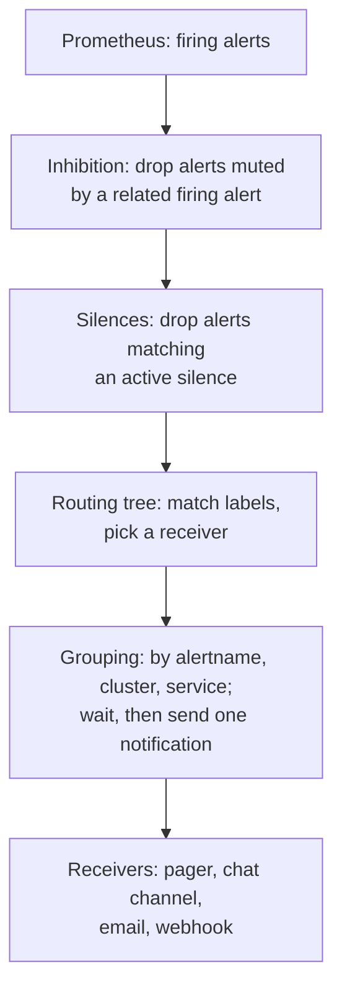

# Alerting and Alertmanager

> **Status: AI draft, 2026-11-16.** Not yet verified by me. Written from the Prometheus and Alertmanager documentation and the Google SRE books; nothing was run.

## In one line

Prometheus evaluates alert rules (a PromQL condition that must hold `for` a while, plus labels and annotations) and sends firing alerts to Alertmanager, which routes them through a tree by label to receivers, groups related alerts into one notification, suppresses dependent alerts with inhibition, and honours silences; page only on user-facing symptoms that need action now, with a runbook link.

## The plain idea

A metric crossing a line is not yet an alert worth sending. Someone has to decide: is it real (not a blip)? Who needs to know? Should twenty related problems be one message? Is the cause already known and being worked on? Prometheus answers the first question with **alert rules**; **Alertmanager** answers the rest.

The hardest part is not the tooling but restraint: every alert that pages someone at night must be urgent, actionable and about something users feel. Otherwise people learn to ignore pages, and the one that matters is missed.

## How it works

### Alert rules

```yaml
groups:
  - name: sample-app
    rules:
      - alert: SampleAppHighErrorRate
        expr: |
          sum(rate(http_requests_total{job="sample-app", status_class="5xx"}[5m]))
          /
          sum(rate(http_requests_total{job="sample-app"}[5m])) > 0.05
        for: 10m
        labels:
          severity: page
          team: team-a
        annotations:
          summary: "sample-app: more than 5% of requests failing"
          description: "Error ratio is {{ $value | humanizePercentage }} for 10 minutes."
          runbook_url: "https://wiki.example.com/runbooks/sample-app-errors"
```

| Field | Meaning |
|---|---|
| `expr` | PromQL; every series it returns is an alert ([PromQL](promql.md)) |
| `for` | The condition must hold this long; meanwhile the alert is `pending`. Filters blips |
| `keep_firing_for` | Keep firing this long after the condition clears, against flapping |
| `labels` | Used by Alertmanager for routing and grouping (`severity`, `team`) |
| `annotations` | Human text: summary, description, runbook link, dashboard link |

On Kubernetes, rules are delivered as PrometheusRule objects ([Prometheus on Kubernetes](prometheus-on-kubernetes.md)).

### Alertmanager



```yaml
route:
  receiver: team-a-chat
  group_by: [alertname, cluster, namespace]
  group_wait: 30s
  group_interval: 5m
  repeat_interval: 4h
  routes:
    - matchers: ['severity="page"']
      receiver: team-a-pager
inhibit_rules:
  - source_matchers: ['alertname="ClusterUnreachable"']
    target_matchers: ['severity!="page"']
    equal: [cluster]
```

| Concept | What it does | Defaults |
|---|---|---|
| **Routing tree** | Each alert walks the tree; the first matching child route (unless `continue: true`) picks the receiver | Child routes inherit settings from the parent |
| **Grouping** | Alerts with the same `group_by` labels go out as one notification | |
| `group_wait` | Wait before the first notification of a new group, to collect related alerts | 30s |
| `group_interval` | Wait before notifying about new alerts added to a group | 5m |
| `repeat_interval` | Re-send a still-firing group | 4h |
| **Inhibition** | A firing source alert mutes matching target alerts that share `equal` labels | |
| **Silences** | Time-limited mutes created by people, during maintenance or known incidents | |

Running two or more Alertmanagers as a cluster gives high availability; they share silences and deduplicate notifications.

### What makes a good alert

- **Symptom, not cause**: "error ratio above 5%" or "error budget burning fast", not "CPU at 90%" or "one pod restarted" ([SLOs and error budgets](slos.md), [Signals and methods](signals-and-methods.md)).
- **Actionable**: the person paged can do something now; otherwise it is a ticket or a dashboard.
- **Severity decides the channel**: `page` (wake someone), `ticket` (next working day), `info` (dashboard only).
- **Contains**: what is broken, the user impact, how long, a link to the runbook and the dashboard.
- **Owned**: routed to the team that can fix it, via a `team` label.

**Alert fatigue**: too many alerts, too noisy, or not actionable, and people start ignoring all of them. Review alerts after every on-call shift: delete or downgrade any alert that did not need action.

## A concrete example

`sample-app`'s alert set after a cleanup:

| Alert | Severity | Why |
|---|---|---|
| Fast error-budget burn (multi-window) | page | Users are failing now ([SLOs and error budgets](slos.md)) |
| Slow error-budget burn | ticket | Will exhaust the budget in days |
| p99 latency over the SLO for 15 minutes | page | Users waiting |
| `up == 0` for all `sample-app` targets | page | Nothing is scraped; could be total outage |
| Pod restarted, CPU high, one replica down | none (dashboards) | Causes; only matter if users feel them |
| Certificate expiring within 14 days | ticket | Needs action, not tonight ([TLS and certificates](../networking/tls.md)) |

## Why not just...?

- **...alert on every pod restart?** Kubernetes restarts pods routinely; with replicas, users notice nothing. Alert when the service's symptoms degrade.
- **...set `for: 0` so alerts arrive faster?** Every brief spike pages someone. A short `for` (minutes) filters noise at little cost.
- **...send all alerts to one shared channel?** Nobody owns them, and the important ones scroll away. Route by team and severity.

## Commands to know

| Command | What it does |
|---|---|
| `promtool check rules rules.yml` | Validate rule files. |
| `promtool test rules tests.yml` | Unit-test alert rules against synthetic series. |
| `amtool check-config alertmanager.yml` | Validate Alertmanager configuration. |
| `amtool config routes test --config.file=alertmanager.yml severity=page team=team-a` | Which receiver an alert with these labels would reach. |
| `amtool silence add alertname=SampleAppHighErrorRate --duration=2h --comment="deploy rollback in progress"` | Create a silence. |
| `amtool alert query` | Currently firing alerts. |

## How it breaks

| Symptom | Layer | Check | Likely cause |
|---|---|---|---|
| Alert fired in Prometheus, no notification | Routing | `amtool config routes test` | No route matches the labels, or a silence or inhibition applies |
| Same alert repeats every few hours | Repeat | `repeat_interval` | Still firing; fix or silence with a reason |
| Notification storm during an outage | Grouping, inhibition | `group_by`, inhibit rules | Grouping too fine; no inhibition from the root cause alert |
| Alerts never fire in a real outage | Rule | Rule tested? | Expression returns nothing when the target is gone; add `absent()` or `up` alerts |
| Alerts flap on and off | Rule | `for`, window length | Short windows; add `for` and `keep_firing_for` |

## Interview questions

**1. What do Prometheus and Alertmanager each do in alerting?**

<details markdown="1">
<summary>Answer</summary>

- Prometheus evaluates alert rules and sends firing alerts.
- Alertmanager deduplicates, groups, routes to receivers, applies inhibitions and silences.
- Rules decide *whether*; Alertmanager decides *who and how*.

</details>

**2. What do `for` and `keep_firing_for` do?**

<details markdown="1">
<summary>Answer</summary>

- `for`: the condition must hold that long before firing; meanwhile pending.
- `keep_firing_for`: keep firing for a while after the condition clears.
- Both reduce noise from short spikes and flapping.

</details>

**3. Explain grouping, inhibition and silences.**

<details markdown="1">
<summary>Answer</summary>

- Grouping: related alerts (same `group_by` labels) sent as one notification after `group_wait`.
- Inhibition: a firing alert mutes dependent alerts, such as "cluster down" muting per-service alerts.
- Silences: manual, time-limited mutes for maintenance or known issues.

</details>

**4. Why alert on symptoms rather than causes?**

<details markdown="1">
<summary>Answer</summary>

- Symptoms are what users feel; causes (CPU, restarts) often do not matter on their own.
- Cause alerts are noisy and miss unknown failure modes.
- Use causes on dashboards to investigate after a symptom alert.

</details>

**5. What should a good alert notification contain?**

<details markdown="1">
<summary>Answer</summary>

- What is broken and the impact on users, with the current value.
- How long it has been happening.
- Links to the runbook and dashboard; routed to the owning team.

</details>

**6. The on-call engineer gets 40 pages a week, mostly ignored. What do you do?**

<details markdown="1">
<summary>Answer</summary>

- Review each alert: did it need immediate action? Delete, downgrade to ticket, or fix.
- Replace cause-based alerts with SLO-based symptom alerts; tune `for` and grouping.
- Make alert review part of the on-call handover.

</details>

## Try it

1. Write a rule that pages when no `sample-app` target has been up for 5 minutes, using `absent()` or `up`.
2. Extend the routing tree above so `team: team-b` alerts go to team B's receivers, with pages separate.
3. List your current alerts (or a team's) and mark each one page, ticket or delete.

## Zoom out

Alerts are the output of the whole observability stack and the input to incident response ([Incident response](../operations/incident-response.md)). SLO-based burn-rate alerts are the best way to keep them few and meaningful ([SLOs and error budgets](slos.md)).

## Sources

- [Prometheus documentation: alerting rules](https://prometheus.io/docs/prometheus/latest/configuration/alerting_rules/)
- [Prometheus documentation: Alertmanager](https://prometheus.io/docs/alerting/latest/alertmanager/)
- [Prometheus documentation: Alertmanager configuration](https://prometheus.io/docs/alerting/latest/configuration/)
- [Prometheus documentation: alerting practices](https://prometheus.io/docs/practices/alerting/)
- [Google SRE book: practical alerting](https://sre.google/sre-book/practical-alerting/)
