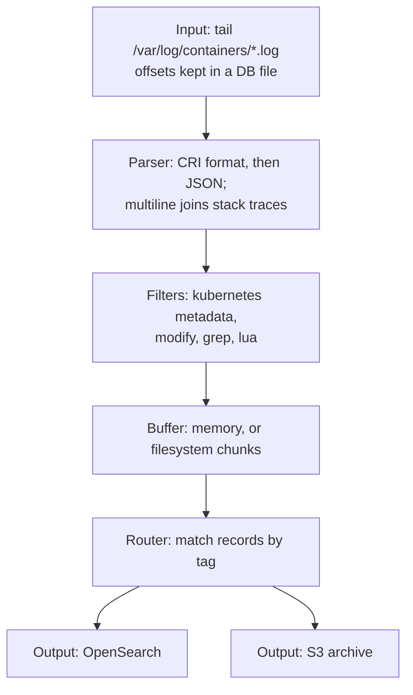

# Fluent Bit

> **Status: AI draft, 2026-11-16.** Not yet verified by me. Written from the Fluent Bit documentation; Fluent Bit was not run for these notes. The log file format it reads is shown with real output on [How Kubernetes logging works](kubernetes-logging.md).

## In one line

Fluent Bit is a small log agent, usually a DaemonSet, that tails log files, parses and enriches records with pod metadata, buffers them in memory or on disk, and sends them to outputs such as OpenSearch or S3. Buffer limits and retry settings decide whether logs survive outages.

## The plain idea

Logs sit in files on every node ([How Kubernetes logging works](kubernetes-logging.md)). Something on each node must read them as they grow, turn each line into a structured record, add who wrote it (namespace, pod, labels), and send it on, without losing lines when the destination is slow and without using much CPU or memory on a node that is running your applications. Fluent Bit is that agent.

## How it works



### Inputs and the position database

- `tail` reads files matching a path and emits one record per line, tagged (for Kubernetes typically `kube.*`, which the kubernetes filter uses to find the pod).
- `db` names a small database file that records each file's inode and offset. After a restart Fluent Bit continues where it stopped instead of re-sending or skipping. Keep it on the host (a `hostPath`), not in the pod's own filesystem.
- Other inputs: `systemd` (the node's journal), `forward`, metrics inputs.

### Parsers

| Need | Parser |
|---|---|
| Container runtime lines (`<time> stdout F <message>`) | Built-in `cri` multiline parser (reassembles `P` partial lines) |
| Docker JSON log files | Built-in `docker` parser |
| App writes JSON | `json` parser, or the kubernetes filter's `merge_log` |
| Fixed text format | A `regex` parser with named groups |
| Stack traces | Multiline parsers (built-in ones for Java, Python, Go, or custom rules) |

### The kubernetes filter

Reads the pod name, namespace and container from the tag (the file name), asks the API server (or the kubelet) for the pod's metadata, and adds `kubernetes.namespace_name`, `pod_name`, `labels`, `container_image` and more to each record. Useful options: `merge_log` (parse a JSON `log` field into top-level fields), `k8s-logging.parser` (let pods suggest a parser by annotation) and `k8s-logging.exclude` (let pods opt out). Its service account needs RBAC to get pods.

### Buffering and backpressure

- **Memory buffering** (default): fast, but lost on restart. When an input reaches its `mem_buf_limit`, Fluent Bit **pauses** that input (logging `paused (mem buf overlimit)`) until chunks are flushed; meanwhile files keep growing and may rotate away unread.
- **Filesystem buffering** (`storage.type filesystem` with a `storage.path`): chunks are written to disk, surviving restarts and absorbing longer outages, at the cost of disk I/O.

### Retries

When an output fails, the chunk is scheduled for a retry with exponential backoff. `Retry_Limit` is set per output and **defaults to 1**: one retry, then the data is discarded. Set it higher, or to `no_limits`, for destinations that can be down for minutes, and pair that with filesystem buffering.

### Outputs

| Output | Notes |
|---|---|
| `opensearch` | Bulk API to OpenSearch; supports AWS SigV4 auth for Amazon OpenSearch Service; watch for bulk rejections ([OpenSearch](opensearch.md)) |
| `s3` | Batches into objects; cheap archive; query later with Athena ([S3](../aws-services/s3.md)) |
| `cloudwatch_logs` | Log groups and streams in CloudWatch ([CloudWatch](../aws-services/cloudwatch.md)) |
| `stdout` | Debugging the pipeline |

On EKS, Fluent Bit gets AWS permissions through IRSA or Pod Identity ([Cluster access, IRSA and Pod Identity](../eks/access-and-pod-identity.md)).

## A concrete example

A YAML configuration for the DaemonSet:

```yaml
service:
  flush: 5
  http_server: on            # metrics on port 2020
  storage.path: /var/fluent-bit/state/buffer

pipeline:
  inputs:
    - name: tail
      tag: kube.*
      path: /var/log/containers/*.log
      multiline.parser: cri
      db: /var/fluent-bit/state/tail.db
      mem_buf_limit: 50MB
      storage.type: filesystem
  filters:
    - name: kubernetes
      match: kube.*
      merge_log: on
      keep_log: off
      k8s-logging.parser: on
      k8s-logging.exclude: on
  outputs:
    - name: opensearch
      match: kube.*
      host: logs.example.com
      port: 443
      tls: on
      aws_auth: on
      aws_region: ap-south-1
      logstash_format: on
      logstash_prefix: k8s-logs
      retry_limit: no_limits
```

`/var/fluent-bit/state` is a `hostPath` volume, so the offsets and buffered chunks survive pod restarts.

## Why not just...?

- **...use memory buffering because it is simpler?** A restart, or a backend outage longer than the memory buffer, loses logs, and paused inputs fall behind rotation. Use filesystem buffering for anything important.
- **...keep the default `Retry_Limit`?** One retry means a backend restart of a minute drops data. Raise it deliberately.
- **...parse everything with regexes in the agent?** Regex parsing costs CPU on every node and breaks when formats change. Have applications log JSON.

## Commands to know

| Command | What it does |
|---|---|
| `kubectl logs -n logging ds/fluent-bit` | Agent errors: output failures, paused inputs, retries. |
| `kubectl exec -n logging <pod> -- curl -s localhost:2020/api/v1/metrics/prometheus` | Records in and out, retries and errors per plugin (with `http_server` on). |
| `kubectl exec -n logging <pod> -- curl -s localhost:2020/api/v1/storage` | Buffer chunk counts (with storage metrics enabled). |
| Add an output `name: stdout, match: kube.*` | See exactly what records look like after filters. |
| `fluent-bit --dry-run -c fluent-bit.yaml` | Check a configuration without running it. |

## How it breaks

| Symptom | Layer | Check | Likely cause |
|---|---|---|---|
| Gaps in logs during a backend outage | Retries | `retry_limit`, output errors | Default one retry, then dropped |
| `paused (mem buf overlimit)` in agent logs | Backpressure | `mem_buf_limit`, output speed | Output slower than input; use filesystem buffering |
| Duplicate logs after a restart | Offsets | `db` location | Position database not persisted on the host |
| Records missing pod metadata | Kubernetes filter | Tag, RBAC | Tag does not match the file naming, or no permission to get pods |
| Stack traces split | Parsing | Multiline settings | No multiline parser for that language |
| OpenSearch rejects records | Mapping | Rejection errors | Field type conflicts or mapping explosion ([OpenSearch](opensearch.md)) |

## Interview questions

**1. Describe the Fluent Bit pipeline.**

<details markdown="1">
<summary>Answer</summary>

- Input (such as tail), parser, filters, buffer, router, outputs.
- Records carry tags; outputs match tags.
- Each stage can be configured per plugin.

</details>

**2. How does Fluent Bit avoid re-reading or skipping logs after a restart?**

<details markdown="1">
<summary>Answer</summary>

- The tail input's `db` option stores each file's inode and offset.
- On restart it resumes from those offsets.
- The database must live on the host (hostPath), not inside the container.

</details>

**3. What does the kubernetes filter do?**

<details markdown="1">
<summary>Answer</summary>

- Derives the pod from the record's tag (file name) and fetches its metadata from the API server or kubelet.
- Adds namespace, pod, container, labels and more to each record.
- Can merge JSON log fields and honour pod annotations for parsers or exclusion.

</details>

**4. Memory vs filesystem buffering?**

<details markdown="1">
<summary>Answer</summary>

- Memory: fast, lost on restart; inputs pause at `mem_buf_limit`.
- Filesystem: chunks on disk survive restarts and longer outages.
- Use filesystem buffering for logs you cannot afford to lose.

</details>

**5. Logs went missing during a 10-minute OpenSearch outage. Why, and how do you prevent it?**

<details markdown="1">
<summary>Answer</summary>

- With the default `Retry_Limit` of 1, failed chunks were retried once and discarded; memory buffers may also have paused inputs while files rotated.
- Set a higher or unlimited retry limit and filesystem buffering with enough disk.
- Monitor retry and drop metrics.

</details>

**6. How do you handle multiline stack traces?**

<details markdown="1">
<summary>Answer</summary>

- Use the CRI multiline parser first, then a language-specific multiline parser (Java, Python, Go) or custom rules.
- Or log JSON with the stack trace as one escaped field.
- Test with real traces before rolling out.

</details>

## Try it

1. Using the CRI lines on [How Kubernetes logging works](kubernetes-logging.md), write down the record Fluent Bit would produce for the JSON line after `merge_log`.
2. Change the example configuration to also send everything to S3 with a different tag match.
3. List the metrics you would alert on for the Fluent Bit DaemonSet itself.

## Zoom out

Fluent Bit is the shipping step between node log files and a searchable store ([How Kubernetes logging works](kubernetes-logging.md), [OpenSearch](opensearch.md)). Its reliability settings (buffering, retries) decide whether logs survive incidents, exactly when you need them most.

## Sources

- [Fluent Bit documentation: data pipeline](https://docs.fluentbit.io/manual/concepts/data-pipeline)
- [Fluent Bit documentation: tail input](https://docs.fluentbit.io/manual/data-pipeline/inputs/tail)
- [Fluent Bit documentation: kubernetes filter](https://docs.fluentbit.io/manual/data-pipeline/filters/kubernetes)
- [Fluent Bit documentation: multiline parsing](https://docs.fluentbit.io/manual/data-pipeline/parsers/multiline-parsing)
- [Fluent Bit documentation: buffering](https://docs.fluentbit.io/manual/data-pipeline/buffering)
- [Fluent Bit documentation: backpressure](https://docs.fluentbit.io/manual/administration/backpressure)
- [Fluent Bit documentation: scheduling and retries](https://docs.fluentbit.io/manual/administration/scheduling-and-retries)
- [Fluent Bit documentation: OpenSearch output](https://docs.fluentbit.io/manual/data-pipeline/outputs/opensearch)
