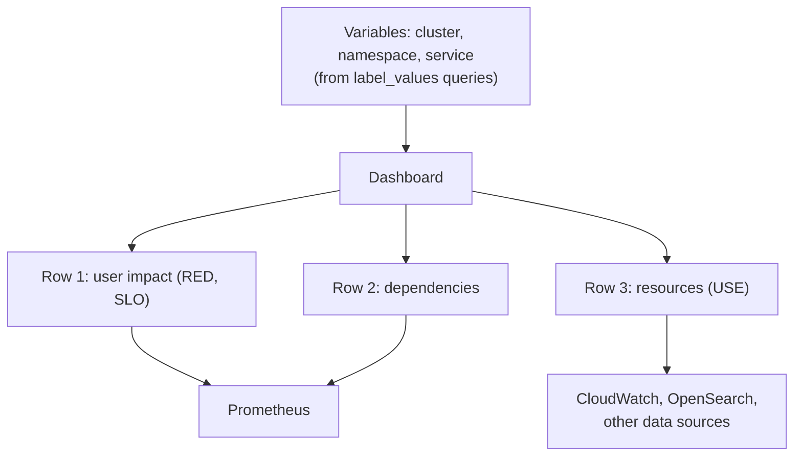

# Grafana

> **Status: AI draft, 2026-11-16.** Not yet verified by me. Written from the Grafana documentation; nothing was run.

## In one line

Grafana draws dashboards from many data sources: each panel queries one source, variables turn one dashboard into many, and provisioning keeps dashboards in Git. It can alert itself or leave that to Alertmanager. Design dashboards from user impact down to causes.

## How it works

| Concept | Meaning |
|---|---|
| **Data source** | A connection to a backend with its own query language: PromQL for Prometheus, Lucene or PPL for OpenSearch, CloudWatch metric queries |
| **Dashboard** | A JSON document of panels, rows, variables and settings |
| **Panel** | One visualisation (time series, stat, table, heatmap) with one or more queries |
| **Variables** | Drop-downs feeding queries: `label_values(kube_pod_info, namespace)` gives a `$namespace` list; queries use `{namespace="$namespace"}` |
| **Annotations** | Events on the time axis, such as deploys, to line up changes with graphs |
| **Provisioning** | YAML files that define data sources and dashboard folders at startup, so configuration lives in Git |

**Dashboards as code**: store dashboard JSON in Git and load it through provisioning (in Kubernetes, often ConfigMaps picked up by a sidecar, as kube-prometheus-stack does), or generate it with Jsonnet and Grafonnet, or manage it with the Grafana Terraform provider. Changes made in the UI to a provisioned dashboard are lost or blocked, which is the point.

**Grafana alerting vs Alertmanager**: Grafana can evaluate alert rules over any of its data sources (useful for CloudWatch or OpenSearch data) and route notifications itself. With Prometheus, many teams keep rules in Prometheus and routing in Alertmanager, version-controlled with the services ([Alerting and Alertmanager](alerting.md)). Pick one place per signal so alerts are not duplicated.

**Designing a dashboard top-down**:

1. Top row: is the service healthy for users? Request rate, error ratio, latency percentiles, SLO budget remaining ([SLOs and error budgets](slos.md)).
2. Next: dependencies (database, queues, external APIs) with the same RED view.
3. Then: resources (CPU against requests and throttling, memory against limits, pod count, HPA state) ([Signals and methods](signals-and-methods.md)).
4. Deploy annotations everywhere; links to logs and traces filtered to the same time range.
5. Few panels per row, consistent units, and a description on each panel.

## Interview questions

**1. What is a Grafana data source and why does it matter for queries?**

Answer

- A configured backend (Prometheus, CloudWatch, OpenSearch...) with its own query language.
- Each panel query is written in that language.
- One dashboard can combine panels from several sources.

**2. How do variables make dashboards reusable?**

Answer

- A variable is a drop-down whose values come from a query (such as `label_values(..., namespace)`).
- Panel queries reference `$namespace`, so one dashboard serves every namespace or service.
- Chained variables (cluster, then namespace, then pod) narrow the view.

**3. How do you manage dashboards as code?**

Answer

- Store dashboard JSON (or Jsonnet that generates it) in Git.
- Load it with provisioning files, ConfigMaps with a sidecar, the Grafana Operator, or Terraform.
- Review changes like code; avoid hand edits in the UI.

**4. Grafana alerting or Alertmanager?**

Answer

- Prometheus rules plus Alertmanager when the data is in Prometheus and you want rules versioned with services.
- Grafana alerting when the data is in other sources (CloudWatch, OpenSearch) or for a single UI.
- Avoid both alerting on the same signal.

**5. How would you lay out a service dashboard?**

Answer

- Top-down: user impact (RED and SLO) first, then dependencies, then resources.
- Deploy annotations and links to logs and traces.
- Consistent units, descriptions, few panels per row.

## Sources

- [Grafana documentation: data sources](https://grafana.com/docs/grafana/latest/datasources/)
- [Grafana documentation: variables](https://grafana.com/docs/grafana/latest/visualizations/dashboards/variables/)
- [Grafana documentation: Prometheus template variables](https://grafana.com/docs/grafana/latest/datasources/prometheus/template-variables/)
- [Grafana documentation: provisioning](https://grafana.com/docs/grafana/latest/administration/provisioning/)
- [Grafana documentation: alerting](https://grafana.com/docs/grafana/latest/alerting/)
- [Grafana documentation: dashboard best practices](https://grafana.com/docs/grafana/latest/visualizations/dashboards/build-dashboards/best-practices/)
