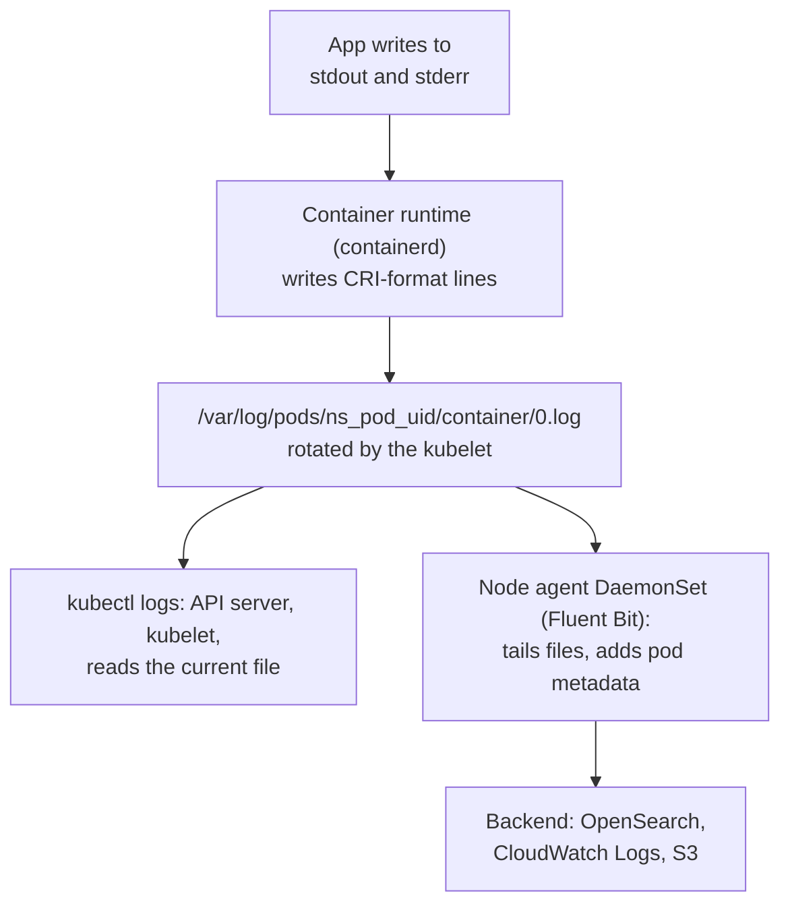

# How Kubernetes logging works

> **Status: AI draft, 2026-11-16.** Not yet verified by me. Commands and output were run on a local kind cluster (Kubernetes 1.37, containerd), including inside the node container; pod UIDs, container IDs and timestamps are replaced with placeholders.

## In one line

Containers write to stdout and stderr; the runtime writes the lines to files under `/var/log/pods/` on the node, the kubelet rotates them, and `kubectl logs` reads them. The files vanish soon after the pod is deleted, so a node agent must ship them elsewhere.

## The plain idea

Kubernetes has no log database. Applications should simply print to stdout and stderr; the runtime catches those streams and writes them to files on whichever node the pod runs. That is enough for `kubectl logs` while the pod exists. For anything else (searching across pods, keeping logs after a pod is gone, alerting on errors) a separate agent must read those files and send them somewhere durable, such as OpenSearch, CloudWatch Logs or S3 ([Fluent Bit](fluent-bit.md), [OpenSearch](opensearch.md)).

## How it works



### The files on the node

- `/var/log/pods/<namespace>_<pod>_<pod-uid>/<container>/<restart-count>.log`: one directory per pod, one file per container start.
- `/var/log/containers/<pod>_<namespace>_<container>-<container-id>.log`: symlinks to those files, with the pod name in the file name; log agents usually tail this path.
- Each line is in the **CRI log format**: `<timestamp> <stream> <tag> <message>`, where `stream` is `stdout` or `stderr` and `tag` is `F` (full line) or `P` (partial: a long line split into pieces).
- The runtime writes the files; the kubelet rotates them when they reach `containerLogMaxSize` (default 10Mi) and keeps `containerLogMaxFiles` (default 5). `kubectl logs` shows only the latest file.

### What kubectl logs reads

`kubectl logs` asks the API server, which asks the kubelet on the pod's node, which reads the current log file. So it works only while the pod (and the node) exists; `--previous` reads the file of the container's previous start, if it is still there ([Troubleshooting playbook](../kubernetes/troubleshooting.md)).

### Getting logs off the node

| Pattern | How | Trade-offs |
|---|---|---|
| **Node-level agent** (DaemonSet) | One agent per node tails `/var/log/containers/*.log` and ships them | No app changes; one config for all; the usual choice ([Fluent Bit](fluent-bit.md)) |
| **Sidecar** that streams a file to stdout | For apps that only write log files; the sidecar tails the file and prints it | Extra container per pod; the node agent still ships it |
| **Sidecar with its own agent** | An agent per pod ships directly | Per-app routing and parsing; more resources and config |
| **App sends directly** | The app's logger writes to the backend | No files; couples the app to the backend; logs lost if the backend is down |

### What is lost, and when

- Pod deleted: its log directory is removed shortly after (here, about 45 seconds later); anything not yet shipped is gone.
- Rotation: lines beyond the kept files are deleted, even while the pod runs.
- Node lost: all its unshipped logs go with it.

### Multiline and structured logs

- A Java stack trace is several lines, and each becomes a separate record unless the agent's multiline parser joins them.
- **Structured logging** (one JSON object per line, with level, message, trace ID, request ID) avoids most parsing problems: the backend indexes fields directly, and logs connect to traces ([Tracing and OpenTelemetry](tracing.md)).

## A concrete example

A pod that writes JSON, plain lines, a line to stderr and a two-line "stack trace":

```console
$ kubectl logs talker -n logs-demo
{"level":"info","msg":"started"}
line 0
warning on stderr
line 1
line 2
Exception in thread main
    at com.example.App.run(App.java:42)
```

The same lines in the file on the node, in CRI format:

```console
$ docker exec notes-lab-control-plane sh -c 'ls -l /var/log/pods/logs-demo_talker_*/talker/'
-rw-r----- 1 root root 417 <date> 0.log
$ docker exec notes-lab-control-plane sh -c 'cat /var/log/pods/logs-demo_talker_*/talker/0.log'
<timestamp> stdout F {"level":"info","msg":"started"}
<timestamp> stdout F line 0
<timestamp> stderr F warning on stderr
<timestamp> stdout F line 1
<timestamp> stdout F line 2
<timestamp> stdout F Exception in thread main
<timestamp> stdout F     at com.example.App.run(App.java:42)
```

- Each record carries its stream. In the real file, the stderr line's timestamp was a few microseconds *earlier* than the stdout line written before it: stdout and stderr are separate pipes, so their order is only approximate.
- The stack trace is two records; without multiline handling it is split in the backend.

The symlink a node agent tails:

```console
$ docker exec notes-lab-control-plane sh -c 'ls -l /var/log/containers/ | grep talker'
lrwxrwxrwx 1 root root  80 <date> talker_logs-demo_talker-<container-id>.log -> /var/log/pods/logs-demo_talker_<pod-uid>/talker/0.log
```

A 20,000-character line is split by the runtime into a partial and a final record, which the agent must reassemble:

```console
$ docker exec notes-lab-control-plane sh -c 'awk "{print \$2, \$3, length(\$0)}" /var/log/pods/logs-demo_longline_*/longline/0.log'
stdout P 16424
stdout F 3656
```

The kubelet's rotation settings on this node:

```console
$ kubectl get --raw "/api/v1/nodes/notes-lab-control-plane/proxy/configz" | python3 -c "..."
{'containerLogMaxSize': '10Mi', 'containerLogMaxFiles': 5, 'containerLogMaxWorkers': 1, 'containerLogMonitorInterval': '10s'}
```

After deleting the pod, `kubectl logs` fails at once, and the directory on the node was gone about 45 seconds later:

```console
$ kubectl logs talker -n logs-demo
error: error from server (NotFound): pods "talker" not found in namespace "logs-demo"
$ docker exec notes-lab-control-plane sh -c 'ls -d /var/log/pods/logs-demo_talker_*'
ls: cannot access '/var/log/pods/logs-demo_talker_*': No such file or directory
```

## Why not just...?

- **...write logs to a file inside the container?** The file lives in the container's writable layer: gone on restart, invisible to `kubectl logs`, and not collected by node agents unless you add a sidecar. Write to stdout.
- **...rely on `kubectl logs` in production?** It shows one container's current file, nothing after deletion, nothing across pods, and is limited by rotation. Ship logs centrally.
- **...log at debug level everywhere to be safe?** Volume costs money at every step (agent CPU, network, storage, indexing) and rotation drops lines faster. Log at info, keep debug switchable.

## Commands to know

| Command | What it does |
|---|---|
| `kubectl logs <pod> -c <container>` | Current log of one container. |
| `kubectl logs <pod> --previous` | The previous container start's log. |
| `kubectl logs -l app=sample-app --all-containers --prefix --since=10m` | Recent logs from several pods (read-only label query). |
| `kubectl logs <pod> -f --tail=100` | Follow the last 100 lines. |
| `kubectl debug node/<node> -it --image=busybox:1.36` then `ls /host/var/log/pods` | Look at the files on a real node ([Troubleshooting playbook](../kubernetes/troubleshooting.md)). |
| `kubectl get --raw /api/v1/nodes/<node>/proxy/configz` | The kubelet's configuration, including log rotation. |

## How it breaks

| Symptom | Layer | Check | Likely cause |
|---|---|---|---|
| Logs missing for a crashed pod | Lifetime | Was it deleted or replaced? | Pod deleted before the agent shipped them; rotation |
| `kubectl logs` shows only recent lines | Rotation | File size settings | Only the current file is read |
| Stack traces split into many records | Parsing | Agent multiline settings | No multiline parser for that format |
| Very long JSON lines broken | Partial lines | `P` records | Agent does not reassemble partial CRI lines |
| Nothing from an app in the backend | Output | `kubectl logs` | App writes to a file, not stdout |
| Node disk full of logs | Rotation | Disk usage under `/var/log/pods` | Very chatty apps; tune rotation and log levels ([Disks and filesystems](../linux/disks-and-filesystems.md)) |

## Interview questions

**1. Where do container logs go in Kubernetes?**

<details markdown="1">
<summary>Answer</summary>

- The app writes to stdout and stderr; the runtime writes them to files under `/var/log/pods/` on the node, with symlinks in `/var/log/containers/`.
- The kubelet rotates them.
- Nothing is kept centrally unless an agent ships them.

</details>

**2. What does `kubectl logs` actually read?**

<details markdown="1">
<summary>Answer</summary>

- The API server proxies to the kubelet, which reads the container's current log file on the node.
- `--previous` reads the previous start's file.
- It fails once the pod is deleted.

</details>

**3. How would you collect logs from every pod in a cluster?**

<details markdown="1">
<summary>Answer</summary>

- A node-level agent as a DaemonSet (Fluent Bit) tailing `/var/log/containers/*.log`.
- It enriches records with pod metadata and ships them to a backend.
- Sidecars only for apps that cannot log to stdout.

</details>

**4. When are logs lost?**

<details markdown="1">
<summary>Answer</summary>

- When the pod is deleted before the agent has shipped them; the directory is removed shortly after.
- On rotation, and when a node dies.
- Agents with filesystem buffers and short flush intervals reduce the loss.

</details>

**5. What is the CRI log format?**

<details markdown="1">
<summary>Answer</summary>

- Each line: timestamp, stream (stdout or stderr), tag (F full or P partial), message.
- Long lines are split into partial records that must be joined.
- Agents need a CRI parser to read it correctly.

</details>

**6. Why prefer structured (JSON) logs?**

<details markdown="1">
<summary>Answer</summary>

- Fields such as level, request ID and trace ID are indexed directly, without fragile regex parsing.
- Easy to filter and aggregate; easy to link to traces.
- Multi-line messages can be escaped inside one JSON line.

</details>

## Try it

On a kind cluster:

1. Run a pod that prints to stdout and stderr, then `docker exec <kind-node> sh -c 'cat /var/log/pods/<ns>_<pod>_*/<container>/0.log'`.
2. Print a 20,000-character line and find the `P` record.
3. Delete the pod and measure how long its directory stays on the node.
4. Clean up with `kubectl delete namespace <ns>`.

## Zoom out

Kubernetes leaves logging to the node and to you: the runtime writes files, the kubelet rotates them, and an agent ships them ([Fluent Bit](fluent-bit.md)) to a store you can search ([OpenSearch](opensearch.md)). The same "write to stdout, collect on the host" idea applies to plain Docker and to Fargate with its own log router ([Running and debugging containers](../containers/running-containers.md), [ECS and Fargate](../serverless/ecs-and-fargate.md)).

## Sources

- [Kubernetes documentation: logging architecture](https://kubernetes.io/docs/concepts/cluster-administration/logging/)
- [Kubernetes documentation: kubelet configuration (containerLogMaxSize, containerLogMaxFiles)](https://kubernetes.io/docs/reference/config-api/kubelet-config.v1beta1/)
- [Kubernetes documentation: kubectl logs](https://kubernetes.io/docs/reference/kubectl/generated/kubectl_logs/)
