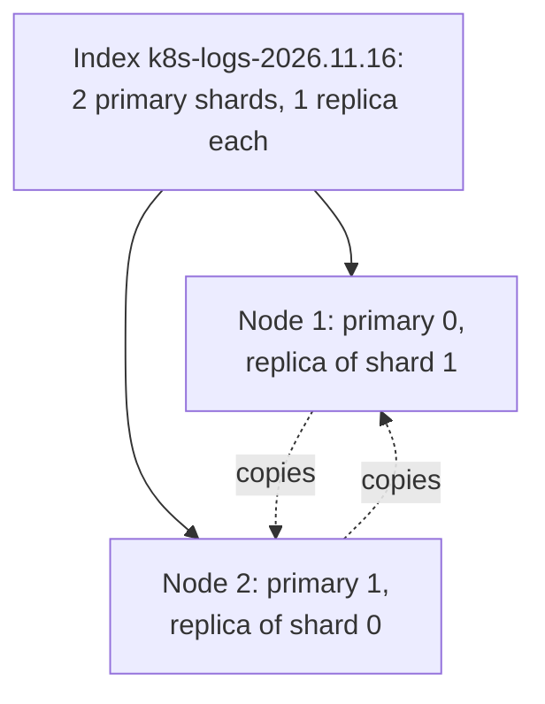

# OpenSearch

> **Status: AI draft, 2026-11-16.** Not yet verified by me. Written from the OpenSearch and Amazon OpenSearch Service documentation; nothing was run.

## In one line

OpenSearch stores JSON documents in indices, splits each index into primary shards spread across nodes with replica copies, and reports health as green (all shards allocated), yellow (a replica missing) or red (a primary missing). For logs, use index templates with explicit mappings, roll indices over and delete them with ISM, and watch disk watermarks, bulk rejections and mapping explosion.

## The plain idea

OpenSearch (a fork of Elasticsearch) is a distributed search engine. For logs it works like this: every log record is a JSON **document**; documents go into an **index**, usually one per day or per rollover (`k8s-logs-2026.11.16`); each index is cut into **shards** so it can be spread over several machines and searched in parallel; each shard has **replicas** on other nodes so a node can fail without losing data.

Most operational problems come from those pieces being the wrong size or shape: too many tiny shards, shards too big to move, disks too full, or documents with thousands of different field names.

## How it works

### Index, shard, replica



| Term | Meaning |
|---|---|
| **Document** | One JSON record, such as one log line with its fields |
| **Index** | A collection of documents with one mapping |
| **Mapping** | The field names and types (`keyword`, `text`, `date`, `long`...) |
| **Shard** | A slice of an index; the unit that is placed on a node and moved |
| **Replica** | A copy of a primary shard on another node, for failover and read capacity |

### Cluster health

| Status | Meaning | Data at risk? |
|---|---|---|
| **Green** | All primary and replica shards allocated | No |
| **Yellow** | All primaries allocated, some replicas not | Not yet, but one more node loss could lose data |
| **Red** | At least one primary shard unallocated | Yes: that shard's data is unavailable; writes to it fail |

A single-node cluster with replicas set to 1 is always yellow, because a replica may not sit on the same node as its primary.

### Templates and mappings

- An **index template** applies settings (shards, replicas, ISM policy) and mappings to every new index matching a pattern, such as `k8s-logs-*`.
- **Dynamic mapping** guesses types from the first value seen. If one service logs `"status": 200` and another `"status": "OK"`, the second is rejected once the field is mapped as a number.
- **Mapping explosion**: every new field name adds to the mapping. Logs with keys such as user IDs or request paths as field names create thousands of fields, slowing the cluster. `index.mapping.total_fields.limit` (default 1000) stops it by rejecting documents that would exceed it.
- Fix both at the source: consistent field names and types, and explicit mappings for known fields with `dynamic: false` or strict handling for the rest.

### Index lifecycle with ISM

**Index State Management** policies move indices through states automatically:

```text
hot (writes, fast storage) → rollover at a size or age → warm (read-only, fewer replicas, cheaper storage) → delete after N days
```

Rollover keeps shards at a sensible size; deletion keeps disks from filling. On Amazon OpenSearch Service, UltraWarm and cold storage tiers are options for the warm stage.

### Writing: bulk indexing and backpressure

Agents send documents in batches with the **bulk API** ([Fluent Bit](fluent-bit.md)). When nodes cannot keep up, they reject bulk requests with HTTP 429 and an `es_rejected_execution_exception` (the write queue is full). The agent must retry with backoff and buffer meanwhile. Persistent rejections mean too few or too small data nodes, too many shards per node, or expensive mappings.

### Shard sizing

- AWS's guidance for OpenSearch Service: keep shards between 10 and 30 GiB where search latency matters, and between 30 and 50 GiB for write-heavy workloads such as logs.
- Too many small shards waste memory (each has overhead); very large shards are slow to move and recover.
- Amazon OpenSearch Service defaults to five primary shards per index, unlike open-source OpenSearch's one, so set shard counts in your templates.

### Disk watermarks

| Watermark | Default | Effect |
|---|---|---|
| Low | 85% | No new replica shards are allocated to that node |
| High | 90% | OpenSearch tries to move shards off the node |
| Flood stage | 95% | Every index with a shard on that node gets a read-only block (`index.blocks.read_only_allow_delete`): writes fail |

The block is released once usage falls below the high watermark. The fix is freeing space (delete old indices, add storage), not just retrying.

### Managed service notes (Amazon OpenSearch Service)

- **VPC access**: the domain gets interfaces in your subnets and is reachable only from the VPC and connected networks; access is then controlled by security groups and access policies ([Security groups and NACLs](../aws-core/security-groups-and-nacls.md)).
- **Fine-grained access control**: users, roles and index or document permissions inside OpenSearch, mapped to IAM roles or SAML groups.
- Clients such as Fluent Bit sign requests with SigV4 using an IAM role ([Cluster access, IRSA and Pod Identity](../eks/access-and-pod-identity.md)).
- Dedicated master nodes and three Availability Zones for production domains.

## A concrete example

A cluster's log indices go red on a Friday night:

1. `GET _cluster/health`: red, 4 unassigned shards.
2. `GET _cluster/allocation/explain`: the node holding those primaries left the cluster; another node is at 96% disk.
3. `GET _cat/allocation?v`: two data nodes above the flood stage; writes to many indices blocked.
4. Delete the oldest indices that the ISM policy should have removed (its delete state had been disabled), add storage, and confirm the block lifts as usage drops below 90%.
5. Afterwards: fix the ISM policy, alert on disk at the low watermark, and give the cluster a third Availability Zone.

## Why not just...?

- **...one index for all logs forever?** It grows without limit, cannot be deleted in parts, and its shards become huge. Use rollover and time-based deletion.
- **...let dynamic mapping handle everything?** Type conflicts and mapping explosion follow. Map known fields explicitly and constrain the rest.
- **...run replicas at 0 to save space?** Any node loss then loses data and turns the cluster red. Keep at least one replica for anything you need.

## Commands to know

| Request | What it shows |
|---|---|
| `GET _cluster/health` | Overall status, unassigned shard counts |
| `GET _cat/indices?v&s=index` | Indices, health, document count, size |
| `GET _cat/shards?v` | Every shard, its node and state |
| `GET _cluster/allocation/explain` | Why a shard is unassigned |
| `GET _cat/allocation?v` | Disk use per node |
| `GET _cat/thread_pool/write?v` | Write queue and rejected counts |
| `GET k8s-logs-2026.11.16/_mapping` | The mapping actually in use |
| `GET _plugins/_ism/explain/k8s-logs-*` | ISM state per index |

## How it breaks

| Symptom | Layer | Check | Likely cause |
|---|---|---|---|
| Cluster red | Allocation | `_cluster/allocation/explain` | Primary shard on a lost node with no replica, or disk too full to allocate |
| Cluster yellow | Replicas | `_cat/shards` | Not enough nodes for replicas, or allocation blocked by disk watermarks |
| Writes fail, `read_only_allow_delete` | Disk | `_cat/allocation` | Flood stage reached |
| HTTP 429 on bulk | Write capacity | Thread pool rejections | Ingest rate above capacity; too many shards |
| Documents rejected: field type conflict | Mapping | Index mapping | Same field name with different types |
| `Limit of total fields [1000] has been exceeded` | Mapping | Field count | Mapping explosion from dynamic keys |

## Interview questions

**1. Explain index, shard and replica.**

<details markdown="1">
<summary>Answer</summary>

- An index is a collection of documents with one mapping.
- It is divided into primary shards placed on nodes, so it scales across machines.
- Replicas are copies on other nodes for failover and read capacity.

</details>

**2. What do green, yellow and red mean?**

<details markdown="1">
<summary>Answer</summary>

- Green: all shards allocated.
- Yellow: all primaries allocated, some replicas not; no data unavailable but less safe.
- Red: a primary is unallocated; some data is unavailable and writes to it fail.

</details>

**3. What is mapping explosion and how do you prevent it?**

<details markdown="1">
<summary>Answer</summary>

- Thousands of field names created by dynamic mapping, usually from dynamic keys in logs.
- It slows the cluster; the total fields limit (default 1000) rejects documents beyond it.
- Prevent with consistent log schemas, explicit mappings and restricted dynamic mapping.

</details>

**4. Writes suddenly fail with an index read-only error. Why?**

<details markdown="1">
<summary>Answer</summary>

- A node's disk passed the flood-stage watermark (95% by default), so indices with shards there got a read-only block.
- Free space: delete old indices, add storage, rebalance.
- The block lifts once usage drops below the high watermark.

</details>

**5. How do you manage log index lifecycle?**

<details markdown="1">
<summary>Answer</summary>

- Index templates plus ISM policies: hot with rollover by size or age, then warm, then delete after the retention period.
- Keeps shard sizes and disk usage under control.
- Monitor ISM so a failed policy does not silently stop deletions.

</details>

**6. Fluent Bit reports HTTP 429 from OpenSearch. What do you do?**

<details markdown="1">
<summary>Answer</summary>

- The write thread pool queue is full: check rejections per node.
- Short term: agents retry with backoff and buffer on disk.
- Longer term: more or bigger data nodes, fewer shards, cheaper mappings, larger bulk batches.

</details>

## Try it

1. A 3-node cluster has an index with 3 primaries and 1 replica. One node dies. Which colour is the cluster, and why? What if replicas were 0?
2. Write an index template for `k8s-logs-*` with 2 shards, 1 replica, and explicit mappings for `@timestamp`, `kubernetes.namespace_name` and `level`.
3. Write the ISM states for: roll over at 30 GiB or 1 day, warm after 2 days, delete after 14 days.

## Zoom out

OpenSearch is the search and storage end of the logging pipeline: applications log to stdout, the node agent ships, OpenSearch indexes ([How Kubernetes logging works](kubernetes-logging.md), [Fluent Bit](fluent-bit.md)). Its capacity, retention and cost are a constant operational topic ([Cost optimisation](../operations/cost-optimisation.md)).

## Sources

- [OpenSearch documentation: introduction (indices, shards, replicas)](https://docs.opensearch.org/latest/getting-started/intro/)
- [OpenSearch documentation: cluster health](https://docs.opensearch.org/latest/api-reference/cluster-api/cluster-health/)
- [OpenSearch documentation: index templates](https://docs.opensearch.org/latest/im-plugin/index-templates/)
- [OpenSearch documentation: mapping explosion](https://docs.opensearch.org/latest/mappings/mapping-explosion/)
- [OpenSearch documentation: Index State Management](https://docs.opensearch.org/latest/im-plugin/ism/index/)
- [OpenSearch documentation: bulk API](https://docs.opensearch.org/latest/api-reference/document-apis/bulk/)
- [OpenSearch documentation: cluster settings (disk watermarks)](https://docs.opensearch.org/latest/install-and-configure/configuring-opensearch/cluster-settings/)
- [Amazon OpenSearch Service: sizing shards](https://docs.aws.amazon.com/opensearch-service/latest/developerguide/bp-sharding.html)
- [Amazon OpenSearch Service: VPC domains](https://docs.aws.amazon.com/opensearch-service/latest/developerguide/vpc.html)
- [Amazon OpenSearch Service: fine-grained access control](https://docs.aws.amazon.com/opensearch-service/latest/developerguide/fgac.html)
