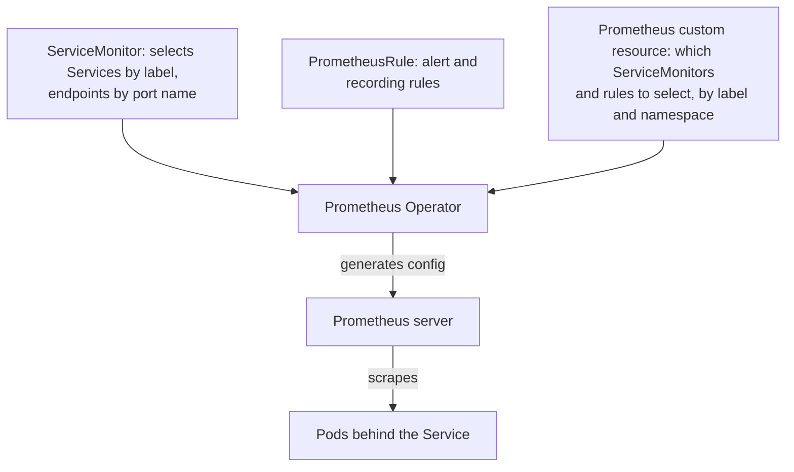

# Prometheus on Kubernetes

> **Status: AI draft, 2026-11-16.** Not yet verified by me. Written from the Prometheus Operator documentation and the kube-prometheus-stack chart; nothing was installed.

## In one line

The kube-prometheus-stack Helm chart installs the Prometheus Operator, Prometheus, Alertmanager, Grafana, kube-state-metrics, node-exporter and default rules and dashboards; you add targets and rules with ServiceMonitor, PodMonitor and PrometheusRule objects, which Prometheus picks up only when their labels and namespaces match its selectors, the usual reason a target is missing.

## How it works



| Resource | Purpose |
|---|---|
| `Prometheus` | A Prometheus deployment: replicas, retention, storage, and selectors for monitors and rules |
| `ServiceMonitor` | Scrape the endpoints behind Services that match a label selector, on a named port and path |
| `PodMonitor` | Scrape pods directly, without a Service |
| `PrometheusRule` | Alerting and recording rules ([Alerting and Alertmanager](alerting.md), [PromQL](promql.md)) |
| `Alertmanager`, `AlertmanagerConfig` | Alertmanager deployment and routing |

```yaml
apiVersion: monitoring.coreos.com/v1
kind: ServiceMonitor
metadata:
  name: sample-app
  namespace: team-a
  labels:
    release: monitoring          # must match the Prometheus serviceMonitorSelector
spec:
  selector:
    matchLabels:
      app: sample-app            # must match the Service's labels
  endpoints:
    - port: metrics              # the Service port's name, not its number
      path: /metrics
      interval: 30s
```

**Selection happens twice**: the Prometheus resource selects ServiceMonitors (by their labels, and by namespace through `serviceMonitorNamespaceSelector`), and each ServiceMonitor selects Services (by the Services' labels, in the namespaces it lists). In kube-prometheus-stack, `serviceMonitorSelectorNilUsesHelmValues` defaults to `true`, so Prometheus only selects monitors carrying the chart's release label unless you change the selector.

**Why a target is missing**:

1. ServiceMonitor lacks the label Prometheus selects on (the `release` label in the chart's default).
2. ServiceMonitor in a namespace Prometheus does not watch.
3. Its `selector` does not match the Service's labels.
4. `endpoints.port` names a port the Service does not have (by name).
5. The Service has no endpoints, or a NetworkPolicy blocks Prometheus ([Services and DNS](../kubernetes/services-and-dns.md)).
6. Prometheus's service account lacks RBAC to list endpoints in that namespace.

**What the stack scrapes out of the box**: the API server, kubelets (including cAdvisor container metrics), CoreDNS, kube-state-metrics, node-exporter on every node, and control plane components where reachable (on EKS the managed control plane exposes only some of them) ([Prometheus](prometheus.md)).

## Interview questions

**1. What does kube-prometheus-stack install?**

<details markdown="1">
<summary>Answer</summary>

- Prometheus Operator, Prometheus, Alertmanager, Grafana.
- kube-state-metrics and node-exporter.
- Default ServiceMonitors, alerting and recording rules, and dashboards.

</details>

**2. What is a ServiceMonitor, and how does Prometheus find it?**

<details markdown="1">
<summary>Answer</summary>

- A custom resource describing how to scrape Services that match a label selector, on a named port.
- The Prometheus resource selects ServiceMonitors by label and namespace; the operator turns them into scrape config.
- Both selections must match.

</details>

**3. You created a ServiceMonitor but the target never appears. What do you check?**

<details markdown="1">
<summary>Answer</summary>

- The ServiceMonitor's labels against the Prometheus `serviceMonitorSelector` (often `release: <name>`), and its namespace against the namespace selector.
- Its `selector` against the Service's labels, and `port` against the Service port's name.
- Endpoints exist, NetworkPolicy, and Prometheus's RBAC.

</details>

**4. ServiceMonitor or PodMonitor?**

<details markdown="1">
<summary>Answer</summary>

- ServiceMonitor when a Service already fronts the pods; most applications.
- PodMonitor for pods without a Service, such as some DaemonSets or jobs.
- Both end up as scrape configuration generated by the operator.

</details>

**5. How do you add an alert rule for your application?**

<details markdown="1">
<summary>Answer</summary>

- A PrometheusRule object with the rule group, labelled to match the Prometheus `ruleSelector`.
- Validate the expression first; include `for`, severity and a runbook link.
- Alertmanager routing decides who is notified.

</details>

## Sources

- [Prometheus Operator: introduction](https://prometheus-operator.dev/docs/getting-started/introduction/)
- [Prometheus Operator: getting started (ServiceMonitor)](https://prometheus-operator.dev/docs/developer/getting-started/)
- [Prometheus Operator: API reference](https://prometheus-operator.dev/docs/api-reference/api/)
- [kube-prometheus-stack Helm chart](https://github.com/prometheus-community/helm-charts/tree/main/charts/kube-prometheus-stack)
