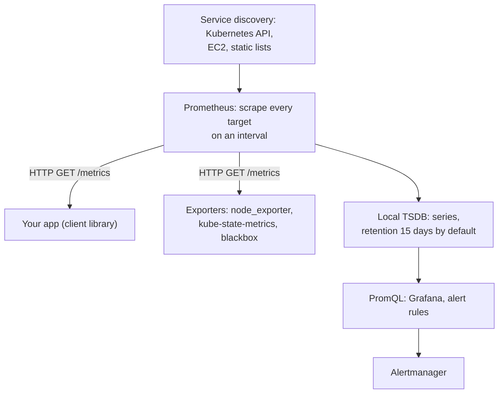

# Prometheus

> **Status: AI draft, 2026-11-16.** Not yet verified by me. The metric output below is real, read from the API server of a local kind cluster (Kubernetes 1.37) with `kubectl get --raw /metrics`; no Prometheus server was run.

## In one line

Prometheus pulls metrics over HTTP from targets it discovers and stores each time series, a metric name plus labels, for PromQL queries and alerts. Metrics are counters, gauges, histograms or summaries, and every new label value is a new series, so watch cardinality.

## The plain idea

Every service exposes a page, usually `/metrics`, listing its current numbers in a simple text format. Prometheus visits each page every few seconds (**scraping**), writes down the numbers with a timestamp, and keeps the history. Because Prometheus does the asking, it knows which targets exist and whether each one answered: a target that stops answering is itself a signal (`up == 0`).

## How it works



### Pull model

- Prometheus finds targets through **service discovery** (Kubernetes pods, services and endpoints; EC2 instances; files) and **relabelling** rules decide what to keep and how to label it ([Prometheus on Kubernetes](prometheus-on-kubernetes.md)).
- Each scrape also records `up` (1 if the scrape worked) and scrape duration.
- Why pull: Prometheus controls the rate, knows when a target is down, and you can curl any target to see exactly what it exposes.

### A time series

A series is a metric name plus labels; each sample is a value at a time. From the kind API server:

```console
$ kubectl get --raw /metrics | grep -E '^# (HELP|TYPE) apiserver_request_total |^apiserver_request_total\{.*resource="pods".*verb="LIST"'
# HELP apiserver_request_total [STABLE] Counter of apiserver requests broken out for each verb, dry run value, group, version, resource, scope, component, and HTTP response code.
# TYPE apiserver_request_total counter
apiserver_request_total{code="200",component="apiserver",dry_run="",group="",resource="pods",scope="cluster",subresource="",verb="LIST",version="v1"} 7
apiserver_request_total{code="200",component="apiserver",dry_run="",group="",resource="pods",scope="namespace",subresource="",verb="LIST",version="v1"} 89
```

Two series of one metric, differing in the `scope` label. Each `code`, `verb`, `resource` combination seen gets its own series.

### Metric types

| Type | Behaviour | Query it with | Example |
|---|---|---|---|
| **Counter** | Only goes up (resets to 0 on restart) | `rate()`, `increase()` ([PromQL](promql.md)) | `apiserver_request_total`, `http_requests_total` |
| **Gauge** | Goes up and down | The value, `avg`, `max` | `process_resident_memory_bytes`, queue length |
| **Histogram** | Counts observations into buckets, plus `_sum` and `_count` | `histogram_quantile()` over rates | `apiserver_request_duration_seconds` |
| **Summary** | Quantiles computed in the client | The quantile series directly; cannot be aggregated across instances | Some client library defaults |

A gauge:

```console
$ kubectl get --raw /metrics | grep -E '^# (HELP|TYPE) process_resident_memory_bytes|^process_resident_memory_bytes '
# HELP process_resident_memory_bytes Resident memory size in bytes.
# TYPE process_resident_memory_bytes gauge
process_resident_memory_bytes 3.3441792e+08
```

A histogram (buckets are cumulative: `le` means "less than or equal"):

```console
$ kubectl get --raw /metrics | grep -E '^apiserver_request_duration_seconds_(bucket|sum|count)\{.*resource="pods".*scope="namespace".*verb="LIST"'
apiserver_request_duration_seconds_bucket{...,le="0.005"} 88
apiserver_request_duration_seconds_bucket{...,le="0.025"} 89
apiserver_request_duration_seconds_bucket{...,le="0.05"} 89
...
apiserver_request_duration_seconds_bucket{...,le="+Inf"} 89
apiserver_request_duration_seconds_sum{...} 0.20507764900000006
apiserver_request_duration_seconds_count{...} 89
```

(The repeated labels are shortened to `...`.) 88 of 89 namespaced pod LIST calls finished within 5 ms, all within 25 ms; together they took about 0.2 seconds.

### Exporters

| Exporter | Exposes |
|---|---|
| node_exporter | Host metrics: CPU, memory, disk, network ([Performance triage](../linux/performance-triage.md)) |
| kube-state-metrics | The state of Kubernetes objects: Deployment replicas, pod phases, restarts |
| cAdvisor (in the kubelet) | Container CPU, memory, network |
| blackbox_exporter | Probes from outside: HTTP, TCP, DNS, ICMP checks |
| Service-specific | PostgreSQL, Redis, NGINX and many more |

### Storage, retention and limits

- Local time-series database on disk; retention defaults to 15 days (`--storage.tsdb.retention.time`), or set a size limit.
- One Prometheus is not built for long-term or global storage; remote write to systems such as Thanos, Cortex, Mimir or a managed service (Amazon Managed Service for Prometheus) handles that.
- Memory grows with the number of active series.

### Cardinality

The kind API server alone exposes 314 metric families. The single histogram `apiserver_request_duration_seconds` has 7,800 bucket series on this one-node lab cluster, because every verb, resource and scope combination gets every bucket:

```console
$ kubectl get --raw /metrics | grep -c '^apiserver_request_duration_seconds_bucket'
7800
```

Add a label with unbounded values (user ID, request ID, full URL path with IDs) to a metric like this, and series multiply until Prometheus runs out of memory. Keep labels bounded; put identifiers in logs and traces ([Signals and methods](signals-and-methods.md)).

### The Pushgateway

For short batch jobs that finish before a scrape, the Pushgateway accepts pushed metrics and holds them for Prometheus to scrape. The Prometheus documentation recommends it only for service-level batch jobs: it becomes a single point of failure, loses automatic `up` health, and keeps stale values until deleted. Most services should be scraped directly.

## A concrete example

Instrumenting `sample-app`:

1. Add the Prometheus client library; expose `/metrics` on port `9090`.
2. A counter `http_requests_total{route, method, status_class}` and a histogram `http_request_duration_seconds{route, method}` with buckets around the latency target. `route` is the route template (`/orders/{id}`), never the real path.
3. A ServiceMonitor tells Prometheus to scrape it ([Prometheus on Kubernetes](prometheus-on-kubernetes.md)).
4. RED dashboards and SLO alerts query these two metrics ([PromQL](promql.md), [SLOs and error budgets](slos.md)).

## Why not just...?

- **...push metrics from every app to a central server?** Then the server cannot tell "no traffic" from "app dead", and every app needs to know where to send. Pull with discovery gives health for free.
- **...use a summary for latency?** Summary quantiles cannot be combined across pods; a histogram can be aggregated, then turned into a percentile.
- **...keep a year of metrics in Prometheus?** Local storage is not designed as a long-term archive. Use remote write to a long-term store.

## Commands to know

| Command or query | What it does |
|---|---|
| `kubectl get --raw /metrics` | The API server's metrics in exposition format (as above). |
| `curl -s http://<pod-ip>:9090/metrics` | What any target exposes. |
| `up` | Whether each target's last scrape worked. |
| `count by (__name__) ({__name__=~".+"})` | Series per metric name: find cardinality problems. |
| `prometheus_tsdb_head_series` | Active series in Prometheus itself. |
| `promtool check rules rules.yml` | Validate rule files. |

## How it breaks

| Symptom | Layer | Check | Likely cause |
|---|---|---|---|
| Target missing | Discovery | Targets page, ServiceMonitor selectors | Labels, port name or namespace do not match ([Prometheus on Kubernetes](prometheus-on-kubernetes.md)) |
| `up == 0` | Scrape | Target endpoint | App down, wrong port or path, NetworkPolicy blocking Prometheus |
| Prometheus out of memory | Cardinality | Head series count | An unbounded label |
| Gaps in graphs | Scrape timing | Scrape duration vs interval | Slow `/metrics`, timeouts |
| Rates jump after a restart | Counters | Resets | Handled by `rate()`; wrong if using raw differences |

## Interview questions

**1. How does Prometheus collect metrics, and why pull?**

<details markdown="1">
<summary>Answer</summary>

- It discovers targets and scrapes their `/metrics` over HTTP on an interval.
- Pull gives health (`up`) for free, controls load centrally, and anyone can curl a target to debug.
- Short-lived jobs are the exception (Pushgateway).

</details>

**2. Explain counter, gauge, histogram and summary.**

<details markdown="1">
<summary>Answer</summary>

- Counter: only increases; query with `rate`.
- Gauge: current value that goes up and down.
- Histogram: bucketed counts plus sum and count, aggregatable into percentiles; summary: client-side quantiles that cannot be aggregated.

</details>

**3. What is a time series in Prometheus?**

<details markdown="1">
<summary>Answer</summary>

- A metric name plus a unique set of label values, with timestamped samples.
- Each new label combination is a new series.
- Hence cardinality matters.

</details>

**4. What causes high cardinality and how do you fix it?**

<details markdown="1">
<summary>Answer</summary>

- Labels with unbounded values: user IDs, request IDs, raw URL paths, pod names in long-lived metrics.
- Find them by counting series per metric and per label.
- Drop or rewrite labels (route templates), relabel at scrape time, move identifiers to logs and traces.

</details>

**5. When should you use the Pushgateway?**

<details markdown="1">
<summary>Answer</summary>

- For service-level batch jobs that end before they can be scraped.
- Not for regular services: it hides health, holds stale values, and is a single point of failure.
- Push the job's result once at the end, and delete stale groups.

</details>

**6. What are kube-state-metrics and node_exporter for?**

<details markdown="1">
<summary>Answer</summary>

- kube-state-metrics: the state of Kubernetes objects (desired vs available replicas, pod phases, restarts).
- node_exporter: host-level CPU, memory, disk and network.
- Together with cAdvisor they cover cluster, node and container views.

</details>

## Try it

On a kind cluster:

1. `kubectl get --raw /metrics | grep '^# TYPE' | awk '{print $4}' | sort | uniq -c` and compare with the type counts (152 counters, 105 gauges, 55 histograms, 2 summaries on this lab's 1.37 API server).
2. Pick one histogram and find its `_count` and `_sum` for one label set; compute the average duration.
3. Count the series of `apiserver_request_total` and list which labels create most of them.

## Zoom out

Prometheus is the metrics backbone of most Kubernetes platforms; PromQL turns its series into answers, the Prometheus Operator wires it into the cluster, and Alertmanager turns rule results into notifications ([PromQL](promql.md), [Prometheus on Kubernetes](prometheus-on-kubernetes.md), [Alerting and Alertmanager](alerting.md)).

## Sources

- [Prometheus documentation: overview](https://prometheus.io/docs/introduction/overview/)
- [Prometheus documentation: data model](https://prometheus.io/docs/concepts/data_model/)
- [Prometheus documentation: metric types](https://prometheus.io/docs/concepts/metric_types/)
- [Prometheus documentation: exposition formats](https://prometheus.io/docs/instrumenting/exposition_formats/)
- [Prometheus documentation: exporters](https://prometheus.io/docs/instrumenting/exporters/)
- [Prometheus documentation: storage (retention)](https://prometheus.io/docs/prometheus/latest/storage/)
- [Prometheus documentation: when to use the Pushgateway](https://prometheus.io/docs/practices/pushing/)
- [kube-state-metrics](https://github.com/kubernetes/kube-state-metrics)
