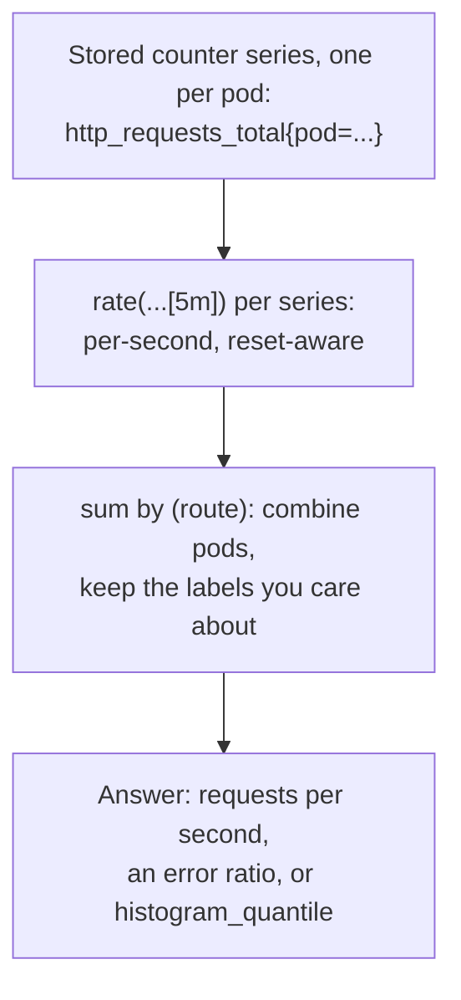

# PromQL

> **Status: AI draft, 2026-11-16.** Not yet verified by me. Written from the Prometheus documentation; no Prometheus server was run, so the queries have no sample output. Metric names follow the `sample-app` example on [Prometheus](prometheus.md).

## In one line

PromQL selects series by name and labels (an instant vector) or over a time window (a range vector, `[5m]`), turns counters into per-second rates with `rate()` before aggregating them with `sum by (...)`, computes error ratios by dividing rates, and gets latency percentiles from histogram buckets with `histogram_quantile()`; recording rules precompute expensive queries.

## The plain idea

Prometheus stores raw counters that only go up. Nobody wants "12,804,553 requests since the pod started"; they want "how many per second now, how many failed, how slow". PromQL is the small language that turns stored series into those answers, for graphs and for alert rules.

## How it works



### Selectors and vectors

```promql
http_requests_total                                   # every series of the metric
http_requests_total{route="/orders", status_class="5xx"}
http_requests_total{status_class=~"4xx|5xx"}          # regex match
http_requests_total{namespace!="kube-system"}         # not equal
http_requests_total[5m]                               # range vector: samples of the last 5 minutes
```

- An **instant vector** has one value per series at the evaluation time: what graphs and alerts plot.
- A **range vector** has all samples in a window for each series: only functions such as `rate()` accept it.

### Counters: rate, irate, increase

| Function | Gives | Use |
|---|---|---|
| `rate(c[5m])` | Per-second average increase over the window, handling counter resets and extrapolating to the window edges | Graphs and alerts |
| `irate(c[5m])` | Per-second rate from the last two samples in the window | Fast-moving, zoomed-in graphs; not alerts |
| `increase(c[1h])` | Total increase over the window (rate multiplied by the window) | "How many in the last hour" |

**Rate first, then aggregate.** `sum(rate(x[5m]))` is correct; `rate(sum(x)[5m])` cannot see a single pod's counter reset and produces nonsense. The documentation states this rule for `rate` and `irate`.

Use a window several times the scrape interval so each window holds enough samples.

### Aggregation

```promql
sum(rate(http_requests_total[5m]))                         # total requests per second
sum by (route) (rate(http_requests_total[5m]))             # per route
sum without (pod, instance) (rate(http_requests_total[5m])) # drop some labels, keep the rest
topk(5, sum by (route) (rate(http_requests_total[5m])))    # five busiest routes
avg by (namespace) (container_memory_working_set_bytes)    # gauges can be aggregated directly
```

### Error ratio

```promql
sum(rate(http_requests_total{status_class="5xx"}[5m]))
/
sum(rate(http_requests_total[5m]))
```

A value of `0.02` means 2% of requests failed in the last 5 minutes. Divide aggregated rates; both sides must end up with matching labels (here none), or use `on()` and `ignoring()` to control matching.

### Latency percentiles from histograms

```promql
histogram_quantile(
  0.99,
  sum by (le) (rate(http_request_duration_seconds_bucket[5m]))
)
```

1. `rate(..._bucket[5m])`: per-second counts for each bucket.
2. `sum by (le)`: combine all pods, keeping the bucket boundary label `le` (add `route` to the `by` list for per-route percentiles).
3. `histogram_quantile(0.99, ...)`: the value below which 99% fell, interpolated within the bucket. Accuracy depends on bucket boundaries; put buckets around your latency targets.

Average latency instead: `sum(rate(..._sum[5m])) / sum(rate(..._count[5m]))`.

### offset and subqueries

```promql
sum(rate(http_requests_total[5m])) / sum(rate(http_requests_total[5m] offset 1w))  # vs same time last week
max_over_time(sum(rate(http_requests_total[5m]))[1h:1m])                           # subquery: peak 5-minute rate in the last hour
```

### Recording rules

Expensive queries used by many dashboards or alerts can be computed on a schedule and stored as new series. Name them `level:metric:operations`:

```yaml
groups:
  - name: sample-app
    rules:
      - record: route:http_requests:rate5m
        expr: sum by (route) (rate(http_requests_total[5m]))
      - record: route:http_request_errors:ratio_rate5m
        expr: |
          sum by (route) (rate(http_requests_total{status_class="5xx"}[5m]))
          /
          sum by (route) (rate(http_requests_total[5m]))
```

## A concrete example

Five queries to know by heart, for `sample-app` on Kubernetes:

| Question | Query |
|---|---|
| Requests per second | `sum(rate(http_requests_total{namespace="team-a"}[5m]))` |
| Error ratio | `sum(rate(http_requests_total{status_class="5xx"}[5m])) / sum(rate(http_requests_total[5m]))` |
| p99 latency | `histogram_quantile(0.99, sum by (le) (rate(http_request_duration_seconds_bucket[5m])))` |
| Pods restarting | `increase(kube_pod_container_status_restarts_total{namespace="team-a"}[1h]) > 0` (kube-state-metrics) |
| CPU throttling | `sum by (pod) (rate(container_cpu_cfs_throttled_periods_total[5m])) / sum by (pod) (rate(container_cpu_cfs_periods_total[5m]))` (cAdvisor) |

## Why not just...?

- **...graph the raw counter?** It only shows a line going up, with drops at every restart. Rates show behaviour.
- **...average the per-pod p99s?** Averaging percentiles is mathematically meaningless. Sum the bucket rates across pods, then take the quantile.
- **...use `irate` in alerts?** It reflects only the last two samples, so one spike or dip fires or clears the alert. Use `rate` with a sensible window and a `for:` duration ([Alerting and Alertmanager](alerting.md)).

## Commands to know

| Command or query | What it does |
|---|---|
| `up == 0` | Targets whose last scrape failed. |
| `count by (__name__) ({__name__=~".+"})` | Series per metric, for cardinality. |
| `absent(up{job="sample-app"})` | Alert when a job disappears entirely. |
| `promtool check rules rules.yml` | Validate recording and alerting rules. |
| `promtool query instant http://prometheus:9090 'up'` | Run a query from the command line. |

## How it breaks

| Symptom | Layer | Check | Likely cause |
|---|---|---|---|
| Negative or huge spikes in a "rate" | Query order | Where `sum` sits | Aggregated before `rate`, so resets were not detected |
| `many-to-many matching not allowed` | Vector matching | Labels on each side | Divide aggregates with matching labels, or use `on()`, `ignoring()` |
| Percentile stuck at a bucket boundary | Histogram buckets | Bucket boundaries | Too few buckets around the interesting range |
| Empty result | Selector | Label values, time range | Wrong label value, or metric not scraped |
| Query slow or times out | Cost | Series touched | High-cardinality metric; use recording rules or narrower selectors |

## Interview questions

**1. What is the difference between an instant vector and a range vector?**

<details markdown="1">
<summary>Answer</summary>

- Instant vector: one sample per series at a point in time.
- Range vector: all samples in a time window per series, written with `[5m]`.
- Range vectors feed functions like `rate()`; graphs and alerts use instant vectors.

</details>

**2. Explain `rate`, `irate` and `increase`.**

<details markdown="1">
<summary>Answer</summary>

- `rate`: per-second average increase over the window, reset-aware, extrapolated.
- `irate`: per-second rate from the last two samples; very responsive, noisy.
- `increase`: total increase over the window; equal to rate times the window length.

</details>

**3. Why must you take `rate()` before `sum()`?**

<details markdown="1">
<summary>Answer</summary>

- `rate` detects counter resets per series.
- Summing first hides a single series' reset inside a larger total, giving wrong values.
- The Prometheus docs state the rule explicitly.

</details>

**4. Write a query for the error ratio of a service.**

<details markdown="1">
<summary>Answer</summary>

- `sum(rate(http_requests_total{status_class="5xx"}[5m])) / sum(rate(http_requests_total[5m]))`.
- Aggregate both sides to the same labels before dividing.
- Use a recording rule if alerts and dashboards reuse it.

</details>

**5. How do you compute p99 latency across all pods?**

<details markdown="1">
<summary>Answer</summary>

- `histogram_quantile(0.99, sum by (le) (rate(..._bucket[5m])))`.
- Sum bucket rates across pods keeping `le`, then take the quantile.
- Never average per-pod percentiles.

</details>

**6. What are recording rules and how should they be named?**

<details markdown="1">
<summary>Answer</summary>

- Queries evaluated on a schedule and stored as new series, to make dashboards and alerts cheap and consistent.
- Named `level:metric:operations`, such as `route:http_requests:rate5m`.
- Validate with `promtool check rules`.

</details>

## Try it

Without a Prometheus server, use the kind API server's real metrics ([Prometheus](prometheus.md)):

1. From `kubectl get --raw /metrics`, take `apiserver_request_duration_seconds_sum` and `_count` for one label set and compute the average duration by hand.
2. Write the PromQL that would give the p99 of `apiserver_request_duration_seconds` per `verb`.
3. Write a recording rule for the API server's 5xx ratio, named correctly.

## Zoom out

PromQL is how metrics become dashboards, alerts and SLOs ([Grafana](grafana.md), [Alerting and Alertmanager](alerting.md), [SLOs and error budgets](slos.md)). The same few patterns (rate then sum, ratio of rates, quantile of summed buckets) cover most real questions.

## Sources

- [Prometheus documentation: querying basics](https://prometheus.io/docs/prometheus/latest/querying/basics/)
- [Prometheus documentation: functions](https://prometheus.io/docs/prometheus/latest/querying/functions/)
- [Prometheus documentation: operators](https://prometheus.io/docs/prometheus/latest/querying/operators/)
- [Prometheus documentation: histograms and summaries](https://prometheus.io/docs/practices/histograms/)
- [Prometheus documentation: recording rules](https://prometheus.io/docs/prometheus/latest/configuration/recording_rules/)
- [Prometheus documentation: recording rule naming](https://prometheus.io/docs/practices/rules/)
