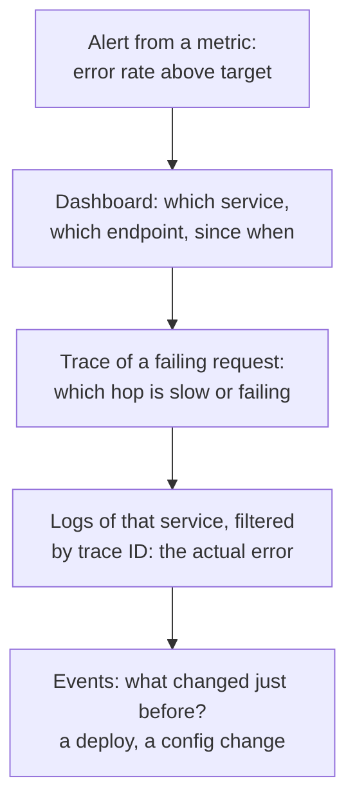

# Signals and methods

> **Status: AI draft, 2026-11-16.** Not yet verified by me. Written from the Google SRE book, Brendan Gregg's USE method, the RED method and the OpenTelemetry documentation.

## In one line

Metrics answer how much and how often, logs what exactly happened, traces where a request spent its time, events what changed. RED (rate, errors, duration) covers services, USE (utilisation, saturation, errors) covers resources. Alert on what users feel.

## The plain idea

When something is wrong, you ask questions: is it slow, for whom, since when, where? Different kinds of data answer different questions, at different costs:

- **Metrics** are numbers over time, cheap to store and fast to query: "500 requests per second, 2% errors".
- **Logs** are records of individual events, rich and expensive: "request 8f2 failed: connection refused to db:5432".
- **Traces** follow one request across services: "of its 900 ms, 850 ms was in the payment service".
- **Events** record changes: a deploy, a pod rescheduled, a config change ([kubectl fluency](../kubernetes/kubectl.md)).

**Monitoring** watches for known failure modes with predefined checks. **Observability** is being able to ask new questions of the system from its outputs, including about failures nobody predicted, which needs rich, connected data.

## How it works

### Which signal answers what

| Signal | Answers | Cost | Example tools |
|---|---|---|---|
| Metrics | How much, how often, trends, alerts | Low per series, explodes with cardinality | Prometheus, CloudWatch metrics ([Prometheus](prometheus.md)) |
| Logs | What exactly happened, error details | High volume | Fluent Bit, OpenSearch, CloudWatch Logs ([How Kubernetes logging works](kubernetes-logging.md)) |
| Traces | Where time went across services | Medium, usually sampled | OpenTelemetry, Jaeger, X-Ray ([Tracing and OpenTelemetry](tracing.md)) |
| Events | What changed and when | Low | Kubernetes events, deploy markers, CloudTrail |

### The methods

| Method | For | Measure |
|---|---|---|
| **RED** | Request-driven services | **R**ate of requests, **E**rrors, **D**uration (latency distribution) |
| **USE** | Resources: CPU, memory, disks, network, connection pools | **U**tilisation, **S**aturation (queued work), **E**rrors ([Performance triage](../linux/performance-triage.md)) |
| **Four golden signals** (Google SRE) | User-facing systems | **Latency**, **traffic**, **errors**, **saturation** |

Use RED on every service endpoint, USE on everything those services depend on, and the golden signals as the summary on top.

### Cardinality

Each unique combination of metric name and label values is a separate time series. A label with a few values (`method="GET"`) is fine; a label with unbounded values (`user_id`, `request_id`, full URLs) creates millions of series, and the metrics system slows down or falls over. High-cardinality details belong in logs and traces, linked by IDs ([Prometheus](prometheus.md)).

### Dashboards vs alerts

- **Alerts** wake people up, so they must be about user impact and need action: "checkout error rate above the SLO burn threshold" ([Alerting and Alertmanager](alerting.md), [SLOs and error budgets](slos.md)).
- **Dashboards** support investigation: causes, resources, dependencies. They can be detailed because nobody is paged by them ([Grafana](grafana.md)).

## A concrete example

What to measure for `sample-app`, an HTTP API behind an ALB:

| Layer | Measure |
|---|---|
| User-facing (RED) | Requests per second by route and status class; error ratio (5xx divided by all); p50, p95, p99 latency from a histogram |
| Dependencies (RED) | The same for its calls to the database and the payment API |
| Resources (USE) | Pod CPU against requests and throttling, memory against limits, DB connection pool in use and waiting ([Requests, limits and QoS](../kubernetes/resources-and-qos.md)) |
| Saturation | Request queue length, HPA at max replicas |
| Events | Deploys and config changes as annotations on dashboards |
| Logs | Structured JSON with route, status, duration and trace ID |
| Alerts | Error budget burn rate, and p99 latency over the SLO, nothing else paging |

## Why not just...?

- **...log everything and search the logs when needed?** Logs are the most expensive signal and slow to aggregate; "error rate over the last week" is a metrics question. Use logs for detail.
- **...put user IDs in metric labels to debug individual users?** Cardinality explodes. Put user IDs in logs and traces.
- **...alert on CPU above 80%?** High CPU without user impact is not an emergency, and user impact can happen at low CPU. Alert on symptoms, investigate causes on dashboards.

## Commands to know

| Command or query | What it shows |
|---|---|
| `kubectl top pods -n team-a` | Current CPU and memory (USE, coarse) ([Autoscaling](../kubernetes/autoscaling.md)) |
| `kubectl get events -A --sort-by=.lastTimestamp` | Recent cluster events |
| `sum by (status_class) (rate(http_requests_total[5m]))` | Traffic by status class (RED rate and errors) ([PromQL](promql.md)) |
| `histogram_quantile(0.99, sum by (le) (rate(http_request_duration_seconds_bucket[5m])))` | p99 latency (RED duration) |
| `count by (__name__) ({__name__=~".+"})` | Series per metric name: find cardinality problems |

## How it breaks

| Symptom | Layer | Check | Likely cause |
|---|---|---|---|
| Monitoring is green, users complain | Coverage | What is measured | Measuring resources, not user-facing RED; no synthetic checks |
| Too many alerts, all ignored | Alert design | What pages | Cause-based alerts (CPU, single pod restarts) instead of symptom-based |
| Metrics system slow or out of memory | Cardinality | Series count by metric | Unbounded label values |
| Cannot connect a slow request to its error | Correlation | Trace IDs in logs | Logs without trace or request IDs |
| Averages look fine, some users suffer | Statistics | Percentiles | Averages hide tails; use p95 and p99 |

## Interview questions

**1. What are metrics, logs and traces each best for?**

Answer

- Metrics: cheap numbers over time for trends and alerts.
- Logs: detailed records of individual events, for the exact error.
- Traces: one request's path across services, to find where time or errors come from.

**2. Explain RED and USE.**

Answer

- RED, for services: request rate, errors, duration.
- USE, for resources: utilisation, saturation, errors.
- Together they cover what users feel and what the system is running out of.

**3. What are the four golden signals?**

Answer

- Latency, traffic, errors and saturation, from the Google SRE book.
- Latency of successful and failed requests should be tracked separately.
- Saturation shows how close the service is to its limits.

**4. What is cardinality and why does it matter?**

Answer

- The number of unique label combinations, each a separate time series.
- Unbounded labels (user IDs, request IDs, URLs) create huge numbers of series and break the metrics system.
- Keep such details in logs and traces.

**5. What is the difference between monitoring and observability?**

Answer

- Monitoring checks known conditions with predefined dashboards and alerts.
- Observability lets you ask new questions of the system's outputs to explain unknown failures.
- It depends on rich, connected signals: metrics, structured logs, traces with shared IDs.

**6. What would you monitor for a new web API before launch?**

Answer

- RED per route, with latency histograms; RED for its dependencies.
- USE for pods and the database; saturation signals like queue length and pool waits.
- An SLO with burn-rate alerts, structured logs with trace IDs, deploy annotations.

## Try it

1. For a service you know, fill in the concrete-example table above.
2. List three labels currently on your metrics that could grow without limit.
3. Write one alert that pages and three graphs that do not, for the same service.

## Zoom out

These ideas organise the rest of the observability pages: Prometheus and PromQL for metrics, Fluent Bit and OpenSearch for logs, OpenTelemetry for traces, Alertmanager and SLOs for deciding when to wake someone ([Prometheus](prometheus.md), [Fluent Bit](fluent-bit.md), [Tracing and OpenTelemetry](tracing.md), [SLOs and error budgets](slos.md)).

## Sources

- [Google SRE book: monitoring distributed systems (the four golden signals)](https://sre.google/sre-book/monitoring-distributed-systems/)
- [Brendan Gregg: the USE method](https://www.brendangregg.com/usemethod.html)
- [Grafana Labs: the RED method](https://grafana.com/blog/the-red-method-how-to-instrument-your-services/)
- [OpenTelemetry: observability primer](https://opentelemetry.io/docs/concepts/observability-primer/)
- [Prometheus documentation: instrumentation practices](https://prometheus.io/docs/practices/instrumentation/)
