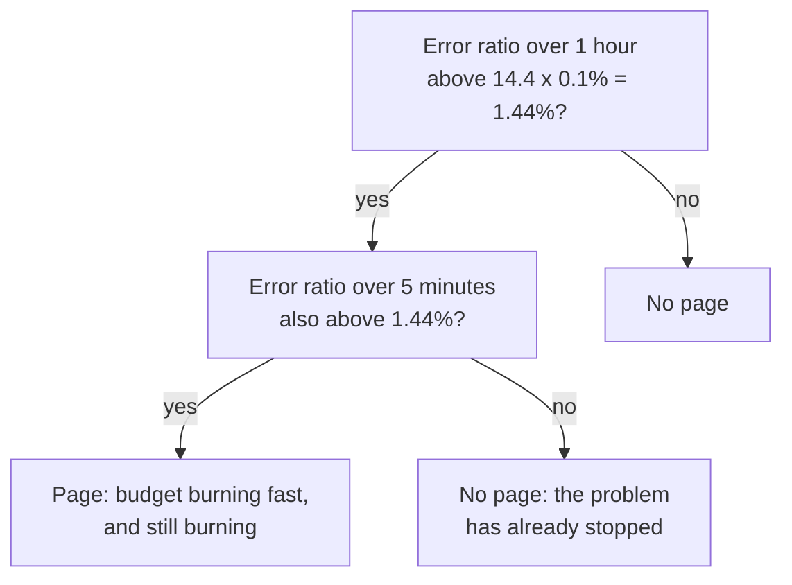

# SLOs and error budgets

> **Status: AI draft, 2026-11-16.** Not yet verified by me. Written from the Google SRE book and workbook; the arithmetic is worked out on this page, and the burn-rate thresholds are the workbook's recommended starting points.

## In one line

An SLI measures the share of good events, an SLO sets its target (99.9% over 30 days), and the error budget is what may fail (about 43 minutes of full outage a month). Alert on how fast the budget burns, and let the remaining budget set the release pace.

## The plain idea

"Always up" is impossible and not even desirable: every extra nine costs more and slows change. So agree on how reliable is reliable enough, measure it the way users experience it, and treat the gap between 100% and the target as a **budget** to spend: on releases, experiments and planned maintenance. When the budget is gone, slow down and fix reliability. When plenty is left, ship faster.

## How it works

### SLI, SLO, SLA

| Term | Meaning | Example |
|---|---|---|
| **SLI** (indicator) | A measurement: good events divided by valid events | Proportion of HTTP requests that returned non-5xx within 300 ms |
| **SLO** (objective) | The target for the SLI over a window | 99.9% over a rolling 30 days |
| **SLA** (agreement) | A contract with consequences (credits) if missed | 99.5% monthly, with refunds |

The SLA should be looser than the SLO, so you notice and react before you owe anyone money.

### Choosing SLIs

- **Availability**: `good = requests not 5xx`, `valid = all requests` (perhaps excluding health checks).
- **Latency**: `good = requests faster than a threshold`, measured from a histogram bucket ([PromQL](promql.md)).
- Measure as close to the user as practical: the load balancer or ingress logs and metrics see failures the app itself never logs.
- Few SLIs per service, for the journeys users care about (log in, browse, pay).

### Error budget arithmetic

For an SLO of 99.9% over 30 days:

- Error budget = 100% − 99.9% = **0.1%**.
- Time-based: 30 days × 24 h × 60 min = 43,200 minutes; 0.1% of that is **43.2 minutes** of total outage.
- Request-based: with 10 million requests in 30 days, **10,000** may fail.
- A 20-minute full outage uses 20 / 43.2, about **46%** of the month's budget. A partial outage that fails 5% of requests for 2 hours uses the same as 6 minutes of full outage.

### Burn rate

The **burn rate** is how fast the budget is being spent relative to the SLO: burn rate 1 spends exactly the whole budget over the window; burn rate 2 spends it in half the window.

Error ratio threshold for a burn rate = burn rate × (1 − SLO). For a 99.9% SLO, burn rate 14.4 means an error ratio above 1.44%.

The SRE workbook's recommended starting points for a 30-day window:

| Budget consumed | In | Burn rate | Action |
|---|---|---|---|
| 2% | 1 hour | 14.4 | Page |
| 5% | 6 hours | 6 | Page |
| 10% | 3 days | 1 | Ticket |

Check: 14.4 × 1 h / 720 h = 2%; 6 × 6 h / 720 h = 5%; 1 × 72 h / 720 h = 10%.

### Multi-window alerts

A long window alone keeps firing long after a problem ends; a short window alone is noisy. Require both: the long window shows significant budget spent, the short window (about 1/12 of the long one, per the workbook) shows it is still happening.



```yaml
- alert: SampleAppErrorBudgetFastBurn
  expr: |
    (
      sum(rate(http_requests_total{job="sample-app",status_class="5xx"}[1h]))
      / sum(rate(http_requests_total{job="sample-app"}[1h])) > (14.4 * 0.001)
    )
    and
    (
      sum(rate(http_requests_total{job="sample-app",status_class="5xx"}[5m]))
      / sum(rate(http_requests_total{job="sample-app"}[5m])) > (14.4 * 0.001)
    )
  labels:
    severity: page
```

### Using the budget

An **error budget policy**, agreed in advance between product and engineering:

- Budget healthy: normal release pace, experiments allowed.
- Budget nearly spent: only low-risk changes, extra review.
- Budget exhausted: freeze feature releases for the service; reliability work first, until the window recovers.

## A concrete example

`sample-app` checkout API:

1. SLI: checkout requests at the ALB that return non-5xx in under 500 ms.
2. SLO: 99.9% over 30 rolling days. Budget: 43.2 minutes, or 0.1% of requests.
3. Alerts: fast burn (1 h and 5 m windows, burn 14.4) and medium burn (6 h and 30 m, burn 6) page; slow burn (3 d and 6 h, burn 1) opens a ticket.
4. In week two a bad release fails 10% of checkouts for 15 minutes: that is the same as 1.5 minutes of full outage, about 3.5% of the budget. The fast-burn alert pages within minutes; the team rolls back.
5. At the month's review 60% of the budget remains, so the team keeps its release pace.

## Why not just...?

- **...aim for 100%?** Impossible in practice, and the cost of each extra nine rises steeply while users often cannot tell the difference. 100% also leaves no room to change anything.
- **...measure uptime by pinging the health endpoint?** A health check can pass while real requests fail or crawl. Measure real user requests.
- **...page on "error ratio above 0.1%"?** That fires on every tiny spike, because 0.1% is the long-term average you allow. Page on burn rate over windows.

## Commands to know

| Query or tool | What it does |
|---|---|
| `1 - (sum(rate(http_requests_total{status_class="5xx"}[30d])) / sum(rate(http_requests_total[30d])))` | Availability SLI over 30 days (prefer a recording rule) |
| `sum(rate(http_request_duration_seconds_bucket{le="0.5"}[30d])) / sum(rate(http_request_duration_seconds_count[30d]))` | Latency SLI: share of requests under 500 ms (needs a bucket at 0.5) |
| `1 - ((1 - <SLI>) / 0.001)` | Remaining budget fraction for a 99.9% SLO |
| `python3 -c "print(30*24*60*0.001)"` | Budget minutes for 99.9% over 30 days |

## How it breaks

| Symptom | Layer | Check | Likely cause |
|---|---|---|---|
| SLO met, users unhappy | SLI choice | What the SLI measures | Measuring the wrong thing (health checks, server-side only), or the wrong journey |
| Budget alerts page constantly | Thresholds | Burn rates and windows | Using the raw SLO as threshold, or one short window |
| Budget never spent, releases still slow | Policy | How the budget is used | No error budget policy; reliability work not traded against features |
| Latency SLI cannot be computed | Instrumentation | Histogram buckets | No bucket at the threshold |
| Outage not reflected in SLI | Measurement point | Where the metric comes from | App down, so it reports nothing; measure at the load balancer |

## Interview questions

**1. What are SLI, SLO and SLA?**

<details markdown="1">
<summary>Answer</summary>

- SLI: a measured ratio of good to valid events.
- SLO: the target for it over a window.
- SLA: a contract with consequences; looser than the SLO.

</details>

**2. What is the error budget for 99.9% over 30 days?**

<details markdown="1">
<summary>Answer</summary>

- 0.1% of requests, or 43.2 minutes of full outage (43,200 minutes × 0.001).
- Partial failures spend it proportionally.
- It is spent on releases, experiments and incidents.

</details>

**3. What is a burn rate and why alert on it?**

<details markdown="1">
<summary>Answer</summary>

- How fast the budget is being consumed relative to the SLO; 1 means exactly on budget.
- Alerting on burn rate ties pages to real budget impact, not to every blip.
- For example burn rate 14.4 for an hour consumes 2% of a 30-day budget.

</details>

**4. Why use multi-window burn-rate alerts?**

<details markdown="1">
<summary>Answer</summary>

- The long window confirms significant budget spend; the short window confirms it is still happening.
- Fewer false positives and faster reset after recovery.
- The workbook suggests the short window at about 1/12 of the long one.

</details>

**5. How would you choose SLIs for an API?**

<details markdown="1">
<summary>Answer</summary>

- Availability (non-5xx) and latency (under a threshold) for the main user journeys.
- Measured at the edge (load balancer or ingress) where possible.
- Few, understandable, agreed with product owners.

</details>

**6. The error budget is exhausted halfway through the month. What happens?**

<details markdown="1">
<summary>Answer</summary>

- Per the error budget policy: slow or freeze feature releases for that service.
- Prioritise fixes for the causes of the spend; postmortems for the big incidents.
- Resume normal pace as the rolling window recovers.

</details>

## Try it

1. Compute the error budget in minutes for 99.5%, 99.9% and 99.99% over 30 days.
2. For a 99.5% SLO, what error ratio corresponds to a burn rate of 14.4? (Answer: 14.4 × 0.5% = 7.2%.)
3. Write the slow-burn ticket alert for `sample-app` using the 3-day and 6-hour windows.

## Zoom out

SLOs connect observability to decisions: what to alert on, how fast to release, and when to invest in reliability ([Alerting and Alertmanager](alerting.md), [Deployment strategies](../cicd/deployment-strategies.md), [Incident response](../operations/incident-response.md)).

## Sources

- [Google SRE book: service level objectives](https://sre.google/sre-book/service-level-objectives/)
- [Google SRE workbook: implementing SLOs](https://sre.google/workbook/implementing-slos/)
- [Google SRE workbook: alerting on SLOs (burn rates, multi-window)](https://sre.google/workbook/alerting-on-slos/)
- [Google SRE workbook: error budget policy](https://sre.google/workbook/error-budget-policy/)
