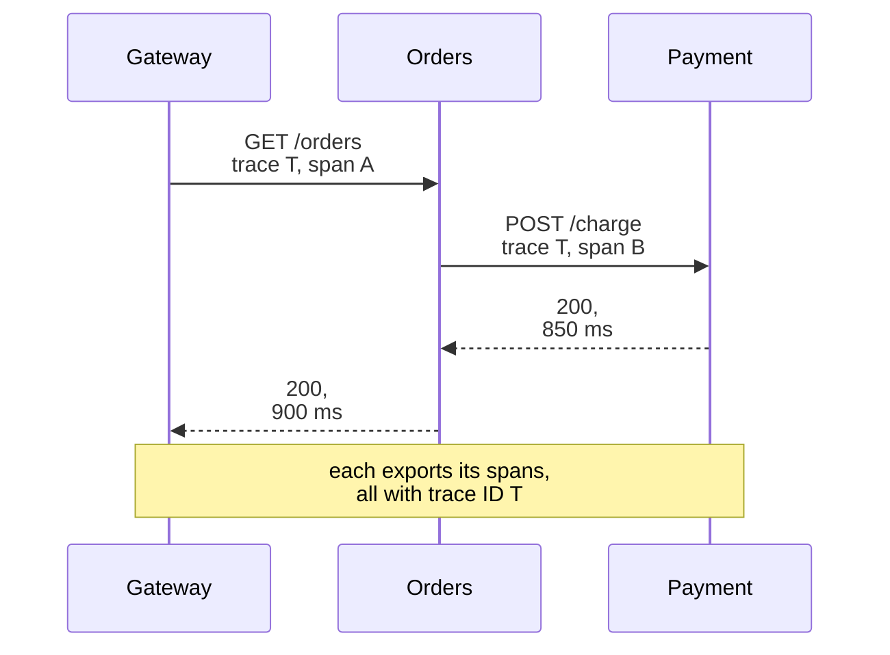

# Tracing and OpenTelemetry

> **Status: AI draft, 2026-11-16.** Not yet verified by me. Written from the W3C Trace Context specification and the OpenTelemetry and Istio documentation; nothing was run.

## In one line

A trace is the tree of spans (timed operations) one request creates across services, joined by a trace ID passed in the `traceparent` header; OpenTelemetry SDKs create and propagate spans, the Collector receives, processes, samples and exports them, and traces become most useful when logs and metrics carry the same trace ID.

## How it works

| Concept | Meaning |
|---|---|
| **Trace** | Everything one request did, identified by a 16-byte trace ID |
| **Span** | One operation: name, start, duration, status, attributes, parent span ID |
| **Context propagation** | Passing the trace ID and current span ID to the next service, in the W3C `traceparent` header: `version-traceid-parentid-flags`, such as `00-<32 hex>-<16 hex>-01` |
| **Sampling** | Keeping only some traces: **head** sampling decides at the start (cheap, may miss rare errors); **tail** sampling decides after the trace is complete (keep all errors and slow traces), done in the Collector |

**OpenTelemetry (OTel)** is the vendor-neutral standard:

- **SDKs and auto-instrumentation** in each language create spans for incoming and outgoing requests and propagate context.
- The **Collector** runs as an agent (DaemonSet) or gateway (Deployment): **receivers** (OTLP and others) take data in, **processors** batch, filter, add Kubernetes attributes and sample, **exporters** send to a backend (Jaeger, Tempo, X-Ray, vendors).
- One protocol, OTLP, for traces, metrics and logs.

**Where a mesh helps, and where it does not**: Istio's sidecars (or Envoy proxies) emit spans for every hop automatically, but the documentation is clear that applications must still copy the trace headers from incoming to outgoing requests; otherwise each hop is a separate trace ([Sidecars and traffic flow](../mesh/sidecars-and-traffic-flow.md)).

**Using traces with metrics and logs**: an alert fires on a metric; an exemplar or a filtered trace search shows slow requests; the trace shows the slow span; the logs of that service, filtered by trace ID, show the error ([Signals and methods](signals-and-methods.md)). That only works if logs include the trace ID ([How Kubernetes logging works](kubernetes-logging.md)).

## Interview questions

**1. What are a trace and a span?**

Answer

- A trace is one request's full path across services, identified by a trace ID.
- A span is one timed operation in it, with a parent, attributes and status.
- The spans form a tree showing where time went.

**2. How does context propagate between services?**

Answer

- Each outgoing request carries the trace ID and current span ID, in the W3C `traceparent` header.
- The next service continues the trace with a child span.
- If any service drops the header, the trace breaks into pieces.

**3. Head vs tail sampling?**

Answer

- Head: decide at the start of the request, cheap, but rare errors may be dropped.
- Tail: decide after the trace completes, so errors and slow traces can always be kept; needs a Collector holding spans.
- Many setups combine a base head rate with tail rules.

**4. What does the OpenTelemetry Collector do?**

Answer

- Receives telemetry (OTLP and other formats), processes it (batching, Kubernetes attributes, filtering, sampling), and exports it to backends.
- Decouples applications from the backend choice.
- Runs as a node agent, a central gateway, or both.

**5. With Istio installed, why might traces still be broken?**

Answer

- Sidecars create spans per hop but cannot link an incoming request to the outgoing calls the app makes.
- The application must copy the trace headers from incoming to outgoing requests.
- OTel SDKs or instrumentation libraries do this automatically.

## Sources

- [W3C: Trace Context](https://www.w3.org/TR/trace-context/)
- [OpenTelemetry: traces](https://opentelemetry.io/docs/concepts/signals/traces/)
- [OpenTelemetry: context propagation](https://opentelemetry.io/docs/concepts/context-propagation/)
- [OpenTelemetry: sampling](https://opentelemetry.io/docs/concepts/sampling/)
- [OpenTelemetry: Collector](https://opentelemetry.io/docs/collector/)
- [Istio: distributed tracing overview](https://istio.io/latest/docs/tasks/observability/distributed-tracing/overview/)
