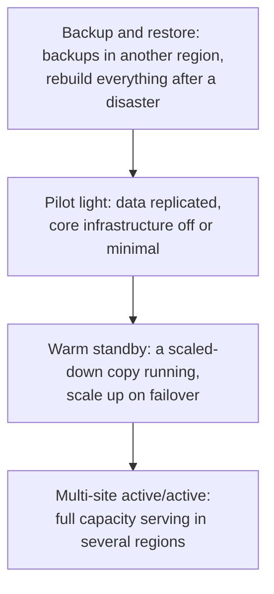

# Backup and disaster recovery

> **Status: AI draft, 2026-11-16.** Not yet verified by me. Written from the AWS disaster recovery whitepaper, AWS Backup and Velero documentation; nothing was run.

## In one line

RPO is how much data you can lose and RTO how long you can be down; the DR strategies (backup and restore, pilot light, warm standby, active/active) trade cost for lower RPO and RTO. Replication also copies corruption, so keep isolated point-in-time backups and test restores.

## The plain idea

High availability handles the failures you expect (an instance, a zone) by having spare copies running ([High availability and failure domains](high-availability.md)). Disaster recovery handles the rest: a region-wide outage, a deleted database, ransomware, a bad migration that corrupted data, an account compromised. For those, running copies are not enough; you need **copies from the past**, stored somewhere the disaster cannot reach, and a practised way to come back.

Two numbers frame every decision:

- **RPO** (recovery point objective): how far back in time you may land. "We can lose at most 15 minutes of orders."
- **RTO** (recovery time objective): how long until service is back. "Checkout must work again within an hour."

## How it works

### The four strategies

| Strategy | Recovery region holds | RPO and RTO | Cost |
|---|---|---|---|
| **Backup and restore** | Backups only; infrastructure defined as code | Longest of the four | Lowest |
| **Pilot light** | Replicated data, core services provisioned but switched off or minimal | Shorter | Low to medium |
| **Warm standby** | A smaller, fully working copy | Shorter still | Medium to high |
| **Multi-site active/active** | Full production serving traffic | Shortest | Highest |

The AWS whitepaper notes that for a well-architected, highly available workload, losing one data centre may only need backup and restore, and that region-level or regulatory needs push towards the other three. It also recommends relying on data plane operations (which keep working during control plane trouble) for failover.

### Replication is not a backup

Continuous replication (database replicas, S3 cross-region replication) gives a low RPO against losing a site, but a `DROP TABLE`, a corrupting bug or malicious deletion is replicated within seconds. Point-in-time backups protect against those. You need both.

### Backups: the questions

| Question | Good answer |
|---|---|
| What? | Databases, volumes, object stores, and configuration not in Git (secrets in the store, DNS, IAM) |
| How often? | Driven by RPO: continuous or point-in-time for databases, daily for the rest |
| Where? | Another account and another region, so one compromise or regional event does not take the backups too |
| How long? | Per data class and regulation: daily for weeks, monthly for longer |
| Protected how? | Encrypted, immutable (vault lock or object lock), access separated from production admins |
| Tested how? | Regular automated restores with checks that the data is usable |

**AWS Backup** centralises this: backup plans (schedules and retention), vaults, cross-account and cross-region copies, vault lock for immutability, and restore testing.

### Kubernetes: what Git restores, and what it does not

| Restored from Git (GitOps) | Not in Git |
|---|---|
| Deployments, Services, config, Helm releases, Argo CD Applications | Data on persistent volumes |
| Policies, RBAC, CRDs | Secret values (only references are in Git) |
| Cluster add-ons | Objects created at runtime by operators or users |

So: rebuild the cluster from IaC and GitOps, restore volumes from snapshots (or the database from its own backups), and make sure the secret store is backed up and reachable. Velero backs up Kubernetes objects and volume snapshots per namespace, which helps for stateful workloads and migrations ([etcd, backups and cluster upgrades](../kubernetes/etcd-backups-and-upgrades.md), [GitOps principles](../gitops/principles.md)).

### Restore drills

An untested backup is a hope. On a schedule:

1. Restore into an isolated environment.
2. Check the data: row counts, latest timestamps, application smoke test.
3. Measure how long it took; compare with RTO; compare the restore point with RPO.
4. Fix what was missing (a key, a permission, an undocumented step), and update the runbook.

### A DR runbook contains

- Who declares a disaster and who leads ([Incident response and postmortems](incident-response.md)).
- The order of recovery: network, identity, data stores, then services by business priority.
- Exact commands or automation for each step, with checks.
- Where backups and credentials are, and how to reach them if the primary account or region is unavailable.
- How to fail back afterwards.

## A concrete example

`sample-app`, with RPO 15 minutes and RTO 4 hours for a regional disaster:

1. Aurora with point-in-time recovery, plus snapshots copied to a second region and a separate backup account via AWS Backup with vault lock.
2. S3 uploads replicated to the second region, with versioning and object lock for protection against deletion.
3. Infrastructure in Terraform and the cluster in GitOps, able to build a new environment in the second region (backup and restore with fast rebuild, close to pilot light).
4. Quarterly drill: build the stack in the second region, restore the latest snapshot, run smoke tests; the last drill took 2 hours 40 minutes.

## Why not just...?

- **...rely on multi-AZ and replicas?** They protect against infrastructure failure, not against deletion, corruption or a compromised account, all of which are replicated instantly.
- **...keep backups in the same account?** Whoever can delete production can delete the backups. Separate account, separate permissions, immutability.
- **...choose active/active for everything?** It is the most expensive and complex option, with data consistency challenges. Match the strategy to each service's RPO and RTO.

## Commands to know

| Command | What it does |
|---|---|
| `aws backup list-backup-plans` | Backup plans in the account. |
| `aws backup list-recovery-points-by-backup-vault --backup-vault-name <vault>` | Available restore points. |
| `aws backup start-restore-job ...` | Restore a recovery point. |
| `aws rds restore-db-cluster-to-point-in-time ...` | Point-in-time restore for Aurora ([RDS and Aurora](../aws-services/rds-and-aurora.md)). |
| `velero backup create team-a --include-namespaces team-a` | Back up a namespace's objects and volumes (with Velero installed). |
| `velero restore create --from-backup team-a` | Restore it. |

## How it breaks

| Symptom | Layer | Check | Likely cause |
|---|---|---|---|
| Restore fails during a real incident | Testing | Last drill | Never tested; missing keys, permissions or steps |
| Backups deleted along with production | Isolation | Backup account and locks | Same account and admin role; no vault or object lock |
| Restored data is older than expected | RPO | Backup schedule | Schedule does not match the RPO |
| Restore takes days | RTO | Restore drill timings | Large data, single-threaded restore, manual steps |
| Corrupted data in every copy | Replication | Point-in-time backups | Relied on replication only |

## Interview questions

**1. What are RPO and RTO?**

Answer

- RPO: maximum acceptable data loss, measured in time.
- RTO: maximum acceptable time to restore service.
- Both drive the backup frequency and the DR strategy, and their cost.

**2. Describe the four DR strategies on AWS.**

Answer

- Backup and restore: cheapest, slowest; rebuild from code and backups.
- Pilot light: data replicated, minimal core infrastructure ready.
- Warm standby: a scaled-down working copy; multi-site active/active: full capacity in several regions, fastest and most expensive.

**3. Why is replication not a backup?**

Answer

- Replication copies every change, including deletions and corruption, almost instantly.
- Point-in-time backups let you go back to before the bad change.
- You need both, with backups isolated from production credentials.

**4. If you run everything with GitOps, what still needs backing up?**

Answer

- Persistent data: volumes, databases, object stores.
- Secret values in the secret store; runtime state created outside Git.
- The Git repositories and the IaC state themselves.

**5. How do you know your backups work?**

Answer

- Regular restore drills into an isolated environment, with data checks and smoke tests.
- Measure restore time against RTO and the restore point against RPO.
- Automate the drill where possible (AWS Backup restore testing).

**6. Design backups for a production database with a 15-minute RPO.**

Answer

- Point-in-time recovery (continuous log backups) plus daily snapshots.
- Copies to another region and a separate account, encrypted and immutable.
- Monthly restore drills, with the restore time recorded.

## Try it

1. For two services you know, write their RPO and RTO and pick a DR strategy for each.
2. List everything a full rebuild of one of your environments would need that is not in Git.
3. Write the first page of a DR runbook: who declares, who leads, and the first five steps.

## Zoom out

Backup and DR cover what redundancy cannot: time travel and region loss ([High availability and failure domains](high-availability.md)). They connect to IaC and GitOps (rebuild), storage and databases (data), and incident response (who decides) ([Terraform workflow](../iac/terraform-workflow.md), [Incident response and postmortems](incident-response.md)).

## Sources

- [AWS whitepaper: disaster recovery options in the cloud](https://docs.aws.amazon.com/whitepapers/latest/disaster-recovery-workloads-on-aws/disaster-recovery-options-in-the-cloud.html)
- [AWS whitepaper: business continuity plan, RTO and RPO](https://docs.aws.amazon.com/whitepapers/latest/disaster-recovery-workloads-on-aws/business-continuity-plan-bcp.html)
- [AWS Backup Developer Guide: what is AWS Backup](https://docs.aws.amazon.com/aws-backup/latest/devguide/whatisbackup.html)
- [AWS Backup Developer Guide: vault lock](https://docs.aws.amazon.com/aws-backup/latest/devguide/vault-lock.html)
- [AWS Backup Developer Guide: restore testing](https://docs.aws.amazon.com/aws-backup/latest/devguide/restore-testing.html)
- [Velero documentation](https://velero.io/docs/v1.19/)
