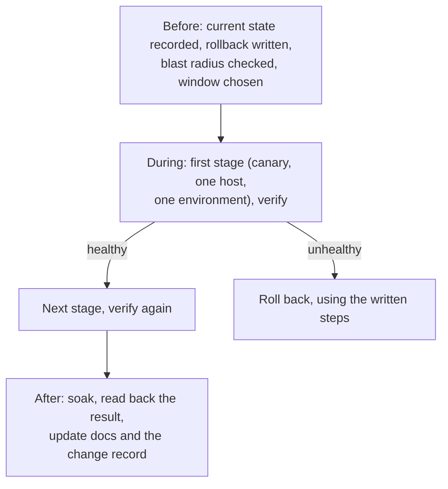

# Change management

> **Status: AI draft, 2026-11-16.** Not yet verified by me. Written from the Google SRE book and the AWS Well-Architected operational excellence pillar; general practice, no commands.

## In one line

Most outages follow a change, so make changes small, reversible and observable: record the current state, write the rollback and check the blast radius before; roll out in stages and verify each one during; soak, confirm and document after. Review in proportion to risk.

## How it works

The Google SRE book reports that roughly 70% of outages are due to changes in a live system, and names three practices that limit the damage: progressive rollouts, quick and accurate detection of problems, and safe rollback. AWS's operational excellence design principles say the same in other words: make frequent, small, reversible changes.

**Before**

- Record the current state (configuration, versions, counts) so you can compare and restore.
- Write the rollback steps before the first command, and know how long they take. If you cannot roll back, say so explicitly and plan more carefully.
- Check the blast radius: what exactly will this touch? List the objects a selector or a plan affects ([Reading a plan](../iac/reading-a-plan.md), [Labels, selectors and namespaces](../kubernetes/labels-selectors-namespaces.md)).
- Pick a window when people are available and traffic is lower, and avoid stacking several changes at once.

**During**

- Stage the rollout: one canary, one host, one zone, one environment, then more ([Deployment strategies](../cicd/deployment-strategies.md)).
- Verify after each step against the signals that matter (error rate, latency, the specific function changed).
- Stop at the first unexpected result; do not "push through".

**After**

- Let it soak long enough for slow problems (memory leaks, daily jobs) to appear.
- Read back the result: the actual configuration, not what the command said it did.
- Update runbooks and the change record; tell the people who need to know.

**Reversible steps first**: order work so the early steps are easy to undo (add before remove, expand before contract, deploy dark before enabling). The irreversible step comes last, once everything else is proven ([Migration patterns](migration-patterns.md)).

**Review in proportion to risk**: a typo fix needs a quick review; a database engine change needs a written plan, a rehearsal and an approver. Automated changes through reviewed pipelines (GitOps, Terraform plans) carry their own evidence ([GitOps principles](../gitops/principles.md)).

## Interview questions

**1. Why do changes cause most incidents, and what reduces the risk?**

Answer

- Systems are stable until something changes; the SRE book attributes roughly 70% of outages to changes.
- Progressive rollouts, fast detection and safe rollback limit the damage.
- Small, frequent, reversible changes keep each one easy to understand and undo.

**2. What do you do before making a risky production change?**

Answer

- Record the current state and write the rollback steps.
- Check exactly what the change touches; rehearse in a lower environment.
- Choose a window, tell the people affected, and have monitoring open.

**3. What does "reversible steps first" mean?**

Answer

- Order the work so early steps can be undone easily: add before removing, expand before contracting.
- Leave irreversible steps (deleting old data, decommissioning) to the end, after verification.
- Each stage leaves a safe stopping point.

**4. How much review should a change get?**

Answer

- In proportion to risk and reversibility, not one process for everything.
- Low-risk changes through automated, reviewed pipelines; high-risk ones with a written plan, rehearsal and approval.
- Too much process for small changes pushes people to batch changes, which is riskier.

**5. A change went wrong halfway through. What now?**

Answer

- Stop, assess impact, and follow the written rollback, or declare an incident if users are affected ([Incident response and postmortems](incident-response.md)).
- Do not improvise further changes under pressure without coordination.
- Afterwards, review why the plan missed it.

## Sources

- [Google SRE book: introduction (change management)](https://sre.google/sre-book/introduction/)
- [AWS Well-Architected: operational excellence design principles](https://docs.aws.amazon.com/wellarchitected/latest/framework/oe-design-principles.html)
