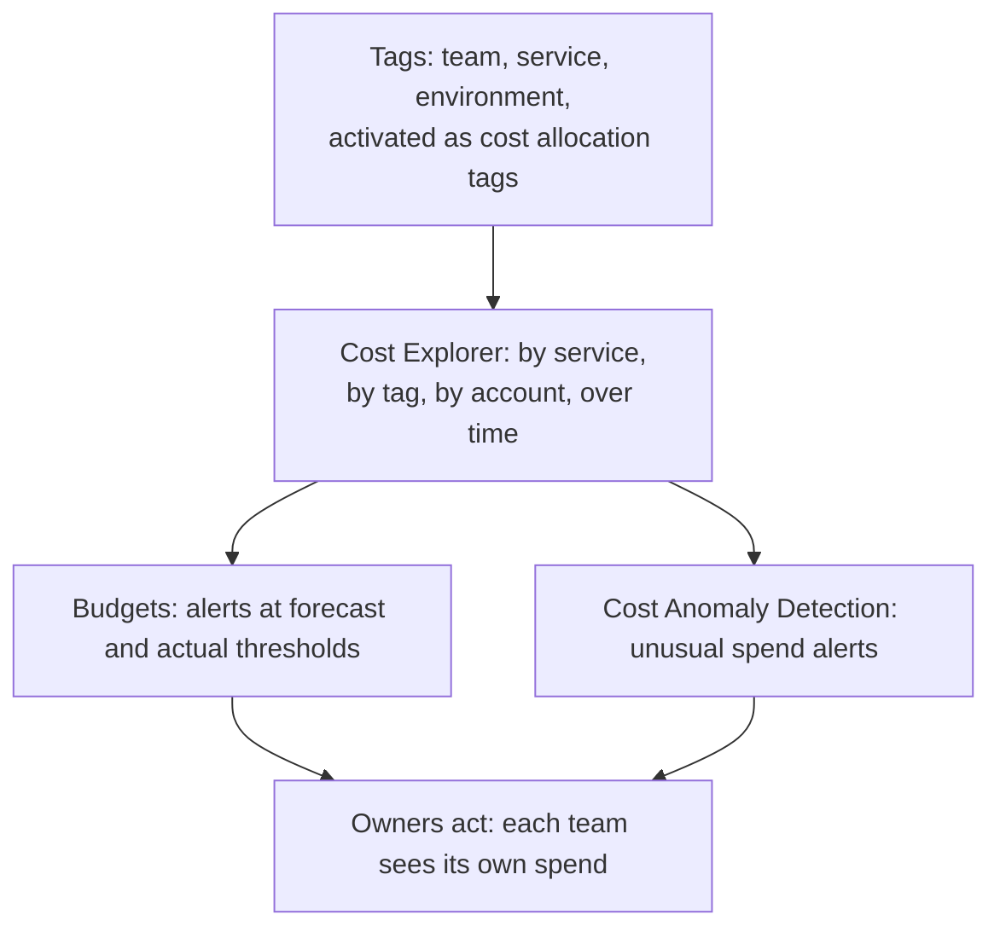

# Cost optimisation

> **Status: AI draft, 2026-11-16.** Not yet verified by me. Written from the AWS cost management, Savings Plans and Well-Architected documentation. No prices are quoted: they change and differ by region, so follow the pricing links.

## In one line

Find where the money goes before cutting anything (tags, Cost Explorer, budgets, anomaly alerts), then remove waste (idle and oversized resources, unneeded NAT and data transfer, forgotten storage and logs), match purchase options to usage (Spot for interruptible work, Savings Plans or reservations for the steady base), and in Kubernetes close the gap between requested and used capacity.

## The plain idea

Cloud bills grow quietly: every experiment leaves something running, every service is sized for a peak that rarely comes, every log line is stored forever. Cost optimisation is ordinary engineering hygiene applied to money: measure, find the biggest waste, fix it, and make the fix stick through defaults and automation. The cheapest resource is the one you turned off.

## How it works

### Where the money usually goes on AWS

| Area | Typical waste |
|---|---|
| Compute (EC2, EKS nodes, Fargate) | Oversized instances, idle environments running nights and weekends, low cluster utilisation |
| Storage (EBS, S3, snapshots) | Unattached volumes, old snapshots, data never moved to cheaper storage classes |
| Data transfer | Cross-AZ chatter, traffic to the internet, traffic through NAT gateways that could use VPC endpoints |
| NAT gateways | Per-hour charges plus per-GB processing; pulling images and calling AWS APIs through NAT ([NAT, endpoints and PrivateLink](../aws-core/nat-endpoints-privatelink.md)) |
| Public IPv4 addresses | AWS charges for public IPv4 addresses; unused Elastic IPs and public IPs on instances that do not need them |
| Load balancers | Idle ALBs and NLBs left behind by old services or one Ingress per app ([AWS Load Balancer Controller](../eks/load-balancer-controller.md)) |
| Logs and metrics | Everything at debug level, kept forever, high-cardinality metrics ([Signals and methods](../observability/signals-and-methods.md)) |

### Visibility first

- Tag everything at creation (enforced by IaC modules and policies), and activate the tags for cost allocation.
- Separate accounts per environment or team make ownership obvious ([Organizations, SCPs and multi-account](../aws-core/organizations-and-scps.md)).
- Every lab account gets a budget with an alert, from day one.

### Right-sizing from real usage

- Look at actual CPU, memory and network over weeks, including peaks; Compute Optimizer gives recommendations.
- Downsize, move to newer instance generations, or to Graviton (Arm) where software allows.
- Schedule non-production environments to stop outside working hours.

### Purchase options

| Option | What it is | Fits |
|---|---|---|
| **On-Demand** | Pay per use, no commitment | Spiky, new or short-lived workloads |
| **Spot** | Spare capacity at a discount, can be reclaimed with a two-minute warning | Stateless, fault-tolerant, batch, CI runners, most Kubernetes app nodes with diversification ([Karpenter in depth](../eks/karpenter.md)) |
| **Savings Plans** | Commit to a spend per hour for one or three years, applied automatically (Compute Savings Plans cover EC2, Fargate and Lambda) | The steady base you will run anyway |
| **Reserved Instances** | Commit to specific instance configurations (also used for databases and caches) | Stable, predictable databases and caches |

Commit only to the baseline you are sure about; cover peaks with On-Demand and Spot.

### Kubernetes

- You pay for **nodes**, sized by **requests**, not by usage. Requests far above real usage waste whole nodes ([Requests, limits and QoS](../kubernetes/resources-and-qos.md)).
- Right-size requests from usage (VPA in recommendation mode, or metrics) ([Autoscaling](../kubernetes/autoscaling.md)).
- Bin-packing and consolidation: Karpenter replaces underused nodes; Cluster Autoscaler removes nodes below its utilisation threshold ([Cluster Autoscaler vs Karpenter](../eks/cluster-autoscaler-vs-karpenter.md)).
- Spot for stateless workloads, with PDBs and multiple replicas.
- Share load balancers (IngressGroups, Gateway API) instead of one per service.

### Storage lifecycle

- S3 lifecycle rules: move objects to infrequent-access or archive classes after N days, expire old versions and incomplete multipart uploads ([S3](../aws-services/s3.md)).
- Delete unattached EBS volumes and old snapshots, with a retention policy; gp3 instead of gp2 where it fits ([EBS](../aws-services/ebs.md)).

### Data transfer and logging

- Gateway VPC endpoints for S3 and DynamoDB, and interface endpoints for heavily used services (ECR, STS), to keep traffic off NAT gateways.
- Keep chatty services in the same zone where availability allows; avoid unnecessary cross-region traffic.
- Log retention per log group; drop debug logs in production; sample traces; watch metric cardinality ([CloudWatch](../aws-services/cloudwatch.md)).

## A concrete example

A monthly review of a team's account:

1. Cost Explorer by tag: 40% of spend is EKS nodes, 15% NAT gateways, 10% CloudWatch Logs.
2. Nodes: requests total twice the measured usage. Right-size requests on the ten largest Deployments, enable Karpenter consolidation and Spot for stateless pools.
3. NAT: most traffic is image pulls and S3. Add an S3 gateway endpoint and an ECR interface endpoint.
4. Logs: two services log at debug; set them to info and set 30-day retention on all log groups.
5. The steady base after these changes is covered with a Compute Savings Plan; budgets and anomaly alerts watch for regressions.

## Why not just...?

- **...buy Savings Plans first?** Committing before removing waste locks in paying for waste for years. Clean up, measure the new baseline, then commit.
- **...put everything on Spot?** Stateful or interruption-sensitive workloads suffer. Use Spot where the workload tolerates interruptions, with diversification.
- **...cut redundancy to save money?** A cheaper single-zone setup can cost far more in one outage. Optimise waste, not resilience ([High availability and failure domains](high-availability.md)).

## Commands to know

| Command | What it does |
|---|---|
| `aws ce get-cost-and-usage --time-period Start=<date>,End=<date> --granularity MONTHLY --metrics UnblendedCost --group-by Type=DIMENSION,Key=SERVICE` | Spend by service. |
| `aws budgets describe-budgets --account-id 123456789012` | Budgets and their thresholds. |
| `aws ec2 describe-volumes --filters Name=status,Values=available` | Unattached EBS volumes. |
| `aws ec2 describe-addresses --query 'Addresses[?AssociationId==null]'` | Elastic IPs not attached to anything. |
| `kubectl top pods -A` compared with `kubectl get pods -A -o jsonpath=...requests...` | Usage vs requests. |
| `aws logs describe-log-groups --query 'logGroups[?!retentionInDays].logGroupName'` | Log groups that keep data forever. |

## How it breaks

| Symptom | Layer | Check | Likely cause |
|---|---|---|---|
| Bill jumped overnight | Anomaly | Cost Explorer by service and day | A new resource, a runaway job, a logging loop, traffic through NAT |
| NAT gateway costs high | Data path | VPC flow logs, endpoints | AWS and image traffic not using VPC endpoints |
| Cluster cost high, nodes "full" | Requests | Requests vs usage | Over-requested pods |
| Savings Plan unused | Commitment | Utilisation report | Committed above the real baseline |
| Nobody owns the cost | Attribution | Tag coverage | Missing tags; shared accounts |

## Interview questions

**1. How would you start reducing an AWS bill?**

Answer

- Visibility: cost allocation tags, Cost Explorer by service and tag, budgets and anomaly alerts.
- Remove waste first: idle and oversized resources, unattached storage, unnecessary NAT traffic, log retention.
- Then commit (Savings Plans) to the cleaned-up baseline.

**2. Compare On-Demand, Spot, Savings Plans and Reserved Instances.**

Answer

- On-Demand: flexible, no commitment.
- Spot: large discount, can be reclaimed with two minutes' warning; for interruptible work.
- Savings Plans and Reserved Instances: discounts for one- or three-year commitments; Savings Plans by spend, RIs by configuration.

**3. Why can a Kubernetes cluster be expensive even when nodes look full?**

Answer

- Nodes fill up with requests, not usage; over-requested pods waste capacity.
- Right-size requests from measured usage and enable consolidation.
- Use Spot for stateless workloads, and share load balancers.

**4. How do NAT gateways become a large cost, and what do you do?**

Answer

- They charge per hour and per GB processed; image pulls and AWS API calls from private subnets flow through them.
- Add gateway endpoints for S3 and DynamoDB and interface endpoints for heavy services like ECR.
- Check flow logs for the biggest talkers.

**5. How do you keep costs under control without slowing teams?**

Answer

- Safe defaults in templates (tags, lifecycle rules, log retention, sensible instance families).
- Per-team visibility and budgets with alerts.
- Automated clean-up of idle resources and scheduled shutdown of non-production.

**6. What would you not cut to save money?**

Answer

- Redundancy needed for availability targets, backups, security logging.
- These cost little compared with an outage, data loss or an undetected breach.
- Optimise waste, not resilience.

## Try it

1. In any AWS account you own (a lab), create a monthly budget with an alert; this is required for every lab in these notes.
2. List the resources in one of your environments that would still run if nobody used it for a weekend.
3. For one Deployment, compare its requests with a week of usage, and propose new requests.

## Zoom out

Cost is a non-functional requirement like availability and security, best handled by defaults, visibility and ownership rather than occasional clean-up drives ([CloudWatch](../aws-services/cloudwatch.md), [Karpenter in depth](../eks/karpenter.md)). The AWS Well-Architected cost optimisation pillar organises the same ideas.

## Sources

- [AWS Cost Explorer](https://docs.aws.amazon.com/cost-management/latest/userguide/ce-what-is.html)
- [AWS Budgets](https://docs.aws.amazon.com/cost-management/latest/userguide/budgets-managing-costs.html)
- [AWS Cost Anomaly Detection](https://docs.aws.amazon.com/cost-management/latest/userguide/manage-ad.html)
- [AWS Billing: cost allocation tags](https://docs.aws.amazon.com/awsaccountbilling/latest/aboutv2/cost-alloc-tags.html)
- [Savings Plans User Guide](https://docs.aws.amazon.com/savingsplans/latest/userguide/what-is-savings-plans.html)
- [Amazon EC2 User Guide: Spot Instances](https://docs.aws.amazon.com/AWSEC2/latest/UserGuide/using-spot-instances.html)
- [AWS Compute Optimizer](https://docs.aws.amazon.com/compute-optimizer/latest/ug/what-is-compute-optimizer.html)
- [Amazon S3 User Guide: lifecycle management](https://docs.aws.amazon.com/AmazonS3/latest/userguide/object-lifecycle-mgmt.html)
- [Amazon VPC pricing (NAT gateways, public IPv4 addresses)](https://aws.amazon.com/vpc/pricing/)
- [AWS Well-Architected: cost optimization pillar](https://docs.aws.amazon.com/wellarchitected/latest/cost-optimization-pillar/welcome.html)
