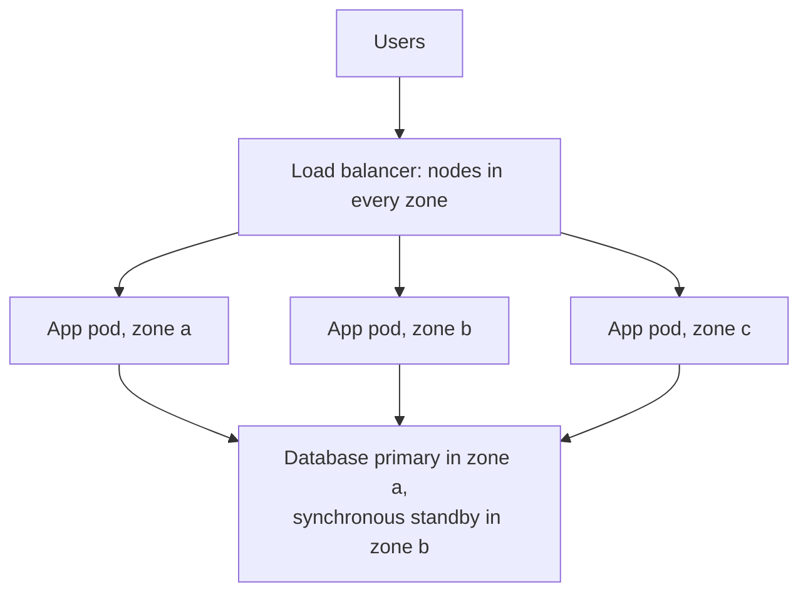

# High availability and failure domains

> **Status: AI draft, 2026-11-16.** Not yet verified by me. Written from the AWS Well-Architected reliability pillar, the AWS Builders' Library and the Kubernetes documentation; the availability arithmetic is worked out on this page.

## In one line

Design for failure at each level (process, node, Availability Zone, region): run redundant copies across failure domains so one loss does not stop the service, keep stateful tiers replicated with quorum, fail fast with timeouts, retries with backoff and jitter and circuit breakers, and remember that dependencies in series multiply their availability while redundant copies in parallel multiply their unavailability.

## The plain idea

Everything fails eventually: a process crashes, a node disappears, a whole data centre loses power, occasionally an entire region has trouble. High availability means asking, for each of those, "what happens to users?", and arranging things so the answer is "nothing much".

The tools are simple to name: **redundancy** (more than one of everything that matters), **spread** (copies in different failure domains, not side by side), **detection** (health checks that notice failure and move traffic), and **degradation** (when something is broken, fail quickly and partially rather than slowly and completely).

## How it works

### Failure domains

| Domain | Fails when | Protection |
|---|---|---|
| Process or container | Crash, OOM, deadlock | Restart policy, liveness probes, multiple replicas ([Probes and graceful shutdown](../kubernetes/probes-and-graceful-shutdown.md)) |
| Node or instance | Hardware fault, kernel panic, Spot interruption | Replicas on different nodes, PDBs, autoscaling ([Disruptions and PDBs](../kubernetes/disruptions-and-pdbs.md)) |
| Availability Zone | Power, network or facility problem | Replicas across zones, multi-AZ databases, zone-aware load balancing |
| Region | Rare large-scale event | Multi-region designs, DR plans ([Backup and disaster recovery](backup-and-dr.md)) |

### Removing single points of failure

Walk every request path and ask "if this one thing disappears, what stops?" Typical hidden single points: one NAT gateway for all zones, one CoreDNS replica, a single-zone EBS volume, a single database instance, one person who knows the runbook ([NAT, endpoints and PrivateLink](../aws-core/nat-endpoints-privatelink.md), [EBS and EFS CSI drivers](../eks/storage.md)).

### Stateless vs stateful tiers

- **Stateless** services (web and API tiers) are easy: run several copies anywhere, any copy can serve any request.
- **Stateful** tiers (databases, queues, caches) need replication and a way to agree on the current primary. Consensus systems need a **quorum**, a majority of members, which is why they run 3 or 5 members across 3 zones ([etcd, backups and cluster upgrades](../kubernetes/etcd-backups-and-upgrades.md)).

### Health checks and failover

Load balancers send traffic only to healthy targets; Kubernetes Services only to ready pods; databases fail over to a standby. Health checks must test the thing users need (can it serve a request?) without failing just because a shared dependency is slow, or every instance is removed at once ([ALB and NLB](../aws-core/load-balancers.md)).

### Graceful degradation

| Technique | Protects against |
|---|---|
| **Timeouts** on every remote call | Hanging forever on a slow dependency, exhausting threads and connections |
| **Retries with exponential backoff and jitter** | Transient errors, without synchronised retry storms |
| **Retry budgets and idempotency** | Retries multiplying load, and duplicate side effects |
| **Circuit breakers** | Hammering a dependency that is already failing; fail fast instead |
| **Fallbacks** | Serving cached or reduced results when a non-critical dependency is down |
| **Load shedding** | Overload: reject some requests quickly so the rest succeed |

AWS's Well-Architected guidance (REL05-BP03) is to retry with exponential backoff, add jitter, and limit the number of retries; retries without these turn a small outage into a large one.

### Availability arithmetic

- **In series** (each one required): multiply availabilities. `A = A1 × A2 × A3`.
- **In parallel** (any one is enough): multiply the unavailabilities. `A = 1 − (1 − A1) × (1 − A2)`.

Worked example (illustrative numbers):

| Component | Availability |
|---|---|
| Load balancer | 99.99% |
| One app instance | 99.5% |
| Two app instances in parallel | 1 − 0.005² = 99.9975% |
| Database (multi-AZ) | 99.95% |

- With one app instance: 0.9999 × 0.995 × 0.9995 ≈ **99.44%**, about 242 minutes of downtime in 30 days.
- With two app instances: 0.9999 × 0.999975 × 0.9995 ≈ **99.94%**, about 27 minutes in 30 days.
- The weakest serial component dominates: no amount of app redundancy makes this system better than its database.

Real failures are not independent (both instances share a zone, a deploy, a configuration), so treat these numbers as an upper bound.

### Multi-AZ on AWS and Kubernetes

- Subnets, NAT gateways, load balancers and node groups in every zone the service uses ([VPC basics](../aws-core/vpc-basics.md)).
- Pods spread with **topology spread constraints** on `topology.kubernetes.io/zone`, plus PDBs ([Scheduling](../kubernetes/scheduling.md)).
- Multi-AZ databases (RDS Multi-AZ, Aurora replicas) ([RDS and Aurora](../aws-services/rds-and-aurora.md)).
- Enough spare capacity that losing one zone's worth of pods still serves peak load.

## A concrete example

`sample-app` after an Availability Zone outage review:

1. Found: all three replicas had been scheduled into one zone after a node replacement; the single NAT gateway lived in that zone.
2. Fix: a topology spread constraint with `maxSkew: 1` on zone and `whenUnsatisfiable: DoNotSchedule`; minimum replicas raised to 3; a NAT gateway per zone with per-zone route tables.
3. Calls to the payment API got a 2-second timeout, 2 retries with jittered backoff, and a circuit breaker; the checkout page now shows "payment temporarily unavailable" instead of hanging.
4. A game day drained one zone in staging to prove it.

## Why not just...?

- **...run everything in one zone to save inter-AZ data transfer?** One zone failure then takes everything down. Pay for redundancy where the service needs it, and design to limit cross-zone chatter.
- **...retry immediately and forever?** Synchronised retries multiply load on a struggling dependency and turn a blip into an outage. Back off, add jitter, cap retries.
- **...go multi-region for everything?** It multiplies cost and complexity (data replication, failover, testing). Most services need solid multi-AZ first; choose multi-region based on the business need.

## Commands to know

| Command | What it does |
|---|---|
| `kubectl get pods -o wide -l app=sample-app` | Which nodes the replicas run on. |
| `kubectl get nodes -L topology.kubernetes.io/zone` | Zone of each node. |
| `kubectl get pdb -A` | Disruption budgets and allowed disruptions. |
| `aws ec2 describe-nat-gateways --query 'NatGateways[].{id:NatGatewayId,subnet:SubnetId}'` | Is there one NAT gateway per zone? |
| `aws rds describe-db-instances --query 'DBInstances[].{id:DBInstanceIdentifier,multiAZ:MultiAZ}'` | Which databases are Multi-AZ. |

## How it breaks

| Symptom | Layer | Check | Likely cause |
|---|---|---|---|
| Zone outage took the whole service down | Spread | Pod and node placement | Replicas in one zone; single-zone dependency (NAT, volume, database) |
| Small dependency outage became a full outage | Degradation | Timeouts, retries | No timeouts; retry storms; no circuit breaker |
| Health checks removed every instance at once | Health checks | What the check tests | Check depends on a shared dependency |
| Failover took far longer than expected | Stateful tier | Failover tests | Never rehearsed; DNS caching; connection pools pinned to the old primary |
| Redundant copies failed together | Correlation | Shared causes | Same deploy, config or zone |

## Interview questions

**1. What failure domains do you design for, and how?**

Answer

- Process (restarts, replicas), node (spread across nodes, PDBs), zone (multi-AZ everything), region (DR or multi-region).
- Remove single points of failure along every request path.
- Keep spare capacity to absorb the loss of one domain.

**2. Compute the availability of two 99.9% components in series and in parallel.**

Answer

- Series: 0.999 × 0.999 = 99.8%.
- Parallel: 1 − 0.001² = 99.9999%.
- Real failures are correlated, so parallel figures are optimistic.

**3. Why add jitter to retries?**

Answer

- Without it, many clients retry at the same moments, creating synchronised load spikes.
- Jitter spreads retries out so the dependency can recover.
- Combine with exponential backoff, caps and retry budgets.

**4. How do you make a Kubernetes workload survive the loss of a zone?**

Answer

- At least one replica per zone with topology spread constraints, plus a PDB.
- Nodes available in every zone (node groups or Karpenter allowing all zones).
- Zone-independent dependencies: NAT per zone, multi-AZ databases, no single-zone volumes for critical state.

**5. What is a circuit breaker?**

Answer

- A client-side switch that stops calling a failing dependency after errors cross a threshold.
- Calls fail fast (or use a fallback) while open; it tests again after a pause.
- Prevents wasting resources and piling load on something already failing.

**6. Your service is 99.99% available but depends on a 99.9% database. What can you promise?**

Answer

- At most about 99.89% (0.9999 × 0.999) for paths that need the database.
- Improve the database (multi-AZ, failover), or reduce dependence (caching, degraded modes).
- Set SLOs to what the chain can deliver ([SLOs and error budgets](../observability/slos.md)).

## Try it

1. Draw your service's request path and mark every component that exists only once.
2. Compute the availability of: load balancer 99.99%, three app instances at 99% each in parallel, cache 99.9% (required), database 99.95%.
3. Write a topology spread constraint that keeps `sample-app` pods balanced across zones.

## Zoom out

High availability is the structural side of reliability; SLOs say how much is enough, backups and DR cover the failures redundancy cannot, and deployment strategies stop changes from being the most common cause of outages ([SLOs and error budgets](../observability/slos.md), [Backup and disaster recovery](backup-and-dr.md), [Deployment strategies](../cicd/deployment-strategies.md)).

## Sources

- [AWS Well-Architected reliability pillar: availability](https://docs.aws.amazon.com/wellarchitected/latest/reliability-pillar/availability.html)
- [AWS whitepaper: availability and beyond](https://docs.aws.amazon.com/whitepapers/latest/availability-and-beyond-improving-resilience/availability-and-beyond-improving-resilience.html)
- [AWS Well-Architected reliability pillar: control and limit retry calls](https://docs.aws.amazon.com/wellarchitected/latest/reliability-pillar/rel_mitigate_interaction_failure_limit_retries.html)
- [Google SRE book: addressing cascading failures](https://sre.google/sre-book/addressing-cascading-failures/)
- [Kubernetes documentation: topology spread constraints](https://kubernetes.io/docs/concepts/scheduling-eviction/topology-spread-constraints/)
